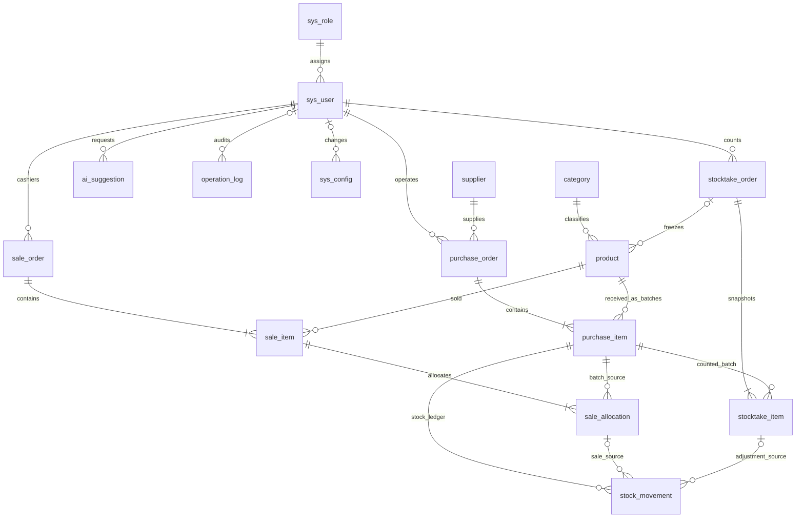

# 超市进销存管理系统数据库设计与使用说明

2026-11-11模型扩展：保持16表8视图，在`ai_suggestion`追加`prompt_tokens/completion_tokens/total_tokens/cached_tokens/provider_request_id`可空字段、`ck_ai_usage`约束及`ix_ai_usage`索引。NULL表示服务商未报告，不补造旧Token。`sys_config`的`ai.provider_settings`保存版本、默认/可选模型和AES-GCM密文，API Key明文及主密钥不进入SQL；审计只保存安全投影。

新空库使用唯一`supermarket_inventory.sql`，旧库备份后显式运行`python scripts/upgrade-ai-usage.py --database <明确库名>`，无数据重置、库存写入或启动自动ALTER。已在隔离验收副本完成增量升级，并在`supermarket_inventory_ai_stream_dbcheck`从最终SQL新建验证59项通过（含新增V29用量一致性）。主密钥位于后端私有`.local/secrets/ai-master.key`或独立环境配置，保管与恢复方式见根README。业务库本次未自动升级。

本设计逐项对应 [功能需求文档](../超市进销存管理系统功能需求文档.md)，用于本地毕业设计开发和答辩演示。采用 **16 张基础表、8 个查询视图**，覆盖三类角色、七大模块、批次库存、采购对账、盘点冻结、正反向业务事件、头像图片及智能建议降级。不包含真实部署上线或真实支付。

本地实际验证环境为 MySQL Community Server **8.0.34**、`127.0.0.1:3306`。项目库名为 `supermarket_inventory`；连接账号使用用户提供的 `root`。MySQL 自带的 `mysql` 库保存服务器系统信息，本设计使用独立项目库承载业务表。

**维护基准调整：** 根据用户指定，唯一数据库基准为 [supermarket_inventory.sql](./supermarket_inventory.sql)。该文件是2026-11-10的Navicat全量导出；以下表设计解释继续适用，但旧分离SQL和种子推导脚本不再作为初始化权威。开发实现同时遵循 [开发规范](../基于SpringBoot与Vue的超市进销存管理系统开发规范文档.md)。

## 1 交付文件与导入

| 文件 | 用途 |
| --- | --- |
| [supermarket_inventory.sql](./supermarket_inventory.sql) | 唯一初始化基准：16张表、8个视图、约束、索引与2026-11-10测试数据快照 |
| 01_schema.sql、02_seed.sql | 早期分离脚本，仅保留历史参考；后续开发不再据此初始化或修改结构 |
| [03_verify.sql](./03_verify.sql) | 28 项只读数据一致性检查、状态分布、库存明细和月度统计 |
| [04_queries.sql](./04_queries.sql) | 17 组开发查询示例，涵盖本人数据范围、图表、预警、建议摘要和幂等查询；附事务协议 |
| [验证结果.json](./验证结果.json) | 本次执行的 58 项数据库验证明细，全部通过 |
| [tools/generate_seed.py](./tools/generate_seed.py) | 历史种子推导工具，仅输出系统临时目录中的预览片段，不覆盖权威SQL或项目库 |
| [tools/validate_database.py](./tools/validate_database.py) | 可选的数据库自动验证工具，依赖 PyMySQL、bcrypt，仅允许连接 `*_dbcheck` 验证库，修改一律回滚 |

### 1.1 正常导入

先启动本地 MySQL 服务。通过命令行登录，密码使用用户提供的数据库密码；业务测试账号密码与数据库密码不同。

```powershell
& 'D:\lib\mysql\bin\mysql.exe' --host=127.0.0.1 --port=3306 --user=root --password --default-character-set=utf8mb4
```

先明确选定一个空项目库或允许重置的隔离副本，再导入唯一基准。当前导出未包含建库/选库语句；下面的`USE`必须指向允许初始化的目标。也可在数据库管理工具中选择该目标库，以UTF-8打开文件执行。

```sql
-- 只适用于空库/可重置副本；已有正在使用的业务库不得重导。
CREATE DATABASE IF NOT EXISTS supermarket_inventory CHARACTER SET utf8mb4 COLLATE utf8mb4_0900_ai_ci;
USE supermarket_inventory;
SET time_zone = '+08:00';
SOURCE D:/xc_test/bysj/Supermarket-Inventory-Management-System/doc/数据库/supermarket_inventory.sql;
SOURCE D:/xc_test/bysj/Supermarket-Inventory-Management-System/doc/数据库/03_verify.sql;
```

当前Navicat基准包含`DROP TABLE/VIEW`和临时关闭外键，会重建选定库中的对应对象；禁止在已有业务库重复执行。不得使用`--force`忽略错误，必须核对视图依赖顺序、生成列、外键恢复和一致性结果。本次制定开发规范没有执行该导出文件，没有改动现有业务库。

**2026-11-10工程实现验证：** 首次在新空副本导入时发现视图创建顺序错误：v_cashier_inventory/v_low_stock先于其依赖v_product_inventory。已仅将唯一基准的视图片段按依赖重排，未修改表结构、种子及视图查询含义。通过根目录`scripts/prepare-test-db.py`分别创建supermarket_inventory_test和新的supermarket_inventory_scaffold_dbcheck，验证16表、8个可读视图、外键检查恢复；后者再运行本目录tools/validate_database.py，58项全部通过，结果见验证结果.json。业务库supermarket_inventory未重导；既有库无需DDL迁移。该结果仍只证明数据库，不代表所有前后端功能完成。

建表/删表会逐步提交，不能依靠`ROLLBACK`撤销整份DDL；当前导出也不保证全部数据处于单一事务。因此只能在选定的可重建副本验证，不将“执行到末尾”当成完整导入成功。需要新副本时先选择新库，并在辅助验证SQL中同步其目标库名。

此前数据库设计阶段已创建项目库`supermarket_inventory`和验证副本`supermarket_inventory_dbcheck`，并执行过验证；该历史结果不能自动证明后来导出的文件已在新空库完整导入。验证副本不作为应用默认库。

### 1.2 后端连接和时间

连接目标为 `jdbc:mysql://127.0.0.1:3306/supermarket_inventory`，使用 `utf8mb4` 字符集，连接会话时区统一为 `+08:00`。后端日期、查询区间与数据库会话必须一致，不能只在页面格式化时转换时区。金额用 `BigDecimal`，数量/ID/库存版本用可覆盖 `BIGINT` 的整数类型。

推荐 MySQL 8.0.16 及以上，以执行实际生效的 CHECK；本次在 8.0.34 对所有脚本验证。CHECK 能约束本行表达式，跨表合计、岗位授权和工作流仍由服务事务负责，不能把数据库校验当作完整业务实现。[MySQL CHECK 官方说明](https://dev.mysql.com/doc/refman/8.0/en/create-table-check-constraints.html)

## 2 精简为 16 张表的依据

不以“把全部业务塞进通用 JSON 表”为精简目标。采购、销售、盘点的主从关系、商品批次和库存流水保留关系型字段及真实外键；仅将小规模权限配置、图片元数据和只作历史展示的审计快照存为 JSON。

| 合并或省略的对象 | 处理方式 | 不丢失的能力 |
| --- | --- | --- |
| 角色权限、角色权限关系 | `sys_role` 中存当前、默认、上限三份权限代码数组；目录在 `sys_config` | 按按钮授权、恢复默认、岗位上限与权限版本失效 |
| 独立文件资源表 | 用户和商品各存相对路径、JSON 上传元数据 | 头像/图片替换、移除、大小/类型/尺寸记录；删除文件前按路径检查两类引用 |
| 独立库存余额表 | 合并到 `product.stock_qty` | 总库存、商品级行锁、乐观版本；余额与批次合计可验证 |
| 独立库存冻结表 | 合并到 `product.frozen_stocktake_id` | 一个商品最多一张活动盘点；原任务和明细保留历史冻结范围和起止时间 |
| 库存批次表 | 一条采购明细只产生一个批次，因此合并到 `purchase_item` | 生产/到期日、来源单、采购价、当前批次量、FEFO/FIFO 和多批次销售 |
| 采购对账主从表 | 当前核对摘要在采购单、逐行外部数量/单价在采购明细 | 逐行核对、总额校验、差异处理、核对撤回 |
| 独立对账版本表 | 每次操作把完整单头/逐行核对前后快照追加到 `operation_log` | 撤回后仍可重建当次核对过程；当前字段不承担历史职责 |
| 冲销事件表 | 原单保留冲销人/原因/时间，库存账本存反向事件，事件视图合成金额正负记录 | 不覆盖原销售/采购事实、按事件时间统计、避免跨批次重复金额 |
| 会话表 | 用户凭证版本与角色权限版本，凭证携带双版本 | 改密、禁用、角色变更、授权变更后失效；退出采用该用户全部会话失效的简化策略 |
| 预警、统计结果、热销滞销表 | 由业务数据实时聚合和视图计算 | 阈值、日期和库存变化立即反映，避免缓存表失真 |
| 支付、退货、仓库、会员等 | 不在本期范围 | 模拟收款与受限整单纠错已有明确字段，不引入超出毕设范围的表 |

采购明细与批次合并依赖“整单一次入库、每行一种批次”的明确边界。若未来增加一行多次收货或分仓库库存，应拆出批次/收货表；本期不需要为尚不存在的业务预建这些表。

## 3 表清单与主要关系

| 序号 | 表名 | 内容及重要字段 | 主要索引或约束 |
| --- | --- | --- | --- |
| 1 | `sys_role` | 三岗位、权限数组、默认/上限数组、数据范围、授权版本 | 固定角色代码；权限必须为数组且属于本角色上限 |
| 2 | `sys_user` | 用户名、BCrypt、姓名、手机号、头像路径与元数据、角色、启停、凭证版本 | 用户名唯一；角色外键；登录状态索引 |
| 3 | `sys_config` | 默认库存下限、临期天数、静态权限树、配置可编辑标记 | 参数键主键；不存模型密钥 |
| 4 | `operation_log` | 操作者快照、动作、对象单号、时间、结果、原因、前后 JSON | 对象/时间、操作者/时间、动作/时间索引 |
| 5 | `category` | 一级分类、排序、启停 | 编码/名称唯一；引用后限制删除 |
| 6 | `supplier` | 编码、名称、联系人电话、地址、启停、备注 | 编码/名称唯一；采购引用外键 |
| 7 | `product` | 商品全部档案、图片、保质期规则、售价、阈值、余额、冻结指针 | 编码/可空条码唯一；分类外键；余额非负 |
| 8 | `purchase_order` | 供应商和经办人快照、各状态时间/原因、合计、当前对账摘要 | 单号唯一；本人/状态/供应商/对账索引 |
| 9 | `purchase_item` | 商品/分类/单位快照、采购和实收数量、进价、批次、日期、余额、外部核对字段 | 单内行号唯一；系统批次号唯一；批次+商品复合唯一；行金额生成列 |
| 10 | `sale_order` | 收银员、幂等键及请求摘要、支付信息、销售时间、纠错信息 | 单号/幂等键唯一；找零生成列；当天纠错约束 |
| 11 | `sale_item` | 商品/分类/单位/售价快照、数量、金额 | 单内商品唯一；行金额生成列 |
| 12 | `sale_allocation` | 销售行、真实来源批次、分配数量 | 复合外键保证商品一致；同销售行同批次唯一 |
| 13 | `stocktake_order` | 经办人、状态、开始/审核/关闭信息、冻结生命周期 | 单号唯一；本人/状态索引 |
| 14 | `stocktake_item` | 来源批次、账面快照、可空实盘、差异、原因 | 同盘点同批次唯一；差异生成列；非零差异必须有说明 |
| 15 | `stock_movement` | 类型、来源真实外键、前后数量、变化量、经办人、时间 | 类型+来源防重；商品/批次流水索引；算式和方向约束 |
| 16 | `ai_suggestion` | 类型、申请人、区间、过滤与输入快照、模型、状态、结果或错误、夹具标记 | 请求键唯一；类型状态/本人历史索引；成功不得空正文 |

所有基础表使用 InnoDB。核心业务外键默认限制删除，删除顺序由服务针对未引用档案/未提交草稿处理；不级联删除已生效业务。审计操作者被合法删除时只清空可选用户引用，保留姓名快照。



### 3.1 三类 JSON 的使用边界

1. `sys_role` 数组存稳定权限代码，`sys_config.security.permission_catalog` 提供模块、页面、按钮、父节点与允许岗位；菜单树可直接重建。不能由前端提交新的角色上限。默认配置共有三角色并覆盖需求中的全部能力。
2. `avatar_meta`、`image_meta` 可存 MIME、大小、宽高、上传者和上传时间等；真实上传时后端重新校验。初始路径只是占位，不伪造实际文件尺寸或验证结果。
3. `operation_log.before_data/after_data` 保存不可覆盖的审计版本，例如完整对账单头及 `lines:[{itemId,externalQty,externalUnitCost,...}]`。库存扣减、单据合计、批次分配和日常统计不能依赖解析这些日志。

使用 JSON_TABLE 展开固定权限目录的查询已在本地执行验证；该函数的表列映射规则见 [MySQL JSON_TABLE 官方说明](https://dev.mysql.com/doc/refman/8.0/en/json-table-functions.html)。

## 4 状态、库存与历史规则

### 4.1 状态枚举

| 对象 | 状态代码 | 对应含义 |
| --- | --- | --- |
| 采购 | DRAFT / PENDING / REJECTED / IN_STOCK / CLOSED / REVERSED | 草稿 / 待审核 / 驳回 / 已入库 / 关闭 / 入库已撤销 |
| 采购核对 | UNRECONCILED / DIFFERENCE / MATCHED / NA | 未核对 / 有差异 / 已核对 / 撤销入库后不适用 |
| 销售 | COMPLETED / CORRECTED | 已完成 / 当天整单已纠错 |
| 盘点 | COUNTING / PENDING / REJECTED / COMPLETED / CLOSED | 盘点中 / 待审核 / 驳回 / 已完成 / 已关闭 |
| 库存流水 | PURCHASE_IN / PURCHASE_REVERSE | 采购入库正向 / 入库撤销反向 |
| 库存流水 | SALE_OUT / SALE_CORRECTION | 销售出库 / 销售整单纠错恢复 |
| 库存流水 | STOCKTAKE_GAIN / STOCKTAKE_LOSS | 盘盈 / 盘亏，包括实际过期清理 |
| 建议 | PENDING / SUCCESS / FAILURE | 请求中 / 成功 / 失败降级 |

数据库检查状态属于合法枚举并检查部分状态字段，**不负责所有前后状态转换**。例如不能从已关闭直接更新成已入库，服务端必须先锁单据并检查当前状态。更新时附预期状态或 `row_version`，并检查实际影响行数。

### 4.2 批次合并后的使用方法

- 草稿、待审核、已驳回、已关闭的采购明细：`batch_no=NULL, stock_qty=NULL`，不能作为库存或盘点来源。
- 审核通过：同事务填写唯一 `batch_no`、`stock_qty=received_qty`，采购单改 `IN_STOCK`，商品余额增加，写 `PURCHASE_IN` 流水。
- 已入库明细同时就是真实库存批次；一商品可有多个采购明细批次，甚至在同采购单中多行不同日期。
- 撤销入库：满足未核对、无任何后续库存变动等条件时写反向流水，批次保留为 0，原单改 `REVERSED`。`v_batch_inventory` 排除该单，但原批次仍可追溯。
- 食品按到期日期、入库时间、批次 ID 分配，普通商品按入库时间与 ID。所有分配写 `sale_allocation`，纠错严格按原分配恢复，不重新分配到当前最近批次。

### 4.3 库存计算和盘点冻结

必须保持：

```text
商品账面余额 = 有效批次当前余额之和 = 商品全部流水变化量之和
批次当前余额 = 该批次全部流水变化量之和
批次后余额 = 批次前余额 + 变化量
商品后余额 = 商品前余额 + 变化量
```

可售数量排除过期、停用和禁售商品；**盘点冻结不把可售数变成 0**，仅通过独立冻结指针阻止交易，否则会产生虚假低库存。

开始盘点时，先按商品 ID 升序锁定 `product`，检查当前无冻结，再创建任务、所有相关批次明细快照并设置商品指针。相同商品无法保存两个指针。盘点中、待审核、驳回保持冻结；审核完成或关闭必须同事务释放。正在盘点的商品禁止采购入库、销售出库、销售纠错和采购撤销，其他商品可正常业务。

`actual_qty=NULL` 表示未填，`0` 表示实盘确实为零；差异由数据库生成。库存事务必须检查快照仍等于当前批次量，不能拿旧快照覆盖已变化的余额。来源不存在的商品/批次不能凭盘点创建，先走真实采购来源。

### 4.4 正反向事件统计

`v_sale_event` 每个销售商品行产生一次正事件；已纠错单同一行再产生一次负事件，分别用销售时间与纠错时间。它不按销售批次行计金额，因此一商品跨两批次不会把销售额乘二。

`v_purchase_event` 同理保留采购入库与入库撤销事件。库存流水已存真实的正反向数量变化；金额来自原明细及冲销时间即可重建，因此不另建一张重复事件表。按区间汇总必须筛 `event_at`，不能只过滤当前状态。

商品、供应商、分类、单位、售价等历史显示使用单据快照；修改当前售价不会重算原明细金额。分类库存占比按当前账面数计算，包含未清理的过期实物，不等同于可售库存占比。

### 4.5 对账的当前值与历史版本

当前状态放采购单，外部数量、单价在采购行，外部行金额由数据库生成。逐行一致且总额一致才能确认 `MATCHED`；仅总额一致不足以通过。

每次登记差异、确认一致、撤回核对均锁定采购单，把修改前和修改后的完整核对快照写审计日志并递增 `reconcile_version`。撤回核对清空当前外部值，不丢日志。只有 `UNRECONCILED` 且所有源批次无后续变动时才能撤销采购。

### 4.6 登录、图片和文件回收

账号测试密码均为 **`Test123456`**，数据库实际存标准 BCrypt 60 位摘要；后端使用对应 BCrypt 校验，不能按明文或 MD5 比较。密码、角色、启停等变更递增 `credential_version`，角色授权变更递增 `sys_role.auth_version`，凭证与服务端版本一致才可使用。本期采用退出时该账号全部登录失效的简化实现，不必增加会话表。

用户头像与商品图片均存相对路径 **`测试图片.jpg`**，没有盘符、绝对磁盘路径或固定服务地址。实际文件未在工作区提供，SQL 仅建立路径占位；后续将该文件放入本地静态资源或上传目录，由后端映射资源访问地址。

真实上传仍按需求校验 JPG/PNG、2 MB、64～4096 像素及真实解码，成功后写新路径与元数据；失败保留旧绑定。移除头像可置 `avatar_path=NULL` 以回到默认图。物理回收前同时检查用户头像和商品图片是否仍引用，**不能因一个用户更换头像而删除大家共用的测试图片**。不要求实现对象存储或复杂文件管理平台。

### 4.7 应用层必须实现的规则

数据库设计为这些规则提供字段与锁定基础，但 SQL 文件不等于完整服务端实现：

- 固定岗位上限、菜单按钮权限、本人记录范围、字段脱敏和不能绕过图表下钻越权。
- 最后一个启用管理员保护：统一先锁 `sys_role` 的 ADMIN 行，再检查并修改用户/授权，防止两请求同时删光管理员。
- 账号停用/变更前处理本人活动任务；用户名、商品编码/分类/保质期规则等引用后不可改的条件。
- 单据合法状态转换、管理员审核、非零实盘差异的完整性、到货日期不在未来、入库当日没有过期。
- 全部库存事务按商品行统一加锁、批次校验、余额修改、流水和单据原子提交；失败整组回滚。
- 销售幂等键遇重复需核实同一收银员且 `request_hash` 相同；不能把另一个人的旧单返回给请求者。
- 销售纠错的当天、货物完整在店、盘点未冻结及最多一次限制；采购撤销还须查询是否曾有后续流水，不能只看余额恢复相等。
- 核对历史完整追加、原始快照不覆盖、流水及操作日志不经通用编辑/删除接口改写。
- 密钥保留在本地后端配置，建议生成请求超时/失败只影响智能模块；真实模型返回按文本处理。

## 5 初始数据与功能测试定位

### 5.1 初始数据规模

| 对象 | 数量 | 覆盖 |
| --- | --- | --- |
| 角色 / 用户 | 3 / 8 | 两管理员、两采购、两收银、停用账号、可删未用账号 |
| 分类 / 供应商 / 商品 | 6 / 8 / 24 | 五种已用分类和一个空分类；停用/未引用供应商；各类库存边界 |
| 采购单 / 采购明细 | 10 / 28 | 所有采购状态、同商品多批次、对账差异及撤回历史 |
| 销售单 / 商品行 / 批次分配 | 7 / 9 / 10 | 多商品、跨批次、现金找零、模拟电子支付、纠错、历史调价 |
| 盘点单 / 明细 | 5 / 8 | 所有盘点状态、盘盈、盘亏、无差异、过期清理、实盘NULL |
| 库存流水 / 操作历史 | 38 / 28 | 实际前后余额连续、采购撤销/销售纠错/盘点调整和核对版本 |
| 智能建议 | 6 | 两类成功展示夹具，超时、未配置、限流、空结果失败夹具 |

这是一组功能测试数据，不把需求中“建议规模”的性能样本数量当作必须的初始数据量；大规模性能测试可在功能完成后另建副本扩充，不能凭这组小样本宣称已经满足 5000 张销售单的性能目标。

### 5.2 业务测试账号

| 用户名 | 角色或状态 | 初始密码 | 用途 |
| --- | --- | --- | --- |
| admin | 超市管理员 | Test123456 | 审核、全量查询、权限配置、纠错 |
| admin2 | 备用管理员 | Test123456 | 最后管理员保护、管理员角色变更 |
| buyer01 | 采购入库操作员 | Test123456 | 本人采购、供应商、盘点、库存建议 |
| buyer02 | 采购入库操作员 | Test123456 | 同岗位本人范围及库存共享 |
| cashier01 | 前台收银操作员 | Test123456 | 现金、跨批次及本人销售查询 |
| cashier02 | 前台收银操作员 | Test123456 | 同岗位隔离、并发、模拟电子支付 |
| disabled01 | 已停用收银员 | Test123456 | 停用账号不能登录 |
| unused01 | 启用但未产生业务 | Test123456 | 用户删除及资料编辑测试，测试后可回滚 |

### 5.3 商品场景

| 商品ID | 场景 | 初始结果与后续操作 |
| --- | --- | --- |
| 1 | 需求文档闭环的瓶装饮料 | 入库 20、售 12、盘亏 1、再售 2，当前 5；补入 10 后应为 15，预警消失 |
| 2 | 普通有效食品 | 当前 38，供正常开单、提交流程及交易故障测试 |
| 3 | 临期酸奶 | 到期日为导入日+3，当前 12，临期预警 |
| 4 | 已过期有实物 | 当前 6、可售 0，可演示盘点清理闭环 |
| 5 | 正常粮油 | 当前 45；已有历史销售和无差异盘点 |
| 6 | 滞销食用油 | 当前 30，两个月前入库且观察窗口无销售，可作为滞销样本 |
| 7 | 盘盈、正常销售与当天纠错 | 当前 40；销售已冲销原单净额为 0，另有盘盈 2 |
| 8 | 多来源普通商品 | 当前 30，其中 3 为独立未使用新批次，采购单5可撤销 |
| 9 | 并发边界 | 当前 5，下限 5；两收银同时各买 4 应只有一单完成 |
| 10 | 盘点中冻结 | 当前 20，实盘未填为NULL；可售数仍20，但禁止结算 |
| 11 | 待审核盘点冻结 | 当前10，实盘10，无差异；审核完成释放冻结 |
| 12 | 已驳回盘点冻结 | 当前12，实盘11待复核；修改重提或关闭 |
| 13 | 停用但有库存 | 账面8、可售0，历史与盘点仍可查 |
| 14 | 禁止采购 | 当前7，可销售，不允许新采购 |
| 15 | 禁止销售 | 账面8、可售0，不允许收银开单 |
| 16 | 从未入库的零库存 | 下限0，命中低库存边界；不能凭盘点创建来源 |
| 17 | 新近入库 | 昨天入库20，不能直接判为已观察30天的滞销 |
| 18 | 到期当天且临期阈值0 | 今天可售4并临期，次日可售0、账面仍4 |
| 19 | 次日到期 | 可售6，可测试跨日及近到期优先 |
| 20 | 过期已清零 | 原批次5，过期清理盘亏5后0，不再出现在正库存预警 |
| 21 | 待审核采购/草稿引用 | 当前0，可审核采购单6或测试撤回 |
| 22 | 无引用可删除商品 | 当前0、条码NULL，演示合法删除和可空唯一条码 |
| 23 | 历史售价快照 | 当前售价9，历史销售单价7.50，重查历史金额不变 |
| 24 | 食品缺日期被驳回 | 在采购单7补日期后重新提交，当前无批次余额 |

本表边界对应2026-11-10快照。当前权威SQL中的日期已经固化，不会随再次导入自动平移。重复日期边界验收时使用可控Clock、仅验证会话的时间，或在隔离副本准备并同步合适的数据；不能修改系统时钟，也不能假定重新导入历史导出就会重新临期。

### 5.4 单据场景

| 对象 | 单号/ID | 测试入口 |
| --- | --- | --- |
| 多行已核对采购 | CG-DEMO-0001 | 对账查看、批次库存、不能撤销存在后续业务的采购 |
| 核对撤回历史 | CG-DEMO-0002 | 当前未核对，历史含确认及撤回；含过期实物与已清理批次 |
| 对账差异采购 | CG-DEMO-0003 | buyer02，外部凭据多1件，原采购与库存不因核对而变化 |
| 入库已撤销 | CG-DEMO-0004 | 正反流水并存，批次留0，再次撤销须拒绝 |
| 可撤销的已入库 | CG-DEMO-0005 | buyer02，经管理员检查后可撤销3件，主商品余额从30变27 |
| 待审核采购 | CG-DEMO-0006 | buyer01，审核与撤回竞争、审核一次生效 |
| 驳回采购 | CG-DEMO-0007 | 食品缺日期，需要补日期后提交 |
| 未提交草稿 | CG-DEMO-0008 | buyer02，允许删除；草稿不加库存 |
| 已关闭采购 | CG-DEMO-0009 | 不允许再提交/审核 |
| 撤回后的草稿 | CG-DEMO-0010 | first_submitted_at非空，允许编辑但不能硬删抹去历史 |
| 跨批次销售 | XS-DEMO-0004 | 12瓶、应收60、实收100、找零40，分两批次扣库 |
| 已纠错销售 | XS-DEMO-0006 | 原金额12和反向事件并存，净额0，禁止再次纠错 |
| 完成的综合盘点 | PD-DEMO-0001 | 盘亏1、盘盈2、无差异、过期清理5四种明细 |
| 活动/待审/驳回盘点 | PD-DEMO-0002/0003/0004 | 冻结、实盘NULL、撤回、驳回修改与审核释放 |
| 已关闭盘点 | PD-DEMO-0005 | 不改余额且无残留冻结 |

### 5.5 智能建议夹具与真实 API

所有初始建议的 `is_fixture=1`、`provider=FIXTURE`、`model_name=fixture-not-api`，成功正文也明确写“非真实模型调用”。界面展示这类记录时必须标注“测试数据”，不能作为真实模型对接成功截图。

库存摘要的饮料数量来自这组数据的期末5、下限5、最近净销量14、金额70；销售摘要在原始数据准备时由实际事件视图聚合，当前导出保存的是当时快照，重新导入不会重新计算摘要。没有写入真实联系人、密码或密钥。真实后端调用完成后保存 `is_fixture=0` 的结果，失败只记错误原因，不能把失败占位正文写成成功。

### 5.6 对全部操作需求的逐项映射

| 需求编号 | 操作 | 数据支撑和测试入口 |
| --- | --- | --- |
| G01 | 登录退出 | sys_user启停、密码摘要、用户凭证版本和角色版本；8个账号 |
| G02 | 工作台 | 本人/全店单据、预警、事件视图；按岗位聚合而非新增首页统计表 |
| G03 | 个人资料 | real_name、phone、只读username/role_code/enabled |
| G04 | 头像上传更换移除 | avatar_path、avatar_meta；共同图片引用；真实文件校验由接口测试 |
| G05 | 修改密码 | BCrypt摘要与credential_version；旧密码验证及旧凭证拒绝由接口测试 |
| G06 | 列表与表单 | 主键、查询索引、唯一约束、row_version和状态字段 |
| A01 | 用户管理 | 双管理员、停用及未用账号；FK限制有业务用户删除 |
| A02 | 角色权限 | 三组当前/默认/上限权限、权限树、auth_version、权限变更日志 |
| A03 | 分类 | 6类，含可删除空分类；已引用分类FK保护 |
| A04 | 商品 | 档案全部字段、图片元数据、状态与报价；商品13～24覆盖边界 |
| A05 | 供应商 | 快照和唯一约束；停用供应商7、可删供应商8 |
| A06 | 入库审核 | 采购6待审，采购7驳回，采购1等已入库；批次与流水 |
| A07 | 入库撤销/核对 | 采购4已撤销、采购5可撤销、采购1不可撤销；逐行核对与历史 |
| A08 | 库存与流水 | 商品余额、批次行、38条连续前后余额流水和视图 |
| A09 | 盘点审核 | 5种盘点状态、差异行、冻结指针及释放协议 |
| A10 | 库存预警 | 商品1/9下限边界，3临期，4过期，18/19日期边界，20清零 |
| A11 | 销售统筹和纠错 | 原单、corrected_*、分配、反向流水和正负销售事件 |
| A12 | 数据分析 | 三个自然月份业务事件，分类库存、热销、滞销和不足窗口样本 |
| A13 | 智能建议 | 两类输入摘要、成功/失败历史、类型授权、明确fixture标记 |
| A14 | 参数与记录 | 两个可编辑默认业务参数、只读权限目录、28条操作历史 |
| B01 | 供应商维护 | 共享供应商、编码/名称唯一、启停与历史快照 |
| B02 | 新采购与到货 | 采购草稿、商品多批次、数量价格日期、合计和提交时间 |
| B03 | 查询撤回和对账 | 双采购员归属、first_submitted_at、对账当前值与撤回历史 |
| B04 | 库存盘点 | 本人任务、实盘NULL/0、盘盈盘亏、冻结和状态版本 |
| B05 | 库存预警统计 | 全店库存视图和来源单经办人，来源详情仍核对本人权限 |
| B06 | 库存建议 | 只限INVENTORY，成功共享、失败仅本人，聚合销量无需销售明细权限 |
| C01 | 销售开单 | 商品条码/价格/可售量；禁售、停用、冻结、无库存样本 |
| C02 | 模拟收款扣库 | 支付方式、应收实收找零、请求幂等、销售行与跨批次分配 |
| C03 | 销售记录 | 双收银员cashier_id，历史快照，不向收银暴露采购价 |
| C04 | 只读库存 | v_cashier_inventory精简投影，冻结提示但不改数量 |
| C05 | 销售图表 | v_sale_event聚合；图表下钻仍按本人单据范围，不增权限 |

### 5.7 34 个需求验收场景的准备情况

| 需求验收号 | 初始数据或测试手段 |
| --- | --- |
| T01、T02、T31、T33 | 三角色和同岗多账号，sys_role权限与归属字段，Q03/Q12/Q14/Q15演示查询；实际HTTP鉴权待开发 |
| T03、T04 | 相对头像路径与元数据，上传合法/伪装/超大图片须在应用层准备真实文件测试 |
| T05、T06 | 停用用户、双管理员、凭证版本及授权上限；最后管理员保护需事务服务 |
| T07 | 唯一编码/条码/FK，另留未引用商品、分类、供应商与账号 |
| T08～T13 | 六种采购状态、食品缺日期驳回、多行已入库、三种核对状态与核对历史、可撤销及不可撤销来源 |
| T14、T15 | 现金找零、模拟电子支付、12瓶两批次销售记录 |
| T16～T19 | 商品9库存5、唯一请求键、数据库非负约束、商品状态/日期/价格字段；完整并发结算待服务实现 |
| T20 | 已纠错单及仍可纠错的当天销售，原批次分配和反向流水 |
| T21～T24 | 三张不同活动状态盘点、实盘NULL、差异原因、冻结指针、关闭样例 |
| T25、T26 | 下限相等、到期当天/次日、过期有量/过期清零的商品 |
| T27～T29 | 跨三月销售、历史调价与冲销、空分类、滞销油和昨天入库商品；全零图可在测试事务置零后回滚 |
| T30、T32 | 有明确标记的成功/失败建议夹具；真实密钥、外部服务成功、断网和超时需后端联调，不以夹具冒充 |
| T34 | 自动验证工具中事务中途失败后回滚余额和批次；实际业务单据整组回滚需服务测试 |

## 6 本次验证结果与边界

以下是此前分离建表/种子方案的历史验证记录，不代表前后端已实现，也不代表本次指定的Navicat导出已经重新执行验证：

1. 早期分离建表脚本在新的验证库建成16张表及8个视图，当时建表过程外键始终启用。
2. 早期分离初始数据在项目库和独立验证库完整导入；中文数据以utf8mb4存储。当前开发只认`supermarket_inventory.sql`。
3. `03_verify.sql` 的28项检查全部 `violations=0`，包括总量、批次、流水、时间顺序、单据合计、分配、核对、冻结和权限目录。
4. 另30项实际数据库验证通过，包括重复账号/条码、负库存、重复入账、非法跨商品分配、无原因差异、越界授权、跨日纠错、引用删除、密码摘要、动态过期、事务回滚和双连接行锁竞争。
5. `04_queries.sql` 中17组查询均执行无语法错误。所有写入约束测试仅在验证库事务内运行，结束后回滚。

自动报告合计 **58 项通过、0 项失败**。其中双连接验证证明商品行排他锁能阻止第二连接同时获得锁，不等于已经完成“两收银并发结算”的完整接口测试。当前仓库尚未开发前后端，本次完成的是数据库与数据交付，不能据此宣称用户登录、头像上传、真实API调用或所有34个端到端场景已通过。

需要复跑验证时，明确选择新的`*_dbcheck`库，按唯一基准导入并核对对象后再执行检查；历史日期边界须与测试时钟一致。运行验证工具时通过`MYSQL_PWD`或交互提供口令，不将本地root口令写入仓库文件。

```powershell
python doc/数据库/tools/validate_database.py --database supermarket_inventory_dbcheck
```

继续开发时，先实现第4节的统一库存事务和岗位授权，再按需求文档开发页面与接口。不要让通用商品编辑接口写 `stock_qty`，不要让采购/收银直接写审核状态，也不要在单据事务成功前返回“已完成”。
