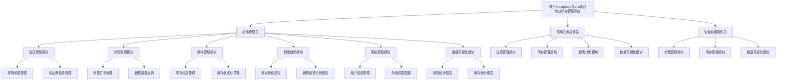
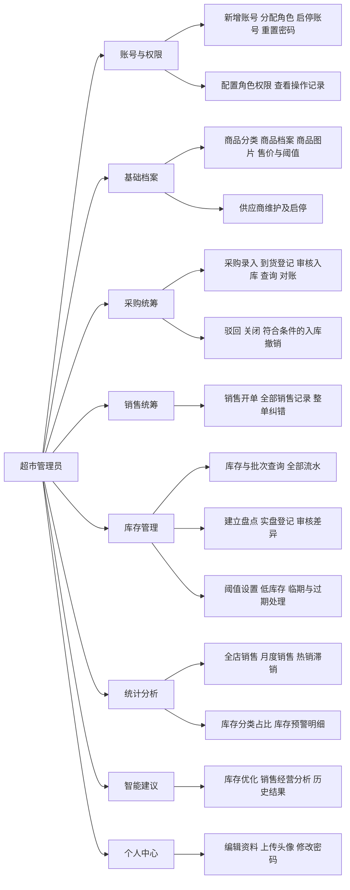
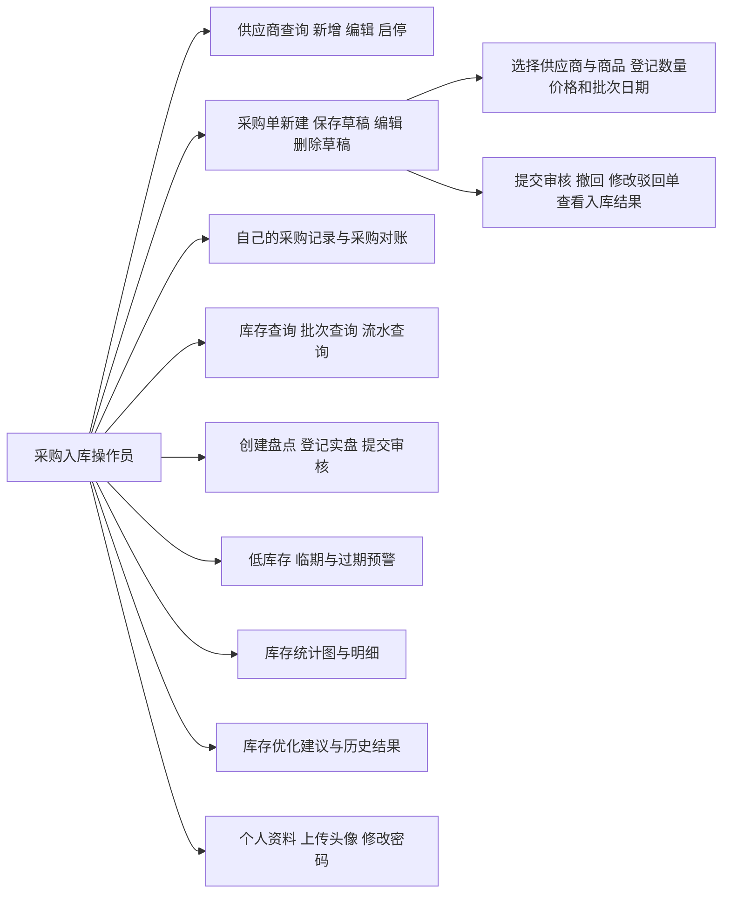
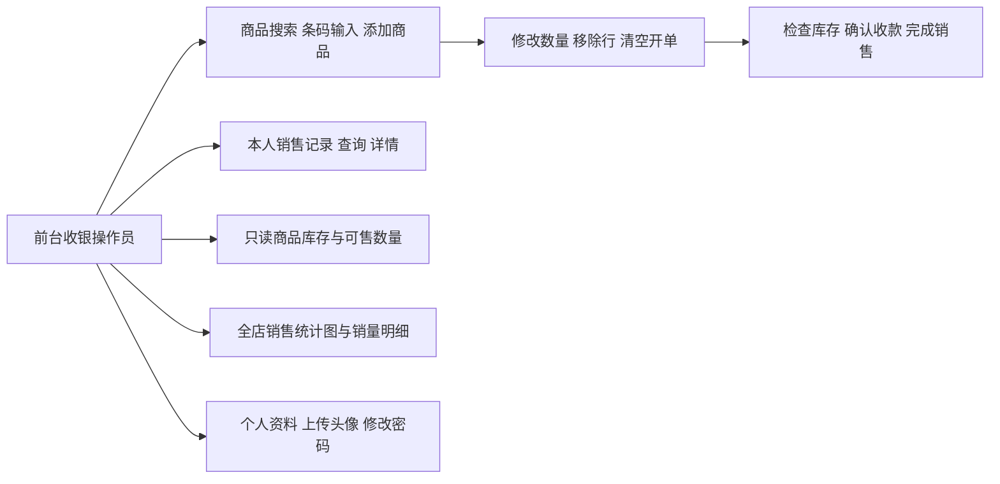
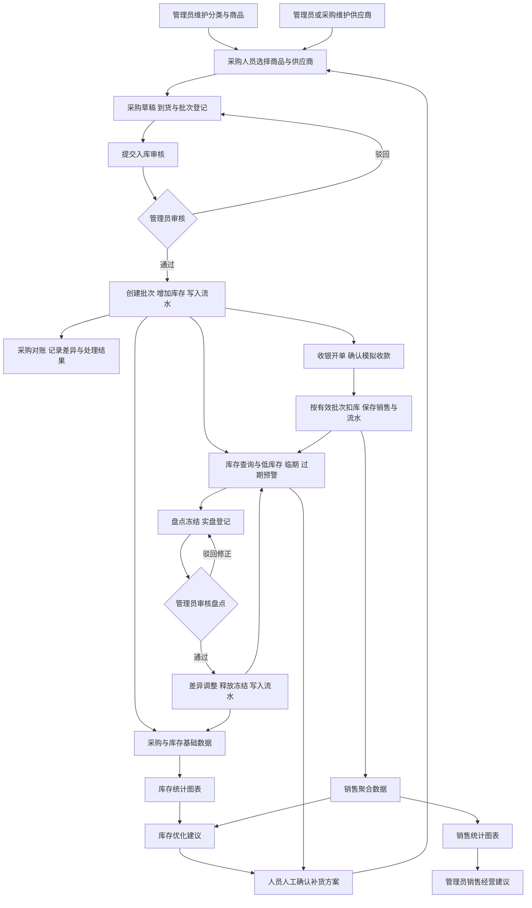
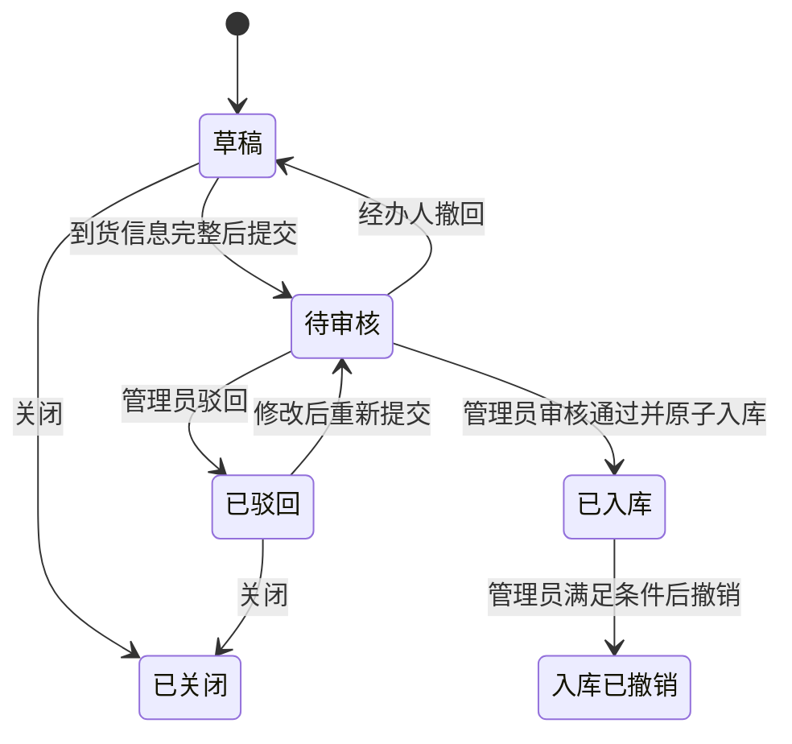
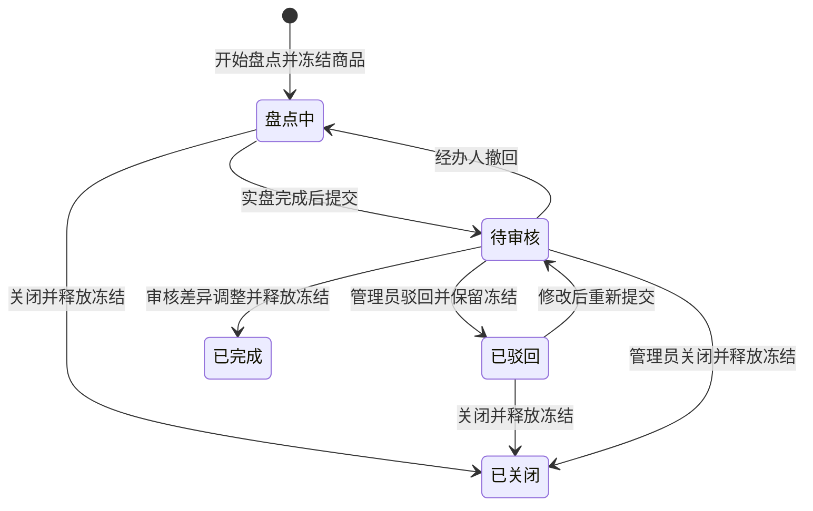

# 基于 SpringBoot 与 Vue 的超市进销存管理系统功能需求文档

| 项目 | 内容 |
| --- | --- |
| 文档版本 | V1.0 |
| 编写日期 | 2026-11-10 |
| 适用阶段 | 毕业设计需求分析、数据库设计、前后端开发与功能验收 |
| 依据材料 | [基于SpringBoot + Vue的超市进销存管理系统设计与实现.docx](./论文材料/基于SpringBoot%20+%20Vue的超市进销存管理系统设计与实现.docx) |
| 系统定位 | 面向中小型超市的单门店、单库存地点、轻量化进销存毕业设计系统 |
| 技术边界 | SpringBoot、Vue、MySQL、ECharts、通义千问大模型 API；本地开发、运行与答辩演示 |

本文按超市管理员、采购入库操作员、前台收银操作员划分功能需求，细化到页面入口、按钮、输入字段、校验、权限、状态变化和业务结果。系统必须形成“基础档案—采购入库—库存—销售—盘点纠偏—统计分析—智能建议—人工补货”的完整闭环。所有基础业务必须能够在大模型服务不可用时独立运行。

文中“必须”为本期验收项，“可选”为不影响本期验收的体验增强。开题报告没有明确到操作层面的细节，统一标记为“细化”或“闭环补充”，不将这些细节表述为开题报告原文要求。

**后续正式库验收说明（2026-11-11）：** 用户已明确授权对正式库加载适当数据并以Playwright MCP全面验收。已先完整备份，显式升级模型用量字段，再通过正常页面完成演示建档、采购、销售、盘点、对账和真实模型调用。本轮31组功能、T01～T34、12.5扩展的证据与限制集中于[正式库用户视角验收记录](./正式库用户视角验收记录.md)。下文各“实现维护记录”中的测试副本通过、业务库未写入等为各自历史阶段，不替代本轮状态；本轮最新后端全量存在数据库通信失败，不标记为全量通过。

## 1 开题报告内容分析与需求依据

### 1.1 原文的核心目标

开题报告“研究的目的和意义”“研究的主要内容”明确提出：现有同类系统存在只做基础增删改查、数据分析薄弱、岗位权限边界不清晰、流程复杂等问题。本系统要在轻量化的前提下完成基础进销存、可视化统计、大模型辅助建议与精细化权限控制。研究现状中出现的 EOQ、JIT、VMI、ERP、SaaS 是背景与参考，不能据此直接增加订货算法、供应链平台或云服务等开发任务。

以下编号用于后文追溯。定位采用原文章节和内容，不使用未经页面渲染核实的页码。

| 依据编号 | 原文位置 | 明确要求及对开发的约束 |
| --- | --- | --- |
| E01 | 研究目的；研究的主要内容（一） | 面向中小型超市，完成进货、销售、库存闭环，采用 SpringBoot、Vue、MySQL |
| E02 | 研究的主要内容（一）系统功能模块说明 | 七大模块：系统管理、进货管理、销售管理、库存管理、基础信息设置、数据统计分析、智能经营建议 |
| E03 | 实际意义中关于模块解耦的说明 | 基础信息设置维护商品、供应商档案；进货管理处理采购录入、入库审核、采购对账；不能把档案维护当成进货业务本身 |
| E04 | 研究目的；实际意义；图表说明 | RBAC 模型，固定三类角色，按岗位限制操作，防止越权 |
| E05 | 图表说明中的超市管理员 | 拥有全部模块操作权限，管理用户与角色，统筹进销存，查看全部图表和智能建议 |
| E06 | 图表说明中的采购入库操作员 | 维护供应商、录入采购单、执行库存盘点、查看库存预警、库存统计与库存优化建议；不能处理销售或配置权限 |
| E07 | 图表说明中的前台收银操作员 | 销售开单、销售记录查询，只读查看商品库存和销售统计；不能操作采购、盘点、权限或查看经营分析类智能建议 |
| E08 | 实际意义；发展趋势；研究的主要内容（一） | 对商品月度销售、分类库存占比等进行聚合，以柱状图、饼图等展示，识别热销与滞销商品 |
| E09 | 研究的主要内容（一）；实际意义 | 库存查询、库存盘点、临期商品监控，兼顾普通商品与有保质期商品 |
| E10 | 研究目的；实际意义；研究的主要内容（一） | 接入通义千问大模型 API，结合业务数据输出参考建议；调用异常时降级，基础进销存不受影响 |
| E11 | 研究思路和方法 | 数据一致性、完整性、安全性、易用性、稳定性；进行功能和黑盒测试 |
| E12 | 功能模块图 | 管理员下列六组模块及十二个细分功能；采购角色四组入口；收银角色三组入口，详见 3.1 |

### 1.2 原文正文与模块图的关系

1. **模块数量的差异。** 正文明确为七大模块，原图的管理员分支呈现六组，未独立画出“基础信息设置”，也未单列商品档案维护。本文以正文七大模块为系统功能架构，并补全商品基础信息页面。
2. **供应商归属的差异。** 原图将“供应商信息管理”放在“进货管理模块”下；正文明确供应商档案属于基础信息设置。本文把供应商维护页面统一放在基础信息设置，采购页面提供选择供应商与跳转维护入口，复用同一份数据。
3. **智能模块与统计模块的命名。** 原图的“智能辅助模块”“数据可视化模块”，分别对应正文的“智能经营建议模块”“数据统计分析模块”，不重复开发。
4. **图中的模块入口不等于全部操作权限。** 收银角色虽然连接“库存管理模块”，但正文限定为只读查询；采购角色虽然连接“智能辅助模块”，但只能使用库存优化建议。开发应以操作权限和数据范围为准。
5. **原文没有规定审核分工和单据状态。** 本文补充采购人员提交、管理员审核，以及库存生效时点等规则，以解决重复入库、越权审核和账实不一致问题。
6. **开题报告中的“QModel”未给出模型标识。** 本文仅确定通义千问提供方及服务端调用能力，具体可用模型由本地配置指定，不凭该文字推断一个确定的 API 模型名称。

### 1.3 操作细化与闭环补充的范围

| 类别 | 本文处理 | 性质 |
| --- | --- | --- |
| 登录、退出、个人资料、修改密码、上传头像 | 作为三类账号的公共操作能力；头像不影响业务流程 | 账号功能细化；原文未逐项列出 |
| 分类、单位、库存下限、临期阈值 | 作为商品档案和统计、预警所需的基础字段 | 原有模块细化 |
| 采购、盘点审核及库存流水 | 明确由谁提交、由谁审核、何时改库存 | 闭环补充 |
| 销售批次分配、过期禁售、库存不足拦截 | 保证临期监控和销售扣库能共同成立 | 闭环补充 |
| 采购对账状态 | 核对已入库单的数量与金额，保留处理结果 | 对正文“采购对账”的细化 |
| 销售整单纠错、未使用入库撤销 | 管理员处理误操作，保留原单和反向流水 | 最小纠错补充，不扩展为完整退换货模块 |
| 盘点报损原因 | 通过盘点差异调整处理过期、损耗等，避免增加报损审批模块 | 既有库存盘点功能的细化 |

## 2 系统边界与统一约定

### 2.1 本期必须实现

- 三类角色登录和服务端权限校验，用户及角色权限管理。
- 商品、分类、供应商档案维护和商品价格、库存阈值设置。
- 采购单录入、到货信息登记、提交审核、审核入库、记录查询和采购对账。
- 销售开单、模拟收款确认、库存扣减和销售记录查询。
- 商品总库存、批次库存、库存流水、库存盘点、低库存和临期/过期预警。
- 商品月度销售柱状图、商品分类库存占比饼图，以及用于识别热销、滞销的统计。
- 库存优化建议、销售经营分析建议，以及大模型失败后的独立降级提示。
- 个人资料、头像上传、密码修改、必要操作记录和业务纠错。

### 2.2 毕业设计的简化边界

1. 单门店、单库存地点，不开发连锁门店、多仓库、仓间调拨、货架补货、运输物流。
2. 商品按“件、瓶、袋、盒”等离散基本单位计数，数量为整数；不开发散称计价、多单位换算、组合商品、拆包组装。
3. 一个采购单对应一个供应商，允许多种商品和同一商品的不同到货批次；整单一次入库，不做分批收货、采购预付款和供应商订单协同。
4. 销售采用直接开单并确认收款，不做会员、积分、优惠券、满减、折扣审批、赊销和应收应付会计核算。
5. 收款方式只记录“现金”“模拟电子支付”，不调用真实支付、退款、银行卡或发票服务；可输入商品条码，不要求连接扫码枪、小票机等硬件。
6. 采购对账只核对数量、单价、金额和差异备注，不等同于付款、银行对账、财务结账。
7. 不开发完整采购退货、销售部分退款、换货和跨期结算；输入错误通过本文限定的撤回、驳回、整单纠错处理。
8. 角色固定为三类，不新增客户、供应商、财务人员等登录身份；每个用户只分配一个角色。
9. 不要求公网部署、域名、证书、容器编排、云运维、高可用或生产监控。头像文件可保存在本地应用文件目录。
10. 大模型仍须具备真实 API 调用能力；本地无网络或未配置密钥时演示降级，不把固定文案或模拟结果冒充真实生成结果。

### 2.3 术语与数据口径

| 名称 | 本文含义 |
| --- | --- |
| 商品档案 | 商品编码、条码、名称、分类、单位、售价、保质期管理方式等基本信息；不是库存余额 |
| 到货批次 | 一次入库中的商品批次，保留来源采购明细、数量和日期；由系统批次号唯一标识 |
| 账面库存 | 所有批次的当前在库数量之和，包括尚未处理的过期实物 |
| 可售库存 | 启用且可销售商品中，未过期、数量大于零的批次余额之和；盘点冻结只临时阻止交易，不将此数量归零 |
| 库存流水 | 每次库存数量增减的不可随意修改记录，包含业务单号、批次、变化量及变化前后余额 |
| 已生效业务 | 已审核入库的采购、已完成的销售、已审核的盘点调整等实际产生库存影响的操作 |
| 参考建议 | 基于系统统计生成的文字建议，供人工判断；不会直接生成已生效采购、改售价或修改库存 |
| 业务时间 | 由服务端记录的入库时间、销售完成时间、调整时间；草稿创建时间不作为统计生效时间 |

所有时间按北京时间解释和展示，日期型字段不因时区转换改变生产/到期日期。金额单位为元，单价与金额保留两位小数，数量使用正整数或非负整数。到期日当天仍可销售，`业务日期 > 到期日期` 时视为过期；剩余天数为到期日减业务日期。

## 3 功能模块图

### 3.1 原始功能模块图的结构复现

下图复现 Word 内嵌原图的角色分支和功能名称，不在此图中追加正文遗漏项。原图中的“库存盘点与预警”按正文进一步拆分为盘点、库存预警和临期监控。

### 3.2 依据正文统一后的七大模块图

```mermaid
flowchart TB
    S[超市进销存管理系统]
    S --> M1[系统管理]
    S --> M2[基础信息设置]
    S --> M3[进货管理]
    S --> M4[销售管理]
    S --> M5[库存管理]
    S --> M6[数据统计分析]
    S --> M7[智能经营建议]
    M1 --> M11[用户新增 编辑 启停 重置密码]
    M1 --> M12[三类角色的菜单与操作权限]
    M1 --> M13[必要操作记录与本地业务参数]
    M2 --> M21[商品档案与分类]
    M2 --> M22[供应商档案]
    M2 --> M23[售价 保质期 库存下限]
    M3 --> M31[采购草稿与商品明细]
    M3 --> M32[到货批次登记 提交 撤回]
    M3 --> M33[审核通过入库 驳回修改]
    M3 --> M34[采购查询 对账与差异处理]
    M4 --> M41[选品 数量 结算 模拟收款]
    M4 --> M42[销售查询与整单纠错]
    M5 --> M51[总库存 批次库存 库存流水]
    M5 --> M52[盘点冻结 实盘登记 审核调整]
    M5 --> M53[低库存 临期 过期预警]
    M6 --> M61[月度销量与销售额柱状图]
    M6 --> M62[商品分类库存数量占比饼图]
    M6 --> M63[热销 滞销明细与下钻]
    M7 --> M71[库存优化建议]
    M7 --> M72[销售经营分析建议]
    M7 --> M73[数据摘要 生成记录 异常降级]
    S -.公共能力.-> G[登录 退出 个人资料 上传头像 修改密码]
```

### 3.3 超市管理员操作模块图

### 3.4 采购入库操作员操作模块图

### 3.5 前台收银操作员操作模块图

Mermaid 为 Markdown 内的可编辑图示；不支持 Mermaid 的查看器可结合本节标题及后文权限矩阵阅读，不影响需求理解。

## 4 角色权限与数据范围

### 4.1 角色定义

| 角色 | 角色代码建议 | 业务责任 | 数据范围 |
| --- | --- | --- | --- |
| 超市管理员 | ADMIN | 维护账号、基础档案，审核与统筹业务，分析经营结果 | 全部业务记录和统计，仍须满足单据状态、库存一致性等约束 |
| 采购入库操作员 | PURCHASER | 供应商维护、采购录入、到货登记、库存盘点与补货参考 | 共享供应商及全店库存；本人的采购、对账和盘点；库存统计与库存优化建议 |
| 前台收银操作员 | CASHIER | 前台销售及记录查询 | 本人销售单；全店可售商品库存和不含成本的全店销售聚合统计 |

“本人业务单据”的默认范围为本文细化，用于避免同岗位人员互改数据；管理员可查看、接续和处理全部记录。收银员查看全店销售聚合统计源于原文的销售统计权限，聚合图表不能成为访问他人销售单明细的绕行入口。

### 4.2 操作权限矩阵

“全部”含合法状态下的操作；“本人”不包含审核；“只读”禁止通过直接请求改写；“—”表示前后端均禁止。

| 功能或操作 | 超市管理员 | 采购入库操作员 | 前台收银操作员 |
| --- | --- | --- | --- |
| 登录、退出、个人资料、本人头像、本人密码 | 本人 | 本人 | 本人 |
| 用户查询、新增、编辑、启停、重置密码 | 全部 | — | — |
| 角色权限配置、业务参数修改、操作记录查看 | 全部 | — | — |
| 商品分类维护、商品新增编辑启停、图片上传 | 全部 | — | — |
| 商品采购选择信息与参考进价查询 | 全部 | 只读 | — |
| 商品销售选择信息与售价查询 | 全部 | 业务只读 | 只读 |
| 供应商档案查询、新增、编辑、启停 | 全部 | 全部 | — |
| 删除未引用的供应商 | 全部 | — | — |
| 采购草稿新增、编辑、删除、提交、撤回 | 全部 | 本人 | — |
| 采购审核通过、驳回、入库撤销 | 全部 | — | — |
| 采购记录、采购详情 | 全部 | 本人 | — |
| 采购对账核对、差异登记、重新核对 | 全部 | 本人 | — |
| 销售开单、结算、模拟收款 | 全部 | — | 本人 |
| 销售单据查询和详情 | 全部 | — | 本人 |
| 已完成销售的整单纠错 | 全部 | — | — |
| 当前库存名称、条码、单位、可售数量 | 全部 | 只读 | 只读 |
| 批次库存、来源单据、库存流水、采购成本 | 全部 | 只读，来源单详情仍按本人范围 | — |
| 创建盘点、填实盘、提交、撤回 | 全部 | 本人 | — |
| 审核盘点、驳回、关闭、释放盘点冻结 | 全部 | — | — |
| 低库存、临期、过期预警完整页面 | 全部 | 只读及发起后续业务 | — |
| 修改商品库存下限、临期预警天数 | 全部 | — | — |
| 销售图表、销量/销售额、热销滞销聚合 | 全店 | — | 全店，只读且不含成本 |
| 库存图表与明细 | 全店 | 全店，只读 | — |
| 库存优化建议生成与库存类历史查看 | 全部 | 生成及查看库存类结果 | — |
| 销售经营分析建议生成与历史查看 | 全部 | — | — |

### 4.3 RBAC 的实施约束

1. 固定三种岗位，管理员在各岗位允许的功能范围内配置菜单、按钮和查询权限；采购角色不能被配置为销售角色，收银角色不能被配置为审核角色。
2. 初始权限必须满足开题报告规定的岗位能力，不得通过关闭全部功能来替代实现。角色权限页面为查看与勾选权限树、保存、恢复默认，不需要动态创建第四种角色。
3. 登录后由服务端返回菜单与操作权限，前端据此显示入口。接口还要独立校验角色、权限、记录所属人和当前状态。
4. 禁止通过修改用户 ID、单据 ID、建议类型等参数越权；无权查看的成本、联系人或销售明细不能先返回给前端再隐藏。
5. 管理员拥有全部功能不代表可以直接改数据库库存、覆盖已生效单据或绕过状态检查。
6. 至少保留一个启用的管理员。最后一个启用管理员不得被禁用、删除、改为其他角色或移除关键系统管理权限。
7. 用户被禁用、重置密码或角色变更后，原登录凭证必须失效；角色权限保存后，相关已登录账号的权限也必须重新生效。

## 5 三类角色的公共操作需求

### 5.1 G01 登录与退出 ✅

**实现维护记录（2026-11-11）：✅ 三岗位登录、完整菜单、会话失效及身份查询恢复已验证。**

- 输入字段与校验：已核对，无变化；用户名去首尾空格，密码不裁剪。失败清空密码，保留用户名，提交时防重复。
- 角色及数据范围：三角色读取数据库当前权限；JWT携带用户凭证版本、岗位与角色授权版本，每次请求复核启停及版本。退出使本人全部会话失效。前端Session序号丢弃旧账号异步结果。
- 接口：`POST /api/v1/auth/login`（LoginRequest → LoginResult，包含Token及UserVO）、`GET /api/v1/auth/me`（UserVO）、`POST /api/v1/auth/logout`。统一ApiResponse；400校验、401凭证/停用、403权限。UserVO不含密码摘要及凭证版本。
- 数据库影响：sys_user.last_login_at、credential_version；只读sys_role.permissions/auth_version，无结构变化。
- 验证：AuthCatalogIntegrationTest实测三角色登录、普通角色分类接口403、退出及角色版本变化后旧凭证401；Playwright五条用例中的岗位导航/直接路由拒绝/退出后历史访问通过。前端单元测试覆盖错误保留、重复提交、401一次失效及旧响应隔离。
- 补充验证：完整七模块及固定三岗位菜单已接入；后端全量122项测试涵盖本人单据范围、账号管理/岗位修改及旧凭证拒绝，3项账号和2项岗位页面测试同批通过。最新整站批次中的三角色登录、退出历史保护、岗位配置、重置/停用/换岗失效均通过，MCP复核本人姓名更新同步顶部并还原。
- 异常处理修复：刷新时`GET /auth/me`网络失败不再误清登录。跳转独立`/session-unavailable`，隐藏业务界面、保留当前会话和原合法路径，用户显式重试后返回原页；真正401仍由统一失效处理清除会话并要求登录。新增session-recovery页面用例及MCP断开身份查询→核验失败页→恢复连接→返回原销售记录通过，前端16项单测、lint/typecheck/build通过。无接口/字段/数据库结构变化。
- 当前功能无遗留项；连接策略及最终两组34项整站通过证据见G06，保留历史失败，不将身份恢复或批次通过表述为本机网络永不失败。

**页面与入口：** 未登录访问系统进入登录页；登录成功进入对应岗位工作台。系统不提供公众注册、短信登录或外部账号登录。

**字段：** 用户名、密码；用户名必填、去除首尾空格，密码必填且不自动去除用户输入字符。

**操作：** 输入账号密码，点击“登录”或按回车；提交过程中按钮显示“登录中”并禁止重复点击。成功后加载当前用户头像、姓名、角色和权限。失败保留用户名、清空密码，统一提示“账号或密码错误”；禁用账号提示“账号已停用，请联系管理员”。密码不能明文展示在页面日志、网络响应或操作记录中。

点击右上角“退出登录”，确认后使当前凭证失效，清理当前用户页面数据并返回登录页。未保存表单需先提示离开会丢失内容。登录失效时提示重新登录，并保存待返回的合法页面地址；不得复用上一账号的开单内容和业务数据。

**验收：** 三类测试账号分别看到规定菜单；直接访问无权页面或接口被拒绝；退出后返回浏览器历史页也不能继续提交业务。

### 5.2 G02 角色工作台 ✅

**实现维护记录（2026-11-11）：✅ 三岗位真实指标、同口径下钻和失败恢复通过。**

- 接口：`GET /api/v1/dashboard`返回DashboardVO（businessDate、collectedAt、scopeNote、metrics、shortcuts）；无写入请求。指标含代码、文字、值/单位、口径、合法路径及筛选。数额两位小数字符串，服务端Clock确定北京业务日，在只读REPEATABLE_READ中复用销售/采购/盘点/预警列表Mapper条件。
- 范围：管理员显示全店今日未纠错有效销售额、待审核采购/盘点、低库存商品及临期批次；采购显示本人草稿/驳回、本人已入库未核对/差异采购、全店三类预警；收银只显示本人今日未纠错完成单数和有效销售额。逐卡检查岗位和相关页面/操作权限，撤销授权后不返回指标或入口。用户ID等附加查询参数不改变认证范围。快捷入口按岗位和当前权限给出；无模型调用、无成本及个人联系方式。
- 下钻：采购携带status/reconcileStatus，盘点携带status，预警携带type；销售携带采集业务日和COMPLETED状态，管理员全店、收银本人，不能扩大权限。列表页面补齐合法状态参数读取；页面加载期间不显示虚构数值，失败清空旧指标、提供显式重试，注明采集时间及业务变化需刷新。
- 验证：新增3项真实MySQL测试通过（本人待办变化不影响另一采购、真实销售及纠错更新本人/全店指标且另一收银不变、移除权限后不返回数据）。103项后端verify全量通过；前端lint/typecheck/build通过。新增2条UI覆盖三岗位卡片、筛选/列表数量和失败清空/重试，全量24条UI通过。MCP管理员5卡、低库存81与下钻81一致、待审核盘点1与列表1一致；采购本人未核对卡片携带IN_STOCK/UNRECONCILED；常见桌面尺寸无水平溢出，截图检查布局可读。
- 数据库/库存影响：只读，无DDL或数量变更；测试事务回滚。首次工作台销售测试的外层事务与结算NOT_SUPPORTED边界冲突，改为在回滚事务中调用真实库存命令后验证聚合；实际结算入口仍由现有销售接口/UI测试覆盖，未削弱业务边界。
- 未验证：本组无遗留项；G01/G06和账号/岗位/参数等仍按对应章节验收。

| 角色 | 默认工作台内容 | 快捷操作 |
| --- | --- | --- |
| 超市管理员 | 今日销售额、待审核采购数、待审核盘点数、低库存数、临期批次数；统计口径链接到对应列表 | 商品维护、采购审核、盘点审核、全部统计、智能建议 |
| 采购入库操作员 | 本人待提交/被驳回采购、本人待核对采购、低库存数、临期与过期批次 | 新建采购、供应商维护、库存查询、库存盘点、库存建议 |
| 前台收银操作员 | 本人今日完成销售单数、本人今日有效销售额、只读商品查询 | 新建销售、本人销售记录、销售统计 |

工作台的卡片不能展示本角色无权访问的数据；点击卡片带入相同筛选条件，不应跳到一份口径不同的列表。

### 5.3 G03 查看与编辑个人资料 ✅

**实现维护记录（2026-11-10）：✅ 已实现并通过当前功能验收。**

- 输入字段与校验：已核对，无变化。姓名2～20字、手机可空或11位大陆手机号；用户名、角色、启停只读。资料PATCH拒绝未声明字段，不能夹带角色或他人ID。
- 角色及数据范围：三角色的`common.profile`，对象固定为当前登录人。保存后个人中心及顶部姓名同步；头像使用同一当前用户状态，图片失败显示姓名占位。
- 状态转换与库存影响：仅本人姓名/手机，不改变岗位、启停、历史业务快照或库存。
- 接口：`GET /api/v1/auth/me`返回UserVO；`PATCH /api/v1/profile`（ProfileUpdateRequest → UserVO）；400字段校验/未知字段，401失效，403缺权限。
- 数据库影响：sys_user.real_name、phone；无DDL变化。
- 验证：AuthCatalogIntegrationTest的本人资料/受保护字段/非法手机号用例通过；Playwright资料用例验证非法手机号保留表单、取消恢复、姓名顶部同步、刷新持久、修改后还原。MCP验证取消离开继续编辑、手机号错误与取消恢复。前后端类型、格式、测试和构建通过。
- 回归：三角色登录、退出、分类维护及密码修改五条UI场景均通过。
- 未验证：未来用户管理功能的跨页面刷新，归属A01联动回归；本功能当前接口与页面无待验项。

点击右上角头像或“个人中心”进入页面。展示用户名、姓名、角色、手机号、头像、账号状态；用户名、角色、账号状态为只读。

点击“编辑资料”，允许修改姓名、手机号并点击“保存”或“取消”。姓名必填，2～20 个字符；手机号可空，填写时为 11 位中国大陆手机号。保存成功即时更新顶部姓名；失败保留表单并说明原因。修改资料不能携带并修改角色、权限或用户状态。

### 5.4 G04 上传、更换与移除头像 ✅

**实现维护记录（2026-11-10）：✅ 已实现并通过当前功能验收。**

- 输入字段与校验：已核对，无变化。单张JPG/JPEG/PNG，≤2MB、64～4096像素；前端先预览并明确确认上传，服务端实际解码、检查格式/尺寸并重新编码，拒绝SVG、伪装图及损坏内容。后端只接受一个file，不接受用户ID、路径或多文件。
- 角色及数据范围：三角色的`common.avatar`，绑定对象来自当前登录人。图片相对路径由UUID生成；`/media/{filename}`只读生成的图片名，不提供目录或任意路径读取。
- 状态转换与库存影响：图片IO完成后由独立短事务绑定；绑定失败清理本次孤立文件并保留旧绑定。替换/移除后同时检查用户头像与商品图片引用，无引用才回收生成文件；共享样例文件名不删除。无库存影响。
- 接口：`POST /api/v1/profile/avatar`（multipart单file → UserVO）、`DELETE /api/v1/profile/avatar`（→ UserVO）、`GET /media/{filename}`（PNG/JPEG二进制）。400 IMAGE_INVALID/字段错误、401/403、404资源不存在、503 FILE_UNAVAILABLE；失败不清空当前头像。
- 数据库影响：sys_user.avatar_path/avatar_meta；商品image_path只读用于引用检查，无DDL变化。目录由UPLOAD_DIR配置，默认backend/.local/uploads，真实目录不进Git。
- 验证：ImageStorageTest覆盖实际解码、生成名、路径穿越、SVG/伪PNG、尺寸及大小边界、绑定失败孤立文件清理；AvatarIntegrationTest覆盖真实提交、资源读取、替换回收、无效上传保持绑定、恢复默认、商品及其他用户共享引用保护。Playwright头像用例通过预览取消、上传、刷新、重登、伪图拒绝和恢复默认；MCP实际选择本地PNG后验证顶部同步、刷新与恢复默认。
- 回归：既有登录、资料、改密、分类五条UI用例及后端接口测试通过；未配置模型不影响此模块启动。
- 回归补充（2026-11-10）：A04商品图片已复用ImageStorage/ImageLifecycle，图片提交、替换、移除、删除档案后回收均通过真实MySQL/文件测试，MCP验证上传与刷新；头像五条既有UI场景包含在最新8条页面回归中通过。当前头像功能无待验项。

**入口：** 个人中心头像区域，提供“上传头像”“更换头像”“使用默认头像”。这是用户信息模块的操作细化，非开题报告单列业务模块。

**操作步骤：**

1. 点击“上传头像”打开本地文件选择框，只能选择一张 JPG、JPEG 或 PNG 图片。
2. 选中文件后校验文件大小不超过 2 MB、图片可正常解码、宽高均不小于 64 像素且不大于 4096 像素；失败展示明确提示并保留旧头像。
3. 校验通过显示预览，用户点击“确认上传”后才发送；点击“取消”恢复原图。裁剪为可选，不要求编辑器。
4. 服务端重新检查类型、真实内容、大小和尺寸，使用系统文件名保存到本地文件目录；拒绝 SVG、脚本、伪装图片和用户自定义保存路径。
5. 上传并绑定用户成功后更新个人中心与顶部头像；刷新或重新登录仍显示新图。上传失败不得清空旧头像或先提示成功。
6. 点击“使用默认头像”确认后解除自定义图片绑定；不删除其他用户仍引用的文件。

**权限与字段：** 操作对象只能是当前登录用户，不接收任意用户 ID 作为改头像依据。头像接口返回可访问的资源地址，不暴露本地磁盘绝对路径。头像文件失败不能影响登录、采购、销售或库存操作。

### 5.5 G05 修改密码 ✅

**实现维护记录（2026-11-10）：✅ 已实现并通过当前功能验收。**

- 输入字段与校验：已核对，无变化。旧密码必填；新密码8～20位，含字母与数字，两次一致且与旧密码不同。前后端均验证，失败保留输入并恢复按钮。
- 角色及数据范围：三角色的`common.password`，只修改本人。锁定账号后用BCrypt校验旧密码，更新摘要并递增credential_version，原Token失效并返回登录页。
- 状态转换与库存影响：旧密码错误不写数据；成功不改岗位、启停、历史业务或库存。
- 接口：`POST /api/v1/profile/password`（PasswordChangeRequest → 空data）；400 OLD_PASSWORD_INCORRECT/VALIDATION_ERROR、401失效、403权限。任何响应不含密码或摘要。
- 数据库影响：sys_user.password_hash、credential_version，无DDL变化。
- 验证：AuthCatalogIntegrationTest验证旧密码错误摘要不变、成功后旧凭证401、新摘要匹配；Playwright验证错误保留、新密码成功后退出、新密码可重新登录，并通过相同页面流程还原隔离测试账号密码。
- 回归：登录/退出、个人资料、头像及分类UI场景通过，前后端检查及构建通过。
- 未验证：A01管理员重置密码入口尚未实现，该入口另行验收；本人改密当前无待验项。

在个人中心点击“修改密码”，填写旧密码、新密码、确认新密码。新密码 8～20 个字符，至少含字母和数字，与旧密码不同，两次新密码一致。点击“保存”后服务端验证旧密码并更新安全存储的密码，成功使原凭证失效并返回登录页。旧密码错误时不修改数据；不返回密码原文。

### 5.6 G06 通用列表、表单与提示 ✅

**实现维护记录（2026-11-11）：✅ 已实现并通过最终关联回归。**

- 输入与契约：统一DTO/VO、ApiResponse/PageResult、Axios解包与错误提示；分页data为records/total/pageNum/pageSize，ID和金额为字符串、数量为数值。业务字段及校验已核对，无变化。
- 列表与表单：全部23处分页支持10/20/50，查询/重置返回第一页，加载期间保留边界并禁用分页，失败后同批次清空旧结果和计数；5项分页边界单测、MCP商品20条第二页验证通过。统一必填、空态、详情、危险确认、未保存离开、写后刷新和失败保留。
- 权限、状态与库存：沿用各业务章节的固定三岗位、动作及本人范围，不增加通用越权入口，不改变审核/扣库时点。身份读取失败保留会话并进入显式恢复页，隐藏未核实数据，401仍失效登录。
- 未知写结果：采购保存/盘点发起遇网络或5xx时保留输入、禁用重复提交，按供应商/商品筛选进入列表核实；销售沿原请求键查询。MCP与task-write-recovery实际丢弃成功响应，验证仅一次POST、已保存记录可查、正常关闭，无自动写重试。
- 连接约定：Vite普通与AI各自4连接独立池，空闲25秒，保留普通10秒/建议20秒超时；BACKEND_PROXY_TARGET仅由代理进程读取。JDBC会话状态通过Spring/JDBC管理并有真实数据库只读/隔离/回滚测试，不改变事务边界。此前IPv4/IPv6及TLS对照的失败均保留，不能声称某个地址切换消除了网络故障。
- 数据库：已核对现有表、字段、约束、视图，无DDL/种子变化；唯一SQL保持不变，业务库未写入。最终验收副本28项一致性检查均0违反，原测试库30条历史盘点时间差保留，修复及证据见A09/B04和《测试验收记录》。
- 验证与回归：最终后端123项verify、Spotless/JAR通过；前端lint、类型检查、16项单测与build通过。打包预览34/34通过（.local-final-dual-pool-ui.log），默认127.0.0.1:5173→8080开发组合另一次完整34/34通过（.local-default-final-full-ui.log），均Chrome默认速度、单worker、无自动重试。MCP另验证界面、分页、失败恢复及真实模型调用。性能240样本均低于2秒；T01～T34映射及历史失败详见《测试验收记录》。
- 未验证：本组无功能遗留项。IDE原生自动化管道不可用，未将JDK17命令行启动表述为IDE图形点击运行；本地IDE导入/运行配置和说明已交付。性能仅代表本机正常采样窗口。

- 列表提供查询、重置、分页、查看详情；默认每页 10 条，可选 20、50 条，按业务时间或创建时间倒序。
- 查询条件变更后回到第一页；重置清除筛选并恢复默认排序；无数据展示空状态，不能显示上一条件的残留结果。
- 必填字段标星；字段级提示与服务端错误含义一致。保存成功返回或刷新对应列表，并显示生成的单号或保存结果。
- 删除、审核通过、关闭、撤销入库、销售纠错、盘点提交等关键操作显示单号和影响提示；删除原因、驳回原因、纠错原因等按相应规则必填。
- 表单未保存时离开提示确认；提交中禁止重复操作。按钮被禁用时显示原因，如“存在盘点冻结”“库存不足”。
- 失败后不清空已填写内容；业务接口超时先查询单据结果，不自动重复提交造成重复扣库。

## 6 超市管理员功能需求

管理员拥有本章全部功能，以及第 7、8 章的采购和销售功能。管理员操作同样遵循状态限制；业务经办人为实际登录账号，不允许随意改成其他人。

### 6.1 A01 用户账号管理 ✅

**实现维护记录（2026-11-11）：✅ 账号管理、会话失效、任务接续与并发保护通过。**

输入与展示：固定ADMIN/PURCHASER/CASHIER，用户名4～20位字母数字下划线、创建后不可修改，姓名2～20字，手机号可空或合法大陆号码，密码及确认复用8～20位字母数字规则。StaffVO只含字符串ID、资料、岗位、启停、时间和任务/历史引用标志；不含密码摘要或凭证版本。列表支持关键词、岗位、状态、10/20/50分页。新建默认启用及默认头像；错误保留输入，危险操作明确目标并二次确认。本人改名同步顶部，本人改密/岗位变化返回登录。

- 接口：`GET /api/v1/system/users`（StaffQuery→PageResult<StaffVO>）、`GET /{id}`、`GET /{id}/tasks`（PageQuery→PageResult<StaffTaskVO>）；`POST`（StaffCreateRequest）、`PUT /{id}`（StaffUpdateRequest）、`PATCH /{id}/state`（StaffStateRequest）、`POST /{id}/reset-password`（StaffResetPasswordRequest）、`DELETE /{id}`（StaffVersionRequest）。除新建外写入校验expectedUpdatedAt，陈旧资料409，未知字段/格式400，普通岗位403。账号页及每项操作均由服务端固定管理员边界与独立权限复核。
- 事务与保护：管理员岗位行协调所有管理写入，再锁目标账号，保护最后启用管理员及当前账号；角色变化/停用前检查本人未完成采购、活动盘点，提供管理员接续或关闭链接。有历史引用只允许停用，不级联删除。采购创建/盘点开始在事务内共享锁定账号，停用/删除竞争同一行。启停、重置密码、变更岗位增加凭证版本，旧会话下次请求立即401；账号更新审计仅保存安全投影和掩码手机号，重置不记录密码。
- 文件与数据库：只改sys_user及operation_log，无DDL变化或直接库存写入。删除未使用账号提交后回收无引用的生成头像，复用共享文件保护；真实文件测试验证账号删除、旧会话拒绝及文件消失。
- 验证：StaffIntegrationTest共9项通过，包括两个管理员并发停用仅一方成功；采购创建与停用两个提交顺序均通过真实事务和performance_schema行锁等待核实。账号锁改为单表用户锁，独立角色保存可并行完成；身份查询避免读取同事务中的旧授权缓存。后端全量121项verify通过，前端16项单测及lint/typecheck/build通过。新增3条账号UI与2条岗位UI同批5项通过；MCP验证buyer01采购3/盘点2、停用禁用及5个可处理任务入口。首次页面批次存在确认框动画造成的测试定位歧义和一次商品选项代理超时，保留失败记录，修正等待并完整重跑5项通过。
- 测试边界：所有写入独立测试库；普通用例回滚，并发夹具仅清理自身唯一账号/草稿/审计；最后管理员竞争结束恢复原启用账号，不触及业务库。当前账号功能无遗留项；整站回归与13.1完整闭环仍按全局门槛继续验收。

**入口：** 系统管理 → 用户管理。

**列表与查询：** 用户名、姓名、角色、手机号、启用状态、创建时间；按用户名/姓名、角色、状态筛选。按钮为“新增用户”“编辑”“启用/停用”“重置密码”“删除未使用账号”。

**新增：** 填写用户名（4～20 位字母、数字、下划线，唯一且创建后不可修改）、姓名、角色、初始密码、确认密码，可填手机号；初始状态为启用，头像为默认图。手机号及密码校验复用公共规则。保存成功后账号可登录，不能创建同名账号。

**编辑：** 可修改姓名、手机号、角色；角色变更立即影响权限并使旧凭证失效。存在本人未完成采购、冻结盘点等任务时，须先由管理员处理或接续这些任务，再允许角色变更/停用，不能留下无人可处理的冻结。

**启停：** 停用后不能登录、不能新发起业务，历史单据保留经办人快照；保护最后一个启用管理员。当前账号不提供自停用按钮。

**重置密码：** 输入新密码并确认，确认框显示目标用户名；成功后原登录失效，提示管理员线下告知使用者，不发送短信或邮件。

**删除：** 仅允许删除从未产生业务关联且不是当前账号、不是最后一个管理员的账号。有关联时提示使用停用，不能级联删除采购、销售或盘点单。

### 6.2 A02 角色权限配置 ✅

**实现维护记录（2026-11-11）：✅ 固定岗位、授权树、会话失效与审计联动通过。**

- 接口：`GET /api/v1/system/roles`返回固定三岗位RoleSummaryVO；`GET /{ADMIN|PURCHASER|CASHIER}`返回RoleDetailVO（模块/页面/操作节点、当前勾选、受保护节点及数据范围说明）；`PUT /{role}/permissions`接收RoleSaveRequest（expectedVersion、permissions）；`POST /{role}/restore`接收RoleRestoreRequest（expectedVersion）。不存在第四岗位或数据范围编辑入口。
- 服务端独立复核ADMIN、system.role及save/restore操作权限；仅接受数据库权限目录与该岗位ceiling共同允许的代码。未知/越界403、缺父节点/重复代码400、移除必要管理入口或陈旧版本409，拒绝请求夹带数据范围等未知字段。保留各岗位公共入口和管理员账号/权限恢复能力，普通岗位不能获得审核或系统管理权限。
- 保存先协调管理员岗位行、再锁目标岗位，原子写入permissions、auth_version及ROLE_SAVE/ROLE_RESTORE变更前后审计。相关岗位所有原凭证下一请求失效；本人岗位变更直接清理会话并返回登录。恢复默认需明确二次确认，也更新授权版本；业务记录范围仍由固定岗位和本人条件控制，不因菜单配置扩大。
- 页面：中文权限树，操作勾选自动保留父页面/模块，取消父节点移除子操作，关键节点禁用说明；有未保存修改时离开/切换/刷新须确认。保存失败保留勾选，未知结果要求显式刷新核实，无自动写重试；不展示数据库权限代码作为操作文案。
- 验证：5项真实MySQL权限测试及最新122项后端verify通过，含固定范围、越界/父子/关键节点、旧凭证失效、恢复默认、审计与陈旧版本；2条权限UI与3条账号UI同批5项通过。MCP在1366×900检查采购岗位36节点、无销售和系统节点、基础节点禁用、中文标签及无整页横向溢出，并打开ROLE_SAVE变更前后快照。前端lint/typecheck/build通过；无DDL或库存变化。
- 当前组无遗留项；默认速度32条整站回归存在本机连接失败，已保留结果，仍须按全局门槛继续处理，未将分次通过称为整站全绿。

**入口：** 系统管理 → 角色权限。

列表固定显示三个角色，点击“配置权限”展示“模块—页面—操作”的权限树，另展示数据范围说明。勾选页面后才能勾选其按钮；取消页面则取消其操作。点击“保存”验证第 4 章边界；“恢复默认”需二次确认并写入默认岗位权限。

保存后记录操作者、角色、变更前后权限和时间，相关用户重新取得权限。对超出角色上限的配置即使手工构造请求也拒绝。审核、用户管理等关键权限不得通过普通岗位勾选获得。

### 6.3 A03 商品分类维护 ✅

**实现维护记录（2026-11-10）：✅ 分类及商品档案联动已通过验收。**

- 输入字段与校验：已核对，无变化；CategoryRequest为code/name/sortOrder，新增默认启用，独立StatusRequest启停。服务端拒绝未知字段，编码和名称受MySQL唯一约束。
- 角色及数据范围：仅管理员，查询base.category，新建/编辑/启停/删除分别使用既有权限目录下create/edit/enable/delete权限；采购与收银直接调用返回403。
- 状态转换与库存影响：分类修改和审计同事务；锁分类后检查商品引用，有引用删除409，不级联停用商品或改变库存。
- 接口：`GET /api/v1/categories`（PageQuery → PageResult<CategoryVO>）、`GET /api/v1/categories/{id}`、`POST /api/v1/categories`（CategoryRequest）、`PATCH /api/v1/categories/{id}`（CategoryRequest）、`POST /api/v1/categories/{id}/status`（StatusRequest）、`DELETE /api/v1/categories/{id}`。写入返回CategoryVO，删除空data；400校验、403权限、404不存在、409唯一/引用冲突。
- 数据库影响：category及operation_log；无DDL变化。分类名更改不写入既有单据快照。
- 验证：真实MySQL接口测试覆盖CRUD、重复、引用保护、非法分页和同事务审计；Playwright覆盖重复失败保留、查询、详情、启停、删除；MCP另测新增、编辑、停用、删除及未保存离开保护。
- 联动验证：CatalogIntegrationTest实测停用分类拒绝新增商品、保留原商品启用状态、原分类停用后仍可维护原商品；有业务引用的商品禁止改变分类；分类更名后purchase_item/sale_item的分类名称快照不变，历史事件视图仍读取这些快照。中文名称搜索对ASCII编码列显式转换UTF-8，分类/商品/供应商中文检索通过。
- 回归：后端verify共30项、前端9项单测、8条页面用例通过，MCP商品中文建档/搜索及既有分类操作通过。
- 统计联动：A12现已通过分类聚合、商品快照与同筛选下钻；本分类功能无当前待验项。

**入口：** 基础信息设置 → 商品分类。

本期采用一级分类。列表展示分类编码、名称、排序值、启停状态、商品数。可新增、编辑、启停、删除无关联分类；名称和编码唯一，名称 2～30 字，编码 2～20 位字母数字或下划线，排序为非负整数。

被商品引用的分类不能删除；停用后禁止新增商品选用，不自动停用已有商品。已被业务引用的商品不能随意变更分类，以免改变历史统计归属；确需变化时建立新商品档案。历史分类更名仅影响当前显示，已生效单据仍保留当时分类名称快照。

### 6.4 A04 商品档案新增、编辑、图片与状态 ✅

**实现维护记录（2026-11-10）：✅ 档案、图片及采购/销售联动验收通过。**

- 输入字段与校验：已核对，无变化。ProductRequest白名单不含库存、冻结、库存版本、启停或创建人；分类ID必须为字符串，售价/参考进价为两位小数字符串，数量/阈值保留合法0，空条码归NULL。单位取固定选项；金额按decimal(16,2)限制，库存下限≤999999999999；默认库存下限和临期天数读取sys_config，仅预填新商品。
- 角色及数据范围：档案查询/维护仅管理员，分别使用base.product及create/edit/enable/delete/image权限；采购只读选品使用product.purchase_lookup，收银销售选品使用product.sale_lookup。销售选品独立SaleProductVO，服务端不返回参考进价、实际成本或供应商来源。
- 状态转换与库存影响：新增库存0，不写任何流水。编辑仅写档案列，不写库存/冻结/版本；锁分类及商品后复核状态，已引用商品不得改编码、分类、单位；有库存或引用不得切换保质期方式。启停保留库存，删除仅限无业务引用且零库存。图片IO与短事务绑定分离，旧文件跨用户/商品引用检查后回收。
- 接口：`GET /api/v1/products`（ProductQuery→PageResult<ProductVO>）、`GET /api/v1/products/{id}`、`POST /api/v1/products`及`PATCH /api/v1/products/{id}`（ProductRequest→ProductVO）、`POST /api/v1/products/{id}/status`（StatusRequest）、`DELETE /api/v1/products/{id}`；`GET /api/v1/products/defaults`、`GET /api/v1/products/category-options`；`POST /api/v1/products/{id}/image`（单file）和`DELETE /api/v1/products/{id}/image`。选品为`GET /api/v1/product-lookups/purchase`、`GET /api/v1/product-lookups/sale`，按岗位独立VO投影。
- 异常处理：400字段/金额/ID/图片错误、401失效、403权限、404不存在、409编码/条码唯一或引用/状态冲突、503文件存储失败。表单失败保留输入，提交及校验期间防重；未保存离开确认。长表固定商品和操作列，编辑弹窗滚动表单并保留操作区可见。
- 数据库影响：product档案列、image_path/image_meta和operation_log；只读category、sys_config及引用/库存视图，无DDL变化。
- 验证：CatalogIntegrationTest验证零库存、防伪造、金额/ID契约、唯一性、分类启停联动、已引用字段锁定、调价/改名不重写历史与余额；ProductImageIntegrationTest验证持久绑定、替换/移除回收、伪图保留原绑定、删除后清理。Playwright页面用例完成建档、0阈值、6.25售价、图片刷新持久、启停、详情、删除。MCP另行验证中文建档/搜索、改价、停用、图片上传及刷新，专属样例已删除。
- 采购联动补充（2026-11-10）：A06用例已验证供应商/商品停用、禁止采购及盘点冻结的提交/审核复核，草稿/提交不增加库存；有效入库后历史快照保持只读。
- 销售联动补充：真实MySQL验证调价返回409 PRICE_CHANGED、停用/禁售/盘点冻结/日期过期拒绝成交，改名改价不改历史快照；Playwright实测开单后管理员5.00→6.25，原确认被拒绝，显式采用新价后才成交。C02及库存回滚验证通过，本组无遗留项。

**入口：** 基础信息设置 → 商品管理。查询条件为商品编码、条码/名称、分类、启用状态、是否管理保质期、是否可采购、是否可销售。

| 字段 | 必填 | 校验与用途 |
| --- | --- | --- |
| 商品编码 | 是 | 系统生成或录入，唯一；2～32 位字母、数字、短横线或下划线；有业务后不可改 |
| 商品条码 | 否 | 可空；填写时为 4～32 位数字且唯一，支持人工输入搜索，不要求外部商品库 |
| 商品名称 | 是 | 2～100 字，列表和单据快照使用 |
| 分类 | 是 | 选择已启用分类 |
| 规格 | 否 | 如 500mL/瓶，最长 100 字，仅描述，不参与换算 |
| 基本单位 | 是 | 从件、瓶、袋、盒、箱等固定选项选择；有业务后不可改 |
| 参考进价 | 否 | 非负金额，仅辅助采购录入；实际采购以采购明细单价为准 |
| 销售单价 | 是 | 大于 0，最多两位小数，由收银开单读取，收银员不可改价 |
| 管理保质期 | 是 | 是/否；是则采购入库必须登记生产日期和到期日期 |
| 默认保质期天数 | 条件必填 | 管理保质期时为正整数，用于入库日期预填，不代替实物到期日确认 |
| 临期预警天数 | 是 | 非负整数，默认 7；在此天数以内且未过期的正库存批次进入临期预警 |
| 库存下限 | 是 | 非负整数，默认 0；可售库存小于等于下限时进入低库存预警 |
| 可采购、可销售 | 是 | 分别控制采购选品和销售选品；默认均为是 |
| 启用状态 | 是 | 默认启用；停用后不能新采购或新销售，但仍参与库存和历史查询 |
| 商品图片 | 否 | 一张 JPG/PNG，不超过 2 MB；选择、预览、上传、替换、移除流程同头像，不要求裁剪 |
| 备注 | 否 | 最长 500 字 |

**新增：** 点击“新增商品”，填写并保存。库存初始为 0；不允许在商品表单填写期初库存，有现货的演示数据通过采购审核入库建立。

**编辑：** 修改名称、规格、参考进价、售价、图片、阈值、可采购/可销售状态等。价格变更只影响后续新开单；保质期管理方式有正库存或业务引用后不可切换，避免旧批次失去日期规则。

**启停：** 停用商品仍可查看现存数量并纳入盘点。需处理过期或损耗库存时不要求先重新启用。待审核采购遇商品停用，审核必须拒绝并提示修正单据。

**删除：** 只有未产生任何业务引用且库存为零时可物理删除，其他情况采用停用。编辑商品不得改变历史单据中的名称、分类、单位或价格快照。

### 6.5 A05 供应商管理 ✅

**实现维护记录（2026-11-10）：✅ 供应商档案、管理删除及采购联动通过。**

复用B01维护接口与页面，管理员额外具有`base.supplier.delete`；`DELETE /api/v1/suppliers/{id}`锁供应商并检查所有purchase_order引用，存在引用返回409，不删除历史；删除与审计同事务。真实MySQL测试验证采购角色删除403、管理员删除无引用成功、删除已引用档案失败、主档更名不改历史供应商快照。MCP验证管理员可查看采购员新增档案并删除未引用样例。B02选择器只提供启用档案；A06提交和审核均加锁复核供应商启用状态，停用时409且无库存写入。Playwright验证采购页跳转维护、新增后返回选用和完整入库。字段、状态、库存影响已核对无变化；无DDL变化。未验证：本组无遗留项；系统其他模块仍按各章节标记。

管理员可执行第 7.1 节全部供应商操作，并可删除无引用档案。已有采购引用的供应商只允许停用，不删除历史关系。供应商历史名称、联系人变更不能改写已入库采购单中的供应商快照。

### 6.6 A06 采购审核与库存生效 ✅

**异常交互补充（2026-11-11）：** 共享采购录入页在保存遇网络/5xx、无法核实是否提交时保留输入、禁用再保存，并引导按供应商到列表核对（既有单据可直接查看详情）。不自动重发创建/更新；字段、审核状态、权限与库存时点已核对，无变化。MCP丢弃成功响应验证单次POST、数量2保留、实际草稿可查及关闭；新增丢失响应与既有采购/盘点五项定向UI同批通过，前端lint/typecheck/build及16项单测通过。本异常交互修复无后端或DDL变化；最终连接配置及两组34项整站回归结果见G06。

**实现维护记录（2026-11-10）：✅ 真实审核入库及驳回通过。**

- 输入字段与校验：已核对，无变化；`CommandVersion(expectedVersion)`、`ReasonCommand(expectedVersion,reason)`明确版本；原因裁剪后2～500字。审核重新校验完整到货、实收=采购、启用/可采购、日期和盘点冻结，行级错误含行号/商品名。到期当天有效；时间统一北京时间。
- 角色及数据范围：`purchase.order.review/reject`且固定ADMIN岗位；管理员可自审，经办人保留原归属，审核人由当前登录身份记录。普通采购员直接调用403。
- 状态与库存：PENDING→IN_STOCK时，来源批次、商品余额、入库流水、单头、审核记录和审计在READ_COMMITTED同一事务生效。拒绝仅PENDING→REJECTED，不写库存；保存和提交不入库。
- 接口：`POST /api/v1/purchases/{id}/approve`、`/reject`→`PurchaseDetailVO`；审核列表为`GET /api/v1/purchases?status=PENDING`，页面`/purchases/review`默认待审核。重复/状态冲突409，过期版本409 `VERSION_CONFLICT`，页面刷新实际状态；输入400、会话401、权限403、不可见404。无自动重试写入。
- 数据库：现有purchase_order、purchase_item、product、stock_movement、operation_log；无DDL/种子变更。库存写入仅由MANDATORY的InventoryKernel参与业务事务；单据→商品ID升序→批次ID升序单表行锁。
- 验证：PurchaseIntegrationTest覆盖普通/保质期到货、空实收与0、日期、停用/禁采/冻结、重复审核、中途流水唯一冲突整单回滚、审核与撤回竞争及双审核竞争。Playwright完成采购员提交→管理员通过/驳回；MCP管理员另行新建、提交、自审并检查批次。后端全量47项、前端10项单测及11条UI回归通过。
- 未验证：本组无遗留项；销售/盘点共用内核的最终123项后端及整站34项UI关联回归已通过，详见G06及测试验收记录。

**入口：** 进货管理 → 入库审核；列表默认筛选“待审核”，展示单号、供应商、经办人、总数量、总金额、提交时间。支持“查看”“审核通过”“驳回”。

**审核前：** 展示采购明细、批次、实收数量、生产/到期日期、单价和金额；再次检查供应商、商品状态，商品是否允许采购，单据是否仍待审核，批次日期是否合法，相关商品是否存在盘点冻结。

**通过：** 管理员点击“审核通过并入库”，确认后在同一事务内变更单据为“已入库”、创建批次、增加批次和商品库存、生成入库流水、记录审核人和入库时间。任意一步失败全部回滚。审核通过时才入库，保存草稿或提交不增加库存。

**驳回：** 填写 2～500 字驳回原因，状态改为“已驳回”，库存不变；经办人可修改后重新提交。

管理员在小型门店可审核自己录入的采购单，但仍必须显式执行审核步骤并记录经办人和审核人；这是简化分工的允许情形，不允许普通采购人员自审。

### 6.7 A07 采购入库撤销与对账监督 ✅

**实现维护记录（2026-11-10）：✅ 受限撤销及全店核对监督通过。**

- 输入/范围：撤销使用`ReasonCommand`，仅ADMIN且`purchase.order.reverse`；监督核对用`purchase.order.reconcile`，管理员全部、采购本人。已核对/有差异必须先撤回核对。
- 状态/库存：仅IN_STOCK且UNRECONCILED、无冻结、批次余额等于原实收且不存在任何后续流水才可整单撤销。检查的是流水历史，不能靠当前数量恢复相等绕过。扣回批次及商品余额、反向流水、原单REVERSED/对账NA及审计同事务；保留原始数量/金额、审核和撤销时间/原因。重复409。
- 接口：`POST /api/v1/purchases/{id}/reverse`→`PurchaseDetailVO`；核对接口见B03，共用同一实现。错误400/401/403/404/409，版本冲突独立`VERSION_CONFLICT`；前端二次确认展示单号、供应商、数量、金额并必填原因。
- 数据库影响：现有表及v_purchase_event；无DDL变化。入库正事件、撤销负事件按各自发生日期汇总，历史区间不按最终状态抹去原入库事件。
- 验证：真实MySQL验证核对后禁止直接撤销、撤回后成功、重复拒绝、冻结拒绝、已有销售/盘点后续流水拒绝且流水/状态不变、净事件金额归零。Playwright完成差异→一致→撤回→管理员撤销→库存0；MCP独立样例入库后撤销，批次2→0，原单/反向轨迹保留。
- 未验证：本组无遗留项；正常采购退货不在本期范围，未新增退货或付款功能。

**撤销用途：** 仅用于误录入库的整单纠错。入口为已入库采购详情的“撤销入库”，非正常采购退货。

**条件：** 管理员操作、填写原因、采购对账状态为“未核对”、所有来源批次自入库后没有任何销售、盘点调整或其他后续库存变动、相关商品没有盘点冻结、批次当前数量等于原始入库数量。任一不满足则禁止撤销并说明具体依赖，不允许扣成负库存。

**结果：** 原单标记“入库已撤销”，整单扣回原批次数量并生成反向流水；保留原单、审核和撤销记录，相关采购统计按净额反映，不生成一张正常退货单。再次点击不得重复扣库。

管理员还可查看全部采购对账情况、登记差异、确认核对结果。处于“有差异”或“已核对”的单据若发现录入错误，必须先填写原因撤回本次核对，恢复“未核对”并保留历史；只有仍满足上述全部库存条件时才允许撤销入库，否则通过盘点处理真实库存差异并保留对账差异说明，不能强行改原始采购金额。

### 6.8 A08 库存查询和库存流水 ✅

**实现维护记录（2026-11-10）：✅ 当前库存、批次追溯和流水只读查询通过。**

- 字段/口径：已核对，无变化。StockQuery支持编码/条码/名称、分类、启停、低库存；展示账面/批次合计/可售/过期、下限和最近有效入库。按统一Clock传入业务日计算日期，不将盘点冻结扣成0；停用、禁售、过期和账批不一致分别说明。
- 权限：管理/采购的库存接口在权限之外再次固定岗位限制；收银继续使用独立CashierInventoryVO。批次可见必要成本、来源单号，`sourceReadable`仅在有purchase.order且管理员/本人时为true；他人来源显示普通文本，采购详情自身仍校验归属。
- 接口：`GET /api/v1/inventory/products`（StockQuery→PageResult<StockInventoryVO>）、`GET /api/v1/inventory/products/{id}/batches`（BatchQuery，批次/批号/来源关键词、包含零库存→StockBatchVO）、`GET /api/v1/inventory/movements`（MovementQuery，时间/商品/批次/事件类型/业务单号→StockMovementVO）。页面同名路由；查询均分页10/20/50，无写库存接口。
- 状态/数据库：只读product、category、purchase_order/item、stock_movement；无DDL或余额写入。已撤销批次以零库存保留追溯并明确标记；草稿不作为库存批次。无权限403、非法ID/日期400、不存在404，失败有重试、加载和空状态。
- 验证：StockReadIntegrationTest覆盖账批相等、冻结仍有可售数、停用归0、到期当天/过期实时重算、他人来源不可读、收银成本/流水接口403；UI采购李四验证他人来源纯文本、8.00实际采购价、批次及正反变动轨迹；MCP验证冻结商品账面/可售均20、P0007批次40及5条历史流水。北京时间省略秒的ISO输入已修复为完整本地显示，边界单测和UI通过。
- 回归/未验证：47项后端、10项前端单测、11条UI全量通过；本组无遗留项。预警页、图表及盘点动作仍分别由A09/A10/A12/B04/B05验收。

**入口：** 库存管理 → 当前库存。可按编码、条码、名称、分类、启用状态、低库存筛选，列表至少含账面库存、可售库存、过期库存、库存下限、最近入库时间。

点击“批次详情”查看系统批次号、供应商批号、来源采购单、生产/到期日期、剩余天数、当前数量、可售状态、实际采购单价。点击“库存流水”按时间、商品、批次、业务类型、业务单号筛选，展示变化前、增减量、变化后和操作者。

库存管理页面不提供“直接修改库存数量”按钮。所有增减来自采购入库、销售完成、已审核盘点及允许的业务纠错。账面库存等于批次合计，可售库存不等于账面库存时须有过期、停用或禁售等可解释原因。盘点冻结作为独立状态显示，临时不能结算，但不改变可售数量口径，不制造虚假的缺货预警。

### 6.9 A09 盘点审核与异常盘点关闭 ✅

**时间一致性修复（2026-11-11）：✅ 实际时钟与页面审核验证通过，恢复本组标记。** 收尾只读校验发现原UI测试库30条盘点流水与任务完成时间来自两次取时，数量/余额一致但V21检查不通过（差1275～249596微秒）。先补真实System Clock断言并复现失败，再把审核中捕获的同一个时间用于流水与完成状态。修复后ClosedLoopIntegrationTest和StocktakeIntegrationTest共13项verify、Spotless及JAR通过。MCP在新建supermarket_inventory_acceptance_test专属商品上执行入库5→实盘4→审核，盘点20的完成时间与盘亏流水均为2026-11-11 10:01:01.565205、数量−1、余额4、冻结为空；新副本28项一致性SQL全部0违反。原测试库30条历史问题记录未修改，原SQL及业务库不变。整批后端仍有通信/锁等待失败，页面两项复测也在准备阶段失败，均保留日志，不把13项通过写成全部122项当前全绿。

**异常交互补充（2026-11-11）：** 共享发起页遇网络/5xx时显示“本次盘点发起结果待核实”，保留范围/备注并禁用再次发起，带商品筛选到盘点列表核实真实任务，再按原权限继续或关闭。MCP及新增UI均实际丢弃成功响应，核实只发一次POST、任务真实存在，关闭后释放本次冻结且不改变库存；关联采购/盘点五项UI同批通过。字段、状态和服务端冻结事务已核对，无变化；不增加自动写重试或放宽任务归属。

**实现维护记录（2026-11-10）：✅ 审核、驳回、异常关闭与原子释放通过。**

- 范围/输入：固定ADMIN且`inventory.stocktake.review/reject`；管理员可接续全部盘点、自审仍为独立操作。CommandVersion/ReasonCommand要求预期版本和2～500字原因，字段/状态已核对无变化。
- 接口：`POST /api/v1/stocktakes/{id}/approve`、`/reject`、`/close`→StocktakeDetailVO。审核锁任务→商品ID升序→批次ID升序，复核冻结归属、有效来源批次完整范围、各批次快照与商品合计后，通过InventoryKernel调整原批次和商品、写STOCKTAKE_GAIN/LOSS、COMPLETED及审计并释放冻结；无差异不写零流水。同一READ_COMMITTED事务全成或全败。
- 驳回PENDING→REJECTED保留冻结；关闭任意未完成任务→CLOSED，不调整库存，释放本任务仍持有的全部指针，包括异常遗留指针，不影响其他盘点冻结。已完成/已关闭不能再处理。400输入、403岗位、404不可见、409状态/快照/冻结，版本冲突VERSION_CONFLICT。
- 数据库：现有stocktake_order/item、product冻结/余额/版本、purchase_item余额、stock_movement来源及operation_log；无DDL/种子变更。
- 验证：StocktakeIntegrationTest共12项真实MySQL验证空白/0、盘盈盘亏/无差异、过期和停用商品清理、快照不一致拒绝、原子关闭、审核与关闭竞争、第二行唯一来源冲突全回滚；75项后端全量通过。两条盘点UI及全量16条通过；MCP实测开始→空白→无差异暂存→自审完成，另测关闭中断样例，冻结释放且不改库存。前端lint/typecheck/build及13项单测通过。
- 未验证：本组无遗留项；账号停用对活动盘点的阻止/接续仍归A01联动，不据此标记账号管理完成。

管理员能执行第 7.4 节的盘点录入；另有“审核通过”“驳回”“关闭盘点”权限。

**通过审核：** 逐行核对账面数、实盘数、差异和原因；再次校验冻结归属、当前库存仍等于盘点快照。通过后在同一事务内按批次增加/减少差异数量、记录调整流水、标记“已完成”，释放本单冻结。无差异行不生成零变化流水。

**驳回：** 原因必填，回到“已驳回”，保留冻结供经办人修正；页面必须明确展示“商品仍处于盘点冻结”。

**关闭盘点：** 对尚未完成的盘点填原因后关闭，丢弃尚未生效的差异并释放冻结。账号停用、长时间未完成或录错范围时管理员可关闭，不允许遗留永久冻结。关闭操作不更改库存。

管理员自己发起的盘点可由本人审核，仍保留两次独立操作记录。发现冻结期间库存快照已不一致时必须阻止审核并提示关闭重建，不能悄悄按旧数量调整。

### 6.10 A10 库存预警与处置入口 ✅

**实现维护记录（2026-11-11）：✅ 预警与采购/盘点/库存建议处置入口通过。**

- 接口：`GET /api/v1/inventory/warnings`（WarningQuery关键词/分类/分页及type=LOW/NEAR/EXPIRED→WarningPageVO），返回业务日、采集时间和显式StockWarningVO。固定ADMIN/PURCHASER且`inventory.warning`；收银403。400非法类型/ID/分页，失败区域重试，查询为空显示空态。
- 口径/数据库：按注入Clock每次计算，复用当前库存聚合片段。低库存启用且可销售、可售量≤下限，冻结不归零；临期/过期为有效入库正库存保质期批次，停用仍保留处置提示。只读，无DDL、余额写入或“已读清除”。字段/状态/规则已核对无变化。
- 页面联动：三页签、采集时间、规则/单位、过期禁售及来源批次，链接库存详情；低库存预选商品进入采购，供应商/数量/单价留待人工；临期/过期预选商品进入盘点，仍须确认才冻结。管理员阈值设置进入对应商品，采购没有阈值写入口。
- 验证：5项StockWarningIntegrationTest覆盖下限等于/大于、冻结仍非零可售、禁售/停用排除低库存、到期当天/次日、阈值即时修改、零批次/普通商品排除、停用过期保留、清理盘点后预警消失及岗位拒绝。后端verify累计80项通过；MCP实测临期酸奶12件/剩3天/阈值7天、过期面包6件/过期1天/禁售、采集时间与处置入口，并检查1366×900布局。Playwright全UI验证5件等于下限触发、管理员阈值链接/采购无阈值动作、预选采购数量和单价空白且供应商待选、过期盘点预选并取消未冻结、收银无菜单/直接路由受限。80后端/13前端单测/17UI全量通过，无自动写重试。
- 建议联动：商品行按ai.inventory权限提供库存优化建议，携带精确商品字符串ID，进入后仍须核对摘要并确认生成，不自动处理预警。MCP实测P0001跳转后摘要仅含商品1，库存5/销量14；A13真实调用与降级、100项后端/15项前端单测、22条无密钥环境UI回归通过。本组无遗留项。

**入口：** 库存管理 → 库存预警，包含“低库存”“临期商品”“过期商品”三个页签。

| 页签 | 计算规则 | 展示和处置 |
| --- | --- | --- |
| 低库存 | 启用且可销售商品的可售库存 ≤ 商品库存下限 | 展示商品、可售量、下限；“新建采购”预填商品，供应商和数量仍需人工确认 |
| 临期商品 | 管理保质期、批次数量 > 0、0 ≤ 剩余天数 ≤ 临期阈值 | 展示批次、生产/到期日、剩余天数和数量；进入库存详情、库存优化建议 |
| 过期商品 | 批次数量 > 0、当前日期 > 到期日期 | 突出“禁止销售”；进入盘点登记实物清理后的数量与损耗原因 |

不管理保质期的商品不进入临期/过期列表。阈值为 0 时，到期当天进入临期提示；到期后进入过期列表。日期推进、库存变化和阈值修改后，重新查询必须反映新结果，不依赖每天定时任务才生效。

点击“处理”并不直接清除预警：低库存需实际入库补货后满足阈值；过期商品需完成实物处理并由盘点审核减少账面库存。临期提示可因销售、盘点或日期变化消失。预警处置不能只增加一个“已读”标记掩盖仍存在的库存问题。

### 6.11 A11 销售统筹和整单纠错 ✅

**实现维护记录（2026-11-10）：✅ 全店查询、当天整单纠错和原批次恢复通过。**

- 范围/输入：销售查询管理员全部，可按收银员筛选；纠错固定ADMIN且`sale.order.correct`。`SaleCorrectionRequest(expectedVersion,goodsReturned,reason)`要求明确确认实物完整、版本非负、原因裁剪后2～500字；字段与业务规则已核对无变化。
- 接口：`POST /api/v1/sales/{id}/correct`→`SaleDetailVO`；单据→商品ID升序→原批次ID升序单表锁，同事务恢复原分配、生成SALE_CORRECTION流水、记录CORRECTED及审计。禁止直接修改或删除销售。400输入、403权限、404不可见、409重复/跨日/冻结，版本冲突为VERSION_CONFLICT，页面刷新实际状态。
- 日期/库存：服务端Clock北京时间判断当天；允许恢复已过期或停用来源的账面量，可售量仍排除。返回`expiredSourceStock`提示过期处置；纠错事件由v_sale_event按纠错发生时间计负，保留原始事实。无DDL变化。
- 验证：真实MySQL覆盖原批次精确恢复、重复/跨日/冻结拒绝、过期恢复不可售、净事件归零及销售后即使纠错仍不能撤销来源采购；UI验证实物确认、原因、状态、原金额10.00/净额0.00及库存恢复5。MCP另测管理员销售后整单纠错及原库存恢复。全量63项后端、13项前端单测、14条UI通过。
- 未验证：本组无遗留项；统计图页面仍归A12验收。

管理员可按第 8 章开单，并查询全部销售记录、按收银员筛选。管理员不能直接编辑已完成销售的商品、数量和金额。

“整单纠错”用于本地演示中错单撤销，必须确认对应货物实际仍在或已完整收回；本期限制为当天的完整单据，无部分退款。操作者填写 2～500 字原因并确认后：锁定原单，校验未纠错、原批次仍存在、相关商品未处于盘点冻结，按原销售批次分配明细恢复数量，生成反向库存流水和销售冲销记录。模拟收款仅反向记录，不接第三方退款。

原批次已过期时恢复账面库存但不得计入可售库存；界面提示进入过期处置。原单标记“已纠错”，保留原销售及纠错时点；禁止重复纠错。跨日或实物未完整退回时不走此按钮，保留原销售并通过管理员核实、实际盘点差异处理库存，不伪造一笔无实物依据的销售退回。

### 6.12 A12 数据统计分析 ✅

**实现维护记录（2026-11-11）：✅ 真实聚合、图表、明细与权限下钻通过。**

- 契约：`GET /api/v1/statistics/sales`（SalesStatisticsQuery→SalesStatisticsVO）、`GET /api/v1/statistics/sales/slow-products`→SlowProductPageVO；`GET /api/v1/statistics/inventory`（InventoryStatisticsQuery→InventoryStatisticsVO）。商品/分类字符串ID、关键词、日期/年份及分页；实现约定年份1～9998、观察窗口1～3650天，默认Clock当年、含今天30日。400非法参数、403类型越权，加载/空态/区域失败重试。
- 聚合：只读REPEATABLE_READ一致快照，不持有库存排他锁；v_sale_event按正负事件各自日期求和，批次分配不参与金额聚合，月度补足12月；商品合并不同名称快照，用区间内最近销售快照作为显示标签，历史单价/分类不改。热销按净量/净额/编码排序取正净量前10；日度表列有事件的日期。库存复用当前库存片段，账面分母包含停用/过期，百分比后端两位计算、全零不画饼图；冻结仍独立显示。
- 滞销：当前启用可销售且可售量>0；首次有效IN_STOCK来源不晚于窗口开始日且窗口净量0为STAGNANT，首次有效入库晚于窗口开始单列INSUFFICIENT_HISTORY（含其已有销量）；已撤销来源不参与首次日期。显示简化判断和需人工结合缺货/到货的说明。
- 授权/页面：销售固定ADMIN/CASHIER及statistics.sales；库存固定ADMIN/PURCHASER及statistics.inventory。均为显式聚合VO，无成本/供应商/他人单据；月度柱图、日度趋势、热销图和分类库存饼图均有同源可读表格、采集时间/范围/单位。ReportChart按需加载ECharts、ResizeObserver缩放、离开销毁，tooltip采用画布富文本，不执行业务名称HTML。
- 下钻：月份柱/表改变对应日期范围；聚焦商品、分类明细保持过滤。销售单据入口携同商品/区间，管理员全店、收银强制本人并醒目说明与全店图表的范围差异。库存预警沿用已采集报表的关键词、分类、商品和启停，而非未提交的表单草稿；明细按钮仍按各自权限显示。
- 验证：6项StatisticsIntegrationTest真实MySQL验证跨批次销售金额只计一次、两个自然月份、12月补0、调价/改名快照合并、纠错净额、滞销/观察不足、撤销来源排除、停用过期保留、54.55%/45.45%、全零和岗位拒绝；后端verify共86项通过。两条统计专项UI通过（现金销售→图表→本人/全店下钻→纠错净0，库存饼图→同范围预警、空/断网/重试、岗位拒绝）；MCP点击9月柱实得9月1～30日、冻结商品20/20及100.00%。前端14项单测和构建通过，新增重置清除后加筛选的回归。
- 回归：早一轮19条中18条通过，商品档案分类选项请求中断，已保留失败记录；增加受控读取中断→禁用新建→手动重试→正常打开表单用例后，20条完整UI全部通过，无自动测试重试或写入重试。86项后端、14项前端单测及构建通过，无DDL变化。
- 未验证：本组无遗留项；真实模型见A13，最终规模240样本、13.1闭环、123项后端及34项UI通过。历史连接故障保留，界面已验证显式恢复。

**入口：** 数据统计分析 → 销售统计 / 库存统计。支持查询、重置、刷新，图表及明细使用相同筛选条件和统计口径。

| 图表或指标 | 输入筛选 | 计算与展示 | 下钻 |
| --- | --- | --- | --- |
| 月度销售柱状图 | 年份，默认当前年；可选商品、分类 | 1～12 月的净销量、净销售额；可切换指标；无业务月份补 0 | 月份对应的商品汇总明细 |
| 销售趋势与汇总 | 开始/结束日期、分类、商品 | 指定区间净销售额、净销售数量、完成单数及纠错数 | 管理员可进销售单，收银员只能进允许范围 |
| 热销商品排行 | 日期区间、分类，默认最近 30 天 | 按净销量降序取前 10，平局按销售额、商品编码排序；显示数量和销售额 | 商品区间销售汇总 |
| 滞销商品列表 | 观察天数，默认 30 天 | 当前可销售、可售库存 > 0、首次有效入库日期不晚于窗口开始日期、窗口净销量为 0 的商品；首次入库未满窗口单列为观察不足 | 当前库存与窗口销售汇总 |
| 商品分类库存占比饼图 | 当前时点，可选启用状态 | 按分类汇总账面库存数量，比例 = 分类账面库存 / 总账面库存；标题说明是基本单位数量合计 | 分类下商品账面/可售/过期库存 |
| 库存汇总与预警 | 分类、商品 | 账面总量、可售总量、低库存商品数、临期/过期批次数 | 当前库存或对应预警页签 |

不同单位商品合计只是按基本计数单位作数量展示，不表示体积、重量或价值占比；图表必须附此口径。总库存为 0 时显示“暂无库存数据”，不除零、不绘制误导性的等比例饼图。饼图保留两位百分比，四舍五入误差允许总和有微小差异。

滞销采用上述确定性的简化规则，不声称商品在整个观察窗口持续有货。列表注明“当前有可售库存、窗口零净销量，需结合缺货和到货情况人工判断”；首次有效入库日期排除已撤销的采购。区间按北京时间首日 00:00 至末日次日 00:00 前计算，默认最近 30 天为含今天的连续 30 个自然日。

销售统计以销售完成事件计正数、整单纠错事件计负数；只统计在所选时间内发生的事件，不能仅按原单最终状态过滤导致历史数被无声重写。当前限制当天纠错，净销量、净销售额与当天有效业务一致。草稿、未成功收款、失败请求不计入销售；新售价不能重算历史销售额。

图表同时提供可读的数据表、加载状态、空状态和错误重试；ECharts 负责可视化，聚合数据由后端统一计算，不使用硬编码演示数值替代真实业务数据。管理员可以看到全部分析，成本与毛利并非本期必做指标。

### 6.13 A13 智能经营建议 ✅

**扩展维护记录（2026-11-11）：✅** 模型选择、真实SSE及安全Markdown已实现；真实qwen-flash库存、qwen-plus销售调用成功，Token记录和7项相关UI同批通过；整站33/36及历史失败单独记录，详见12.5节。原权限、摘要和幂等边界保持。

**实现维护记录（2026-11-11）：✅ 真实库存/销售调用、历史、权限和降级通过。**

- 输入与校验：PreviewRequest仅接受UUID请求标识、类型、1～3650天日期范围及分类/商品字符串ID；后台在只读一致快照中构建白名单摘要。库存最多列50个风险优先商品、销售最多列最近366个事件日，截取范围明确注明，总计不截取。无业务数据400且不调用；只有库存无销售时明确注明。摘要缓存10分钟、最多256份，确认只提交空对象，拒绝伪造正文、操作者和输入摘要。
- 权限：管理员按ai.inventory/ai.sales区分；采购只有库存类型，成功共享、失败/待完成仅本人；收银全部拒绝。列表、摘要、详情、原键恢复及筛选选项独立复核固定岗位与权限；采购不能读取销售建议摘要或他人的请求恢复。ID与金额按统一字符串规则输出。
- 接口：`GET /api/v1/suggestions/context`、`GET /suggestions/category-options`、`GET /suggestions/product-options`、`POST /suggestions/preview`、`POST /suggestions/by-request/{key}/generate`、`GET /suggestions/by-request/{key}`、`GET /suggestions`分页、`GET /suggestions/{id}`（省略路径均以/api/v1开头）。生成返回DetailVO，包含record、filters、summary、content、errorCode、durationMs；明确失败为200的FAILURE资源，输入/权限/状态错误仍返回400/403/404/409。
- 状态与隔离：确认后短事务插入PENDING，唯一request_key防重；释放事务后调用模型，最多4个并行槽位，再短事务写SUCCESS/FAILURE及同事务审计。不修改库存或单据。重复原键返回原结果，不重复调用；崩溃留下的PENDING在查询超过45秒后记录INTERRUPTED，不自动再生成。前端按账号保存原键与建议类型；结果未知时只查询一次，保留人工查询/同键重试，刷新不会另发POST。
- 模型与安全：DashScope兼容接口，模型从管理员允许列表选择并随摘要固定。Key支持后端环境/本地文件及管理员仅写入的加密覆盖，不随摘要、返回、审计或源码传出。连接最多5秒、单次1～15秒，无重定向/自动重试；未配置、认证、限流、网络、超时、空正文和格式异常均保存安全原因。正文实时增量和历史均用安全Markdown排版，可复制，显示范围/时间/来源/Token/仅供人工参考及测试夹具警示；不执行原始HTML、图片或危险链接。建议流式fetch等待22秒，代理20秒，普通基础结算超时未增大。新增实现和验证以12.5节维护记录为准。
- 数据库：使用既有ai_suggestion和operation_log及共享库存/事件查询；无DDL、种子或业务库重置。
- 验证：100项后端测试通过，含8项真实MySQL建议集成及6项本地HTTP模型适配测试，模拟输出明确FIXTURE。15项前端单测及lint/typecheck/build通过；新增2条UI覆盖采购类型/夹具/越权和商品精确下钻。MCP真实库存记录49（DASHSCOPE、is_fixture=0、904字、13705ms）和销售记录57（579字、9829ms）均成功，刷新历史正文持久；P0001摘要为库存5、销量14、销售额70.00，无个人/成本字段。销售响应和首次查询丢失后刷新恢复SALES类型，只发一次生成POST，查回同一记录。
- 降级/回归：真实销售调用记录50在15007ms超时并保存TIMEOUT；缩短回答要求后真实销售成功。临时启动无密钥配置，MCP记录58为NOT_CONFIGURED、无正文；随后完成测试销售290（应收5.00/实收20.00/找零15.00），当天纠错恢复专属商品库存5。无密钥环境执行全部22条UI回归，采购/销售/盘点/图表仍正常；之后恢复本地密钥配置。初次真实库存调用发现代理10秒提前断开，已单独调整建议代理，原结果通过查询恢复，未伪造成功。
- 未验证：本组无遗留项；参数/账号/岗位、13.1完整闭环及规模性能均已完成对应验收，最终批次和证据见G06及测试验收记录。

**入口：** 智能经营建议，分“库存优化建议”“销售经营分析建议”“历史记录”页签。角色权限须同时约束生成接口、历史列表和详情。

**共同操作：** 选择可用模型、分析区间（默认最近 30 天）、分类或商品范围，点击“查看数据摘要”，检查模型、范围与采集时间后点击“生成建议”；正文逐段显示，请求中禁止重复生成同一请求。结果展示类型、分析区间、摘要采集时间、生成时间、提供方/模型标识、建议正文、服务商Token或未报告说明及“仅供人工参考”。可以复制文本、重新生成；无需复杂聊天、外部搜索或自动执行工具。

**库存优化输入：** 商品编码、名称、分类、当前账面和可售库存、库存下限、近期净销量、临期/过期批次数量、最近入库时间。输出至少围绕补货关注、临期处理优先级、库存积压风险说明，不承诺一定降低成本，也不要求实现销量预测算法。

**销售经营分析输入：** 区间销量/销售额、月度或日度趋势、商品/分类排行、滞销列表等聚合指标。输出经营现象、可能原因、人工核查点及建议；数据不足须说明，不能捏造不存在的销售额、供应商条件和行业事实。

**结果与历史：** 成功结果保存为历史记录，记录请求类型、操作者、区间、输入摘要、模型标识、生成时间和正文；历史注明“生成时快照”，不冒充当前实时库存。失败记录只保留状态和可读原因，不将错误堆栈或密钥保存为建议正文。

**服务边界：** 只在服务端保存和使用 API 密钥，按权限构建最小聚合摘要，不发送密码、头像、手机号、供应商联系人等无关信息。大模型只返回文本，不得直接新建并审核采购、修改价格、调整库存或自动处理预警。商品名、备注、模型返回内容均作为普通业务数据/文本处理，不作为系统指令执行，页面不直接执行其中 HTML。

**异常降级：** 未配置密钥、网络不可达、限流、认证失败、超时、空结果和格式异常都应使当前生成失败；建议单次调用超时上限为 15 秒，并可在后端本地配置。界面显示“智能建议暂不可用，进销存功能可正常使用”，提供“重试”“查看已有记录”“返回统计分析”。不自动无限重试、不阻塞登录或采购销售，不弹出无关的全站错误遮罩。历史成功记录可读但标注历史时间；无历史则展示空状态。

没有实际业务数据时不调用模型，提示先完成入库/销售或调整区间。只有库存无销售时允许库存风险分析，但摘要明确“无销售历史”，不能伪造销量。原文提到行业方案搜集，本文通过模型的业务分析提示完成参考性输出，不增设联网爬虫或资料检索模块。

### 6.14 A14 必要参数与操作记录 ✅

**扩展维护记录（2026-11-11）：✅** 管理页默认/可选模型、仅写入API Key、AES-GCM保存、安全审计和Token统计已实现，配置/用量接口及岗位边界通过；原业务参数与日志回归通过，详见12.5节。

**实现维护记录（2026-11-11）：✅ 参数、日志及用户/岗位变更审计联动通过。**

- 参数接口：`GET/PUT /api/v1/system/defaults`，固定只处理默认库存下限（0～999999整数）和默认临期天数（0～3650整数）；PUT还须提供expectedStockLowerLimit/expectedNearExpiryDays，拒绝未知字段、非法数字、陈旧值。服务层同时复核ADMIN岗位、system.config以及保存时system.config.save。按参数键顺序锁两行，在同事务中保存两值及CONFIG_UPDATE变更前后快照；并发陈旧值409，失败全回滚，不接受任意配置键或模型密钥。商品默认值读取改为只读一致快照；既有商品不批量更新，无库存写入。
- 日志接口：`GET /api/v1/system/logs`分页、`GET /system/logs/actions`动作选项、`GET /system/logs/{id}`详情（省略前缀均为/api/v1）。OperationLogQuery按日期、动作、操作者姓名、结果及对象单号/编码/原因筛选，分页10/20/50，发生时间/ID倒序；均复核ADMIN及system.log，普通岗位403。VO仅含对象、操作者姓名快照、动作、结果、原因、时间、追踪编号；详情另含只读前后快照。敏感键值隐藏、历史数字ID规范成字符串，页面普通文本展示，不执行HTML。
- 页面：业务参数支持保存、取消、未保存离开保护、失败保留输入及显式刷新核对；日志支持加载/失败重试、空态、分页及详情。模型设置由独立“模型配置与用量”页管理，沿用ADMIN及system.config/system.config.save授权，接口、密钥处理和统计口径见12.5节。
- 验证：新增3项真实MySQL测试覆盖参数不覆盖已有商品、商品默认值与审计一致、陈旧保存409、零/小数/越界/未知字段、保存权限独立限制、日志过滤/敏感快照/岗位拒绝。106项后端测试及verify通过；前端格式/类型/构建通过。新增2条UI通过，验证失败保留、未保存取消离开、新表单默认值、既有P0001库存下限仍5、日志详情及普通角色直接路由拒绝。MCP更改默认值0/0后新表单为0/0，再还原5/7，日志保留前后快照。初版审计对象键违反非空约束时参数修改完整回滚，已修正为固定inventory.defaults；无DDL、种子或业务库变化。
- 联动补充：A01账号新增/编辑/启停/重置/删除、A02权限保存/恢复均与业务写入同事务审计，前后快照只含安全投影；账号手机号掩码，不存密码/摘要/凭证。StaffIntegrationTest、RoleIntegrationTest和SystemSettingsIntegrationTest纳入最新122项verify通过；岗位UI验证日志列表含ROLE_SAVE/ROLE_RESTORE，MCP打开CASHIER权限变更详情，确认角色及permissions前后快照可读。既有采购、销售、盘点、档案及AI动作沿用同一日志查询。当前组无遗留项；整站连接失败仍按全局回归处理。

**参数：** 管理员可修改默认库存下限、默认临期天数，新建商品时取默认值，既有商品保留各自设置；全局默认值修改不批量覆盖已有商品。模型默认值、可选列表和API Key覆盖可在管理员页面配置，密钥仅写入且后端加密；服务商地址、独立超时和加密主密钥仍由后端本地配置。

**操作记录：** 至少保存用户/权限修改、商品与供应商关键状态变更、采购审核/撤销、盘点审核/关闭、销售纠错、采购对账变更、智能调用成功/失败。展示时间、操作者、动作、对象单号/编码、结果和必要原因，支持按时间、动作和操作者查询。不得记录明文密码、密钥；普通角色不能访问全量操作记录。

## 7 采购入库操作员功能需求

采购人员登录后以采购、库存任务为主。不能访问销售开单、销售单详情、销售统计、用户管理或角色权限，即使知道页面地址和接口路径也不允许。

### 7.1 B01 供应商档案操作 ✅

**实现维护记录（2026-11-10）：✅ 共享档案及采购页维护入口联动通过。**

- 输入字段与校验：已核对，无变化；SupplierRequest仅name/contactName/contactPhone/address/remark；编码由系统生成、默认启用，名称裁剪后唯一，电话6～20位数字/空格/短横线，字段长度按原要求校验。客户端无法指定创建人、编码或启停字段。
- 角色及数据范围：管理员及采购共享，不按创建人过滤；收银不开放列表/详情/写入。采购无删除按钮，直接DELETE返回403。权限为base.supplier及create/edit/enable，管理员删除另用delete。
- 接口：`GET /api/v1/suppliers`（SupplierQuery：编码/名称关键词、联系人、状态、分页→PageResult<SupplierVO>）、`GET /api/v1/suppliers/{id}`；`POST /api/v1/suppliers`、`PATCH /api/v1/suppliers/{id}`（SupplierRequest→SupplierVO）；`POST /api/v1/suppliers/{id}/status`（StatusRequest→SupplierVO）。400输入、401/403、404、409唯一/引用冲突；失败保留表单，启停二次确认。
- 状态转换与库存影响：新增启用；启停及编辑记录必要审计，保留历史采购快照，不改变库存。enabled=true查询仅返回启用档案，供后续采购选择。
- 数据库影响：supplier及operation_log，无DDL变化。
- 验证：CatalogIntegrationTest覆盖共享、越权、唯一性、电话、状态筛选、快照；Playwright采购新建/非法电话/停用、管理员共享查询/接续编辑/删除通过。MCP用采购员新增并查询，确认无删除入口，再以管理员查看并删除专属样例。
- 联动补充：采购供应商选择器分页检索启用档案；同源“维护供应商”新窗口保留登录，原采购未保存输入保持，返回可自动/手动刷新。Playwright已完成跳转新增→返回检索→选择→保存采购。提交及审核都加锁复核启用状态，停用拒绝且不改变库存。
- 未验证：本组无遗留项；无DDL变化。

**入口：** 基础信息设置 → 供应商管理；采购选供应商弹窗内可点击“维护供应商”跳转。

| 字段 | 要求 |
| --- | --- |
| 供应商编码 | 系统生成，唯一，创建后只读 |
| 供应商名称 | 必填，2～100 字；去除首尾空格后唯一 |
| 联系人 | 必填，2～30 字 |
| 联系电话 | 必填，支持 11 位手机号或含区号的固定电话，6～20 位数字、空格、短横线 |
| 地址 | 可空，最长 200 字 |
| 启用状态 | 默认启用 |
| 备注 | 可空，最长 500 字 |

**查询：** 按编码/名称、联系人、状态筛选，列表有“新增”“编辑”“启用/停用”“查看详情”。

**新增与编辑：** 点击按钮打开表单，保存成功后可用于采购选择；重复名称、必填缺失、电话格式不合法时定位提示。修改只影响后续选择和当前档案，不改历史采购快照。

**停用：** 二次确认；停用供应商仍可查历史采购，但不允许被新采购选择。其已有待审核采购也不能直接入库，应重新选择或启用后再审核。采购人员不能删除供应商档案。

### 7.2 B02 新建采购单与到货登记 ✅

**异常交互补充（2026-11-11）：** 复用A06共享录入页的未知保存结果保护；网络/5xx不再只弹普通错误并允许立即再存，现保留输入、禁用再次提交并提供结果核实入口。新建按供应商筛选采购列表，既有单直接查看详情，核对经办人、创建时间、商品及明细后再决定操作。新增成功响应丢失用例与采购/盘点回归同批5项通过，无重复POST；首次核实过滤使用了不受支持的商品编码，已修正到既有供应商口径。接口、字段、角色/本人范围和不入库语义无变化。

**实现维护记录（2026-11-10）：✅ 草稿、到货登记与提交审核通过。**

- 输入/校验：PurchaseSaveRequest仅供应商、预期版本、预计到货日、带时区到货时间、备注和1～100行明细；PurchaseLineRequest为字符串商品ID、整数采购/实收、两位小数字符串单价、批号、生产/到期日期。不接收经办人、金额合计或库存字段；小数数量直接400，不截断。单行数量1～999999，实收可NULL或0～999999，金额上限decimal(16,2)，服务端重算行额/总额。100行为本期单据上限。
- 页面：分页供应商/商品选择，带出规格/单位/参考价/保质期；不同批次保留独立行，可移除/确认清空。实收默认空白，0与空区分；登记到货读取后端北京时间，日期可按默认保质期天数预填但提示人工核实。失败保留表单，未保存离开确认，版本冲突要求重新加载。
- 权限/状态：create/edit/submit权限及ADMIN/PURCHASER岗位；采购仅本人，管理员全部且不改原经办。新增DRAFT，DRAFT/REJECTED可编辑，驳回保存保持REJECTED，完整到货方可转PENDING；三种操作均不写库存。
- 接口：`POST /api/v1/purchases`、`PATCH /api/v1/purchases/{id}`（PurchaseSaveRequest→PurchaseDetailVO），`POST /api/v1/purchases/{id}/submit`（CommandVersion）。选项为`GET /api/v1/purchases/supplier-options`、`/context`及`GET /api/v1/product-lookups/purchase`。输入400、权限403、不可见404、业务冲突409；rowVersion冲突为409 `VERSION_CONFLICT`，不自动重试。
- 数据库：现有purchase_order/item及operation_log，单号/快照由后端生成，draft明细无批次号/余额；无DDL变化。供应商/商品状态、日期、实收、冻结在提交及审核再次检查。
- 验证：PurchaseIntegrationTest的13项真实MySQL用例及完整UI闭环覆盖字段伪造、跨人访问、未到货、实收NULL/0、小数拒绝、管理日期、到期当天和未来生产日；UI还验证草稿保存→失败提交→补到货→提交、自审/分工审核。MCP独立新建/选品/到货/提交/审核通过。
- 到货交互修复：登记到货向服务端取业务时间期间显示加载，保存禁用且保存函数再次防护；返回时间按北京时间补全秒后赋值。受控延迟UI用例先复现原问题，再验证保存禁用及后续提交/审核正常。
- 预警联动补充：从A10进入仅预选仍启用可采购的商品；供应商、数量、单价留空，必须人工填写，不提交采购或入库。新建页加载失败可重试，后端仍复核全部档案、数量及金额。17条UI回归通过，含采购原有入库/核对/撤销、销售、盘点及预警入口。
- 未验证：本组无遗留项；草稿可保存未完整到货，但不能借此绕过提交/审核校验。

**入口：** 进货管理 → 采购单管理 → 新建采购。

**单头字段：** 系统单号、供应商、经办人、创建时间、预计到货日期（可空）、到货登记时间（提交入库审核前必填）、备注。经办人和创建时间自动赋值，不能手改成其他账号。

**明细字段：** 商品、商品编码/条码、名称、规格、单位、采购数量、实际采购单价、实收数量、供应商批号（可空）、生产日期、到期日期、行金额。页面显示总采购数量、总实收数量和总金额。

**操作过程：**

1. 点击“选择供应商”，按编码或名称检索启用供应商并确认；没有可选项时跳转新增供应商，返回后刷新选择列表。
2. 点击“添加商品”，按名称、条码或编码查询启用且可采购的商品，选择后带出单位、规格、参考进价和保质期规则。
3. 填采购数量和单价，可修改采购单价；数量为正整数，单价大于 0。不同到货批次分行录入；同商品同批号且日期、单价相同可合并，单价或日期不同保留独立明细。
4. 点击“移除行”删除未生效明细；清空明细须确认。至少保留一行有效商品后才能保存。
5. 点击“保存草稿”获得采购单号，状态为“草稿”，不改库存。未到货可以先保存草稿，不能直接审核入库。
6. 实物到货后编辑草稿，点击“登记到货”，填写实收数量、到货时间及批次日期。本期实收数量必须等于采购数量；少到、多到或价格变化时先修正草稿，使单据反映本次真实完整到货，再提交，不保留未收余量。
7. 管理保质期商品必须填生产日期与到期日期；生产日期不晚于当前日期，到期日期不早于生产日期且不早于入库审核日期。系统可按默认天数预填，到期日期必须由人员按实物确认。
8. 普通商品不要求保质期字段，系统仍创建批次用于流水追溯；到货时间不得晚于当前时间。
9. 点击“提交入库审核”，展示供应商、数量、金额确认框；再次检查完整性和盘点冻结，无误后转“待审核”，明细锁定并提示“审核通过后增加库存”。

**失败处理：** 供应商/商品停用、缺少保质期信息、数量为零、日期不合法或商品处于盘点冻结时禁止提交，标出行号和原因。服务器重新计算金额，不能信任前端传入合计。

### 7.3 B03 采购单查询、撤回、修改和对账 ✅

**实现维护记录（2026-11-10）：✅ 采购生命周期、逐行核对及供应商汇总通过。**

- 查询/范围：PurchaseQuery按单号/供应商、状态、对账状态、供应商ID、创建/入库/事件日期分页；采购全部读写和核对历史均仅本人，管理员全部。PurchaseSummaryVO/DetailVO显式快照投影；收银所有采购入口403。
- 状态与接口：`GET /api/v1/purchases`、`/{id}`；`DELETE /api/v1/purchases/{id}`携CommandVersion，仅从未提交的DRAFT；`POST /{id}/withdraw`为PENDING→DRAFT并保留firstSubmittedAt；`POST /{id}/close`携原因，仅DRAFT/REJECTED→CLOSED。已提交过的草稿不可删除；编辑见B02，不改已入库原始字段。撤回/关闭均不改库存。
- 核对：`POST /api/v1/purchases/{id}/reconcile-difference`、`/reconcile-match`携ReconcileSaveRequest（row/reconcile预期版本、逐行itemId/外部数量/单价/备注、外部凭据总额、凭据号、差异/处理说明）；服务端核实完整行集、数量和单价、外部明细合计、凭据总额及原单金额，不能仅凑总金额。差异必填说明，DIFFERENCE→MATCHED必填处理说明。`POST /{id}/withdraw-reconciliation`携ReconcileWithdrawRequest恢复UNRECONCILED并保存完整前后快照历史；不修改采购金额或库存。MATCHED重录须先撤回。
- 汇总：`GET /api/v1/purchases/supplier-summary`（SupplierSummaryQuery→SupplierPurchaseSummaryVO）；默认含今天30自然日，v_purchase_event按入库/撤销事件时间净额统计。未核对/差异单数注明为区间内入库且目前仍有效的单据。页面按同一供应商、EVENT日期和归属下钻。
- 异常/数据库：400输入/重复明细、不匹配确认409、版本409 VERSION_CONFLICT、越权403/不可见404；命令防重并刷新冲突状态，核对业务校验失败保留可继续修改输入。当前核对字段及operation_log JSON历史同事务，无DDL变化。保留原快照、金额和所有有效业务轨迹。
- 验证/回归：真实MySQL验证跨人404/空列表、收银403、先提交草稿禁止删除、驳回编辑保持状态、双版本/重复、逐行金额不同但总额相同不能确认、差异/一致/撤回三次历史、本人汇总隔离与撤销净额、EVENT下钻；UI完成维护供应商返回、未保存取消离开、驳回→编辑→重提→撤回→关闭，以及完整核对/撤销流程；MCP验证供应商汇总和区间下钻。最终47项后端、10项前端单测和11条UI通过。
- 未验证：本组无遗留项；核对不表示付款，不新增财务结算。

**列表：** 只查询本人的采购单；按单号、供应商、状态、创建/入库日期筛选。显示数量、金额、状态、对账状态、经办人和审核结果。

| 单据状态 | 采购人员允许操作 | 库存影响 |
| --- | --- | --- |
| 草稿 | 查看、编辑、删除、到货登记、提交、关闭 | 无 |
| 待审核 | 查看、撤回；管理员已处理则撤回失败并刷新状态 | 无 |
| 已驳回 | 查看原因、编辑、重新提交、关闭 | 无 |
| 已入库 | 查看详情、库存入库结果、进入对账 | 已由审核增加库存，不得直接改数量/单价 |
| 已关闭 | 查看，不允许重新提交；可另建新单 | 无 |
| 入库已撤销 | 查看原单、撤销原因和反向流水 | 保留撤销前后的库存轨迹 |

删除仅限本人且从未提交的草稿，需二次确认；待审核须先撤回为草稿才能修改；已驳回单修改保存仍为已驳回，直到重新提交。不能删除已提交过的单据来抹除审核轨迹。

**采购对账：** 在“已入库”单据中点击“核对账单”，展示系统数量、各行单价/金额及合计；逐行登记外部凭据数量、单价，系统计算外部行金额与合计，再与外部凭据总金额核验。填写差异说明（存在差异必填），可填写参考凭据号。此处不要求上传发票或接入供应商系统。

- 初始为“未核对”。核对数量或金额存在差异时保存为“有差异”，不修改原采购金额，不影响已入库数量。
- 差异解决后输入最终核对金额及处理说明，且逐行数量/单价与系统单据一致，才可“确认一致”，转“已核对”。不以只比较总金额代替逐行核验。
- “有差异”或“已核对”需重新核对或纠正错误入库时，点击“撤回核对”，填写原因，保留操作历史后转“未核对”；撤回不动库存。核对录入错误可重新录入；原采购错误只有符合撤销入库条件时才可撤销后重建，不能用外部核对数覆盖原单。
- 系统汇总同供应商、同区间的已入库净采购金额、未核对数和差异数，点汇总下钻到当前有权查看的采购单。采购人员的汇总只覆盖本人采购，管理员覆盖全部。
- 单据若被管理员撤销入库，对账标记为“不适用”，保留历史核对过程。对账不是付款，不显示虚构的付款成功状态。

### 7.4 B04 库存盘点操作 ✅

**时间一致性修复（2026-11-11）：✅ 与A09共享的完成时间修复已验收。** 实际System Clock回归先复现旧代码两次取时不一致；现审核流水及完成状态共用单次时间。13项盘点/闭环verify、Spotless和新JAR通过，MCP实际入库5→实盘4→审核，时间精确相同、余额4且无冻结；新验收副本28项一致性SQL0违反。原测试库30条历史时间差记录完整保留，无数量错误；不改权威SQL或业务库。该证据支持本组修复完成，不代表通信故障下整站回归已全部通过。

**异常交互补充（2026-11-11）：** 共享盘点开始页在未知结果时保留选品、禁用再次发起，先到按商品筛选的本人盘点列表核实，避免将已创建并冻结的任务当作失败重建。MCP与新增UI验证成功响应丢失后实际任务可查、仅一次POST、正常关闭并释放冻结；与采购、盘点原有流程五项UI同批通过。字段、实盘NULL/0、差异原因、审核及库存时点已核对，无变化；无自动重试或数据权限扩张。

**实现维护记录（2026-11-10）：✅ 本人盘点录入、冻结及生命周期通过。**

- 接口：`GET /api/v1/stocktakes`（StocktakeQuery关键词/状态/开始日期分页→PageResult<StocktakeSummaryVO>）、`GET /{id}`→StocktakeDetailVO；`POST /api/v1/stocktakes`携StocktakeStartRequest(productIds,remark)，最多100种/2000批次；`PUT /{id}/counts`携StocktakeSaveRequest(expectedVersion,items[id,actualQty,reasonType,reasonNote])；`POST /{id}/submit`、`/withdraw`携CommandVersion，`/close`携ReasonCommand。
- 范围/校验：采购仅本人全部读写，管理员全部；固定ADMIN/PURCHASER并逐动作权限校验，收银403、他人详情404。商品ID字符串/不得重复，实盘null或0～999999999999整数；差异原因COUNT_ERROR/LOSS/EXPIRY/OTHER加2～500字说明；拒绝未知字段、假明细、小数及不完整行集。实际差异后端计算，客户端不传快照/归属/库存。
- 状态/库存：开始锁商品后读取有效IN_STOCK来源的全部既有批次（含0、停用和过期），冻结与快照同事务；无有效来源、账批不一致或已有冻结整次拒绝。暂存COUNTING/REJECTED保持状态，空白不能提交，0有效；提交→PENDING，撤回→COUNTING，驳回保留冻结；本人关闭仅COUNTING/REJECTED，待审核先撤回。所有库存写仅在A09审核时生效。
- 页面：范围确认后才开始；逐批空白录入、即时差异/原因、暂存后再提交、未保存离开保护、提交加载防重、冻结醒目提示；保存版本冲突保留输入并要求刷新，状态命令冲突刷新实际状态。明细横向滚动，主要操作保持可见；无库存直接编辑入口。
- 验证：12项盘点接口测试覆盖本人隔离、防伪造、空白/0、驳回重提/撤回关闭、销售/纠错/采购冻结拦截与非零可售量、开始和销售/采购审核竞争、双开始及旧版本拒绝。Playwright两条全UI验证清点差异、离开取消、另一采购员拒绝、管理员审核后5→4再盘盈恢复5；0保存刷新、驳回、撤回、关闭不改库存。75后端/13前端单测/16UI全量通过，无DDL变化；本组无遗留项。

**入口：** 库存管理 → 库存盘点 → 新建盘点。

**盘点范围：** 选择一个或多个商品，系统展开当前有库存的批次，也允许选择零库存但已存在的批次；从未有过任何有效入库批次的商品不能直接盘点，应先通过采购建立真实来源。每次盘点按“商品整体”冻结，不能同一商品并行建立多张活动盘点。

**操作过程：**

1. 选择商品后点击“开始盘点”，服务端验证无其他活动盘点，在同一事务中创建单号、冻结所选商品、保存各批次账面库存快照；若某商品已冻结，整次开始失败并提示关联盘点单。
2. 状态变为“盘点中”；从此相关商品不能采购审核入库、销售扣库、销售纠错恢复或采购入库撤销。其他商品继续正常营业。
3. 列表展示商品、批次、生产/到期日、快照数量，逐行填写实盘数量（非负整数）；未填写必须显示空白，不能默认成 0。
4. 系统实时计算差异 = 实盘数量 − 快照数量。差异行必选原因：清点差异、损耗、过期清理、其他；“其他”必须填写说明，其他差异也需简要备注。
5. 点击“暂存”保留已填数据且继续冻结；未完成所有行不能提交。过期清理应在实际移除过期货品后把相应批次实盘数填为实际剩余，不能只因过期自动填写 0。
6. 点击“提交审核”进入待审核，实盘数锁定；“撤回”仅限管理员未审核时返回盘点中，冻结继续保留。
7. 审核通过后查看调整流水、差异数量及完成时间，库存与实盘数一致并解除冻结；被驳回后修改再提交。
8. 点击“申请关闭/关闭”时，本人可关闭盘点中或已驳回的单据并填写原因，释放冻结；待审核需先撤回。管理员可关闭任意未完成盘点，防止无人接续。

**盘盈限制：** 实盘数可大于快照，但只对已存在批次登记盘盈；若发现系统从未登记的商品或新批次，先关闭对应商品的盘点，经正常采购登记入库建立来源，再重建盘点，不通过盘点凭空创建未知日期批次。盘盈在原有批次上增加，成本来源仍保留原批次采购价，不增加财务核算模块。

**查询范围：** 采购人员查看本人盘点及自己当前活动任务，管理员查看全部。不能编辑别人盘点的实盘数。商品冻结状态对有销售权限的人只展示“盘点中暂不可销售”，不泄露盘点成本或其他经办详情。

### 7.5 B05 库存查询、预警和库存图表 ✅

**实现维护记录（2026-11-11）：✅ 库存查询、预警、图表和库存建议联动通过。**

复用A08只读库存、批次和流水，采购角色可看必要来源单号/成本，但他人采购来源为纯文本且直接详情404，真实MySQL与UI已验证。A10三类只读预警及人工采购/盘点预选已通过，A12库存饼图和明细也已通过；统计预警下钻沿用同一筛选，采购无法访问销售报表。商品行库存建议入口携带精确商品ID且按ai.inventory授权，MCP验证摘要范围正确；不自动建单。100项后端、15项前端单测、22条无密钥环境UI全量通过。接口、状态、库存影响已核对无变化，无DDL；本组无遗留项。

采购人员使用第 6.8、6.10、6.12 节的库存部分，不能借批次来源单链接打开他人采购详情，但可见库存追溯必要的来源单号、批次和数量。无权限的链接显示为普通文本或提示无权查看。

库存预警中点击“新建采购”可预填商品，不能自动确定供应商、数量、采购单价，更不能自动入库。临期/过期页点击“发起盘点”预填相关商品，由用户确认范围后冻结并盘点。库存图表只显示库存指标，不能返回销售经营分析结果或全量销售单。

### 7.6 B06 库存优化建议 ✅

**扩展维护记录（2026-11-11）：✅** 采购员可选择允许模型并实时阅读安全Markdown库存建议，历史及本人范围保持，销售建议与密钥/用量管理均拒绝；7项相关UI同批含该岗位原用例通过，整站失败另记录，详见12.5节。

**实现维护记录（2026-11-11）：✅ 库存摘要、共享成功历史和类型边界通过。**

复用A13库存摘要、确认生成、历史详情及降级页面；采购只有ai.inventory，服务器强制类型及记录范围，近期销量仅为商品聚合，不开放销售报表/单据。后端8项建议集成覆盖采购不能请求销售摘要/历史/详情、另一采购成功共享但失败及原键恢复404、收银全拒绝；UI验证无销售页签、销售历史详情无正文、测试夹具显式标识。MCP从预警及库存统计的商品行进入建议，均保留productId=1且摘要仅P0001，不生成采购。真实调用、输入校验、接口、状态、异常和无DDL影响见A13；本组无遗留项。

操作流程同第 6.13 节，但只有库存优化类型。采购人员可查看共享的库存类成功历史及本人失败记录，不可查看销售建议正文、销售建议输入摘要、管理员的其他智能调用详情。

库存摘要可含商品近期聚合销量，作为原文库存优化建议的必要输入；不因此向采购角色开放销售单据或销售统计模块。建议中的“补货”仍由采购人员手动新建采购单，经管理员审核后入库。

## 8 前台收银操作员功能需求

### 8.1 C01 商品检索与销售开单 ✅

**实现维护记录（2026-11-10）：✅ 安全检索与可编辑开单通过。**

- 输入/范围：`product.sale_lookup`的独立SaleProductVO按编码/名称/精确条码检索，图片、售价、可售量及冻结提示；无成本、供应商、来源单。数量正整数1～999999，重复商品合并；金额decimal.js精确展示，售价不可编辑。字段及状态已核对无变化。
- 接口/库存：复用`GET /api/v1/product-lookups/sale`，当前开单仅页面状态，不创建单据、不预占库存；`POST /api/v1/sales/quote`预校验见C02。失效401、权限403、非法输入400；失败保留输入。未保存离开/刷新保护，清空二次确认。
- 验证：Playwright通过编码加购、重复合并、数量2→3合计15.00、移除、条码回车、清空取消及确认、离开取消、现金结算；MCP验证冻结商品仍显示可售20且禁用加入。单测/接口验证安全字段与冻结/库存状态。63/13/14全量通过，无DDL变化；本组无遗留项。

**入口：** 销售管理 → 前台开单。页面包含商品检索、当前开单明细、金额汇总、收款确认区域。

**检索：** 可输入条码精确查找，或按商品编码/名称模糊查询。结果展示图片、名称、规格、单位、当前售价、当前可售库存，禁止展示采购价、供应商联系方式和库存来源成本。

**选品：** 点击商品或条码匹配后加入开单，默认数量 1；重复添加同一商品合并数量。停用、禁止销售、全部过期、无可售库存或盘点冻结商品不能加入，并提示原因。

**编辑明细：** 可输入正整数数量、通过加减按钮调整、移除单行、清空整单；清空需确认。数量超过页面已知可售量先提示，但最终库存必须由服务器在结算时重新校验。售价由系统带出且不可编辑，不提供折扣、抹零或负数数量。

**金额：** 单行金额 = 当前开单售价 × 数量，合计 = 行金额之和；后端重算。未完成结算的页面开单不占库存、不计销售，不要求保存为销售草稿或挂单。刷新或离开前提示未完成开单可能丢失。

### 8.2 C02 确认收款与销售扣库 ✅

**实现维护记录（2026-11-10）：✅ 真实事务扣库、幂等及结果未知恢复通过。**

- 契约：`POST /api/v1/sales/quote`携`SaleQuoteRequest(items[productId,quantity,expectedPrice])`→`SaleQuoteVO`（新旧价、逐商品问题、当前总额及canConfirm）；`POST /api/v1/sales/complete`携`SaleCompleteRequest(requestKey,paymentMethod,receivedAmount,items)`→`SaleDetailVO`。ID及两位金额为字符串，拒绝重复商品、未知字段、小数数量及伪造合计；CASH实收≥应收，MOCK_EPAY严格等于应收。`GET /api/v1/sales/context`返回业务日和默认方式（缺配置回退CASH）。
- 权限/事务：固定ADMIN/CASHIER及`sale.order.complete`。READ_COMMITTED锁商品后重校验价格/启停/禁售/冻结/当日有效批次，按FEFO及普通FIFO分配。单头、商品快照、分配、批次/商品余额、流水及审计同事务，任一失败全部回滚；仅InventoryKernel写库存。无DDL变化。
- 幂等：UUID键及服务端归属/请求摘要；同人同键同内容返回原结果，异人或异内容409。并发唯一冲突在原事务退出后查询已提交结果，不重试写入。`GET /api/v1/sales/by-request/{key}`仅本人结果，未找到404。
- 页面/异常：409 PRICE_CHANGED展示新旧价格，必须明确采用后重新预校验；不足/冻结等保留开单。网络或5xx先查询结果，未能核实则按账号在sessionStorage持久保存原键及不可变提交内容；刷新后可查询或同键同内容手动重试，禁止未决时另建请求。成功显示单号/快照/收款后清空开单。
- 验证：SaleIntegrationTest的13项真实MySQL测试覆盖12件跨10+10批次应收60实收100找零40、库存8，现金/模拟金额、价格/状态/日期、归属、防伪造、整单不足、并发5件各买4、同键并发、原批次纠错及中途失败回滚；3项分配单测覆盖FEFO并列与普通FIFO。UI拦截真实提交成功响应并中断结果查询，刷新后恢复同单且POST仅一次；前端3项恢复单测通过。全量63项后端、13项前端单测、14条UI通过。
- 未验证：本组无遗留项；实际第三方支付不在范围。

**前置条件：** 至少一行商品，数量与售价有效；用户仍有销售权限。

**操作过程：**

1. 点击“结算”，服务端预校验并展示商品总数、总数量、应收金额和收款方式。付款方式为现金或模拟电子支付。
2. 现金填实收金额，必须大于等于应收金额，系统显示找零；模拟电子支付按应收金额记录，界面写明“模拟确认，不发生真实扣款”。
3. 点击“确认收款并完成销售”，按钮进入提交中。服务器重新验证商品状态、当前售价、可售库存、有效期和盘点冻结。
4. 如果当前售价与用户看到的开单售价不一致，拒绝本次完成，显示新旧售价并要求重新确认；不能静默按新价结算。
5. 按到期日从近到远分配未过期批次；同到期日按入库时间、批次号排序。不管理保质期的商品按入库时间先进先出。分配结果写入销售批次明细，一行商品可拆到多个批次。
6. 同一事务中生成唯一销售单号、保存商品及售价快照、记录收款信息、扣减批次及总库存、写销售出库流水、标记“已完成”。任意商品扣库失败则整单失败，其他商品也不得部分扣减。
7. 成功后展示单号、应收/实收/找零、收银员、时间、商品明细，清空当前开单并可“查看详情”“继续开单”；刷新查询仍可看到该记录。

**异常：** 库存不足、跨日后批次过期、商品停用或盘点开始时，按商品明确提示，保留开单供调整；不创建假成功销售。接口超时先以本次提交标识查询结果，已完成则显示原单，不能重复扣库。

**幂等：** 每次确认使用唯一业务提交标识，重复点击、网络重试或相同请求并发只能产生一张销售单及一次库存影响。不同新开单使用新的标识。

### 8.3 C03 销售记录查询和详情 ✅

**实现维护记录（2026-11-10）：✅ 本人范围、筛选汇总与历史快照通过。**

- 接口：`GET /api/v1/sales`（SaleQuery→SalePageVO）、`GET /api/v1/sales/{id}`→SaleDetailVO；管理员额外`GET /api/v1/sales/cashiers`。`sale.order`且固定ADMIN/CASHIER，收银所有查询强制本人，外加他人收银员筛选403、详情404；管理员可清除收银员筛选查看全部。
- 字段/口径：默认本人今天，日期按Clock北京时间；关键词匹配原单号及商品快照，支持商品、支付、状态、日期筛选及分页。汇总与同一筛选一致，分别注明原始金额/净销售额和完成/纠错数量。VO显式投影，不暴露成本、分配内部ID、请求摘要；详情原名称/分类/单价/收款快照不随档案更改。只读无库存影响、无DDL变化；字段状态已核对无变化。
- 异常/验证：400输入、401失效、403岗位、404不可见，区域错误重试及空状态。真实MySQL及Playwright验证第二收银员手改详情拒绝、管理员筛选收银王五和纠错净额0，快照价格保持原值；MCP验证已纠错详情及原始金额。63/13/14全量通过，本组无遗留项。

**入口：** 销售管理 → 销售记录。默认显示本人今天记录，可按单号、日期、商品、付款方式、状态筛选；状态包括“已完成”“已纠错”。

**列表字段：** 单号、销售时间、商品种类数、总数量、应收金额、支付方式、状态、收银员。金额汇总注明“筛选范围内原销售金额”或“净销售额”，避免把已纠错原单再次计作收入。

**详情字段：** 编码/条码、商品名称快照、规格、单位、单价、数量、行金额、应收/实收/找零、付款方式、收银员和时间；已纠错单显示纠错时间和原因，不展示成本。

收银员不提供编辑、删除、纠错、退款按钮；发现错单可记录单号交管理员按第 6.11 节处理。手工改参数访问他人单据应拒绝。查看成功销售单不会再次扣库存。

### 8.4 C04 只读库存查询 ✅

**实现维护记录（2026-11-10）：✅ 已实现并通过当前功能验收。**

- 输入字段与校验：编码/名称关键词、精确条码、分类；分页10/20/50。InventoryQuery的分类ID经合法范围校验，列表按商品创建时间/ID倒序。输入字段与原需求已核对，无变化。
- 角色及数据范围：`inventory.query`查询全店安全库存投影。CashierInventoryVO仅含商品ID/编码/条码/名称/分类/规格/单位/售价/图片/可售数/冻结标志；不包含采购价、供应商、批次来源、账面金额或冻结单ID，即使客户端传includeCost也不增加字段。
- 状态转换与库存影响：纯查询，SQL固定字段投影并按v_product_inventory相同口径计算，业务日改为显式Clock参数以与结算保持一致；停用/禁售/过期不计可售，冻结独立显示且不归零。页面无任何库存写入口，该GET接口不接受POST（405），请求不改变余额。
- 接口：`GET /api/v1/inventory/saleable-products`（InventoryQuery→PageResult<CashierInventoryVO>）；分类选项复用`GET /api/v1/products/category-options`，只返回分类基本资料。400非法分页/分类、401失效、403缺权限，错误及空态可重试；图片失败用占位图。
- 数据库影响：只读库存视图及product创建时间，无DDL及写入。
- 验证：CashierInventoryIntegrationTest验证冻结商品仍20件、停用/禁售零可售、条码/中文/分类/分页/排序、严格字段集合、匿名拒绝、伪造写入405且库存不变。Playwright库存页用例验证冻结20件、无成本/编辑/删除、停用零库存与商品管理页越权。MCP以cashier01实测盘点中文具笔20件及冻结提示，确认无编辑/删除/参考进价入口。最新后端verify30项、前端9项单测及8条页面回归通过。
- 回归：三角色登录、资料、头像、改密、分类、商品与供应商页面通过。
- 销售联动：C02真实结算及纠错后重新进入库存页取新余额，63项后端/13项前端单测/14条UI全量通过；本组无当前待验项。

**入口：** 库存查询。按编码、条码、名称、分类查询，展示商品名称、规格、单位、售价、可售数量和是否盘点中。可显示“暂无可售库存”，不展示批次采购价、供应商或采购来源详情。

不能新增、编辑、删除库存记录，不能盘点或配置阈值。临期/过期批次在销售分配时由系统排除或排序，收银员不需要进入预警处置页。

### 8.5 C05 销售统计图表 ✅

**实现维护记录（2026-11-11）：✅ 全店销售聚合和本人记录下钻通过。**

复用A12的`GET /api/v1/statistics/sales`及`/sales/slow-products`、页面`/statistics/sales`；固定ADMIN/CASHIER及statistics.sales，收银没有库存统计/AI入口，直接访问库存统计403。月度柱图、区间趋势/汇总、热销排行、滞销及观察不足均来自显式安全聚合，无成本、供应商或他人单据明细。按商品/分类/日期/年份筛选；图表有同源表格、采集时间、空态和错误重试，离开销毁图表。

点击月份/聚焦商品限定聚合；进入销售记录携同商品和区间，收银强制本人并显示“下方仅本人，图表全店”说明；管理员下钻全部。接口只读，无DDL及库存写入。6项统计MySQL测试及两条UI专项通过，UI真实销售2件应收10→全店图10→本人/管理员记录→纠错后净0，另测库存统计直接路由受限。86项后端、14项前端单测、20条UI全量通过；字段、口径和异常规则已核对无变化，本组无遗留项。

可查看第 6.12 节全店销售部分：月度销售柱状图、区间净销量/净销售额、热销排行、滞销聚合，不包含库存统计饼图、采购金额、成本、毛利和任何智能建议。

点击图表只能查看商品销售聚合；若进入销售单据列表则仍只显示本人记录，并明确标注“下方为本人销售记录，图表为全店聚合”，避免合计被误认为完全一致。管理员图表下钻为全店单据，不存在此范围差异。

## 9 跨模块业务闭环与状态规则

### 9.1 完整业务流

闭环终点不是“显示一个报表”：预警和建议可指导人工开采购单，实际入库消除缺货；过期监控通过实物处置、盘点审核减少账面数量；销售完成反向更新库存并成为下一次统计依据。智能服务故障时，库存和统计页面仍提供人工判断依据。

### 9.2 采购单状态机

删除草稿是删除未流转记录，不画为业务终态；提交过再撤回的单据保留提交历史，不允许硬删除。关闭、已入库、入库已撤销均不可直接改回草稿。采购对账状态独立于入库状态，不以对账改变库存。

### 9.3 盘点状态机

### 9.4 库存影响矩阵

| 业务事件 | 商品/批次库存变化 | 流水 | 统计影响 |
| --- | --- | --- | --- |
| 新建商品、采购草稿、提交、撤回、驳回、关闭 | 不变 | 不生成 | 不计采购入库、不计销售 |
| 审核采购入库 | 增加实际入库数量 | 采购入库正向流水 | 增加采购入库事件和当前库存 |
| 撤销未使用采购入库 | 减少原入库数量 | 入库撤销反向流水 | 产生采购冲销事件，保留原事件 |
| 完成销售 | 减少实际分配批次数量 | 销售出库流水 | 增加销售事件，减少当前库存 |
| 管理员销售整单纠错 | 恢复原销售批次数量 | 销售纠错反向流水 | 产生销售冲销事件，保留原销售 |
| 开始、暂存、提交、驳回盘点 | 数量不变，保持冻结 | 不生成数量流水 | 不计库存调整 |
| 审核盘点 | 按实盘与账面差异增减 | 盘盈/盘亏流水 | 更新当前库存，不计采购或销售 |
| 关闭盘点 | 数量不变，解除冻结 | 不生成数量流水 | 无 |
| 日期推进导致过期 | 账面不变，可售量减少 | 不生成数量流水 | 更新临期/过期预警与可售统计 |
| 修改阈值、对账、查看图表、生成建议 | 数量不变 | 不生成数量流水 | 只改变预警条件或生成建议记录 |

### 9.5 必须始终成立的业务规则

1. 每个商品的账面库存 = 该商品所有批次当前数量之和；每个批次当前数量 = 该批次全部有效增减流水累计值。
2. 所有批次库存不得为负；可售库存不得包含过期批次或停用/禁售商品。冻结商品即使可售数量大于零也禁止结算，以独立冻结标志拦截，不能因盘点把可售量归零并误报低库存。
3. 同一采购审核、销售确认、纠错或盘点审核只能生效一次。前端禁用按钮只能改善体验，最终靠服务端状态与唯一提交标识防重。
4. 多商品单据须全成或全败；库存检查与实际扣减不可分离为没有并发保护的两步。
5. 盘点开始与其他库存事务竞争时，通过同一商品级并发控制决定先后；盘点快照包含在它之前已完成的业务，之后的业务被冻结拦截。实现约定：多商品统一按商品ID升序、批次ID升序加锁，与开发规范8.2一致，避免编码可读排序与数据库锁序混用。
6. 审核、撤回、关闭并发时只能一个转换成功，另一个返回当前状态；不出现已关闭单继续入库。
7. 历史商品、供应商、单价、分类使用业务快照；主档改名或调价不能追溯修改已生效事实。
8. 同一商品可以存在多个到期日，临期监控按批次计算，不能只给商品维护一个固定到期日。
9. 过期是可售状态变化，实物清理才造成数量减少；不能在跨日时无流水自动清零。
10. 采购对账不更改库存，盘点调整不制造销售收入，模型建议不形成自动业务动作。
11. 删除只适用于未引用档案和从未提交的草稿；历史业务采用状态和反向记录纠错。
12. 所有关键库存事务失败后，单据、批次、余额、流水和业务事件应一并回滚，不留半张单。

## 10 逻辑数据对象与字段要求

本节供后续数据库建模使用，定义业务对象及关系，不强制具体表名或 ORM。密码、金额、状态和快照等约束不能在实现时省略。

| 对象 | 核心字段 | 关系与约束 |
| --- | --- | --- |
| 用户 | ID、唯一用户名、姓名、密码摘要、手机号、头像资源ID、角色ID、状态、创建/修改时间 | 一个用户一个角色；业务经办人保留历史姓名快照 |
| 角色与权限 | 角色代码/名称、权限代码、菜单/操作类型、角色授权关系 | 固定三角色，受角色权限上限约束；操作代码稳定唯一 |
| 文件资源 | ID、系统文件名、资源类型、MIME、大小、宽高、访问地址、上传人、创建时间 | 本地保存；头像/商品图片分用途检查，禁止任意路径 |
| 商品分类 | 唯一编码、唯一名称、排序、状态 | 关联商品；有业务商品的分类归属保持稳定 |
| 商品 | 唯一编码、可空唯一条码、名称、分类ID、规格、单位、参考进价、售价、图片、保质期规则、预警阈值、采购/销售开关、状态 | 库存通过业务维护，不由商品编辑直接写余额 |
| 供应商 | 唯一编码、名称、联系人、电话、地址、状态、备注 | 一供应商多采购单；历史单据保留供应商快照 |
| 采购单 | 唯一单号、供应商ID及快照、经办人、状态、数量/金额合计、到货时间、提交/审核/入库/关闭/撤销时间、审核人、原因 | 一单多明细；只审核一次；状态转换记录可追溯 |
| 采购明细 | 采购单ID、商品ID及档案快照、采购/实收数量、采购单价、金额、批号、生产/到期日期 | 一条明细对应一个系统入库批次；同商品可多行 |
| 采购对账及历史 | 采购单ID、核对状态、外部总金额、各行外部数量/单价/金额及核验结果、差异/处理说明、凭据号、核对人/时间、撤回原因 | 对账对象为已入库采购；变更保留历史，无付款含义 |
| 库存批次 | 唯一系统批次号、商品ID、来源采购明细ID、供应商批号、入库数量、当前数量、采购价、生产/到期日期、入库时间 | 当前数量非负；来源固定，不凭盘点创建未知批次 |
| 商品库存余额 | 商品ID、账面数量、版本或并发控制信息 | 与批次合计一致；可售数量按日期和冻结状态计算 |
| 库存流水 | ID、商品ID、批次ID、业务类型、单据/明细ID、变化量、批次前后余额、商品前后余额、操作者、事件时间 | 生效后不可直接编辑删除；对同一业务变化防重 |
| 销售单 | 唯一单号、唯一提交标识、收银员及快照、销售时间、状态、原始总数量/金额、支付方式、应收/实收/找零、纠错人/时间/原因 | 原始事实保留；整单最多纠错一次 |
| 销售商品明细 | 销售单ID、商品ID、名称/分类/单位/售价快照、数量、行金额 | 售价快照计算历史金额，不关联现价重算 |
| 销售批次分配 | 销售明细ID、批次ID、实际扣减数量 | 一商品行可对应多个批次；纠错按原分配恢复 |
| 业务冲销事件 | 原采购/销售单ID、事件类型、数量/金额、操作者、发生时间、原因 | 为按事件统计提供正负依据，不能覆盖原事件 |
| 盘点单 | 唯一单号、经办人、范围、状态、开始/提交/审核/关闭时间、审核人、原因 | 活动状态保持商品冻结，完成/关闭必须释放 |
| 盘点明细 | 商品ID、批次ID、账面快照、可空实盘数、差异、原因类别、备注 | 提交前全部填完；实盘数非负；差异由后端计算 |
| 盘点冻结 | 商品ID、盘点单ID、开始时间、释放时间或活动标志 | 每商品最多一条活动冻结；所有库存写操作检查 |
| 智能建议记录 | 类型、操作者、区间、筛选范围、输入摘要、采集时间、模型标识、成功/失败状态、正文或失败原因、生成时间 | 库存类和销售类记录分别授权；无 API 密钥 |
| 参数与操作记录 | 参数键值；操作者、动作、对象、时间、结果、必要变更内容 | 默认参数与商品实际阈值分离；敏感信息脱敏 |

### 10.1 通用校验约定

- 金额采用精确小数计算，不能用二进制浮点误差直接存成业务金额；行金额按单价乘整数数量得到，总金额为行金额之和。
- 单次数量建议上限 999999，金额和合计须有统一上限并在前后端校验，禁止无限长数字导致溢出。
- 状态、角色、支付方式、流水类型等由服务端枚举校验，拒绝请求中夹带的未知字段或非法状态值。
- 单号由系统生成且唯一，格式可为类型前缀、日期和序号；并发时仍唯一，不让用户自由编辑。
- 空值与零区分：未填实盘数不是 0，未填条码不是重复的空字符串，未生成建议不是成功空正文。
- 商品编码、条码、用户名等唯一性必须有持久层约束；并发新增冲突应返回可理解的重复提示。
- 业务记录中的操作者、时间、金额合计、差异、状态由服务端确定；请求传入不同用户 ID 不能冒名操作。

## 11 页面和接口能力清单

以下为可直接拆分开发任务的能力分组。接口路径在设计阶段确定，不在需求阶段绑定某个技术库。

| 页面组 | 页面/弹窗 | 必须支持的接口能力 | 服务端授权重点 |
| --- | --- | --- | --- |
| 登录与公共区 | 登录页、角色工作台、个人中心、头像预览、密码修改 | 登录/退出、当前用户与权限、本人资料修改、头像上传绑定/移除、密码修改 | 仅本人；登录失效处理 |
| 系统管理 | 用户列表/表单、权限树、参数、操作记录 | 用户查增改启停删、密码重置、角色权限读取/保存/恢复、参数读写、日志查询 | 仅管理员；最后管理员保护 |
| 基础信息 | 商品分类、商品列表/表单、商品图片、供应商列表/表单 | 分类和商品维护、图片上传、供应商维护、采购/销售选品查询 | 商品写仅管理员；供应商写管理员及采购；按角色过滤字段 |
| 进货管理 | 本人/全部采购列表、采购编辑、到货登记、审核详情、对账 | 草稿查增改删、提交/撤回/关闭、审核/驳回、撤销入库、对账与汇总 | 本人范围、审核权限、库存冻结、状态防重 |
| 销售管理 | 前台开单、收款弹窗、销售成功页、销售列表/详情、管理员纠错 | 商品检索、结算预校验、幂等销售确认、提交结果查询、本人/全部销售查询、纠错 | 禁止采购角色；成本过滤；库存与状态并发控制 |
| 库存管理 | 当前库存、批次、流水、盘点列表/录入/审核、预警 | 角色库存查询、批次/流水查询、开始/暂存/提交/撤回/关闭盘点、审核/驳回、预警 | 收银只读精简字段；冻结与调整原子性 |
| 统计分析 | 销售统计、库存统计、图表配套明细 | 月度销售、区间销售、热销/滞销、分类库存占比、库存预警汇总 | 销售/库存类型分权；图表下钻不能扩大单据权限 |
| 智能建议 | 摘要确认、生成结果、历史列表/详情、降级空状态 | 权限内摘要、真实模型调用、生成状态/结果、历史查询 | 库存/销售分权、密钥后端持有、基础业务隔离 |

不要求每个按钮单独做成一个页面，也不要求全量 REST 接口在本文固定命名；但不能用一个通用“保存对象”接口让普通用户任意改审核人、状态、库存或归属人。

## 12 本地演示与非功能需求

### 12.1 易用性与可解释性

默认面向桌面浏览器使用，主要页面在常见笔记本分辨率下可操作；长表格允许横向滚动，关键按钮和合计不能被遮挡。状态使用文字配合颜色，危险操作不能只靠颜色区分。日期、金额、单位、空状态与失败原因保持一致。

所有“库存不足”“已被冻结”“不能删除”“模型不可用”等提示应指向下一步可执行操作，而非仅显示服务端异常码。图表和建议显示筛选范围、口径及数据时间，避免使用者把历史建议当实时库存。

### 12.2 正确性、安全性与稳定性

密码采用安全摘要存储，不能明文保存；数据写入使用服务端校验与参数化访问。上传文件限制在专用目录，拒绝可执行内容。接口按角色和记录范围授权，关键操作留痕。

本地断网、大模型认证失败、头像上传失败或统计加载失败，不能导致已完成业务回滚、页面全局崩溃或基础接口不可用。数据库业务事务失败需要清晰提示，不返回假成功。

### 12.3 性能验证范围

不要求压测平台或真实商用容量。以开发机及本地 MySQL 为条件，建议准备 300 个商品、20 个供应商、1000 张采购和 5000 张销售数据，普通分页、查询和结算在正常条件下通常 2 秒内返回；记录测试环境和实际结果，不能将建议目标写成未经测试的性能结论。大模型调用采用独立超时，不计入基础结算时间。

**实际验证（2026-11-11 10:38）：最终JAR通过本地规模采样。** `scripts/performance-check.py`在专用`supermarket_inventory_performance_test`通过真实业务接口新增300商品、20供应商、1000张已入库采购、5000张销售，再完成历次测量销售；含原SQL样例，最终表数为商品324、供应商28、采购1010、销售5074、流水6105。Windows11、24逻辑处理器、OpenJDK17、MySQL8.0.34，单客户端直连本机HTTP后端，排除AI和浏览器渲染。7种分页/聚合各预热3次后采样30次，结算30次计入预校验与确认；最终240个样本均低于2000ms。结算p50/p95/最大109.97/400.74/798.25ms；销售统计138.67/207.35/242.70ms，其他页面接口最大65.72ms。300个专属商品账面=批次合计=流水净额，0不一致，余额总数94933=100000−5067。完整指标见《测试验收记录》，原始报告`.local/performance-report.json`。建数及复测曾因连接故障明确停止，失败报告保留，之后显式按持久状态续跑，未自动重试未知成交；本结论仅适用于该正常采样窗口，不代表本机网络永不失败或商业并发容量达标。业务库无写入。

### 12.4 答辩演示数据

- 至少一个管理员、一个采购员、两个收银员，便于演示角色隔离、本人记录范围和并发销售。
- 至少三个分类，同时包含普通商品、临期商品、已过期有库存商品、低库存商品、正常商品和滞销商品。
- 采购包含草稿、待审核、已驳回、已入库、入库已撤销；对账包含未核对、有差异、已核对。
- 销售包含正常完成和已纠错，能展示单商品跨两个批次扣库。
- 盘点包含盘盈、盘亏、无差异和关闭任务，可演示冻结、驳回、审核与释放。
- 图表业务数据覆盖至少两个自然月份；所有图表应能追溯到业务记录，不能写死柱状图数据。
- 准备一次真实模型成功调用条件和未配置/断网/超时的降级条件。无成功调用条件时如实演示降级，并将真实调用验证列为未完成，不伪造通过。

本期交付不包含真实部署上线方案。本地运行说明只需交代开发环境、数据库初始化、三类测试账号、文件目录与可选的大模型配置方式，密钥不写入演示文档或源码仓库。

### 12.5 模型流式输出、选择与管理（2026-11-11新增）

1. 库存/销售建议选择管理员允许的通义千问文本模型，默认使用管理员设定的模型。模型随摘要固定；同一请求键不得换模型或重复扣费调用。模型配置变更影响之后的调用，不改变已保存历史。
2. 浏览器通过带会话认证的POST SSE接收服务商真实增量，正文边生成边显示；不得将完整结果假装逐字输出。流结束且结果入库后才显示成功。断流或刷新按原请求键核实，不自动再调用模型；部分输出必须标为未完成。浏览器离开后服务端在既有独立超时内收尾并保存结果，基础库存事务不跨远程调用。
3. 实时正文和历史正文统一安全Markdown排版，支持标题、段落、列表、强调、代码和表格；长内容换行/滚动，不渲染脚本、原始HTML、图片或危险链接。状态、模型、生成时间、Token信息及复制入口保持清晰。
4. 管理员在“模型配置与用量”页面查看密钥配置状态、设置/替换API Key、切回本地环境/文件配置、设置默认和可选模型。沿用system.config读取、system.config.save保存并再次校验固定ADMIN岗位；采购/收银直接接口及路由拒绝。Key仅写入、不回显，服务器AES-GCM加密后存sys_config，主密钥与数据库分离；审计只含安全状态投影。乐观版本保护并发编辑，失败保留表单但不泄露密钥。
5. 管理页按北京时间日期、模型和类型筛选调用数、成功/失败/待完成、输入/输出/总Token和缓存输入Token，并查看按模型/日期汇总。仅累加服务商实际usage；历史未记录或断流缺失标为“未报告”，不当作0；测试夹具排除。统计为本系统调用范围，不能冒充阿里云账户余额、完整账单或未经核实的费用。
6. ai_suggestion追加可空用量/服务商请求号字段及约束、统计索引，不修改历史数量、库存或已有建议正文。唯一初始化SQL同步最终形态；既有库按显式非破坏性增量升级，不在应用启动时自动ALTER或重新导入。开发验证仅使用隔离测试库，业务库升级步骤交付后由明确选择目标库执行。
7. 验收覆盖真实增量先于完成、分片UTF-8/SSE边界、空usage选择块、超时/断流与同键恢复、模型快照、防越权、密钥无回显/日志泄漏、并发配置、Token聚合/未知口径、Markdown XSS；另通过MCP实际流式生成与管理页操作，并回归采购/销售/盘点及原建议历史。

**12.5实现维护记录（2026-11-11）：✅ 扩展已完成。**

- 接口与输入：`GET /api/v1/suggestions/context`增加models；preview可选model，服务端仅允许管理员列表内的模型，同键摘要模型不可变化。`POST /suggestions/by-request/{key}/stream`（前缀/api/v1）带Authorization，推送started/delta/result/error事件；原generate/查询/历史兼容，生成复用原去重及短事务边界。
- 管理：`GET/PUT /api/v1/system/ai/settings`，PUT为expectedVersion/defaultModel/models/keyAction（KEEP/REPLACE/USE_LOCAL）/仅REPLACE时apiKey；最多12模型，ID为qwen文本模型格式，Key拒绝空白/换行，最长4096。固定ADMIN与system.config读取、system.config.save写入；403越权、400格式、409版本或列表冲突。ADMIN协调行串行化首次创建及并发保存，乐观版本保护；审计AI_CONFIG_UPDATE仅含安全VO，无明文或密文。主密钥独立私有文件/环境变量，复制数据库不等于复制主密钥。
- 用量：`GET /api/v1/system/ai/usage`接受startDate/endDate/model/type，默认最近30天，最多366天，北京时间按请求日期过滤，RR一致快照返回总计、按模型和日期汇总。仅非夹具；NULL为未知，表格无已报告调用时显示“未报告”，缺失缓存明细亦不伪造。详情增加usage，失败若服务商已报告用量也保存，不能把调用失败等同免费。
- 流式与排版：真实delta.content转发，usage独立块及DONE处理，正文停滞仍受总15秒上限；4工作线程无无限队列。浏览器断流不重发、保留原键，服务端有界收尾可查；不持有库存事务。实时与历史共用Markdown组件，禁原始HTML、脚本、图片/外链，DOMPurify白名单。保留旧正文类以兼容原页面契约，标题/列表/强调/表格/代码可读，复制保留原文。首次正文滚动一次，预留输出高度，后续不抢用户滚动。
- 数据库：唯一SQL及数据库说明同步ai_suggestion新增5可空字段、约束和索引；旧种子明确列名、旧Token保持NULL，16表8视图不变。`scripts/upgrade-ai-usage.py`已验证增量和幂等；只升级隔离副本，业务库未改，运行既有业务库前需显式执行升级。新库59项检查和验收副本29项一致性全部通过。
- 验证：完整后端131项verify通过，随后相关17项verify及最终JAR通过；前端21项单测、lint/类型检查/build通过。最终7项相关UI同批通过，无自动重试，含管理员模型/密钥/用量权限、流式模型与断流恢复、采购/销售建议原用例、两项统计及原改密。整站两批分别35/36、33/36，前者旧正文类定位已修复；后者改密准备、统计登录等待和建议context连接失败保留日志，不将分次通过拼为全量通过。采购/销售/盘点/岗位核心流程两批均通过。
- MCP真实证据：验收库库存38为qwen-flash/SUCCESS/2761ms，482+333=815 Token，完成前85次正文增长；销售39为qwen-plus/SUCCESS/11791ms，479+495=974 Token；库存40复核2117ms、482+348=830 Token。均非夹具，服务商请求号和历史保存，用量汇总可核对。管理页实际保存授权Key，配置/审计无明文，保存后不回显；安全ACL及Git忽略已核实。截图、日志与完整限制见《测试验收记录》。
- 未验证：本轮模型功能无遗留项；当前整站36项尚未一次全绿，原版34/34历史证据不替代本轮结果。用量为本系统已报告Token，不是阿里云账单/余额或费用估算；外部模型实际能力以地域/授权为准。既有业务库未自动升级，主密钥应按README保管。历史本机网络失败及显式重试证据保留，不宣称网络永不失败。

## 13 功能验收用例

下表为本期必须覆盖的代表性验收，不替代实现后的详细测试记录。每个失败场景都要检查数据库数量、流水和状态，而非只看提示。

| 编号 | 场景与操作 | 预期结果 |
| --- | --- | --- |
| T01 | 三类角色依次登录，检查菜单并直接请求无权接口 | 菜单匹配权限，越权被服务端拒绝 |
| T02 | 收银员手改销售单ID访问另一收银员记录；采购员手改采购ID | 不能查看或编辑他人明细；管理员可以查看全部 |
| T03 | 上传合法头像、更换、刷新、退出重登、恢复默认头像 | 图片与绑定持久有效，顶部同步，默认图恢复正常 |
| T04 | 上传超 2 MB、伪装 PNG、SVG 或越界尺寸图片 | 拒绝且说明原因，原头像不变，无脚本执行 |
| T05 | 修改密码、退出、禁用账号、变更角色 | 原凭证按规则失效，禁止继续用旧权限操作 |
| T06 | 停用最后一个管理员或让采购角色获得销售审核权限 | 阻止非法配置，保留可管理系统的管理员 |
| T07 | 新建重复商品编码、条码、分类或供应商；删除已引用档案 | 重复受约束，引用对象不能删除，历史业务保留 |
| T08 | 新建商品后查库存；保存采购草稿、提交和驳回 | 商品初始库存为 0，草稿/提交/驳回均不增加库存 |
| T09 | 提交食品采购缺失日期、到期早于生产或已过期 | 阻止提交或审核，定位明细；不创建无效批次 |
| T10 | 普通采购提交，管理员审核通过 | 采购、批次、余额、流水同时生效，库存增加且可追溯 |
| T11 | 同一采购重复审核，或审核与撤回并发 | 仅一个合法状态转换成功，不重复入库 |
| T12 | 保存采购对账差异，再核对一致或撤回核对 | 对账历史完整，原采购数量金额及库存不被覆盖 |
| T13 | 撤销无后续业务、未核对采购；再试撤销已销售来源采购 | 前者生成反向流水且不重复扣库，后者明确拒绝 |
| T14 | 收银搜索、加商品、改数量、移除、现金结算找零 | 合计精确、实收不足受阻，成功后产生唯一销售单 |
| T15 | 食品同商品有两个有效期批次，完成跨批次销售 | 优先近到期，分配明细正确，商品和批次数量一致 |
| T16 | 库存 5 件，两个收银员并发各买 4 件 | 最多一单完成，另一单明确库存不足，不出现负库存 |
| T17 | 同一销售确认双击、超时重试、重复请求 | 返回同一销售结果，只扣一次库存 |
| T18 | 一个商品缺货的多商品整单结算 | 整单失败，其他商品不被部分扣库 |
| T19 | 开单后管理员调价、停用商品，或日期推进导致过期 | 结算重新校验，明确提醒重确认或拒绝，不静默成交 |
| T20 | 管理员当天整单纠错并尝试再次纠错 | 首次按原批次恢复并产生冲销，第二次拒绝；统计净额正确 |
| T21 | 开始盘点后采购入库、销售、业务纠错竞争同一商品 | 盘点快照和冻结一致；冻结后相关库存写操作被拦截 |
| T22 | 盘点实盘留空、填 0、填盘盈/盘亏、差异不填原因 | 空白不能提交，0 为有效数，差异原因按规则必填 |
| T23 | 盘点被驳回、修改重提、审核完成或关闭 | 驳回保留冻结；完成按差异写流水并释放；关闭不动库存 |
| T24 | 停用有活动盘点的账号或关闭异常盘点 | 先处理/接续任务，关闭后解除冻结，无永久锁定商品 |
| T25 | 商品刚好达到库存下限、到期当天、次日、零库存批次 | 边界符合定义；过期禁售，零库存不预警 |
| T26 | 从过期提示进入盘点，实物清理后审核盘亏 | 账面数量减少、流水可追溯，过期预警按实际余额消失 |
| T27 | 比较月度图与销售事件，空月份、改价、销售纠错 | 月份补 0，历史售价不变，正负事件与净额一致 |
| T28 | 分类库存饼图有数据、全零、商品停用、存在过期库存 | 分母及纳入范围正确，零库存显示空状态，不除零 |
| T29 | 滞销窗口内零净销量商品、新到货商品、已有销量商品 | 首次有效入库不晚于窗口开始且当前有可售库存的零净销量商品列为滞销，标注简化判断口径 |
| T30 | 库存建议及销售建议正常生成，保存并重开历史 | 摘要来自真实聚合，类型授权正确，历史显示生成时间 |
| T31 | 采购角色请求销售建议历史或收银角色请求任何建议 | 列表、摘要和详情都拒绝越权，不只隐藏菜单 |
| T32 | 未配密钥、断网、限流、超时、空正文，同时进行销售和采购 | 建议独立失败且可重试，基础业务与图表正常运行 |
| T33 | 统计页面/库存页传入越权字段或跨用户参数 | 后端不泄露成本、联系人或他人单据，不信任前端隐藏 |
| T34 | 模拟库存事务中途失败 | 单据、批次、余额、流水同时回滚，不留下半完成单 |

### 13.1 一条可重复的答辩闭环脚本

**验证记录（2026-11-11）：独立ClosedLoopIntegrationTest及最终后端全量123项verify通过。** 新建专属分类/供应商/商品，经真实控制器和提交事务执行下述数量闭环；核实FEFO分配10+2、现金找零40.00、冻结拒绝、实盘0与7、盘亏流水、净销量14/金额70.00、摘要库存5和销量14，未配置模型后仍审核补货至15且低库存消失。各步骤核对账面/批次/流水一致；真实Clock断言另确认盘点完成时间与调整流水完全相等。仅清理自身夹具，不复写种子P0001或业务库。成功模型生成由MCP真实非夹具qwen-plus记录独立验证，最终验收库库存记录15耗时8537ms成功；本闭环用例固定无配置以验证降级独立性。详细复现与T01～T34映射见《测试验收记录》。

1. 管理员创建“饮料”分类和某瓶装饮料商品，售价 5.00 元、库存下限 5；采购人员新增供应商。
2. 采购人员创建同商品两批次采购：近到期 10 瓶、较晚到期 10 瓶，采购价均为 3.00 元，合计 20 瓶、60.00 元；登记到货后提交。
3. 管理员审核通过，账面/可售库存均为 20，生成两条入库批次及对应流水；采购人员核对 60.00 元并确认一致。
4. 收银员销售 12 瓶，现金实收 100.00 元，应收 60.00 元，找零 40.00 元；扣完近到期批次 10 瓶，再扣较晚批次 2 瓶，剩余 8 瓶。
5. 采购人员开始盘点，相关商品临时不能销售；实盘剩余 7 瓶，填写损耗 1 瓶原因，管理员审核后剩余 7 瓶，生成盘亏流水并解除冻结。
6. 收银员再售 2 瓶，余额 5 瓶，触发“可售库存 ≤ 5”的低库存预警；累计净销量 14 瓶、净销售额 70.00 元。
7. 管理员查看月度销售和库存占比，采购人员查看库存图表及库存建议；建议输入能反映销量 14、当前库存 5，不含无关个人资料。
8. 依据预警或建议人工再创建 10 瓶采购，管理员审核后库存为 15，低库存预警消失。另用独立临期/过期商品演示到期监控和盘点清理。
9. 关闭网络或取消本地大模型配置，再次生成建议出现降级提示；随后正常完成一次采购审核或销售，证明基础业务独立可用。

本脚本最终数量可用公式核对：`20 − 12 − 1 − 2 + 10 = 15`；销售额 `12 × 5 + 2 × 5 = 70`，盘亏不计销售额，采购对账不改变数量。

## 14 开发拆分与需求追溯

### 14.1 建议实施顺序

| 阶段 | 开发内容 | 完成门槛 |
| --- | --- | --- |
| 第一阶段 | 三角色账号、登录、权限、个人资料和头像；分类、商品、供应商 | 三种账号边界可验证，商品初始零库存，档案引用约束成立 |
| 第二阶段 | 采购草稿、到货、审核、批次、库存流水、对账及受限撤销 | 一张采购从录入到入库可追溯，重复审核不重复加库 |
| 第三阶段 | 销售开单、模拟收款、批次扣库、销售查询及整单纠错 | 一次有效入库可售出，并发不超卖、纠错不重复恢复 |
| 第四阶段 | 盘点冻结、审核调整、临期/过期/低库存预警 | 库存恒等式、冻结释放、过期禁售及清理流程通过 |
| 第五阶段 | 后端聚合、ECharts 图表、热销滞销与下钻 | 与业务单据/事件核对一致，三角色统计范围正确 |
| 第六阶段 | 真实大模型接入、历史记录、异常降级 | 成功路径和故障路径都验证，故障不影响前五阶段 |
| 第七阶段 | 闭环演示数据、代表性验收、问题修正与论文截图 | 第 13 章用例及闭环脚本有可核查结果 |

这些阶段均属于本期范围，智能建议、统计分析、权限和盘点不能因排在后面而被删去；原文明确的七大模块全部是毕业设计成果的一部分。

### 14.2 开题报告与需求覆盖关系

| 开题报告功能 | 本文需求位置 | 主要依据 | 验收对应 |
| --- | --- | --- | --- |
| 三类用户及 RBAC | 第 4 章、G01、A01、A02 | E04～E07、E12 | T01、T02、T05、T06、T31、T33 |
| 用户信息与操作体验 | G02～G06、A01 | E05、E11；头像等为操作细化 | T03～T05 |
| 商品、供应商基础信息 | A03～A05、B01 | E02、E03、E06 | T07～T09 |
| 采购单据与入库审核 | A06、A07、B02、B03、9.2 | E01、E03、E05、E06、E12 | T08～T13 |
| 采购对账 | A07、B03 | E03 | T12、T13 |
| 销售订单与销售记录 | A11、C01～C03 | E01、E05、E07、E12 | T14～T20 |
| 库存信息与联动 | A08、B05、C04、9.4～9.5 | E01、E03、E09 | T10、T15～T18、T34 |
| 库存盘点与预警 | A09、A10、B04、B05 | E06、E09、E12 | T21～T26 |
| 月度销售及库存占比图 | A12、B05、C05 | E08、E12 | T27、T28 |
| 热销与滞销识别 | A12、C05 | E08 | T29 |
| 库存优化与销售经营建议 | A13、B06 | E05、E06、E10、E12 | T30、T31 |
| 大模型异常降级 | A13、12.2、12.4 | E10、E11 | T32 |
| 数据一致性与功能测试 | 第 9～13 章 | E11 | T11、T16～T18、T21～T24、T34 |

### 14.3 本期需求完成定义

三类角色能够分别完成授权内的具体操作，七大模块均有真实业务实现，采购、销售、盘点与库存流水能相互核对，图表数据可追溯，建议由真实接口能力支撑且失败可降级，并通过代表性权限、并发、状态和完整业务闭环验证，即达到本功能需求文档的完成标准。真实部署上线不属于完成条件。
