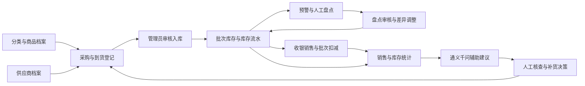
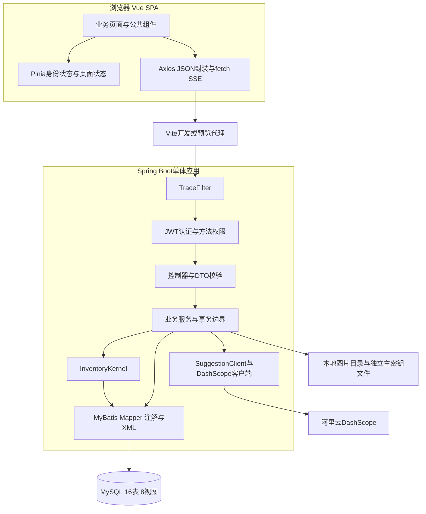
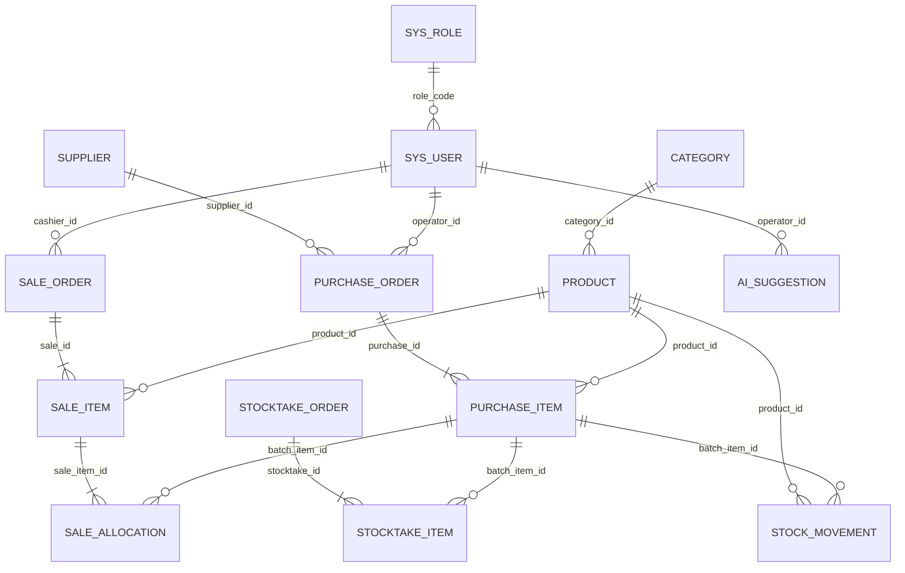
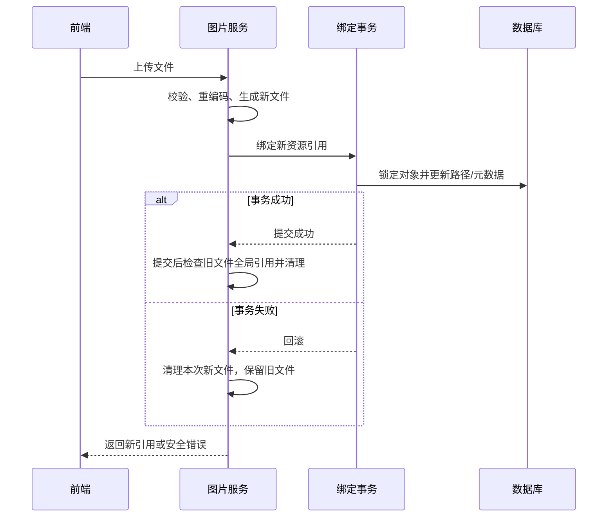
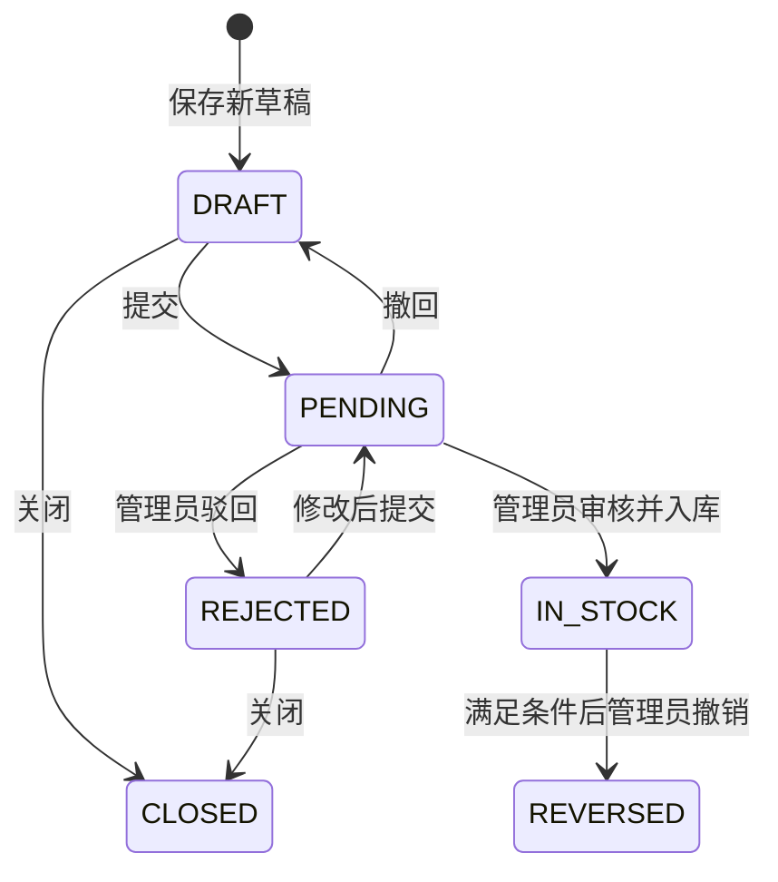
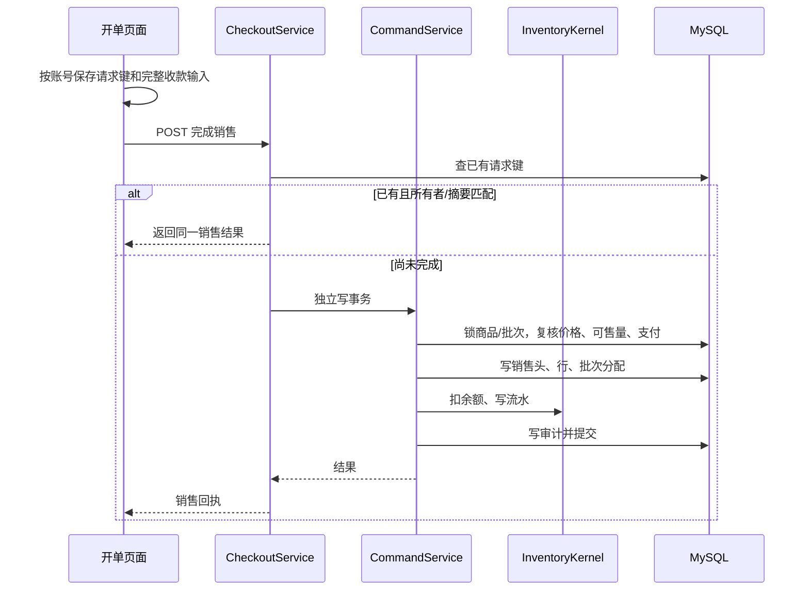
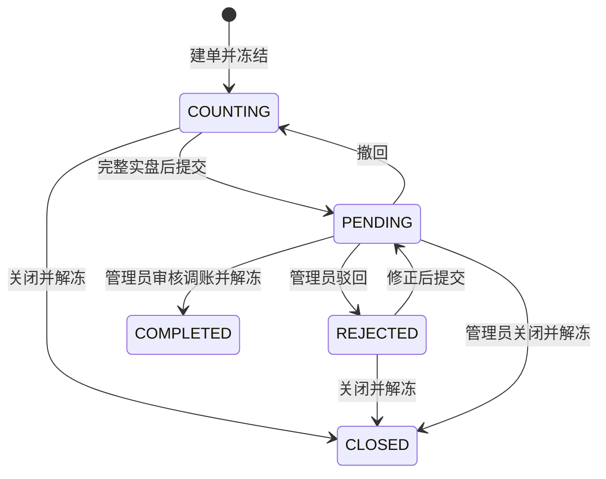
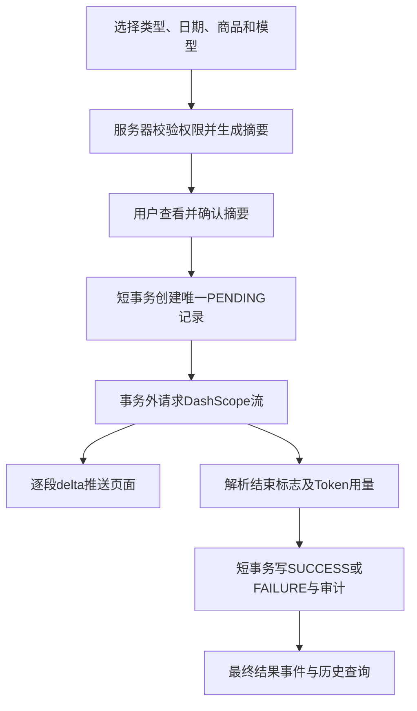

# 超市进销存管理系统详细说明书

> 说明书基于本仓库实际源码、唯一数据库初始化SQL及已保留的验收证据编写，适用于项目理解、毕业设计说明、答辩演示和后续维护。业务需求仍以《超市进销存管理系统功能需求文档》为准。

| 项目 | 内容 |
| --- | --- |
| 系统名称 | 禾序 · 超市进销存管理系统 |
| 文档版本 | 1.0，2026-11-11代码分析快照 |
| 项目形态 | 单门店、单库存地点，Vue前端与Spring Boot模块化单体后端 |
| 分析范围 | `backend/`、`frontend/`全部自有源码和工程文件，并交叉核对数据库、脚本及端到端测试 |
| 文件清点 | 后端297个、前端106个，共403个；含后端生产Java文件248个、测试类25个、Vue组件50个、TypeScript文件48个 |
| 统计口径 | 包括Maven Wrapper、锁文件、配置、测试及静态资源；排除下载的依赖、编译产物、运行日志与私有本地配置。物理行数包含注释和空行，不等于有效代码量 |
| 权威需求 | [功能需求文档](doc/超市进销存管理系统功能需求文档.md) |
| 结构基准 | [唯一初始化SQL](doc/数据库/supermarket_inventory.sql) |
| 实现规范 | [开发规范](doc/基于SpringBoot与Vue的超市进销存管理系统开发规范文档.md) |
| 验收依据 | [正式库用户视角验收记录](doc/正式库用户视角验收记录.md)、[历史测试验收记录](doc/测试验收记录.md) |

文档中的“已实现”指源码存在对应业务链路；“已验证”引用实际保留的测试或页面验收，不表示本次编写说明书又重新运行了全部测试。`node_modules/`、`target/`、`dist/`属于依赖或生成物，不能作为项目自行实现的功能。`backend/application-local.yml`、密钥文件和数据库备份只说明用途，不抄录其私有内容。

## 阅读导航

1. [项目定位与业务边界](#定位)
2. [技术体系与相关理论](#技术)
3. [系统架构与请求链路](#架构)
4. [工程目录与分层职责](#目录)
5. [角色与完整功能清单](#功能)
6. [数据库总体设计](#数据库)
7. [认证、授权与系统管理](#认证)
8. [基础档案与图片管理](#档案)
9. [采购入库与采购对账](#采购)
10. [库存内核、批次分配与预警](#库存)
11. [销售收款、幂等与整单纠错](#销售)
12. [盘点冻结与库存调整](#盘点)
13. [统计分析与工作台](#统计)
14. [通义千问、流式输出与模型管理](#模型)
15. [前端详细设计与交互原理](#前端)
16. [接口、数据契约与异常处理](#接口)
17. [事务、并发与安全设计](#事务)
18. [配置、运行与维护](#运行)
19. [测试体系与验收结论](#测试)
20. [设计特点、边界与扩展方式](#维护)
21. [逐文件职责索引](#文件索引)
22. [完整数据库字段字典与索引](#字段字典)
23. [控制器接口清单](#接口清单)

<a id="定位"></a>
## 1 项目定位与业务边界

### 1.1 系统解决的问题

本系统围绕一个门店的商品、供应商、采购、批次库存、销售、盘点、统计与经营建议开展工作。核心目标是让业务操作产生可追踪、可核对的库存结果：采购审核增加库存，销售从真实批次扣减，盘点经过审核调整差异，撤销和纠错以反向业务保留历史。

系统的基本闭环为：



### 1.2 业务范围及明确边界

| 领域 | 实际实现 | 范围边界 |
| --- | --- | --- |
| 组织与库存 | 固定三类岗位、一个门店库存地点 | 没有多门店、跨仓调拨、租户隔离或组织树 |
| 采购 | 草稿、到货、审核、驳回、撤回、关闭、入库撤销、逐行对账 | 对账不是付款；没有完整应付账款或正常采购退货业务 |
| 销售 | 检索、购物车、预校验、现金找零、模拟电子支付、本人记录、管理员当天整单纠错 | `MOCK_EPAY`不连接真实支付渠道；没有部分退款、会员、优惠券、挂单或线上商城 |
| 库存 | 商品余额、采购批次余额、不可直接编辑的流水、盘点冻结、临期过期与低库存 | 商品基本单位固定，不实现箱瓶换算、称重计价和复杂计量单位体系 |
| 统计 | 销售正负事件聚合、库存分类占比、热销、滞销与新品观察不足 | 不输出毛利、利润预测或全财务报表 |
| 智能服务 | 真实聚合摘要、千问调用、流式正文、模型选择、配置和Token用量 | 建议供人工参考，不自动采购、调价或改库存；用量不是阿里云账户账单 |

### 1.3 三种数据必须分开理解

- **当前主档**：商品、分类、供应商、账号资料，描述当前配置。
- **业务快照**：单据中的商品名称、分类名称、售价、供应商联系方式、操作者姓名，描述业务发生时的事实。
- **余额与事件**：商品和批次保存当前余额；库存流水及销售正负事件解释余额变化和期间统计。

修改主档名称或售价不会重新计算历史单据。当前库存是时点余额，期间销量是时间区间内的流量，不能将两者简单相减来判断库存错误。

<a id="技术"></a>
## 2 技术体系与相关理论

### 2.1 仓库实际技术栈

| 层次 | 版本或实现 | 在项目中的作用 |
| --- | --- | --- |
| Java | JDK 17 | 后端语言与运行环境，使用record、现代集合与JDK HttpClient |
| 后端框架 | Spring Boot 3.5.16 | 自动配置、嵌入式Tomcat、应用入口、测试和打包 |
| Web | Spring MVC、Jakarta Validation | JSON控制器、请求绑定、校验、异常映射、SSE |
| 安全 | Spring Security OAuth2 Resource Server、Nimbus JWT、BCrypt | JWT签发/验证、方法授权、密码安全散列 |
| 持久层 | MyBatis-Plus 3.5.18、MyBatis注解及XML | 档案CRUD、显式锁定、条件查询和聚合SQL |
| 数据库 | MySQL 8.0.34、InnoDB | 事务、行锁、外键、CHECK、生成列、JSON和视图 |
| 连接池 | Spring Boot集成的HikariCP | JDBC连接复用、校验、回收与超时 |
| API说明 | springdoc 2.8.17 | 根据控制器和注解生成OpenAPI及Swagger UI |
| 前端 | Vue 3.5.25、TypeScript 5.9.3 | Composition API、`script setup`、类型约束与组件化 |
| 构建与运行 | Vite 7.2.2、Node.js 24、npm锁文件 | 开发服务、接口代理、懒加载和生产静态资源构建 |
| 路由与状态 | Vue Router 4.6.3、Pinia 3.0.4 | 页面路由、身份恢复、菜单与当前登录状态 |
| 组件与图标 | Element Plus 2.11.8、配套图标2.3.2 | 表格、表单、对话框、权限树、中文交互 |
| 请求与金额 | Axios 1.13.2、decimal.js 10.6.0 | 普通JSON请求、精确十进制前端计算 |
| 可视化 | ECharts 6.0.0 | 月度柱图、趋势线图、库存饼图及点击下钻 |
| 模型正文 | markdown-it 15.0.3、DOMPurify 3.4.17 | Markdown排版与HTML白名单净化 |
| 后端测试 | JUnit 5、MockMvc、Spring Boot Test、真实MySQL | 业务、权限、事务回滚、并发与真实连接失效测试 |
| 前端测试 | Vitest 3.2.4、Vue Test Utils 2.4.6、Playwright 1.56.1 | 状态逻辑、组件交互、浏览器真实业务链路 |
| 工程检查 | Spotless 2.44.3、Google Java Format 1.25.2、ESLint、Prettier、vue-tsc | 格式、静态检查和编译门槛 |

以上版本来自`pom.xml`和`package.json`，不是建议升级的版本清单。Spring、Jackson、MySQL Connector/J等未在pom单独声明版本的依赖由Spring Boot依赖管理控制，维护时应同时检查有效依赖树。

### 2.2 分层、依赖注入与事务代理

后端按业务模块组织，每个模块内部采用Controller、Service、Mapper及数据对象分工。Controller处理HTTP契约，Service落实业务规则和事务，Mapper访问数据库。Spring通过构造函数注入依赖，便于替换模型客户端、时钟及测试实现。

`@Transactional`通过Spring代理在方法调用边界开启、提交或回滚事务。因此项目将外部模型调用与数据库短事务拆成不同Bean，将图片文件操作与绑定事务拆开，将销售幂等冲突恢复放在写事务退出之后。这些拆分直接服务于事务边界，而不是仅为了增加层数。原理参见[Spring 6.2事务注解说明](https://docs.spring.io/spring-framework/reference/6.2/data-access/transaction/declarative/annotations.html)。

### 2.3 ACID、悲观锁与乐观版本

InnoDB事务保证一次审核或结算中的单据、批次、商品余额、流水与审计共同提交。`FOR UPDATE`是读取后准备修改时的排他锁；`FOR SHARE`用于让账号新任务创建与账号停用互相协调。锁一直由事务持有到结束，不能把普通SELECT当成已经锁定数据。参见[MySQL锁定读](https://dev.mysql.com/doc/refman/8.0/en/innodb-locking-reads.html)。

在本项目中，ACID分别体现为：整单一起提交或回滚的原子性；余额、约束与来源关系有效的一致性；并发结算由隔离级别和行锁协调的隔离性；提交后由数据库日志与存储机制承载的持久性。业务守恒仍需要应用规则及数据库约束共同落实，不能仅依赖事务注解自动推导正确业务。

项目同时使用两层并发保护：

1. 数据库行锁串行化冲突写入，商品和批次按ID顺序加锁，降低死锁概率。
2. `row_version`、`stock_version`、岗位`auth_version`、账号更新时间等版本阻止过期页面覆盖新结果。版本检测与行锁解决的问题不同，不能相互替代。

### 2.4 幂等、快照和事件统计

幂等表示同一业务请求重复到达时返回原结果，不重复产生销售或模型调用。销售请求同时绑定UUID、操作者及规范化输入哈希；数据库唯一约束提供最终竞争仲裁。网络中断只意味着客户端未收到结果，不一定意味着服务端回滚，所以前端首先查询原键。

快照用于保留历史事实；正负事件用于表达期间增减。销售完成产生正销量，整单纠错在纠错时点产生负销量，统计从`v_sale_event`聚合，而非一律丢掉已纠错原单。

### 2.5 FEFO与批次追踪

有保质期商品采用先到期先出（FEFO）；到期日相同再按入库时间、系统批次号排序。普通商品没有到期日，按入库时间和批次号分配。分配结果持久化到`sale_allocation`，以便纠错恢复到原采购批次，而不是随意找一个当前批次增加数量。

### 2.6 响应式前端与SSE

Vue通过`ref`、`reactive`、`computed`和`watch`维护页面状态，状态变化驱动模板更新；复用业务状态逻辑放在composable中，表格列和业务命令仍保持明确。参见[Vue组件与响应式介绍](https://vuejs.org/guide/introduction.html)。

SSE在HTTP连接中连续发送事件。项目存在“千问→后端”和“后端→浏览器”两段事件流：前者解析供应商`choices[].delta.content`与`[DONE]`，后者发送项目自己的`started/delta/result/error`。阿里云流式用量需要`stream_options.include_usage=true`，项目已设置并处理仅有用量的尾块。参见[阿里云流式输出说明](https://help.aliyun.com/zh/model-studio/stream)。

<a id="架构"></a>
## 3 系统架构与请求链路

### 3.1 总体架构



这是一个进程内按模块分工的单体系统。模块之间通过Java调用协作，没有服务注册中心、网关、消息队列、Redis、分布式事务或独立微服务。普通JSON与SSE走同一个后端；Vite代理只属于本地开发/预览设施，不是完整的生产网关。

### 3.2 普通请求的处理过程

1. 页面调用`src/api/`模块，统一`request<T>()`添加Bearer Token和客户端追踪值。
2. Vite将`/api`和`/media`转发到后端，普通业务与模型建议使用独立有界连接池。
3. `TraceFilter`生成服务端追踪编号，写入响应头`X-Trace-Id`和MDC。
4. Spring Security校验JWT；从数据库读取当前账号及岗位，核对启用状态、账号凭证版本、岗位授权版本和角色。
5. Controller接收允许的DTO字段，Jakarta Validation校验类型、范围、枚举与跨字段条件。
6. Service校验岗位、数据归属、版本、状态与业务规则，必要时进入事务并锁定数据。
7. Mapper执行参数绑定SQL。库存写入统一经`InventoryKernel`，审计经`AuditService`参与同一事务。
8. 返回显式VO及`ApiResponse`，前端解包显示；错误由页面统一呈现，401进入统一失效流程。

### 3.3 命令与查询的组织

项目采用清晰的读写职责分离，但没有引入CQRS框架或独立读库。采购的草稿、流转、查询、对账分属不同Service；销售的报价、提交、写事务、结果查询分开；库存写内核与只读库存查询独立。统计通过一致快照读取，模型HTTP等待不持有库存事务。

### 3.4 状态存在的位置

| 状态 | 保存位置 | 作用与生命周期 |
| --- | --- | --- |
| 账号、岗位权限、凭证版本 | MySQL | 服务端鉴权最终依据 |
| Token | 当前浏览器标签页`sessionStorage`及内存 | 刷新可恢复；退出或401清除，无刷新Token机制 |
| 普通筛选与编辑表单 | Vue页面内存；部分范围来自路由query | 页面负责加载、校验与离开提醒 |
| 销售未知提交 | 按账号区分的`sessionStorage`键 | 刷新后先查询原UUID，避免重复扣库 |
| 模型待核实请求 | 按账号区分的`sessionStorage`键 | 保留请求键和类型，重新进入后查询原结果 |
| 待确认模型摘要 | 后端内存Map，最多256份、有效10分钟 | 单实例临时快照，重启后未确认摘要失效 |
| 已发起模型调用及结果 | `ai_suggestion` | PENDING/SUCCESS/FAILURE、输入快照、正文、用量 |
| 图片 | 本地上传目录；数据库只存引用和元数据 | 文件IO与绑定事务分离，旧文件按引用回收 |

<a id="目录"></a>
## 4 工程目录与分层职责

```text
Supermarket-Inventory-Management-System/
├─ backend/
│  ├─ pom.xml                         Maven依赖、JDK、打包、格式检查
│  ├─ mvnw / mvnw.cmd / .mvn/        固定Maven Wrapper
│  ├─ application-local.example.yml  私有配置示例
│  └─ src/
│     ├─ main/java/com/supermarket/inventory/
│     │  ├─ InventoryApplication.java 应用入口
│     │  ├─ config/                  时钟、JSON和追踪过滤器
│     │  ├─ common/                  响应、分页、输入转换、异常、文件组件
│     │  ├─ security/                认证、当前用户、数据范围和任务创建保护
│     │  ├─ profile/                 本人资料、密码、头像
│     │  ├─ system/                  账号、岗位、参数、工作台、审计
│     │  ├─ catalog/                 分类、商品、供应商及图片
│     │  ├─ purchase/                采购草稿、流转、查询、对账
│     │  ├─ inventory/               库存内核、批次分配、查询、预警
│     │  ├─ sale/                    报价、幂等销售、纠错和记录
│     │  ├─ stocktake/               盘点任务、实盘、冻结与审核
│     │  ├─ statistics/              销售与库存聚合
│     │  └─ ai/                      摘要、模型客户端、流式接口、配置和用量
│     ├─ main/resources/
│     │  ├─ application.yml          共享运行配置
│     │  ├─ application-local.yml    可选导入私有本地配置
│     │  └─ mapper/                  15个XML映射文件
│     └─ test/                       25个Java测试类与独立库配置
├─ frontend/
│  ├─ package.json / package-lock.json
│  ├─ vite.config.ts / tsconfig.json / eslint.config.js / .prettierrc.json
│  ├─ index.html / public/favicon.svg
│  ├─ playwright.config.ts / test-support/
│  └─ src/
│     ├─ main.ts / App.vue           应用初始化与全局路由失败恢复
│     ├─ router/ / stores/           路由、权限守卫、登录状态
│     ├─ api/                        JSON/SSE封装及业务接口
│     ├─ types/                      业务契约与状态枚举
│     ├─ composables/                分页、未保存保护、销售结果恢复
│     ├─ components/                 头像、图片、图表、安全Markdown等
│     ├─ layouts/                    主布局和按权限生成的菜单
│     ├─ styles/                     全局色彩、间距、表格与弹窗规则
│     ├─ utils/                      金额、时间、图片校验、错误提示
│     └─ views/                      auth/home/profile/catalog/purchase/
│                                    inventory/sale/stocktake/statistics/
│                                    suggestion/system
├─ doc/                              需求、规范、数据库、验收和论文材料
├─ scripts/                          测试库准备、显式升级、启动、性能及网络诊断
├─ tests/e2e/                        真实浏览器业务测试与夹具
├─ .run/                             本地IDE运行配置
├─ .local/                           私有运行/测试产物，不纳入版本控制
└─ 系统详细说明书.md                  本文
```

### 4.1 后端数据对象的区别

| 目录或类型 | 作用 | 不能替代的职责 |
| --- | --- | --- |
| `dto` | 允许客户端输入的字段、校验注解与查询条件 | 不接收库存余额、审核人、归属人等由服务端决定的事实 |
| `vo` | 显式返回前端的数据投影 | 不直接返回含密码散列、密文或内部凭证的持久化对象 |
| `entity` | 数据库行、锁定投影、写入载体或内部快照 | 不是全部统一的MyBatis-Plus实体，不代表可以直接开放保存 |
| `enums` | 状态、支付方式、流水类型、差异原因等固定集合 | 不允许前端随意新增状态代码 |
| `mapper` | 显式SQL及方法契约 | 不承担页面权限、完整状态机和跨表业务事务 |
| `service` | 业务规则、事务边界、数据范围、审计协调 | 不应绕过库存内核直接修改余额 |

不少对象采用不可变Java record；需要数据库回填自增ID或连续更新库存版本的内部载体采用可变类。项目通过MyBatis-Plus starter整合持久层，但当前Mapper采用自定义接口、注解和XML SQL，没有使用`BaseMapper`、`IService`或通用分页拦截器；分页、锁定及库存更新均有显式SQL。

### 4.2 前端复用层次

`components/`复用显示和输入部件；`composables/`复用状态机和请求时序；`api/`复用请求契约；`types/`约束数据形状。复杂业务仍由对应View编排，例如采购编辑器、销售开单页、盘点详情和建议页。分页封装不会替页面决定业务列、权限或操作状态。

<a id="功能"></a>
## 5 角色与完整功能清单

### 5.1 岗位、权限与数据范围

系统固定三种角色，每个账号只有一个角色。权限可在岗位上限内调整，不能通过勾选把采购员升级为管理员。

| 角色 | 主要业务 | 数据范围与限制 |
| --- | --- | --- |
| `ADMIN` 管理员 | 全局监督、采购/盘点审核、销售纠错、主档和系统管理 | 可管理全店业务；具体入口仍要求对应权限；按销售请求键恢复结果仍要求请求所有者 |
| `PURCHASER` 采购员 | 供应商、本人采购及对账、本人盘点、共享库存和预警、库存建议 | 采购单、盘点单按本人归属；库存和供应商共享；他人采购来源编号可显示，不自动授予来源详情权限 |
| `CASHIER` 收银员 | 商品检索、销售收款、本人销售记录、只读可售库存、销售汇总 | 销售明细按本人归属；销售统计是全店聚合；不能查看采购成本、供应商联系人和操作库存流水 |

权限判断分为四层：前端菜单及按钮、后端`@PreAuthorize`、Service固定角色限制、SQL归属过滤。隐藏菜单只改善交互，后端才是授权边界。账号或角色的版本变化会使旧JWT失效。

### 5.2 对应需求的31组业务功能

下表按需求分组说明实现落点；组内多个操作并不意味着每个都是独立页面。

| 编号 | 功能与实际行为 | 主要后端 / 前端落点 |
| --- | --- | --- |
| G01 | 三岗位登录、身份恢复、注销和过期退出 | `AuthService` / `LoginView`、auth store、路由守卫 |
| G02 | 按岗位展示工作台指标、待办和可点击入口 | `DashboardService` / `DashboardView` |
| G03 | 个人资料查看、姓名与手机号修改 | `ProfileService` / `ProfileView` |
| G04 | 上传、替换、移除头像及默认头像 | `AvatarService`、`ImageStorage` / `AvatarEditor`、`UserAvatar` |
| G05 | 校验旧密码、修改密码、旧会话失效 | `ProfileService` / `ProfileView` |
| G06 | 统一布局、筛选分页、加载与空态、异常提示、未保存提醒 | 公共异常层 / `AppLayout`、分页和dirty composable |
| A01 | 账号增改、启停、重置密码、未用账号删除、未完成任务检查 | `StaffService` / `StaffView`、`StaffEditor` |
| A02 | 固定岗位权限树、岗位上限、保护权限、保存与恢复默认 | `RoleService` / `RoleView` |
| A03 | 分类新增、编辑、启停、引用保护删除 | `CategoryService` / `CategoryView` |
| A04 | 商品档案、条码、售价、采购/销售开关、保质期、图片和引用保护 | `ProductService`、图片服务 / `ProductView`、`ProductEditor` |
| A05 | 供应商共享维护、状态切换、管理员删除 | `SupplierService` / `SupplierView` |
| A06 | 全店采购待审列表、审核入库、驳回 | `PurchaseWorkflowService` / 采购列表审核模式、采购详情 |
| A07 | 采购撤销、对账监督和历史查询 | 采购工作流与对账Service / 采购详情、对账对话框 |
| A08 | 商品库存、批次、流水及来源追踪 | `StockReadService` / 三类库存视图 |
| A09 | 盘点审核、驳回、异常任务关闭和解冻 | `StocktakeService` / 盘点列表、详情 |
| A10 | 低库存、临期、过期预警和处理入口 | `StockWarningService` / `StockWarningView` |
| A11 | 全店销售记录、详情、当天整单纠错 | 销售查询和命令Service / 销售列表、详情 |
| A12 | 全店销售统计、库存统计、热销、滞销与下钻 | `StatisticsService` / 两个统计页面 |
| A13 | 库存优化、销售经营分析、摘要确认、历史建议 | 建议模块 / `SuggestionView`、详情 |
| A14 | 新商品默认参数、操作日志及快照查看 | `SystemSettingsService` / 默认参数、日志页面 |
| B01 | 新增、编辑、启停供应商 | 供应商模块；删除仍限制管理员 |
| B02 | 新建采购、到货登记、批次日期、草稿和提交 | `PurchaseDraftService` / `PurchaseEditorView`及选择器 |
| B03 | 本人采购查询、撤回、驳回后编辑、关闭、逐行对账、供应商汇总 | 采购查询、工作流、对账 / 列表、详情、汇总 |
| B04 | 发起盘点、实盘录入、提交、撤回、关闭 | `StocktakeService` / 发起、列表、详情 |
| B05 | 共享库存、预警、库存统计和采购处理入口 | 库存、预警、统计模块 |
| B06 | 共享成功库存建议、本人请求恢复与失败记录 | 建议授权Service / 建议页面 |
| C01 | 编码/名称/条码搜索、扫码式回车加购、购物车 | 销售商品查询 / 搜索、购物车、开单页 |
| C02 | 预校验、现金找零、模拟电子支付、事务扣库存、回执 | 销售报价与命令Service / 收款对话框、回执 |
| C03 | 本人销售记录与商品明细查询 | `SaleQueryService` / 销售列表、详情 |
| C04 | 只读可售库存、冻结状态 | `SaleableInventoryService` / `SaleableInventoryView` |
| C05 | 全店销售聚合、趋势、热销、滞销观察 | `StatisticsService` / `SalesStatisticsView` |

后续千问增强需求还实现了：逐段流式正文、允许模型选择、管理员写入API Key和模型清单、配置版本冲突保护、按模型/日期统计真实Token。它们是智能模块的扩展，不能用初始夹具建议代替真实调用证据。

<a id="数据库"></a>
## 6 数据库总体设计

### 6.1 物理模型与设计思路

唯一初始化基准包含**16张表、258个字段、8个视图**。所有表使用InnoDB，中文业务字段使用`utf8mb4`，部分编码和标识使用ASCII排序规则。系统以关系型外键维护主从关系，以JSON承载权限集合、审计快照、模型摘要等结构变化较多的数据。

| 分类 | 表 | 设计目的 |
| --- | --- | --- |
| 身份与治理 | `sys_role`、`sys_user`、`sys_config`、`operation_log` | 岗位权限、账号凭证版本、参数和可追溯操作 |
| 基础资料 | `category`、`product`、`supplier` | 当前分类、商品、供应商 |
| 采购与库存来源 | `purchase_order`、`purchase_item` | 采购头/行、到货、入库批次及逐行对账 |
| 销售 | `sale_order`、`sale_item`、`sale_allocation` | 收款单、商品快照、销售明细到采购批次的分配 |
| 盘点 | `stocktake_order`、`stocktake_item` | 冻结范围、账面快照、实际数量和差异 |
| 库存事件 | `stock_movement` | 每次批次及商品余额变动的前后值与来源 |
| 模型服务 | `ai_suggestion` | 输入摘要、模型、请求状态、正文、失败和实际用量 |

**采购明细兼作库存批次**：`purchase_item`在未审核时是采购行；审核后写入`batch_no`、`stock_qty`，成为可追踪批次。系统没有额外的`stock_batch`表。一个采购单可包含同一商品的多个批次；一条销售商品明细也可分配到多个采购批次。



此图突出核心关系，未画出所有审核人、日志、冻结指针与复合外键；完整约束以第22章和初始化SQL为准。

### 6.2 主键、快照、金额与时间

- 数据库主键通常使用自增`bigint`；JSON接口以字符串返回ID，避免JavaScript整数精度损失。数量仍是受业务上限限制的整数。
- 采购、销售行保留商品及分类快照；采购头保留供应商、经办人快照。外键用于追踪当前对象，快照用于解释历史。
- 单价和金额使用`decimal`，Java使用`BigDecimal`，前端使用金额字符串及`Decimal`。行金额、找零、盘点差异等部分结果由数据库生成列维护。
- 业务时区统一`Asia/Shanghai`/`+08:00`，服务端注入`Clock`提供业务日期。数据库`datetime(6)`保存该约定下的本地时刻；采购带偏移时间输入先转换为北京时间。
- 日期筛选转换为半开区间`[开始日00:00, 结束日次日00:00)`，避免遗漏结束日晚间及微秒数据。

### 6.3 完整性约束与查询索引

数据库承担最后一道结构约束：唯一编码、条码、业务单号、请求键；非负余额；合法状态与时间字段组合；复合外键保证销售分配的商品和批次一致；来源字段与库存流水类型对应。多数业务引用禁止物理删除，审计中的部分可空操作者引用允许置空，同时保留姓名快照。

`product.stock_version`、业务单据`row_version`、对账`reconcile_version`、账号`credential_version`和角色`auth_version`用途不同，不能互相替代。时间、归属、状态、商品/批次引用等组合索引支持列表和锁定查询；模糊包含搜索并不等于全文索引。分页采用显式`COUNT`与`LIMIT/OFFSET`，规模继续增长后应依据实际执行计划优化。

### 6.4 八个视图的口径

| 视图 | 作用 |
| --- | --- |
| `v_batch_inventory` | 从已形成的采购批次推导余量、有效期、可售条件等 |
| `v_product_inventory` | 商品账面、批次、可售、过期等数量聚合 |
| `v_cashier_inventory` | 面向收银的安全库存投影 |
| `v_category_inventory` | 分类账面库存及占比 |
| `v_low_stock` | 低库存候选 |
| `v_purchase_event` | 入库正事件与撤销负事件，支持期间净采购汇总 |
| `v_reconcile_history` | 从审计记录整理采购对账前后历史 |
| `v_sale_event` | 完成销售正事件与纠错负事件，支持期间净销售统计 |

视图不是另一套余额。运行时Mapper中不少库存查询直接使用等价SQL，并传入后端业务日期，便于跨日测试；不能笼统认为所有页面都直接查询上述视图。正负事件视图则让历史撤销和纠错按发生时间参与统计，避免删除原单造成历史消失。

<a id="认证"></a>
## 7 认证、授权与系统管理

### 7.1 登录及会话失效机制

`AuthController → AuthService → AccountMapper`完成登录：整理用户名、查询账号、BCrypt比较密码、检查启用状态，锁定并复核账号后签发HS256 JWT，更新最后登录时间。不存在账号也执行虚拟BCrypt比较，减少不同错误路径的时间差。默认有效期为2小时，不实现刷新令牌。

JWT包含主体ID、签发/过期时间、账号凭证版本`cv`、角色版本`rv`与角色代码。每次受保护请求都经`AccountPrincipalService`重新读取当前数据库账号及岗位，检查启用状态、版本和角色，再生成权限集合。因此禁用、重置密码、修改密码、角色调整、权限保存等可以在服务端撤销旧会话，而非只删除浏览器Token。

注销增加账号凭证版本，影响该账号原有会话。JWT密钥从本地私有配置或环境注入，要求满足HS256长度条件，不提供内置生产密钥。

### 7.2 账号管理与任务交接

管理员可创建账号、修改姓名/电话/角色、启停、重置密码和删除未被引用账号。创建用户名为4～20位字母数字下划线，密码8～20位且包含字母与数字，手机号按中国大陆格式校验。修改使用`expectedUpdatedAt`比较当前更新时间，过期编辑返回冲突。

关键业务保护如下：

1. 不能停用或删除当前账号；不能移除最后一个启用管理员。
2. 存在未完成采购或活动盘点时，禁止改变业务归属所依赖的岗位、停用或删除，页面列出任务供管理员处理。
3. 有历史业务引用的账号保留，只能停用；不能为了删账号清理历史单据。
4. 管理操作通过管理员岗位锁和账号行锁串行保护；新采购/新盘点通过`BusinessActorGuard`共享锁复核账号，使“已鉴权请求”和“停用账号”之间也有事务顺序。
5. 密码只保存BCrypt散列。管理查询、日志快照和VO不回传散列、旧密码或明文新密码。

### 7.3 固定岗位权限配置

`sys_role`保存权限、默认权限、岗位上限和授权版本；权限目录来自系统配置。保存时校验权限存在、属于岗位上限、父节点齐全、不重复，管理员关键恢复权限不得移除。前端权限树提供父子联动和保护节点禁用显示，后端独立重复验证。

保存与恢复默认都会增加岗位授权版本，相关岗位旧Token失效；操作管理员修改自己所在岗位时，前端也要求重新登录。当前不是任意新增岗位、多岗位账号或按用户单独授权系统。

### 7.4 参数和操作日志

默认参数页面实际管理`inventory.default_lower_limit`和`inventory.default_near_expiry_days`，只影响以后新商品的初始值。保存传入读取时的旧值作为比较条件，将两个参数与审计放在一个事务中，不能覆盖已有商品阈值。

`AuditService`在明确的业务命令中记录动作、对象、操作者、原因及必要前后快照。它要求加入调用方事务：命令回滚时，相应成功审计也回滚；这不是所有HTTP请求自动留痕的通用访问日志。AI失败结果通过独立短事务记录。

管理员可筛选日志并查看安全JSON快照。详情层进一步递归遮蔽可能包含`password/secret/token/authorization/credential/apikey`的键。日志不可作为恢复数据库的替代品。

<a id="档案"></a>
## 8 基础档案与图片管理

### 8.1 分类、商品和供应商

| 对象 | 关键规则 | 历史保护 |
| --- | --- | --- |
| 分类 | 编码2～20位；名称2～30位；排序非负；编码和名称唯一 | 有商品引用不能删除；停用分类不级联停用已有商品；历史单据分类名称不重写 |
| 商品 | 编码2～32位；可选纯数字条码4～32位；名称2～100位；售价大于0；参考成本可空或0 | 新建库存恒为0；被引用后保护编码、分类、单位；有库存或引用时保护保质期管理方式 |
| 供应商 | 服务端生成编码；名称、联系人、电话、地址及备注；启停可控 | 已有采购引用不能删除；历史采购供应商快照不随主档修改 |

商品单位固定为件、瓶、袋、盒、箱、包、罐、支、本、卷。`enabled`、`canPurchase`、`canSell`是三个独立条件；保质期管理商品需要正整数保质期天数，普通商品必须清空该值。`stockLowerLimit`、临期阈值与当前余额分离，档案接口没有直接修改库存的字段。

采购商品选择返回参考成本和保质期字段；销售选择返回售价和可售量。收银投影不包含成本。后端通过不同VO与查询语句实现字段隔离，而非给前端一个完整商品对象后隐藏列。

### 8.2 图片存储与事务协调

头像和商品图片复用`ImageStorage`与`ImageLifecycle`。输入必须是真实JPEG/PNG，单文件不超过2MiB，宽高各64～4096像素；扩展名、解码格式、内容都检查。服务端解码后重新编码，生成UUID文件名，在限定上传根目录下写入，使用临时文件和原子移动完成落盘。

文件系统与数据库没有同一个事务，因此采用以下顺序：



删除旧图前同时检查用户头像和商品图片引用，避免共享文件误删；清理失败记警告，不推翻已经提交的绑定。媒体读取只接受生成文件名、校验根目录及符号链接边界，返回明确MIME、`nosniff`及限制性CSP。当前媒体URL可以匿名读取，不能将其当作私密文档存储。

<a id="采购"></a>
## 9 采购入库与采购对账

### 9.1 模块拆分与数据输入

采购模块由访问范围、草稿、工作流、查询、选择/汇总、对账六类Service协作，避免一个大Service同时承担所有状态。前端对应列表、编辑器、详情、供应商/商品选择器、对账对话框和供应商汇总。

每单1～100行，可对同一商品登记不同批次。采购数量1～999999、实收数量可空或0、单价大于0。草稿允许尚未补齐到货信息，提交时要求实收完整且与采购数量匹配，并校验实际到货时间、启用供应商、可采购商品、冻结和日期。前端日期上限使用后端返回的业务时间；保质期推算只是录入建议，最终日期必须核对实物标签。

### 9.2 采购状态机



保存、提交不改变库存；只有审核入库调用库存内核。提交过的单据即使撤回，也保留`first_submitted_at`，不允许恢复成可删除的全新草稿。物理删除只适用于从未提交的草稿。所有状态命令检查当前状态及`expectedVersion`；重复审核或竞争撤回最多有一个提交成功。

### 9.3 审核入库的原子性

1. 锁定采购头并检查管理员权限、版本、`PENDING`状态。
2. 按商品ID顺序锁定商品，复核供应商/商品启用、采购开关、冻结、实收和日期。
3. 为每行生成系统批次号，设置批次库存。
4. 经`InventoryKernel`增加商品余额、写入`PURCHASE_IN`流水。
5. 更新采购状态、审核和入库时间，追加审计并一起提交。

任一行失败、余额保护失败或流水写入失败，整单回滚，不留下“头已入库但库存只增加一部分”的结果。业务时间在命令中统一取值，保证同次操作的事件时间一致。

### 9.4 入库撤销与普通退货的区别

撤销用于纠正未继续使用的原入库：管理员操作、状态为`IN_STOCK`、对账为`UNRECONCILED`、没有冻结，原批次库存仍等于原实收，且没有后续库存变动历史。即使销售纠错后余量恢复，只要存在下游流水，也不能撤销采购。

成功撤销逐批减回库存，追加`PURCHASE_REVERSE`，原单改为`REVERSED`并保留历史。它不实现部分退货、退货发运或应付退款。

### 9.5 逐行对账

对账属于单据核对，不产生库存流水。输入须覆盖当前单据全部行且无重复，包含外部数量、单价、行备注、外部总额和凭证。服务端以十进制计算外部行合计并与输入总额比较，再与原数量/单价/金额逐项比较。

| 目标 | 允许条件 | 结果 |
| --- | --- | --- |
| `MATCHED` 已对平 | 所有行及总额相符；从差异转对平需解决说明 | 保存核对值和操作者，不改库存 |
| `DIFFERENCE` 有差异 | 实际存在差异且填写原因 | 保留逐行差异，等待人工处理 |
| `UNRECONCILED` 未对账 | 撤回当前已对账/差异结果并填写原因 | 清除当前外部核对字段，历史快照继续保留 |

保存同时检查单据`rowVersion`与`reconcileVersion`，防止单据操作和另一个对账窗口互相覆盖。完整前后行快照写入操作日志，历史查询从中还原。

### 9.6 查询、汇总与不确定结果

采购列表支持创建/入库/事件日期口径，采购员只能看到本人单据。供应商汇总使用期间入库正事件减撤销负事件，点击汇总带相同日期和供应商进入明细。

采购保存不是请求键幂等协议。前端遇到写请求结果未知时保留输入并引导查询核实，阻止盲目再次保存；不能声称所有业务写接口都能安全自动重试。

<a id="库存"></a>
## 10 库存内核、批次分配与预警

### 10.1 一套库存写入口

`InventoryKernel`统一负责商品余额、批次余额、冻结和库存流水，要求调用方已有事务（`MANDATORY`）。采购、销售、纠错、盘点从不同业务入口调用内核，普通商品编辑和AI客户端没有改库存权限。

核心守恒关系是：

```text
商品账面库存 = 该商品已入库且未撤销批次的当前库存合计
每条流水：批次后值 = 批次前值 + delta
每条流水：商品后值 = 商品前值 + delta
期间净销售 = 完成正事件 + 纠错负事件
```

库存数量上限为999999999999，更新不得负数或越界。商品更新SQL比较旧库存、`stock_version`和预期冻结指针，批次更新比较旧库存；影响行数不是1即冲突回滚。行锁与条件更新同时使用，防止绕过锁定约定的写入静默覆盖。

### 10.2 锁定顺序与流水来源

一般命令先锁业务头，再按ID升序锁商品，再按ID升序锁采购批次；销售新建先按商品排序锁定。固定顺序降低死锁概率，但不意味着数据库永不会出现锁超时，应用仍须正确返回冲突/临时不可用。

| 流水类型 | 数量方向 | 来源 |
| --- | --- | --- |
| `PURCHASE_IN` | 正 | 采购入库批次 |
| `PURCHASE_REVERSE` | 负 | 被撤销的原批次 |
| `SALE_OUT` | 负 | 销售批次分配记录 |
| `SALE_CORRECTION` | 正 | 原销售批次分配记录 |
| `STOCKTAKE_GAIN` | 正 | 盘点行 |
| `STOCKTAKE_LOSS` | 负 | 盘点行 |

流水保留业务编号、商品/批次前后值、操作者、原因和发生时间，并通过来源唯一性约束防止同一事件重复落账。库存展示层没有手工修改或删除流水的接口。

### 10.3 账面、可售、过期、冻结

账面库存包含实际仍在库的过期或停用商品；可售数量由有效采购批次、商品启用/可售开关和有效期推导。有效期当天仍可售，只有`expiryDate < today`才算过期。跨日只改变派生分类，不自动修改账面余额。

冻结是“暂时禁止库存命令”的独立状态，不能把可售数量伪装成0。页面同时展示数量和冻结标志，销售、采购入库/撤销、纠错等命令在事务中拒绝冻结商品。过期清理通过盘点记录真实差异并审核落账。

### 10.4 FEFO批次分配

`SaleBatchAllocator`只计算分配方案，不写数据库。先排除无余量、未入库和过期批次；管理有效期商品按到期日优先，其后按入库时间、批次号；普通商品按入库时间、批次号。一个销售行可以跨批次，整体不足则整单不提交。

例如购买6件，批次A临期余2、B余5，则分配A2+B4。销售行金额仍只按6件计算，不能把跨批次分配当成多条销售重复统计。

### 10.5 预警派生规则

| 预警 | 判定 | 处理入口 |
| --- | --- | --- |
| 低库存`LOW` | 启用且可销售商品，可售量小于等于库存下限，包含0 | 人工新建采购并预填商品 |
| 临期`NEAR` | 有余量的有效批次，距到期0～商品临期阈值天 | 查看批次、人工经营处理 |
| 过期`EXPIRED` | 有余量且到期日早于今天 | 发起盘点/实物清理；停用商品仍保留此提示 |

预警由查询时的业务日期计算，不是独立待办表，不需要人工勾选“已读”来清除。实际库存、日期、阈值变化后自动重新派生；零库存批次不继续产生临期/过期数量预警。

<a id="销售"></a>
## 11 销售收款、幂等与整单纠错

### 11.1 从检索到回执

商品搜索支持编码、条码和名称，精确条码回车可加购；同一商品在购物车合并数量。购物车只是浏览器编辑状态，不占库存。收款前调用报价接口获取当前商品状态、售价、余量和冻结信息；报价也不锁定未来库存，提交时还要复核。

客户端提交商品ID、整数数量和用户已确认的`expectedPrice`，不能指定真实成交价。后端锁定后发现售价变化会返回`PRICE_CHANGED`，前端展示新旧价格，要求明确采用新价格。销售行保存成交时的商品、分类、单位和售价快照。

每单最多100种不重复商品，单行数量1～999999。现金实收应不少于应收，找零以精确十进制计算；模拟电子支付要求实收等于应收，并在界面明确标注模拟。

### 11.2 收款事务与幂等协议

`SaleCheckoutService`不持有写事务，`SaleCommandService`负责独立写事务。规范化输入按商品ID排序，计算包含账号、支付方式、实收和商品数量/预期价格的SHA-256摘要；`request_key`有唯一约束。



相同键但不同账号或不同输入不能复用。并发相同键发生唯一冲突时，先退出失败写事务，再查询已提交结果；不在已经失败的事务中继续读取。库存不足、任意行失败和流水失败都回滚整单。

### 11.3 网络丢失后的结果恢复

`useSaleCheckout`在发起写入前按账号将请求键与输入保存到`sessionStorage`。若响应丢失，先按键查询完成结果；查询404也不能证明此前请求已经回滚。结果仍未知时保留原键和原输入、锁定购物车，人工重试使用相同键，不生成新销售请求。明确业务拒绝才解除待恢复状态让用户修改。

这能解决当前浏览器会话中的重复收款风险，但不承诺跨设备找回浏览器草稿。后端唯一键和输入摘要才是防重复扣库存的最终保证。

### 11.4 当天整单纠错

管理员对`COMPLETED`销售执行一次整单纠错，需要版本、2～500字原因，以及“商品仍在或已完整收回”的确认。只允许北京时间当天且非未来销售，不支持跨日、部分数量退款或第二次纠错。

后端根据原`sale_allocation`恢复到原批次，不能按当前FEFO重新选择批次；任何商品冻结都会阻止。原来源批次必须仍有效存在。原批次即使现已过期也能恢复账面库存，但恢复数量不会变成可售库存，界面提示后续实物处理。成功后保留原单、改为`CORRECTED`，追加`SALE_CORRECTION`和审计。

<a id="盘点"></a>
## 12 盘点冻结与库存调整

### 12.1 冻结快照而非临时库存编辑

发起盘点选择1～100个不重复商品。系统锁定商品及其已入库批次，包含零余量批次，校验批次合计与商品余额一致，最多形成2000条盘点行。商品必须有可追踪入库批次；不能对无来源商品直接造盘盈批次。

创建`PD`盘点单并冻结这些商品，盘点行保存`bookQty`，`actualQty`初始为`NULL`。盘点可以包含停用或过期实物，数量0是有效清点结果，必须与“尚未填写”分开。

### 12.2 状态及冻结持续时间



驳回和撤回继续保持冻结，防止快照期间发生出入库。采购员关闭待审核盘点前必须先撤回；管理员可关闭异常活动任务。终态不能重复处理。

### 12.3 实盘保存与审核

保存必须提供当前完整盘点行集合，无多余或重复行；允许尚未填完，但任何非零差异都要选择`COUNT_ERROR/LOSS/EXPIRY/OTHER`并填写至少2字说明。保存只更新实盘、原因和版本，不改库存。

提交要求所有行已有实盘值。管理员审核时重新锁定并检查：冻结仍归当前盘点所有、商品和批次范围完整、原账面数量未变、商品余额与快照一致。非零差异按行交给库存内核，生成盘盈/盘亏流水；零差异不生成虚假库存事件。全部调整、状态完成、解冻和审计在同一事务提交。

关闭只释放属于当前盘点的冻结，不调整数量，不能清除其他盘点的冻结指针。异常快照可通过管理员关闭后重新发起，不能强行覆盖当前余额。

<a id="统计"></a>
## 13 统计分析与工作台

### 13.1 销售事件与报表口径

销售统计按商品明细的正负事件聚合，避免跨批次分配造成重复销量。原销售在完成时间形成正事件，纠错在纠错时间形成负事件。主档改名和改价不重算历史事实；聚合时用事件中最新快照标识同一商品。

| 报表 | 日期与统计规则 |
| --- | --- |
| 销售总览及商品明细 | 默认最近30天，可按商品/分类筛选；净数量、净金额和完成/纠错次数 |
| 月度图 | 按所选年份独立统计，补齐12个月，缺失月份为0，不受另一个日期区间替代 |
| 日趋势 | 返回区间内有事件的日期，不冒充每一天都有观测 |
| 热销 | 净销量为正的前10名，按数量、金额和编码稳定排序 |
| 滞销观察 | 截至今天的独立窗口，默认30天，范围1～3650天；要求当前启用、可售且有可售库存 |

滞销进一步区分：首个有效入库时间晚于窗口起点为`INSUFFICIENT_HISTORY`，即观察不足；观察期足够且净销量为0为`STAGNANT`。新品即使有销售也可处于观察不足。该方法不证明商品在整个窗口一直有库存，不能写成严谨需求预测算法。

收银员可见全店聚合，但进入销售明细仍限定本人。页面明确提示统计和明细范围差异，不因下钻而扩大数据权限。

### 13.2 库存统计

库存总览、分类占比和明细使用同一已应用筛选条件，在一个只读可重复读事务中获取。账面总量包含停用和过期实物；可售量另列，过期量另列，分类占比分母为账面总量。比例保留两位小数，分母为0时返回0并显示空态，不制造饼图。

预警数量与库存统计复用相同日期及判定条件。点击图表、指标或批次进入列表时携带实际筛选参数，而不是仅改变标题。

### 13.3 岗位工作台

管理员展示全店当天净销售和审核待办；采购员展示本人采购草稿/驳回、待对账/差异任务及库存预警；收银员展示本人当天销售金额和完成单数。`DashboardService`复用业务列表谓词并按页面权限过滤指标和快捷入口，避免无权限时仍返回敏感卡片。

工作台是业务数据实时查询，不是额外维护的一张统计表。卡片中的范围说明、业务日期与采集时间帮助用户理解指标。

<a id="模型"></a>
## 14 通义千问、流式输出与模型管理

### 14.1 边界与调用流程

智能模块只有两类任务：`INVENTORY`库存优化和`SALES`销售经营分析。管理员可使用允许类型，采购员限库存建议，收银员无生成入口。模型只接受服务端构建的聚合摘要，不获得Mapper、库存命令或执行工具。



生成前摘要保存在当前后端进程内，最多256份、10分钟有效，绑定请求者、范围和所选模型。确认请求不接收客户端重新提交的摘要，防止伪造。进程重启会丢失未确认预览，用户需重新预览；已经落库的请求可继续查询。

### 14.2 真实摘要与数据最小化

| 类型 | 发送信息 | 截取与说明 |
| --- | --- | --- |
| 库存 | 全范围总量、预警、商品编码/名称/单位、库存、近销量、临期过期数量 | 商品明细最多50项，按过期、临期、账面量等优先；明确覆盖量和截断情况 |
| 销售 | 期间净销量/金额、事件趋势、热销、独立滞销观察等 | 趋势最多最近366个事件日期；热销10项；保留完整范围总计 |

摘要不包含账号密码、联系人、手机号、采购成本和完整订单明细；没有实际业务数据时明确返回`NO_BUSINESS_DATA`，不生成伪造经营分析。库存时点、历史销售区间和当前滞销窗口分别标明，防止模型混用口径。

系统提示要求中文、分段标题、可执行且需人工核验的建议，不杜撰精确数据，不输出HTML、链接和图片。提示约束不等于可证明的模型保证，前端仍进行独立内容净化。

### 14.3 双层流式协议

上游使用DashScope兼容聊天接口，`stream=true`并启用用量尾块；JDK HttpClient读取UTF-8 SSE。`DashScopeStreamReader`处理跨行事件、CRLF、仅包含usage的块和`[DONE]`，不把TCP分块误认成完整JSON。缺少结束标志、内容为空、超长或`finish_reason=length`均不保存为完整成功。阿里云协议参见[流式输出说明](https://help.aliyun.com/zh/model-studio/stream)。

下游通过认证后的`POST`与`fetch`读取SSE，使用以下事件：

| 事件 | 含义 |
| --- | --- |
| `started` | 服务器开始或找到了该请求对应记录 |
| `delta` | 增量正文；此时内容仍是未完成结果 |
| `result` | 已持久化的最终业务结果 |
| `error` | 可安全展示的流式或业务错误 |

前端`eventStream.ts`采用流式`TextDecoder`，保留未完成事件缓冲，解决汉字UTF-8跨块截断问题；切换账号后丢弃旧会话块。请求携带Bearer Token，不将凭据放入URL。

### 14.4 并发、超时和恢复

外部调用不占用数据库长事务。生成并发用信号量限制为4，控制器固定4线程、无积压队列，繁忙时明确拒绝，避免无限堆积。上游连接最多5秒，总调用配置限制1～15秒，计时覆盖响应头和流式响应体；守护定时任务可取消请求并关闭阻塞输入流。

相同请求键不会再次调用模型；先创建`PENDING`，结束时按状态条件更新一次并记录审计。浏览器断开只终止页面接收，后端可在受控时限内继续完成并入库，用户按原键恢复结果。遗留`PENDING`超过45秒会在相关查询时恢复为中断失败，这是读取触发的恢复，不是定时任务。

成功库存建议允许采购员共享读取；他人的失败、待完成请求和按键恢复不开放。初始`is_fixture=1`记录必须标注为夹具，不计入真实用量。

### 14.5 管理员配置API Key与模型

模型配置保存于`sys_config`的`ai.provider_settings` JSON，包括版本、默认模型、允许模型列表与密文Key。允许1～12个唯一千问模型标识，默认模型必须在列表内；前端只能从允许列表选择。预览后模型被管理员移除，生成时明确拒绝；已开始调用使用捕获的一份配置快照。

| Key动作 | 实际行为 |
| --- | --- |
| `KEEP` | 保持当前管理配置，不接收意外混入的明文Key |
| `REPLACE` | 校验新Key后加密保存，接口只返回配置状态 |
| `USE_LOCAL` | 清除管理密文覆盖，使用本地环境或Key文件来源 |

优先级为管理密文Key → `DASHSCOPE_API_KEY` → 配置的UTF-8 Key文件。管理页面不回显旧Key；来源已配置只说明存在配置，不保证云端授权有效。

`AiSecretCipher`使用AES-256-GCM，12字节随机nonce、128位认证标签及固定AAD。主密钥从`AI_CONFIG_MASTER_KEY`或独立文件获取；首次需要时安全创建本地主密钥文件并限制访问。数据库备份必须配套保管该主密钥，只有密文数据库不能恢复Key。保存采用配置版本比较和事务锁，审计只保存安全投影。

### 14.6 用量统计与漂亮排版

上游报告的输入、输出、总Token和缓存Token落在`ai_suggestion`，缺失用量保留`NULL`，不伪造0。服务端校验总量等于输入加输出、缓存不超过输入、数字为合理非负整数。缓存Token是输入Token子集，不能再加到总量上。

管理统计排除夹具，按请求日期、模型和类型汇总调用次数、成功/失败/待完成、已报告与未知覆盖度、Token及缓存报告次数。默认近30天，最大366天。这是本系统记录的实际调用消耗，不是费用估算或阿里云账户全部用量。

正文通过`markdown-it`解析，禁用原始HTML、链接、自动链接与图片，再经DOMPurify标签白名单净化，支持标题、段落、列表、引用、代码和表格。统一行高、段距、标题色条、长词换行和表格横向滚动；流式正文明确“尚未完成”，结束后显示正式结果及元信息。复制功能复制原始纯文本，不复制页面HTML。

<a id="前端"></a>
## 15 前端详细设计与交互原理

### 15.1 启动、路由和会话

`main.ts`注册Pinia、Router、Element Plus中文语言包及统一登录失效处理。`App.vue`承载页面和路由块加载失败恢复；`AppLayout.vue`组织侧栏、顶部用户区和业务内容。

Token只保存在当前浏览器页签的`sessionStorage`；刷新后请求当前用户，恢复权限。认证失败清会话并回登录；普通网络失败进入会话暂不可用页面，允许重试，不把通信失败误判成密码失效。登录后的跳转只允许安全内部路径。

路由懒加载降低首次资源量。页面导航失败保留当前可用页面，并给出重试/留在当前页入口。权限元信息控制页面进入，菜单与按钮使用同一会话权限；后端仍复核全部请求。

### 15.2 通用数据状态

| 机制 | 实现原理 | 解决的问题 |
| --- | --- | --- |
| `usePagedList` | 请求序号保证最新筛选胜出；加载时清旧行但暂保留分页边界 | 慢旧响应覆盖新筛选、切后页时分页器跳回、错误仍显示旧数据 |
| 最后页修复 | 删除后当前页空且有前页时重新取正确页 | 删除最后一行出现无效页 |
| `useDirtyGuard` | 表单快照比较、路由离开/刷新/注销确认及卸载清理 | 未保存编辑意外丢失；当前实现管理一个活动表单 |
| HTTP会话代号 | 切换/清除身份时递增代号，旧响应视为取消 | 前一个账号数据进入后一个账号页面 |
| 分离忙碌状态 | 加载、保存、命令、模型生成各有明确状态 | 重复点击、后台未完成时表单继续更改 |
| 明确未知结果 | 销售按键恢复；采购/盘点保留输入并引导核实 | 网络错误后误重复执行有副作用命令 |

空值与0在采购实收、盘点实盘和未知Token中都保留不同含义。前端不能用`value || 0`统一覆盖业务上的未知状态。

### 15.3 组件、图表和视觉规范

商品/头像预览组件只接受服务端生成资源URL，创建的对象URL在替换、取消和卸载时释放。商品编辑器将已引用不可变字段禁用，当前数据和新建默认参数读取失败时阻止误提交。

`ReportChart`按需注册柱/线/饼图，使用`ResizeObserver`跟随容器，空数据时清图，隐藏或零宽容器延迟初始化，卸载后释放实例。图表旁保留源数据表，点击下钻使用当前筛选；提示采用安全富文本模式处理业务标签。

视觉由`tokens.css`统一控制绿色主色、浅色背景、卡片、表格、筛选栏和对话框。主布局侧栏正常宽216px，较窄桌面缩至176px；长表格横向滚动，对话框限制视口高度并使内容滚动、底部操作稳定。现有验证重点是桌面浏览器1366×900等尺寸，不是完整移动端适配。

### 15.4 API层与类型层

`api/`按领域组织请求，不包含库存计算决策；`types/`定义ID、金额、状态、输入与返回结构。普通请求使用Axios，模型流使用fetch读取；普通业务的12秒超时不会因模型等待而整体放大。API路径和HTTP方法以控制器为准，不能将现有PATCH、PUT和命令POST机械统一。

<a id="接口"></a>
## 16 接口、数据契约与异常处理

### 16.1 普通JSON协议

普通接口返回统一`ApiResponse`：

```json
{
  "code": "OK",
  "message": "操作成功",
  "data": {},
  "traceId": "本次请求追踪标识"
}
```

以上展示结构，实际成功消息以`ApiResponse`实现为准。分页数据包含`records/total/pageNum/pageSize`，部分业务增加汇总、业务日期或筛选回显。图片返回字节，流式接口返回SSE，不能套普通JSON解析。

`TraceFilter`建立追踪标识，异常层向客户端返回安全错误并在服务端保留必要上下文。后端默认不向外输出堆栈或底层错误正文。页面可用追踪标识协助定位。

### 16.2 输入白名单和数字精度

Jackson启用未知字段拒绝，DTO不允许客户端伪造库存、审核人、业务归属、生成模型正文等字段。`IdInputDeserializer`只接受字符串，正数及范围继续由DTO和`Identifiers`复核；`MoneyInputDeserializer`要求1～14位整数部分、固定两位小数的非负金额字符串，例如`"3.00"`，不接受JSON浮点数。整数输入拒绝小数静默截断。金额是否必须大于0及状态组合继续在DTO、Service与数据库层检查。

默认分页10条，可选10/20/50；其他边界见`PageQuery`。上传使用multipart，不经金额/ID JSON规则。后端验证不能由TypeScript类型或表单校验替代。

### 16.3 错误分层

| HTTP类别 | 常见含义 | 前端处理原则 |
| --- | --- | --- |
| 400 | 格式、字段、范围或业务输入不完整 | 显示错误，保留可修正输入 |
| 401 | 未登录、失效、账号或岗位版本变化 | 清当前身份并重新登录 |
| 403 | 当前角色或权限不允许 | 权限提示，不当作会话过期 |
| 404 | 对象不存在或按数据范围不可见 | 不泄露他人对象存在性 |
| 409 | 版本、状态、冻结、库存、价格或重复键冲突 | 刷新事实后由用户处理；不能自动换新键重试 |
| 5xx及超时 | 数据访问暂不可用、模型繁忙或外部服务错误等 | 区分读请求与可能已提交的写请求，进入对应恢复流程 |

AI还使用安全错误码表达未配置、鉴权失败、限流、超时、空结果、截断、模型已移除等，不透传供应商响应中的潜在敏感正文。接口完整清单见第23章。

<a id="事务"></a>
## 17 事务、并发与安全设计

### 17.1 事务边界一览

| 场景 | 边界 | 关键原因 |
| --- | --- | --- |
| 采购审核/撤销、销售、纠错、盘点命令 | 读已提交事务，业务状态+余额+流水+审计一起提交 | 防止部分成功，并在锁定后使用最新已提交事实 |
| 库存内核、业务操作者锁 | 必须加入已有事务 | 不允许孤立余额变更或无事务持锁 |
| 报表/工作台/摘要等 | 多处使用只读可重复读事务 | 同次返回的列表、总量和图表尽量同一快照 |
| 销售冲突恢复 | 外层不参与写事务，内层独立命令 | 唯一冲突后退出回滚事务再读结果 |
| 模型调用 | 外部调用无数据库事务，开始和结束为短事务 | 避免网络等待占用连接和行锁 |
| 图片 | 文件准备在事务外，绑定短事务，旧文件提交后清理 | 协调两个无法原子提交的资源 |

Spring声明事务通过Bean代理生效。新增方法时应检查调用路径，不能只在同类私有/自调用方法上写注解便假定建立了新事务。

### 17.2 并发保护的分工

行锁保护当前竞争过程；版本比较保护用户从旧页面发起的命令；唯一键保护重复业务结果；条件余额更新检查事实仍匹配；数据库外键/CHECK保护结构；审计说明谁做了什么。任何单一手段都不能替代其余职责。

已设计的竞争场景包括：两收银员争抢余量、同键销售并发、采购审核与撤回、盘点开始与销售/入库、审核与关闭、停用账号与创建新任务、最后两个管理员并发变更等。测试用真实数据库事务验证，而非仅检查前端按钮禁用。

### 17.3 实际安全措施与部署责任

- SQL参数使用绑定；排序和事件类型来自固定代码路径，不让任意输入拼接SQL结构。
- JWT无服务端HTTP Session，采用Bearer头；禁用CSRF适用于当前Token协议，不能直接沿用到改成Cookie认证后的设计。
- 方法权限、岗位上限及数据归属都在后端验证；不同VO控制敏感字段。
- 密码BCrypt，管理Key AES-GCM，密钥不进响应和审计；主密钥与数据库分开保管。
- Markdown净化、图片重编码、生成文件名和根目录约束降低脚本及路径输入风险。
- 错误信息、请求追踪与安全日志分离；不向浏览器输出数据库堆栈和云服务原始错误体。

当前JWT保存在`sessionStorage`，并不具有HttpOnly Cookie的脚本不可读属性；同源页面脚本安全仍然重要。当前仓库没有完整的公网限流、WAF、密钥轮换、第三方单点登录、集中监控或灾备平台；对外部署需结合实际环境补充，不能将这些写成已有功能。

<a id="运行"></a>
## 18 配置、运行与维护

### 18.1 运行前提及配置来源

需要JDK 17、MySQL 8.0及Node.js 24；Maven Wrapper固定下载Maven 3.9.9，前端以`package-lock.json`锁定依赖。Python脚本按用途需要PyMySQL，性能脚本另需requests。

后端默认启用`local`配置，资源中的`application-local.yml`只导入工作目录下可选的私有配置文件。应从`backend/`工作目录启动，以使相对配置、上传目录和主密钥目录一致。示例配置可从`backend/application-local.example.yml`复制后在本地填写，不能把示例占位值作为正式密钥。

| 环境变量/属性 | 默认或作用 |
| --- | --- |
| `DB_URL` | 本机3306的`supermarket_inventory`，JDBC强制会话`+08:00` |
| `DB_USER`、`DB_PASSWORD` | 数据库账号与私密密码；密码无可用内置默认值 |
| `JWT_SECRET` | 必填会话签名密钥，至少32字节 |
| `SERVER_ADDRESS`、`SERVER_PORT` | 默认`127.0.0.1:8080` |
| `UPLOAD_DIR` | 后端工作目录下`.local/uploads` |
| `DASHSCOPE_API_KEY` | 本地环境模型Key，可被管理密文配置覆盖 |
| `DASHSCOPE_API_KEY_FILE` | 可选UTF-8 Key文件；相对路径按后端工作目录解析 |
| `DASHSCOPE_MODEL` | 未建立管理配置时默认`qwen-plus` |
| `DASHSCOPE_ENDPOINT` | 仓库配置的DashScope兼容聊天接口地址 |
| `DASHSCOPE_TIMEOUT_SECONDS` | 默认15，客户端限制有效区间1～15秒 |
| `AI_CONFIG_MASTER_KEY`、`AI_CONFIG_MASTER_FILE` | 模型配置加密主密钥或其文件，默认`.local/secrets/ai-master.key` |
| `TEST_DB_URL` | 后端集成测试隔离库地址，默认`supermarket_inventory_test` |
| `BACKEND_PROXY_TARGET` | Vite开发/预览代理目标，默认`http://127.0.0.1:8080` |
| `E2E_TEST_DATABASE` | UI写测试隔离库名称，必须满足配置中的测试库正则 |
| `E2E_BASE_URL`、`E2E_BROWSER_CHANNEL` | UI入口默认5173、浏览器默认Chrome |

此前用户提供的`doc/key.txt`属于本地秘密来源，不在说明书中抄录。若从后端目录用文件方式引用，须核对真实相对路径，例如仓库`doc/`位于后端的上一级；管理界面已经配置密文时，以管理配置为先。

### 18.2 初始化与版本升级

`doc/数据库/supermarket_inventory.sql`是唯一初始化入口，包含建表、约束、视图和演示种子；**含删除/重建表语句，不能对已有业务库直接重导**。旧`01_schema.sql`、`02_seed.sql`仅是保留的历史资料，不应与唯一基准混合执行。应用启动不会自动导入种子或重置数据库。

`scripts/prepare-test-db.py`只允许规定前缀且以`test/dbcheck`结尾的隔离库；非空库拒绝导入，只有显式`--reset`才删除重建该测试库。它不是正式库初始化快捷方式。

已有旧库缺少AI用量字段时，`scripts/upgrade-ai-usage.py --database <明确库名>`仅补充五个可空字段、约束和索引，不重置数据、不伪造历史用量。升级前备份并核对目标库，数据库DDL可能独立提交；脚本是显式运维动作，应用不会自动调用。

### 18.3 开发启动和构建命令

下列命令假定环境变量或私有配置已填写；仅展示操作方法，本次编写说明书没有执行初始化、启动第二套正式服务或重跑业务写入。

```powershell
# 仓库根目录：启动正式配置后端
.\scripts\start-backend.ps1 -JavaHome '你的JDK17目录'

# 另一个终端：启动前端
Set-Location frontend
npm ci
npm run dev
```

```powershell
# 后端构建和集成验证，须先准备独立测试库及其凭据
Set-Location backend
.\mvnw.cmd verify

# 前端质量检查，在frontend目录中执行
npm run lint
npm run test:unit
npm run build
```

后端产物为`backend/target/inventory-1.0.0-SNAPSHOT.jar`，前端产物为`frontend/dist/`。生产托管静态资源时须配置History路由回退到`index.html`，并转发`/api`、`/media`；模型SSE路径关闭代理缓冲，并留足上游和下游超时。Vite开发代理配置不会自动成为生产Web服务器配置。

API文档入口为`/swagger-ui.html`和`/v3/api-docs`。当前安全配置允许读取文档，业务接口仍要求认证；公网部署时可按环境收紧文档入口。

### 18.4 连接池和传输故障的分层治理

当前Hikari最大连接10、最小空闲2，连接获取5秒、校验2秒；会话`wait_timeout=120`秒，连接最大寿命90秒、空闲60秒、保活30秒，回收早于服务器会话过期。JDBC连接超时5秒、Socket读取15秒；`useLocalSessionState=true`减少额外会话状态读取，集成测试检查同池连接的只读、隔离和回滚语义。

Vite普通代理与AI代理使用各自最多4条连接的小池，空闲25秒且采用LIFO复用，业务写入没有自动网络重试。连接配置可以治理失效连接及资源占用，不能修复操作系统TCP握手丢包。

本机历史故障已经做过独立对照：不依赖Java/MySQL的TCP回显也与MySQL握手在同秒失败；停止旧Npcap 0.9982后，回显2000次、MySQL新连接200次和追加三路各300次探测全部成功。随后整站UI由33/36变为一次36/36。证据支持故障位于旧驱动运行时的回环过滤链，不能归咎为某条业务SQL，也不能把连接池改动单独称为根治。

用户已选择暂时保持Npcap停止，未升级驱动、未改其启动类型。此结论是当前验收运行条件；重启系统或再次启动旧驱动可能使故障恢复。需要复查时使用只读`diagnose-connectivity.py`区分新建数据库连接、未认证HTTP和独立回显，并比对时间、阶段和系统状态；不应先通过加大超时或自动重试掩盖。

### 18.5 备份、恢复与日常维护

备份应包含数据库、上传目录、独立AI主密钥和必要私有配置，并分别限制访问。恢复先在隔离环境核验表/视图、约束、余额和资源引用，再切换服务。JWT密钥更换会影响现有会话，AI主密钥丢失会导致管理密文Key不可解密。

一致性检查关注商品与批次合计、流水前后连续性、单据总额与明细、销售分配总量、冻结归属、盘点状态和AI用量算术关系。`03_verify.sql`及验收记录给出了实际核对方法；旧说明中的检查条数可能属于历史版本，当前验收为29项。

上传清理只删除无引用的系统生成文件。不要手工改库存余额、删流水、清空冻结指针或改已完成单据状态来“修正页面”。问题处理应使用关闭、撤销、纠错或新盘点等已定义业务路径。

<a id="测试"></a>
## 19 测试体系与验收结论

### 19.1 代码测试分层

| 层次 | 文件与方式 | 主要覆盖 |
| --- | --- | --- |
| 后端纯逻辑/客户端 | 分配器、图片、DashScope客户端及流解析测试 | FEFO、跨批次、伪装图片、UTF-8、超时、尾块usage、结束标志 |
| 后端集成 | 共25个后端测试类中的各领域集成类；MockMvc+真实MySQL | 角色/归属、约束、状态机、并发竞争、失败回滚和连接恢复 |
| 前端单元 | 7个`*.test.ts`，合计21项 | 登录、分页时序、会话切换、销售恢复、SSE拆块、时间、净化 |
| 浏览器端到端 | `tests/e2e/`17个规格文件，36个用例 | 真实页面表单、权限直达、采购销售盘点闭环、统计、故障交互 |
| 正式库人工验收 | `doc/正式库用户视角验收记录.md` | 31组业务、真实千问调用、截图、账实数据与只读一致性 |

集成测试有数据库名称隔离检查；浏览器配置要求`E2E_TEST_DATABASE`匹配测试库命名，单worker运行。变量声明本身不能代替确认后端实际连接的数据库，运行前须同时核对服务目标。测试会产生或清理专用夹具，不能将其指向正式数据。

UI测试部分故障和流式格式用浏览器注入的明确夹具验证交互；这不构成真实云调用成功证据。真实模型成功与真实认证失败另有记录，二者必须区分。

### 19.2 最新已保留结果

依据现有正式验收记录的最后通信专项，而非本次重新执行：

| 验证 | 已记录结果 | 证据说明 |
| --- | --- | --- |
| 后端完整`verify` | 133/133，失败0、错误0、跳过0 | 包含原131项及2项连接恢复；格式检查、JAR打包通过 |
| 前端质量 | lint、21/21单测、类型检查和生产构建通过 | 保留Element Plus包体积提示 |
| Chrome整站UI | 单批36/36 | 约5.1分钟，单worker、默认速度、无自动重试 |
| 正式库只读一致性 | 29/29 | 保持原业务数据及活动任务；并非重置正式库后通过 |
| 真实千问 | 6次真实请求，5成功、1认证失败 | 已知总9447 Token，失败用量未知；夹具不计入 |

历史通信失败和早期分批回归均保留，没有用局部重跑拼出一次全绿。最新运行条件包含旧Npcap停止，不能据此保证所有机器、所有并发规模和所有未来云服务状态。

### 19.3 可解释的闭环样例

验收商品的库存链路为`20 − 12 − 1 − 2 + 10 = 15`；对应净销售14件、70.00元。该样例同时关联采购、销售、盘点及后续入库，不把盘亏当销量。正式库最后记录的全店账面749、可售729，其差异须按过期和状态口径解释，不能直接判定数据库不一致。

原有活动盘点2/3/4分别处于盘点中、待审核、已驳回，验收没有擅自关闭这些原任务。本轮新增演示任务按实际流程处理完结。说明书描述功能正确性与实际数据状态，不要求把所有历史任务改成终态。

<a id="维护"></a>
## 20 设计特点、边界与扩展方式

### 20.1 当前实现的主要特点

1. **业务事实有来源**：采购行形成批次，销售分配记录具体批次，盘点差异有冻结快照，流水可以反向追踪业务。
2. **修改与历史分开**：主档编辑不改历史快照；撤销/纠错产生反向事件，统计仍能解释原发生日和反向日。
3. **库存写入口集中**：余额、版本和流水规则在内核统一，多个业务流程共享同一约束。
4. **权限深入数据层**：固定岗位、可配权限、版本失效、行归属及安全投影共同工作。
5. **不确定结果显式处理**：销售/模型有请求键协议；采购/盘点不具备同样幂等能力时保留输入并核实。
6. **模型服务有独立边界**：摘要最小化、确认快照、短事务、并发时限、用量真实性及安全排版不依赖模型自觉。

### 20.2 现有边界和维护关注点

| 现状 | 对维护的影响 |
| --- | --- |
| 模块化单体、单MySQL、单机媒体与内存预览 | 多实例部署需设计共享媒体、预览归属、幂等恢复和分布式限并发 |
| 显式SQL较多，部分库存谓词在多个查询存在 | 新改规则要同时检查库存、预警、工作台、报表、AI摘要，防止口径分叉 |
| `StocktakeService`和部分复杂Vue页面较长 | 后续可沿命令、查询和编辑状态拆分，先保留事务边界及竞争测试 |
| `sys_config`使用JSON存多种配置 | 配置结构变更需版本与兼容处理，避免将审计对象名误认成配置键 |
| 盘点按商品整体冻结 | 简化一致性但影响销售可用性；细化到批次需要重设快照与竞争规则 |
| 未实现付款、真实支付、跨日部分退款、多仓及毛利 | 业务扩展须新增完整领域流程，不能仅添加状态按钮 |
| 当前有桌面布局及包体积提示 | 手机交互和更细资源拆分可另行规划，不影响当前已验证桌面功能 |
| 外部Key、模型权限及传输环境可变化 | 配置存在不等于云端可用；应保留安全错误、未知用量与人工恢复入口 |

以上是边界和改进方向，不表示已经实现对应扩展，也不表示发现这些功能当前存在缺陷。

### 20.3 新增功能的推荐落点

新增业务先明确角色、归属、状态机、余额影响和失败恢复，再设计数据库约束及DTO/VO。库存变化必须走内核；单据命令传版本并在锁定后复核；事务审计跟随提交。新增统计先定义事件、时间和筛选口径，再连接图表与下钻。

新增模型供应商应实现`SuggestionClient`边界、用安全错误和可空用量表达差异，并保留摘要白名单。新增可选模型可由管理员配置，但仍需确认云账户具有对应模型权限。新增图片用途应复用存储校验及引用清理机制，并把新的引用纳入全局清理检查。

质量检查应围绕真实风险：权限越界、余额守恒、并发与回滚、结果未知后的重复写入。页面按钮和普通CRUD字段校验不能替代这些业务验证。下列三章给出逐文件、逐字段和逐接口的维护定位索引。

<a id="文件索引"></a>
## 21 逐文件职责索引

本章逐项覆盖本次清点的403个前后端自有文件。路径直接链接源码；行数为分析时物理行数，便于识别体量，不代表质量评分。契约文件列关键结构，全部数据库字段见第22章；控制器路由见第23章。测试列实际`@Test`或测试名称，便于理解其验证意图。

### 21.1 后端工程入口与构建（5个）

| 文件 | 行数 | 内容与职责 |
| --- | --- | --- |
| [maven-wrapper.properties](backend/.mvn/wrapper/maven-wrapper.properties) | 3 | Maven Wrapper3.3.4、only-script分发及固定Maven3.9.9下载地址。 |
| [application-local.example.yml](backend/application-local.example.yml) | 15 | 不含真实凭据的本地配置模板，说明数据库、JWT及AI主密钥/Key文件设置。 |
| [mvnw](backend/mvnw) | 295 | POSIX Maven启动脚本：定位JAVA_HOME、读取Wrapper配置、缓存/下载并调用固定Maven。 |
| [mvnw.cmd](backend/mvnw.cmd) | 189 | Windows Maven启动脚本：定位Java、通过PowerShell处理分发缓存/下载并传递参数调用Maven。 |
| [pom.xml](backend/pom.xml) | 23 | Boot父依赖、JDK17、MVC/校验/安全/MyBatis/OpenAPI及测试依赖；verify绑定Spotless，Boot插件打包。 |

### 21.2 后端生产 / 智能建议（34个）

| 文件 | 行数 | 内容与职责 |
| --- | --- | --- |
| [DashScopeClient.java](backend/src/main/java/com/supermarket/inventory/ai/client/DashScopeClient.java) | 191 | 构造真实千问请求、捕获模型/Key配置快照、限制连接及完整流时限；仅返回正文、身份与用量。 |
| [DashScopeStreamReader.java](backend/src/main/java/com/supermarket/inventory/ai/client/DashScopeStreamReader.java) | 172 | 解析上游SSE、拼接UTF-8正文、识别结束/截断及usage尾块，限制体积并校验Token关系。 |
| [SuggestionClient.java](backend/src/main/java/com/supermarket/inventory/ai/client/SuggestionClient.java) | 30 | 外部模型端口；定义Identity和Result，便于测试替换，不暴露库存写能力。 |
| [SuggestionFailure.java](backend/src/main/java/com/supermarket/inventory/ai/client/SuggestionFailure.java) | 25 | 携带经过归类的模型错误码及安全消息，避免供应商原始正文外泄。 |
| [TokenUsage.java](backend/src/main/java/com/supermarket/inventory/ai/client/TokenUsage.java) | 17 | 用可空输入/输出/总量/缓存及请求ID表示真实用量，未知不补0。 |
| [AiSettingsController.java](backend/src/main/java/com/supermarket/inventory/ai/controller/AiSettingsController.java) | 48 | HTTP边界，共3个映射；负责绑定校验、方法授权并委派对应Service；详细契约见第23章。 |
| [SuggestionController.java](backend/src/main/java/com/supermarket/inventory/ai/controller/SuggestionController.java) | 82 | HTTP边界，共8个映射；建议范围的安全分类选项，独立于采购和商品维护权限；类型授权的安全选品，不返回采购成本或来源；权限内建议类型、默认区间和模型标识；真实聚合快照，服务端保留10分钟供确认，不调用模型；仅确认过的本人快照调用模型，同键不重复调用，基础事务独立；本人本次结果核实，绝不重新调用模型；类型授权历史，采购共享库存成功记录及本人失败/待完成记录；历史快照、真实/夹具来源、正文或安全失败原因 |
| [SuggestionStreamController.java](backend/src/main/java/com/supermarket/inventory/ai/controller/SuggestionStreamController.java) | 97 | HTTP边界，共1个映射；负责绑定校验、方法授权并委派对应Service；详细契约见第23章。 |
| [AiUsageQuery.java](backend/src/main/java/com/supermarket/inventory/ai/dto/AiUsageQuery.java) | 46 | 智能建议：查询条件与校验。关键字段：`endDate`、`model`、`type`。校验/读取约束：Pattern。 |
| [SuggestionConfirmRequest.java](backend/src/main/java/com/supermarket/inventory/ai/dto/SuggestionConfirmRequest.java) | 6 | 智能建议：客户端输入白名单。 |
| [SuggestionPreviewRequest.java](backend/src/main/java/com/supermarket/inventory/ai/dto/SuggestionPreviewRequest.java) | 17 | 智能建议：客户端输入白名单。关键字段：`requestKey`、`type`、`startDate`、`endDate`、`categoryId`、`productId`、`model`。校验/读取约束：NotBlank、Pattern、NotNull、JsonDeserialize。 |
| [SuggestionProductQuery.java](backend/src/main/java/com/supermarket/inventory/ai/dto/SuggestionProductQuery.java) | 39 | 智能建议：查询条件与校验。关键字段：`type`、`categoryId`、`productId`。校验/读取约束：NotNull、Pattern。 |
| [SuggestionQuery.java](backend/src/main/java/com/supermarket/inventory/ai/dto/SuggestionQuery.java) | 55 | 智能建议：查询条件与校验。关键字段：`type`、`status`、`startDate`、`endDate`。校验/读取约束：AssertTrue。 |
| [InventorySummaryItem.java](backend/src/main/java/com/supermarket/inventory/ai/entity/InventorySummaryItem.java) | 19 | 智能建议：内部持久化投影、快照或写载体。关键字段：`productId`、`code`、`name`、`categoryName`、`unit`、`bookQty`、`saleableQty`、`stockLowerLimit`、`recentNetQty`、`nearQty`等14项。 |
| [PreparedSuggestion.java](backend/src/main/java/com/supermarket/inventory/ai/entity/PreparedSuggestion.java) | 10 | 智能建议：内部持久化投影、快照或写载体。关键字段：`ownerId`、`scope`、`preview`、`filtersJson`、`summaryJson`。 |
| [SuggestionRecord.java](backend/src/main/java/com/supermarket/inventory/ai/entity/SuggestionRecord.java) | 31 | 智能建议：内部持久化投影、快照或写载体。关键字段：`id`、`requestKey`、`suggestionType`、`operatorId`、`operatorName`、`periodStart`、`periodEnd`、`filterData`、`inputSummary`、`snapshotAt`等25项。 |
| [SuggestionScope.java](backend/src/main/java/com/supermarket/inventory/ai/entity/SuggestionScope.java) | 7 | 智能建议：内部持久化投影、快照或写载体。关键字段：`type`、`start`、`end`、`categoryId`、`productId`。 |
| [SuggestionStatus.java](backend/src/main/java/com/supermarket/inventory/ai/enums/SuggestionStatus.java) | 7 | 固定业务取值：`PENDING`、`SUCCESS`、`FAILURE`；非法取值拒绝绑定。 |
| [SuggestionType.java](backend/src/main/java/com/supermarket/inventory/ai/enums/SuggestionType.java) | 6 | 固定业务取值：`INVENTORY`、`SALES`；非法取值拒绝绑定。 |
| [AiSettingsMapper.java](backend/src/main/java/com/supermarket/inventory/ai/mapper/AiSettingsMapper.java) | 15 | 读写sys_config中的模型JSON配置。 XML或注解显式实现，不继承通用BaseMapper。 |
| [AiUsageMapper.java](backend/src/main/java/com/supermarket/inventory/ai/mapper/AiUsageMapper.java) | 31 | 聚合非夹具调用与真实/未知Token，分模型和日期。 XML或注解显式实现，不继承通用BaseMapper。 |
| [SuggestionMapper.java](backend/src/main/java/com/supermarket/inventory/ai/mapper/SuggestionMapper.java) | 58 | 建议记录创建、条件完成、过期恢复及权限范围历史。 XML或注解显式实现，不继承通用BaseMapper。 |
| [AiSecretCipher.java](backend/src/main/java/com/supermarket/inventory/ai/service/AiSecretCipher.java) | 99 | AES-GCM认证加密；独立主密钥加载/安全创建、nonce封装和解密错误处理。 |
| [AiSettingsService.java](backend/src/main/java/com/supermarket/inventory/ai/service/AiSettingsService.java) | 197 | 管理模型列表/默认模型/Key动作、优先级、配置快照、版本锁和安全审计；嵌套记录定义管理契约。 |
| [AiUsageService.java](backend/src/main/java/com/supermarket/inventory/ai/service/AiUsageService.java) | 44 | 按日期、模型和类型统计非夹具请求、用量及未知覆盖度，只允许管理员。 |
| [SuggestionAccess.java](backend/src/main/java/com/supermarket/inventory/ai/service/SuggestionAccess.java) | 39 | 限定可用建议类型、固定角色、共享成功库存建议和本人失败/恢复范围。 |
| [SuggestionService.java](backend/src/main/java/com/supermarket/inventory/ai/service/SuggestionService.java) | 344 | 预览缓存、摘要确认、请求键恢复、并发限制、事务外调用和最终状态协调。 |
| [SuggestionSummaryBuilder.java](backend/src/main/java/com/supermarket/inventory/ai/service/SuggestionSummaryBuilder.java) | 115 | 构造真实业务最小聚合摘要，控制明细覆盖量、日期口径和数据白名单。 |
| [SuggestionTransactions.java](backend/src/main/java/com/supermarket/inventory/ai/service/SuggestionTransactions.java) | 65 | 独立短事务创建PENDING、条件完成/失败和审计，保存模型身份及可空用量。 |
| [AiUsageVO.java](backend/src/main/java/com/supermarket/inventory/ai/vo/AiUsageVO.java) | 26 | 智能建议：安全响应/聚合输出。关键字段：`startDate`、`endDate`、`collectedAt`、`totals`、`models`、`days`。 |
| [SuggestionDetailVO.java](backend/src/main/java/com/supermarket/inventory/ai/vo/SuggestionDetailVO.java) | 13 | 智能建议：安全响应/聚合输出。关键字段：`record`、`filters`、`summary`、`content`、`errorCode`、`durationMs`、`recoverablePending`、`usage`。 |
| [SuggestionPreviewVO.java](backend/src/main/java/com/supermarket/inventory/ai/vo/SuggestionPreviewVO.java) | 18 | 智能建议：安全响应/聚合输出。关键字段：`requestKey`、`type`、`periodStart`、`periodEnd`、`categoryId`、`productId`、`snapshotAt`、`expiresAt`、`provider`、`model`等11项。 |
| [SuggestionProductOptionVO.java](backend/src/main/java/com/supermarket/inventory/ai/vo/SuggestionProductOptionVO.java) | 3 | 智能建议：安全响应/聚合输出。关键字段：`id`、`code`、`name`。 |
| [SuggestionSummaryVO.java](backend/src/main/java/com/supermarket/inventory/ai/vo/SuggestionSummaryVO.java) | 19 | 智能建议：安全响应/聚合输出。关键字段：`id`、`type`、`operatorName`、`periodStart`、`periodEnd`、`snapshotAt`、`provider`、`modelName`、`fixture`、`status`等13项。 |

### 21.3 后端生产 / 基础档案（29个）

| 文件 | 行数 | 内容与职责 |
| --- | --- | --- |
| [CategoryController.java](backend/src/main/java/com/supermarket/inventory/catalog/controller/CategoryController.java) | 73 | HTTP边界，共6个映射；分页查询分类；分类详情；新增分类，默认启用；编辑当前分类档案；分类启停，不级联停用商品；删除无商品引用的分类 |
| [ProductController.java](backend/src/main/java/com/supermarket/inventory/catalog/controller/ProductController.java) | 116 | HTTP边界，共10个映射；管理员商品档案分页；新商品默认参数与基本单位；分类选择，只返回分类基本资料；商品档案详情；新增商品，库存初始为零；编辑档案，保留业务快照与库存；商品启停；删除无库存且无业务引用的商品；验证并绑定商品图片；移除商品图片，保留其他用户/商品共享文件 |
| [ProductLookupController.java](backend/src/main/java/com/supermarket/inventory/catalog/controller/ProductLookupController.java) | 35 | HTTP边界，共2个映射；采购选品，排除停用及禁止采购商品；销售选品，永不返回采购价或来源 |
| [SupplierController.java](backend/src/main/java/com/supermarket/inventory/catalog/controller/SupplierController.java) | 73 | HTTP边界，共6个映射；共享供应商分页查询；供应商详情；新增供应商，系统生成编码；编辑当前供应商档案；供应商启停；管理员删除未引用供应商 |
| [CategoryRequest.java](backend/src/main/java/com/supermarket/inventory/catalog/dto/CategoryRequest.java) | 13 | 基础档案：客户端输入白名单。关键字段：`code`、`name`、`sortOrder`。校验/读取约束：NotBlank、Pattern、Size、NotNull、Min。 |
| [ProductQuery.java](backend/src/main/java/com/supermarket/inventory/catalog/dto/ProductQuery.java) | 45 | 基础档案：查询条件与校验。关键字段：`categoryId`、`managesExpiry`、`canPurchase`、`canSell`。校验/读取约束：Pattern。 |
| [ProductRequest.java](backend/src/main/java/com/supermarket/inventory/catalog/dto/ProductRequest.java) | 50 | 基础档案：客户端输入白名单。关键字段：`code`、`barcode`、`name`、`categoryId`、`specification`、`unit`、`referenceCost`、`salePrice`、`managesExpiry`、`shelfLifeDays`等15项。校验/读取约束：NotBlank、Pattern、Size、JsonDeserialize、DecimalMin、Digits、NotNull、Min、Max、AssertTrue。 |
| [StatusRequest.java](backend/src/main/java/com/supermarket/inventory/catalog/dto/StatusRequest.java) | 5 | 基础档案：客户端输入白名单。关键字段：`enabled`。校验/读取约束：NotNull。 |
| [SupplierQuery.java](backend/src/main/java/com/supermarket/inventory/catalog/dto/SupplierQuery.java) | 17 | 基础档案：查询条件与校验。关键字段：`contactName`。校验/读取约束：Size。 |
| [SupplierRequest.java](backend/src/main/java/com/supermarket/inventory/catalog/dto/SupplierRequest.java) | 17 | 基础档案：客户端输入白名单。关键字段：`name`、`contactName`、`contactPhone`、`address`、`remark`。校验/读取约束：NotBlank、Size、Pattern。 |
| [Category.java](backend/src/main/java/com/supermarket/inventory/catalog/entity/Category.java) | 50 | 基础档案：内部持久化投影、快照或写载体。关键字段：`id`、`code`、`name`、`sortOrder`、`enabled`。 |
| [Product.java](backend/src/main/java/com/supermarket/inventory/catalog/entity/Product.java) | 158 | 基础档案：内部持久化投影、快照或写载体。关键字段：`id`、`code`、`barcode`、`name`、`categoryId`、`specification`、`unit`、`referenceCost`、`salePrice`、`managesExpiry`等17项。 |
| [ProductLock.java](backend/src/main/java/com/supermarket/inventory/catalog/entity/ProductLock.java) | 10 | 基础档案：内部持久化投影、快照或写载体。关键字段：`id`、`code`、`categoryId`、`unit`、`managesExpiry`、`stockQty`、`imagePath`。 |
| [Supplier.java](backend/src/main/java/com/supermarket/inventory/catalog/entity/Supplier.java) | 77 | 基础档案：内部持久化投影、快照或写载体。关键字段：`id`、`code`、`name`、`contactName`、`contactPhone`、`address`、`remark`、`createdBy`。 |
| [CategoryMapper.java](backend/src/main/java/com/supermarket/inventory/catalog/mapper/CategoryMapper.java) | 39 | 分类分页、唯一性、引用数与锁定维护。 XML或注解显式实现，不继承通用BaseMapper。 |
| [ProductMapper.java](backend/src/main/java/com/supermarket/inventory/catalog/mapper/ProductMapper.java) | 53 | 商品档案、锁定投影、引用检查及采购/销售安全选品。 XML或注解显式实现，不继承通用BaseMapper。 |
| [SupplierMapper.java](backend/src/main/java/com/supermarket/inventory/catalog/mapper/SupplierMapper.java) | 37 | 供应商分页、锁定、启停、唯一与采购引用。 XML或注解显式实现，不继承通用BaseMapper。 |
| [CategoryService.java](backend/src/main/java/com/supermarket/inventory/catalog/service/CategoryService.java) | 82 | 分类唯一性、启停和引用保护删除；事务内追加审计。 |
| [ProductImageBindingService.java](backend/src/main/java/com/supermarket/inventory/catalog/service/ProductImageBindingService.java) | 34 | 短事务锁定商品，绑定/移除图片元数据并审计。 |
| [ProductImageService.java](backend/src/main/java/com/supermarket/inventory/catalog/service/ProductImageService.java) | 46 | 编排图片准备、绑定失败补偿和旧文件提交后回收。 |
| [ProductService.java](backend/src/main/java/com/supermarket/inventory/catalog/service/ProductService.java) | 173 | 商品输入白名单、新建零库存、默认参数、不可变身份/保质期保护、岗位选品投影。 |
| [SupplierService.java](backend/src/main/java/com/supermarket/inventory/catalog/service/SupplierService.java) | 95 | 共享供应商维护、服务端编码、当前启用校验和采购引用删除保护。 |
| [CategoryOptionVO.java](backend/src/main/java/com/supermarket/inventory/catalog/vo/CategoryOptionVO.java) | 3 | 基础档案：安全响应/聚合输出。关键字段：`id`、`code`、`name`、`enabled`。 |
| [CategoryVO.java](backend/src/main/java/com/supermarket/inventory/catalog/vo/CategoryVO.java) | 12 | 基础档案：安全响应/聚合输出。关键字段：`id`、`code`、`name`、`sortOrder`、`enabled`、`productCount`、`createdAt`。 |
| [ProductDefaultsVO.java](backend/src/main/java/com/supermarket/inventory/catalog/vo/ProductDefaultsVO.java) | 5 | 基础档案：安全响应/聚合输出。关键字段：`stockLowerLimit`、`nearExpiryDays`、`units`。 |
| [ProductVO.java](backend/src/main/java/com/supermarket/inventory/catalog/vo/ProductVO.java) | 30 | 基础档案：安全响应/聚合输出。关键字段：`id`、`code`、`barcode`、`name`、`categoryId`、`categoryName`、`specification`、`unit`、`referenceCost`、`salePrice`等22项。 |
| [PurchaseProductVO.java](backend/src/main/java/com/supermarket/inventory/catalog/vo/PurchaseProductVO.java) | 19 | 基础档案：安全响应/聚合输出。关键字段：`id`、`code`、`barcode`、`name`、`categoryId`、`categoryName`、`specification`、`unit`、`referenceCost`、`managesExpiry`等13项。 |
| [SaleProductVO.java](backend/src/main/java/com/supermarket/inventory/catalog/vo/SaleProductVO.java) | 18 | 基础档案：安全响应/聚合输出。关键字段：`id`、`code`、`barcode`、`name`、`categoryId`、`categoryName`、`specification`、`unit`、`salePrice`、`imagePath`等12项。 |
| [SupplierVO.java](backend/src/main/java/com/supermarket/inventory/catalog/vo/SupplierVO.java) | 15 | 基础档案：安全响应/聚合输出。关键字段：`id`、`code`、`name`、`contactName`、`contactPhone`、`address`、`enabled`、`remark`、`purchaseCount`、`createdAt`。 |

### 21.4 后端生产 / 公共基础（15个）

| 文件 | 行数 | 内容与职责 |
| --- | --- | --- |
| [ApiResponse.java](backend/src/main/java/com/supermarket/inventory/common/ApiResponse.java) | 13 | 统一普通JSON响应的code、message、data和追踪标识。 |
| [BusinessException.java](backend/src/main/java/com/supermarket/inventory/common/BusinessException.java) | 30 | 业务HTTP状态、错误码与可展示消息的显式异常。 |
| [CommandVersion.java](backend/src/main/java/com/supermarket/inventory/common/CommandVersion.java) | 5 | 携带命令读取时的expectedVersion，防止旧页面状态命令覆盖。 |
| [DocumentNumbers.java](backend/src/main/java/com/supermarket/inventory/common/DocumentNumbers.java) | 22 | 生成采购、销售、盘点及批次等可读业务编号。 |
| [ImageLifecycle.java](backend/src/main/java/com/supermarket/inventory/common/files/ImageLifecycle.java) | 69 | 提交后回收旧图和失败时丢弃新图，检查跨用户/商品引用。 |
| [ImageReferenceMapper.java](backend/src/main/java/com/supermarket/inventory/common/files/ImageReferenceMapper.java) | 10 | 统计头像与商品图片全局引用，支持安全回收。 XML或注解显式实现，不继承通用BaseMapper。 |
| [ImageStorage.java](backend/src/main/java/com/supermarket/inventory/common/files/ImageStorage.java) | 127 | 真实图片解码、尺寸/体积/格式校验、重编码、生成名、路径边界及安全读写。 |
| [MediaController.java](backend/src/main/java/com/supermarket/inventory/common/files/MediaController.java) | 25 | HTTP边界，共1个映射；负责绑定校验、方法授权并委派对应Service；详细契约见第23章。 |
| [GlobalExceptionHandler.java](backend/src/main/java/com/supermarket/inventory/common/GlobalExceptionHandler.java) | 83 | 将校验、锁冲突、引用冲突、权限及未知异常映射为安全HTTP响应。 |
| [Identifiers.java](backend/src/main/java/com/supermarket/inventory/common/Identifiers.java) | 16 | 将十进制字符串ID解析为受约束正数，统一非法ID错误。 |
| [IdInputDeserializer.java](backend/src/main/java/com/supermarket/inventory/common/IdInputDeserializer.java) | 14 | 拒绝JSON数值型ID，要求字符串输入；具体范围由DTO及Identifiers复核。 |
| [MoneyInputDeserializer.java](backend/src/main/java/com/supermarket/inventory/common/MoneyInputDeserializer.java) | 18 | 严格读取金额字符串，避免隐式浮点和不合约输入。 |
| [PageQuery.java](backend/src/main/java/com/supermarket/inventory/common/PageQuery.java) | 58 | 公共分页、关键词与启用过滤；页码从1开始，每页仅10/20/50。 |
| [PageResult.java](backend/src/main/java/com/supermarket/inventory/common/PageResult.java) | 5 | 公共records/total/pageNum/pageSize分页输出。 |
| [ReasonCommand.java](backend/src/main/java/com/supermarket/inventory/common/ReasonCommand.java) | 10 | 版本及2～500字原因的状态命令输入。 |

### 21.5 后端生产 / 全局配置（2个）

| 文件 | 行数 | 内容与职责 |
| --- | --- | --- |
| [CoreConfiguration.java](backend/src/main/java/com/supermarket/inventory/config/CoreConfiguration.java) | 54 | 提供统一北京时间Clock及JSON数字/精度等基础配置。 |
| [TraceFilter.java](backend/src/main/java/com/supermarket/inventory/config/TraceFilter.java) | 31 | 每请求生成UUID写入MDC和X-Trace-Id，finally清理线程上下文。 |

### 21.6 后端生产 / 库存（28个）

| 文件 | 行数 | 内容与职责 |
| --- | --- | --- |
| [SaleableInventoryController.java](backend/src/main/java/com/supermarket/inventory/inventory/controller/SaleableInventoryController.java) | 28 | HTTP边界，共1个映射；只读商品库存，按安全投影返回 |
| [StockReadController.java](backend/src/main/java/com/supermarket/inventory/inventory/controller/StockReadController.java) | 48 | HTTP边界，共3个映射；管理/采购库存，含账面/可售/过期与独立冻结状态；批次追溯，来源详情链接受采购归属限制；库存流水，只读、按实际事件时间查询 |
| [StockWarningController.java](backend/src/main/java/com/supermarket/inventory/inventory/controller/StockWarningController.java) | 30 | HTTP边界，共1个映射；业务日实时计算低库存、临期和过期，只读且按岗位授权 |
| [BatchQuery.java](backend/src/main/java/com/supermarket/inventory/inventory/dto/BatchQuery.java) | 15 | 库存：查询条件与校验。关键字段：`includeEmpty`。 |
| [InventoryQuery.java](backend/src/main/java/com/supermarket/inventory/inventory/dto/InventoryQuery.java) | 17 | 库存：查询条件与校验。关键字段：`categoryId`。校验/读取约束：Pattern。 |
| [MovementQuery.java](backend/src/main/java/com/supermarket/inventory/inventory/dto/MovementQuery.java) | 68 | 库存：查询条件与校验。关键字段：`productId`、`batchId`、`eventType`、`startDate`、`endDate`。校验/读取约束：Pattern、AssertTrue。 |
| [StockQuery.java](backend/src/main/java/com/supermarket/inventory/inventory/dto/StockQuery.java) | 13 | 库存：查询条件与校验。关键字段：`lowStock`。 |
| [WarningQuery.java](backend/src/main/java/com/supermarket/inventory/inventory/dto/WarningQuery.java) | 30 | 库存：查询条件与校验。关键字段：`productId`、`type`。 |
| [BatchInventory.java](backend/src/main/java/com/supermarket/inventory/inventory/entity/BatchInventory.java) | 17 | 库存：内部持久化投影、快照或写载体。关键字段：`id`、`purchaseId`、`productId`、`quantity`、`receivedQty`、`unitCost`、`managesExpiry`、`productionDate`、`expiryDate`、`batchNo`等11项。 |
| [StockCategory.java](backend/src/main/java/com/supermarket/inventory/inventory/entity/StockCategory.java) | 3 | 库存：内部持久化投影、快照或写载体。关键字段：`id`、`name`。 |
| [StockProduct.java](backend/src/main/java/com/supermarket/inventory/inventory/entity/StockProduct.java) | 143 | 库存：内部持久化投影、快照或写载体。关键字段：`id`、`code`、`barcode`、`name`、`categoryId`、`specification`、`unit`、`managesExpiry`、`enabled`、`canPurchase`等15项。 |
| [StockReceipt.java](backend/src/main/java/com/supermarket/inventory/inventory/entity/StockReceipt.java) | 5 | 库存：内部持久化投影、快照或写载体。关键字段：`id`、`status`、`stockedAt`。 |
| [MovementType.java](backend/src/main/java/com/supermarket/inventory/inventory/enums/MovementType.java) | 10 | 固定业务取值：`PURCHASE_IN`、`PURCHASE_REVERSE`、`SALE_OUT`、`SALE_CORRECTION`、`STOCKTAKE_GAIN`、`STOCKTAKE_LOSS`；非法取值拒绝绑定。 |
| [InventoryCommandMapper.java](backend/src/main/java/com/supermarket/inventory/inventory/mapper/InventoryCommandMapper.java) | 68 | 商品/批次排序锁、余额CAS、冻结指针、来源约束及流水插入。 XML或注解显式实现，不继承通用BaseMapper。 |
| [SaleableInventoryMapper.java](backend/src/main/java/com/supermarket/inventory/inventory/mapper/SaleableInventoryMapper.java) | 15 | 无成本的收银库存查询、同条件总数与安全分类。 XML或注解显式实现，不继承通用BaseMapper。 |
| [StockReadMapper.java](backend/src/main/java/com/supermarket/inventory/inventory/mapper/StockReadMapper.java) | 34 | 商品库存、批次与库存流水的聚合及分页。 XML或注解显式实现，不继承通用BaseMapper。 |
| [StockWarningMapper.java](backend/src/main/java/com/supermarket/inventory/inventory/mapper/StockWarningMapper.java) | 14 | 低库存/临期/过期统一谓词、分页及计数。 XML或注解显式实现，不继承通用BaseMapper。 |
| [InventoryKernel.java](backend/src/main/java/com/supermarket/inventory/inventory/service/InventoryKernel.java) | 385 | 统一事务内商品/批次余额、冻结和流水写入；排序行锁、条件更新、范围保护。 |
| [SaleableInventoryService.java](backend/src/main/java/com/supermarket/inventory/inventory/service/SaleableInventoryService.java) | 29 | 收银只读安全库存投影，返回售价、可售量和独立冻结标记。 |
| [SaleBatchAllocator.java](backend/src/main/java/com/supermarket/inventory/inventory/service/SaleBatchAllocator.java) | 68 | 纯计算FEFO/FIFO方案，检查可售、冻结和总余量，一行可跨多个批次。 |
| [StockReadService.java](backend/src/main/java/com/supermarket/inventory/inventory/service/StockReadService.java) | 63 | 共享商品库存、批次和流水查询，动态限定采购来源详情可读性。 |
| [StockWarningService.java](backend/src/main/java/com/supermarket/inventory/inventory/service/StockWarningService.java) | 42 | 按统一业务日期派生低库存、临期和过期预警，含停用过期实物。 |
| [CashierInventoryVO.java](backend/src/main/java/com/supermarket/inventory/inventory/vo/CashierInventoryVO.java) | 19 | 库存：安全响应/聚合输出。关键字段：`id`、`code`、`barcode`、`name`、`categoryId`、`categoryName`、`specification`、`unit`、`salePrice`、`imagePath`等12项。 |
| [StockBatchVO.java](backend/src/main/java/com/supermarket/inventory/inventory/vo/StockBatchVO.java) | 24 | 库存：安全响应/聚合输出。关键字段：`id`、`batchNo`、`supplierBatchNo`、`purchaseId`、`purchaseNo`、`sourceReadable`、`sourceStatus`、`productionDate`、`expiryDate`、`remainingDays`等17项。 |
| [StockInventoryVO.java](backend/src/main/java/com/supermarket/inventory/inventory/vo/StockInventoryVO.java) | 22 | 库存：安全响应/聚合输出。关键字段：`id`、`code`、`barcode`、`name`、`categoryId`、`categoryName`、`specification`、`unit`、`enabled`、`canSell`等17项。 |
| [StockMovementVO.java](backend/src/main/java/com/supermarket/inventory/inventory/vo/StockMovementVO.java) | 25 | 库存：安全响应/聚合输出。关键字段：`id`、`productId`、`productCode`、`productName`、`unit`、`batchId`、`batchNo`、`eventType`、`businessNo`、`deltaQty`等19项。 |
| [StockWarningVO.java](backend/src/main/java/com/supermarket/inventory/inventory/vo/StockWarningVO.java) | 25 | 库存：安全响应/聚合输出。关键字段：`productId`、`code`、`name`、`categoryName`、`unit`、`enabled`、`canPurchase`、`canSell`、`frozen`、`bookQty`等19项。 |
| [WarningPageVO.java](backend/src/main/java/com/supermarket/inventory/inventory/vo/WarningPageVO.java) | 14 | 库存：安全响应/聚合输出。关键字段：`records`、`total`、`pageNum`、`pageSize`、`type`、`businessDate`、`collectedAt`。 |

### 21.7 后端生产 / 应用入口（1个）

| 文件 | 行数 | 内容与职责 |
| --- | --- | --- |
| [InventoryApplication.java](backend/src/main/java/com/supermarket/inventory/InventoryApplication.java) | 11 | Spring Boot应用入口，启用组件扫描并启动嵌入式Web服务。 |

### 21.8 后端生产 / 个人中心（6个）

| 文件 | 行数 | 内容与职责 |
| --- | --- | --- |
| [ProfileController.java](backend/src/main/java/com/supermarket/inventory/profile/controller/ProfileController.java) | 67 | HTTP边界，共4个映射；更新本人姓名、手机号；修改本人密码并失效旧凭证；验证并绑定本人头像，不接受用户ID或保存路径；使用默认头像并安全回收无引用文件 |
| [PasswordChangeRequest.java](backend/src/main/java/com/supermarket/inventory/profile/dto/PasswordChangeRequest.java) | 16 | 个人中心：客户端输入白名单。关键字段：`oldPassword`、`newPassword`、`confirmPassword`。校验/读取约束：NotBlank、Size、Pattern、AssertTrue。 |
| [ProfileUpdateRequest.java](backend/src/main/java/com/supermarket/inventory/profile/dto/ProfileUpdateRequest.java) | 12 | 个人中心：客户端输入白名单。关键字段：`realName`、`phone`。校验/读取约束：NotBlank、Size、Pattern。 |
| [AvatarBindingService.java](backend/src/main/java/com/supermarket/inventory/profile/service/AvatarBindingService.java) | 24 | 短事务锁定本人账号并更新头像路径/元数据。 |
| [AvatarService.java](backend/src/main/java/com/supermarket/inventory/profile/service/AvatarService.java) | 38 | 编排头像上传/移除、失败补偿及引用安全回收。 |
| [ProfileService.java](backend/src/main/java/com/supermarket/inventory/profile/service/ProfileService.java) | 39 | 本人资料白名单和旧密码核验；成功改密使旧凭证失效。 |

### 21.9 后端生产 / 采购（33个）

| 文件 | 行数 | 内容与职责 |
| --- | --- | --- |
| [PurchaseController.java](backend/src/main/java/com/supermarket/inventory/purchase/controller/PurchaseController.java) | 167 | HTTP边界，共14个映射；分页查询本人采购，管理员查询全部；采购快照明细及核对历史；新建采购草稿，不入库；更新草稿或驳回单，不入库；删除从未提交的本人草稿；提交入库审核，不改库存；撤回待审核单，保留提交历史；管理员审核，批次/余额/流水/状态同事务生效；驳回采购，不改库存；关闭草稿/驳回采购；受限整单撤销入库，生成反向流水；登记逐行核对差异；确认逐行及合计一致；撤回本次核对，保留完整历史快照 |
| [PurchaseLookupController.java](backend/src/main/java/com/supermarket/inventory/purchase/controller/PurchaseLookupController.java) | 46 | HTTP边界，共3个映射；采购北京时间与默认核对区间；分页检索供应商基本选项；按入库/撤销事件汇总本人或全店供应商净采购 |
| [PurchaseLineRequest.java](backend/src/main/java/com/supermarket/inventory/purchase/dto/PurchaseLineRequest.java) | 24 | 采购：客户端输入白名单。关键字段：`productId`、`quantity`、`receivedQty`、`unitCost`、`supplierBatchNo`、`productionDate`、`expiryDate`。校验/读取约束：NotBlank、Pattern、JsonDeserialize、NotNull、Min、Max、DecimalMin、Size。 |
| [PurchaseQuery.java](backend/src/main/java/com/supermarket/inventory/purchase/dto/PurchaseQuery.java) | 82 | 采购：查询条件与校验。关键字段：`supplierId`、`status`、`reconcileStatus`、`startDate`、`endDate`、`dateBasis`。校验/读取约束：Pattern、AssertTrue。 |
| [PurchaseSaveRequest.java](backend/src/main/java/com/supermarket/inventory/purchase/dto/PurchaseSaveRequest.java) | 19 | 采购：客户端输入白名单。关键字段：`supplierId`、`expectedVersion`、`expectedArrivalDate`、`arrivedAt`、`remark`、`items`。校验/读取约束：NotBlank、Pattern、JsonDeserialize、Min、Size、NotEmpty、NotNull。 |
| [ReconcileSaveRequest.java](backend/src/main/java/com/supermarket/inventory/purchase/dto/ReconcileSaveRequest.java) | 32 | 采购：客户端输入白名单。关键字段：`expectedVersion`、`expectedReconcileVersion`、`externalTotal`、`reference`、`difference`、`resolution`、`lines`。校验/读取约束：NotNull、Min、DecimalMin、JsonDeserialize、Size、NotEmpty、NotBlank、Max。 |
| [ReconcileWithdrawRequest.java](backend/src/main/java/com/supermarket/inventory/purchase/dto/ReconcileWithdrawRequest.java) | 12 | 采购：客户端输入白名单。关键字段：`expectedVersion`、`expectedReconcileVersion`、`reason`。校验/读取约束：NotNull、Min、NotBlank、Size。 |
| [SupplierSummaryQuery.java](backend/src/main/java/com/supermarket/inventory/purchase/dto/SupplierSummaryQuery.java) | 46 | 采购：查询条件与校验。关键字段：`supplierId`、`startDate`、`endDate`。校验/读取约束：Pattern、AssertTrue。 |
| [CategoryName.java](backend/src/main/java/com/supermarket/inventory/purchase/entity/CategoryName.java) | 3 | 采购：内部持久化投影、快照或写载体。关键字段：`id`、`name`。 |
| [PurchaseItem.java](backend/src/main/java/com/supermarket/inventory/purchase/entity/PurchaseItem.java) | 31 | 采购：内部持久化投影、快照或写载体。关键字段：`id`、`purchaseId`、`lineNo`、`productId`、`productCode`、`productBarcode`、`productName`、`categoryId`、`categoryName`、`specification`等25项。 |
| [PurchaseOrder.java](backend/src/main/java/com/supermarket/inventory/purchase/entity/PurchaseOrder.java) | 47 | 采购：内部持久化投影、快照或写载体。关键字段：`id`、`orderNo`、`supplierId`、`supplierName`、`supplierContact`、`supplierPhone`、`supplierAddress`、`operatorId`、`operatorName`、`status`等40项。 |
| [PurchaseSupplier.java](backend/src/main/java/com/supermarket/inventory/purchase/entity/PurchaseSupplier.java) | 9 | 采购：内部持久化投影、快照或写载体。关键字段：`id`、`name`、`contactName`、`contactPhone`、`address`、`enabled`。 |
| [PurchaseWrite.java](backend/src/main/java/com/supermarket/inventory/purchase/entity/PurchaseWrite.java) | 121 | 采购：内部持久化投影、快照或写载体。关键字段：`id`、`orderNo`、`totalReceivedQty`、`totalAmount`、`expectedArrivalDate`、`now`。 |
| [ReconcileHistoryRow.java](backend/src/main/java/com/supermarket/inventory/purchase/entity/ReconcileHistoryRow.java) | 12 | 采购：内部持久化投影、快照或写载体。关键字段：`id`、`actorName`、`action`、`reason`、`beforeJson`、`afterJson`、`occurredAt`。 |
| [PurchaseStatus.java](backend/src/main/java/com/supermarket/inventory/purchase/enums/PurchaseStatus.java) | 10 | 固定业务取值：`DRAFT`、`PENDING`、`REJECTED`、`IN_STOCK`、`CLOSED`、`REVERSED`；非法取值拒绝绑定。 |
| [ReconcileStatus.java](backend/src/main/java/com/supermarket/inventory/purchase/enums/ReconcileStatus.java) | 8 | 固定业务取值：`UNRECONCILED`、`DIFFERENCE`、`MATCHED`、`NA`；非法取值拒绝绑定。 |
| [PurchaseLookupMapper.java](backend/src/main/java/com/supermarket/inventory/purchase/mapper/PurchaseLookupMapper.java) | 21 | 供应商选项及采购正负事件净汇总。 XML或注解显式实现，不继承通用BaseMapper。 |
| [PurchaseMapper.java](backend/src/main/java/com/supermarket/inventory/purchase/mapper/PurchaseMapper.java) | 84 | 采购头行快照、行锁、版本状态迁移与审核写入。 XML或注解显式实现，不继承通用BaseMapper。 |
| [ReconciliationMapper.java](backend/src/main/java/com/supermarket/inventory/purchase/mapper/ReconciliationMapper.java) | 34 | 当前逐行对账字段、版本及历史快照读取。 XML或注解显式实现，不继承通用BaseMapper。 |
| [PurchaseAccess.java](backend/src/main/java/com/supermarket/inventory/purchase/service/PurchaseAccess.java) | 45 | 采购固定角色、本人归属、单据锁和行版本检查。 |
| [PurchaseDraftService.java](backend/src/main/java/com/supermarket/inventory/purchase/service/PurchaseDraftService.java) | 198 | 草稿创建/更新/删除、供应商与商品快照、数量金额汇总，保存不入库。 |
| [PurchaseLookupService.java](backend/src/main/java/com/supermarket/inventory/purchase/service/PurchaseLookupService.java) | 57 | 采购业务时间、分页供应商选择和期间供应商净采购汇总。 |
| [PurchaseQueryService.java](backend/src/main/java/com/supermarket/inventory/purchase/service/PurchaseQueryService.java) | 67 | 按角色归属查询采购头/行及安全还原对账历史。 |
| [PurchaseReconciliationService.java](backend/src/main/java/com/supermarket/inventory/purchase/service/PurchaseReconciliationService.java) | 153 | 完整逐行对账、两类版本检查、一致/差异/撤回及前后审计快照，不改库存。 |
| [PurchaseWorkflowService.java](backend/src/main/java/com/supermarket/inventory/purchase/service/PurchaseWorkflowService.java) | 147 | 提交/撤回/审核/驳回/关闭/撤销状态机；入库与反向库存同事务。 |
| [PurchaseContextVO.java](backend/src/main/java/com/supermarket/inventory/purchase/vo/PurchaseContextVO.java) | 6 | 采购：安全响应/聚合输出。关键字段：`today`、`now`、`summaryStartDate`、`summaryEndDate`。 |
| [PurchaseDetailVO.java](backend/src/main/java/com/supermarket/inventory/purchase/vo/PurchaseDetailVO.java) | 56 | 采购：安全响应/聚合输出。关键字段：`order`、`supplierSnapshot`、`items`、`review`、`closure`、`reversal`、`reconciliation`、`reconcileHistory`。 |
| [PurchaseItemVO.java](backend/src/main/java/com/supermarket/inventory/purchase/vo/PurchaseItemVO.java) | 60 | 采购：安全响应/聚合输出。关键字段：`id`、`lineNo`、`productId`、`productCode`、`productBarcode`、`productName`、`categoryId`、`categoryName`、`specification`、`unit`等24项。 |
| [PurchaseSummaryVO.java](backend/src/main/java/com/supermarket/inventory/purchase/vo/PurchaseSummaryVO.java) | 53 | 采购：安全响应/聚合输出。关键字段：`id`、`orderNo`、`supplierId`、`supplierName`、`operatorId`、`operatorName`、`status`、`totalQty`、`totalReceivedQty`、`totalAmount`等20项。 |
| [ReconcileHistoryVO.java](backend/src/main/java/com/supermarket/inventory/purchase/vo/ReconcileHistoryVO.java) | 12 | 采购：安全响应/聚合输出。关键字段：`id`、`actorName`、`action`、`reason`、`before`、`after`、`occurredAt`。 |
| [ReconcileSnapshotVO.java](backend/src/main/java/com/supermarket/inventory/purchase/vo/ReconcileSnapshotVO.java) | 20 | 采购：安全响应/聚合输出。关键字段：`status`、`externalTotal`、`reference`、`difference`、`resolution`、`lines`。 |
| [SupplierOptionVO.java](backend/src/main/java/com/supermarket/inventory/purchase/vo/SupplierOptionVO.java) | 3 | 采购：安全响应/聚合输出。关键字段：`id`、`code`、`name`、`enabled`。 |
| [SupplierPurchaseSummaryVO.java](backend/src/main/java/com/supermarket/inventory/purchase/vo/SupplierPurchaseSummaryVO.java) | 13 | 采购：安全响应/聚合输出。关键字段：`supplierId`、`supplierCode`、`supplierName`、`netQty`、`netAmount`、`unreconciledCount`、`differenceCount`。 |

### 21.10 后端生产 / 销售（30个）

| 文件 | 行数 | 内容与职责 |
| --- | --- | --- |
| [SaleController.java](backend/src/main/java/com/supermarket/inventory/sale/controller/SaleController.java) | 97 | HTTP边界，共8个映射；销售查询及同筛选原金额/净额汇总；销售快照详情，收银仅本人且不含成本；按本人提交标识恢复已完成结果，不重新扣库；北京业务日及默认收款方式；管理员筛选收银员基本选项；结算预校验，不占库存或生成销售；幂等销售确认，FEFO/FIFO原子扣库；当天整单纠错，按原分配恢复库存 |
| [SaleCompleteRequest.java](backend/src/main/java/com/supermarket/inventory/sale/dto/SaleCompleteRequest.java) | 21 | 销售：客户端输入白名单。关键字段：`requestKey`、`paymentMethod`、`receivedAmount`、`items`。校验/读取约束：NotBlank、Pattern、NotNull、DecimalMin、JsonDeserialize、NotEmpty、Size。 |
| [SaleCorrectionRequest.java](backend/src/main/java/com/supermarket/inventory/sale/dto/SaleCorrectionRequest.java) | 12 | 销售：客户端输入白名单。关键字段：`expectedVersion`、`goodsReturned`、`reason`。校验/读取约束：NotNull、Min、AssertTrue、NotBlank、Size。 |
| [SaleLineRequest.java](backend/src/main/java/com/supermarket/inventory/sale/dto/SaleLineRequest.java) | 16 | 销售：客户端输入白名单。关键字段：`productId`、`quantity`、`expectedPrice`。校验/读取约束：NotBlank、JsonDeserialize、NotNull、Min、Max、DecimalMin。 |
| [SaleQuery.java](backend/src/main/java/com/supermarket/inventory/sale/dto/SaleQuery.java) | 77 | 销售：查询条件与校验。关键字段：`productId`、`cashierId`、`startDate`、`endDate`、`paymentMethod`、`status`。校验/读取约束：Pattern、AssertTrue。 |
| [SaleQuoteRequest.java](backend/src/main/java/com/supermarket/inventory/sale/dto/SaleQuoteRequest.java) | 8 | 销售：客户端输入白名单。关键字段：`items`。校验/读取约束：NotEmpty、Size、NotNull。 |
| [SaleAllocation.java](backend/src/main/java/com/supermarket/inventory/sale/entity/SaleAllocation.java) | 4 | 销售：内部持久化投影、快照或写载体。关键字段：`id`、`saleItemId`、`productId`、`batchItemId`、`quantity`。 |
| [SaleAllocationWrite.java](backend/src/main/java/com/supermarket/inventory/sale/entity/SaleAllocationWrite.java) | 29 | 销售：内部持久化投影、快照或写载体。关键字段：`batchItemId`、`quantity`。 |
| [SaleItem.java](backend/src/main/java/com/supermarket/inventory/sale/entity/SaleItem.java) | 19 | 销售：内部持久化投影、快照或写载体。关键字段：`id`、`saleId`、`lineNo`、`productId`、`productCode`、`productBarcode`、`productName`、`categoryId`、`categoryName`、`specification`等14项。 |
| [SaleItemWrite.java](backend/src/main/java/com/supermarket/inventory/sale/entity/SaleItemWrite.java) | 46 | 销售：内部持久化投影、快照或写载体。关键字段：`saleId`、`quantity`、`product`、`categoryName`、`unitPrice`。 |
| [SaleOrder.java](backend/src/main/java/com/supermarket/inventory/sale/entity/SaleOrder.java) | 26 | 销售：内部持久化投影、快照或写载体。关键字段：`id`、`orderNo`、`requestKey`、`requestHash`、`cashierId`、`cashierName`、`status`、`totalQty`、`totalAmount`、`paymentMethod`等19项。 |
| [SaleQuoteProduct.java](backend/src/main/java/com/supermarket/inventory/sale/entity/SaleQuoteProduct.java) | 14 | 销售：内部持久化投影、快照或写载体。关键字段：`id`、`code`、`name`、`unit`、`salePrice`、`enabled`、`canSell`、`frozen`、`saleableQty`。 |
| [SaleWrite.java](backend/src/main/java/com/supermarket/inventory/sale/entity/SaleWrite.java) | 85 | 销售：内部持久化投影、快照或写载体。关键字段：`id`、`cashierName`、`totalQty`、`receivedAmount`、`paymentMethod`、`now`。 |
| [PaymentMethod.java](backend/src/main/java/com/supermarket/inventory/sale/enums/PaymentMethod.java) | 6 | 固定业务取值：`CASH`、`MOCK_EPAY`；非法取值拒绝绑定。 |
| [SaleStatus.java](backend/src/main/java/com/supermarket/inventory/sale/enums/SaleStatus.java) | 6 | 固定业务取值：`COMPLETED`、`CORRECTED`；非法取值拒绝绑定。 |
| [SaleMapper.java](backend/src/main/java/com/supermarket/inventory/sale/mapper/SaleMapper.java) | 57 | 销售请求键、单头行分配、纠错、期间与本人查询。 XML或注解显式实现，不继承通用BaseMapper。 |
| [SaleAccess.java](backend/src/main/java/com/supermarket/inventory/sale/service/SaleAccess.java) | 28 | 销售固定角色、本人数据范围和管理员纠错授权。 |
| [SaleCheckoutService.java](backend/src/main/java/com/supermarket/inventory/sale/service/SaleCheckoutService.java) | 46 | 写事务外编排同键查询及唯一冲突后的已提交结果恢复。 |
| [SaleCommandService.java](backend/src/main/java/com/supermarket/inventory/sale/service/SaleCommandService.java) | 191 | 事务收款、锁定复核、明细/批次分配/扣库及当天整单原批次纠错。 |
| [SaleInput.java](backend/src/main/java/com/supermarket/inventory/sale/service/SaleInput.java) | 61 | 限制不重复商品，排序规范化输入并生成账号/支付/数量/价格摘要。 |
| [SaleQueryService.java](backend/src/main/java/com/supermarket/inventory/sale/service/SaleQueryService.java) | 94 | 本人或全店销售、同筛选汇总、按键恢复、业务日和收银员选项。 |
| [SaleQuoteService.java](backend/src/main/java/com/supermarket/inventory/sale/service/SaleQuoteService.java) | 73 | 只读收款预校验和价格变化提示，不预占库存。 |
| [CashierOptionVO.java](backend/src/main/java/com/supermarket/inventory/sale/vo/CashierOptionVO.java) | 3 | 销售：安全响应/聚合输出。关键字段：`id`、`name`。 |
| [SaleContextVO.java](backend/src/main/java/com/supermarket/inventory/sale/vo/SaleContextVO.java) | 6 | 销售：安全响应/聚合输出。关键字段：`today`、`defaultPaymentMethod`。 |
| [SaleDetailVO.java](backend/src/main/java/com/supermarket/inventory/sale/vo/SaleDetailVO.java) | 14 | 销售：安全响应/聚合输出。关键字段：`order`、`items`、`correction`、`canCorrectToday`、`expiredSourceStock`。 |
| [SaleItemVO.java](backend/src/main/java/com/supermarket/inventory/sale/vo/SaleItemVO.java) | 37 | 销售：安全响应/聚合输出。关键字段：`id`、`lineNo`、`productId`、`productCode`、`productBarcode`、`productName`、`categoryId`、`categoryName`、`specification`、`unit`等13项。 |
| [SalePageVO.java](backend/src/main/java/com/supermarket/inventory/sale/vo/SalePageVO.java) | 6 | 销售：安全响应/聚合输出。关键字段：`records`、`total`、`pageNum`、`pageSize`、`totals`。 |
| [SaleQuoteVO.java](backend/src/main/java/com/supermarket/inventory/sale/vo/SaleQuoteVO.java) | 27 | 销售：安全响应/聚合输出。关键字段：`canConfirm`、`itemCount`、`totalQty`、`totalAmount`、`checkedAt`、`items`。 |
| [SaleSummaryVO.java](backend/src/main/java/com/supermarket/inventory/sale/vo/SaleSummaryVO.java) | 41 | 销售：安全响应/聚合输出。关键字段：`id`、`orderNo`、`cashierId`、`cashierName`、`status`、`itemCount`、`totalQty`、`totalAmount`、`paymentMethod`、`receivedAmount`等14项。 |
| [SaleTotalsVO.java](backend/src/main/java/com/supermarket/inventory/sale/vo/SaleTotalsVO.java) | 10 | 销售：安全响应/聚合输出。关键字段：`originalAmount`、`netAmount`、`completedCount`、`correctedCount`。 |

### 21.11 后端生产 / 认证授权（12个）

| 文件 | 行数 | 内容与职责 |
| --- | --- | --- |
| [AccountMapper.java](backend/src/main/java/com/supermarket/inventory/security/AccountMapper.java) | 45 | 账号与角色联合认证查询、登录时间和凭证版本更新。 XML或注解显式实现，不继承通用BaseMapper。 |
| [AccountPrincipalService.java](backend/src/main/java/com/supermarket/inventory/security/AccountPrincipalService.java) | 32 | 每次JWT请求读取数据库，验证账号/角色版本及启用状态并生成有效主体。 |
| [AuthController.java](backend/src/main/java/com/supermarket/inventory/security/AuthController.java) | 38 | HTTP边界，共3个映射；三角色登录；获取当前用户及有效权限；退出并使本人全部会话失效 |
| [AuthService.java](backend/src/main/java/com/supermarket/inventory/security/AuthService.java) | 85 | BCrypt登录、锁定复核、JWT签发、最后登录时间和注销版本失效。 |
| [BusinessActorGuard.java](backend/src/main/java/com/supermarket/inventory/security/BusinessActorGuard.java) | 26 | 新采购/盘点事务内共享锁账号，复核角色及凭证，串行协调管理员停用。 |
| [BusinessActorMapper.java](backend/src/main/java/com/supermarket/inventory/security/BusinessActorMapper.java) | 11 | 账号FOR SHARE投影，用于新任务与停用账号并发互斥。 XML或注解显式实现，不继承通用BaseMapper。 |
| [BusinessScope.java](backend/src/main/java/com/supermarket/inventory/security/BusinessScope.java) | 8 | 从服务器认证主体生成全店/本人业务范围，避免接受客户端归属。 |
| [CurrentUser.java](backend/src/main/java/com/supermarket/inventory/security/CurrentUser.java) | 12 | 服务端当前用户及权限载体，从认证上下文构造。 |
| [LoginRequest.java](backend/src/main/java/com/supermarket/inventory/security/LoginRequest.java) | 11 | 登录用户名/密码输入契约，提供长度及非空约束。 |
| [SecurityConfiguration.java](backend/src/main/java/com/supermarket/inventory/security/SecurityConfiguration.java) | 142 | 无状态Security过滤链、HS256编解码、方法权限、BCrypt和安全认证错误。 |
| [SessionAccount.java](backend/src/main/java/com/supermarket/inventory/security/SessionAccount.java) | 16 | 认证专用数据库投影，包含服务端需要的散列和版本，禁止直接作为响应。 |
| [UserVO.java](backend/src/main/java/com/supermarket/inventory/security/UserVO.java) | 27 | 当前用户安全投影，返回角色和权限，不含密码散列及凭证版本秘密。 |

### 21.12 后端生产 / 统计（8个）

| 文件 | 行数 | 内容与职责 |
| --- | --- | --- |
| [StatisticsController.java](backend/src/main/java/com/supermarket/inventory/statistics/controller/StatisticsController.java) | 49 | HTTP边界，共3个映射；全店销售事件汇总、12月补零及商品聚合，不含他人单据与成本；当前可售且窗口零净销量滞销，首次入库不足窗口单列；当前账面库存分类占比、可售及批次预警数量 |
| [InventoryStatisticsQuery.java](backend/src/main/java/com/supermarket/inventory/statistics/dto/InventoryStatisticsQuery.java) | 17 | 统计：查询条件与校验。关键字段：`productId`。校验/读取约束：Pattern。 |
| [SalesStatisticsQuery.java](backend/src/main/java/com/supermarket/inventory/statistics/dto/SalesStatisticsQuery.java) | 81 | 统计：查询条件与校验。关键字段：`productId`、`categoryId`、`year`、`windowDays`、`startDate`、`endDate`。校验/读取约束：Pattern、Min、Max、AssertTrue。 |
| [StatisticsMapper.java](backend/src/main/java/com/supermarket/inventory/statistics/mapper/StatisticsMapper.java) | 45 | 销售事件、时间/商品聚合、热销、观察窗口和库存占比SQL。 XML或注解显式实现，不继承通用BaseMapper。 |
| [StatisticsService.java](backend/src/main/java/com/supermarket/inventory/statistics/service/StatisticsService.java) | 124 | 只读一致快照汇总销售事件、12个月、热销/滞销和库存分类占比。 |
| [InventoryStatisticsVO.java](backend/src/main/java/com/supermarket/inventory/statistics/vo/InventoryStatisticsVO.java) | 30 | 统计：安全响应/聚合输出。关键字段：`records`、`total`、`pageNum`、`pageSize`、`businessDate`、`collectedAt`、`totals`、`categories`、`filters`。 |
| [SalesStatisticsVO.java](backend/src/main/java/com/supermarket/inventory/statistics/vo/SalesStatisticsVO.java) | 37 | 统计：安全响应/聚合输出。关键字段：`records`、`total`、`pageNum`、`pageSize`、`year`、`startDate`、`endDate`、`collectedAt`、`totals`、`monthly`等12项。 |
| [SlowProductPageVO.java](backend/src/main/java/com/supermarket/inventory/statistics/vo/SlowProductPageVO.java) | 24 | 统计：安全响应/聚合输出。关键字段：`records`、`total`、`pageNum`、`pageSize`、`windowStart`、`windowEnd`、`windowDays`、`collectedAt`。 |

### 21.13 后端生产 / 盘点（14个）

| 文件 | 行数 | 内容与职责 |
| --- | --- | --- |
| [StocktakeController.java](backend/src/main/java/com/supermarket/inventory/stocktake/controller/StocktakeController.java) | 107 | HTTP边界，共9个映射；本人盘点列表，管理员全部；批次快照及空白实盘数；原子开始盘点、冻结商品并保存批次快照；暂存全部实盘行，未清点保留null；全部清点后提交审核，继续冻结；撤回待审核盘点，继续冻结；核查冻结和快照、原子调整库存并释放；驳回仍保留冻结；关闭未完成盘点，释放本单冻结且不调整库存 |
| [StocktakeQuery.java](backend/src/main/java/com/supermarket/inventory/stocktake/dto/StocktakeQuery.java) | 46 | 盘点：查询条件与校验。关键字段：`status`、`startDate`、`endDate`。校验/读取约束：AssertTrue。 |
| [StocktakeSaveRequest.java](backend/src/main/java/com/supermarket/inventory/stocktake/dto/StocktakeSaveRequest.java) | 22 | 盘点：客户端输入白名单。关键字段：`expectedVersion`、`items`。校验/读取约束：NotNull、Min、Size、NotBlank、JsonDeserialize、Max。 |
| [StocktakeStartRequest.java](backend/src/main/java/com/supermarket/inventory/stocktake/dto/StocktakeStartRequest.java) | 15 | 盘点：客户端输入白名单。关键字段：`productIds`、`remark`。校验/读取约束：NotNull、Size、JsonDeserialize、NotBlank。 |
| [StocktakeItem.java](backend/src/main/java/com/supermarket/inventory/stocktake/entity/StocktakeItem.java) | 14 | 盘点：内部持久化投影、快照或写载体。关键字段：`id`、`stocktakeId`、`batchItemId`、`productId`、`bookQty`、`actualQty`、`differenceQty`、`reasonType`、`reasonNote`。 |
| [StocktakeOrder.java](backend/src/main/java/com/supermarket/inventory/stocktake/entity/StocktakeOrder.java) | 23 | 盘点：内部持久化投影、快照或写载体。关键字段：`id`、`orderNo`、`operatorId`、`operatorName`、`status`、`startedAt`、`submittedAt`、`reviewedBy`、`reviewerName`、`reviewedAt`等17项。 |
| [StocktakeWrite.java](backend/src/main/java/com/supermarket/inventory/stocktake/entity/StocktakeWrite.java) | 48 | 盘点：内部持久化投影、快照或写载体。关键字段：`id`、`remark`、`operatorId`、`now`。 |
| [CountReason.java](backend/src/main/java/com/supermarket/inventory/stocktake/enums/CountReason.java) | 8 | 固定业务取值：`COUNT_ERROR`、`LOSS`、`EXPIRY`、`OTHER`；非法取值拒绝绑定。 |
| [StocktakeStatus.java](backend/src/main/java/com/supermarket/inventory/stocktake/enums/StocktakeStatus.java) | 9 | 固定业务取值：`COUNTING`、`PENDING`、`REJECTED`、`COMPLETED`、`CLOSED`；非法取值拒绝绑定。 |
| [StocktakeMapper.java](backend/src/main/java/com/supermarket/inventory/stocktake/mapper/StocktakeMapper.java) | 46 | 盘点头/行、冻结快照、范围及版本更新。 XML或注解显式实现，不继承通用BaseMapper。 |
| [StocktakeService.java](backend/src/main/java/com/supermarket/inventory/stocktake/service/StocktakeService.java) | 302 | 盘点全生命周期、批次账面快照、商品冻结、完整实盘、审核差异及受限关闭。 |
| [StocktakeDetailVO.java](backend/src/main/java/com/supermarket/inventory/stocktake/vo/StocktakeDetailVO.java) | 15 | 盘点：安全响应/聚合输出。关键字段：`order`、`items`、`remark`、`reviewerName`、`reviewedAt`、`rejectionReason`、`closedAt`、`closeReason`、`activeFreeze`。 |
| [StocktakeItemVO.java](backend/src/main/java/com/supermarket/inventory/stocktake/vo/StocktakeItemVO.java) | 20 | 盘点：安全响应/聚合输出。关键字段：`id`、`productId`、`productCode`、`productName`、`unit`、`batchItemId`、`batchNo`、`productionDate`、`expiryDate`、`bookQty`等14项。 |
| [StocktakeSummaryVO.java](backend/src/main/java/com/supermarket/inventory/stocktake/vo/StocktakeSummaryVO.java) | 21 | 盘点：安全响应/聚合输出。关键字段：`id`、`orderNo`、`operatorId`、`operatorName`、`status`、`startedAt`、`submittedAt`、`completedAt`、`rowVersion`、`productCount`等15项。 |

### 21.14 后端生产 / 系统管理（36个）

| 文件 | 行数 | 内容与职责 |
| --- | --- | --- |
| [DashboardController.java](backend/src/main/java/com/supermarket/inventory/system/controller/DashboardController.java) | 25 | HTTP边界，共1个映射；负责绑定校验、方法授权并委派对应Service；详细契约见第23章。 |
| [RoleController.java](backend/src/main/java/com/supermarket/inventory/system/controller/RoleController.java) | 53 | HTTP边界，共4个映射；负责绑定校验、方法授权并委派对应Service；详细契约见第23章。 |
| [StaffController.java](backend/src/main/java/com/supermarket/inventory/system/controller/StaffController.java) | 86 | HTTP边界，共8个映射；负责绑定校验、方法授权并委派对应Service；详细契约见第23章。 |
| [SystemSettingsController.java](backend/src/main/java/com/supermarket/inventory/system/controller/SystemSettingsController.java) | 56 | HTTP边界，共5个映射；负责绑定校验、方法授权并委派对应Service；详细契约见第23章。 |
| [DefaultsUpdateRequest.java](backend/src/main/java/com/supermarket/inventory/system/dto/DefaultsUpdateRequest.java) | 9 | 系统管理：客户端输入白名单。关键字段：`stockLowerLimit`、`nearExpiryDays`、`expectedStockLowerLimit`、`expectedNearExpiryDays`。校验/读取约束：NotNull、Min、Max。 |
| [OperationLogQuery.java](backend/src/main/java/com/supermarket/inventory/system/dto/OperationLogQuery.java) | 70 | 系统管理：查询条件与校验。关键字段：`actor`、`action`、`result`、`startDate`、`endDate`。校验/读取约束：Size、Pattern、AssertTrue。 |
| [RoleRestoreRequest.java](backend/src/main/java/com/supermarket/inventory/system/dto/RoleRestoreRequest.java) | 5 | 系统管理：客户端输入白名单。关键字段：`expectedVersion`。校验/读取约束：NotNull、Min。 |
| [RoleSaveRequest.java](backend/src/main/java/com/supermarket/inventory/system/dto/RoleSaveRequest.java) | 9 | 系统管理：客户端输入白名单。关键字段：`expectedVersion`、`permissions`。校验/读取约束：NotNull、Min、Size、NotBlank、Pattern。 |
| [StaffCreateRequest.java](backend/src/main/java/com/supermarket/inventory/system/dto/StaffCreateRequest.java) | 25 | 系统管理：客户端输入白名单。关键字段：`username`、`realName`、`phone`、`role`、`password`、`confirmPassword`。校验/读取约束：NotBlank、Pattern、Size、NotNull、AssertTrue。 |
| [StaffQuery.java](backend/src/main/java/com/supermarket/inventory/system/dto/StaffQuery.java) | 16 | 系统管理：查询条件与校验。关键字段：`role`。 |
| [StaffResetPasswordRequest.java](backend/src/main/java/com/supermarket/inventory/system/dto/StaffResetPasswordRequest.java) | 15 | 系统管理：客户端输入白名单。关键字段：`password`、`confirmPassword`、`expectedUpdatedAt`。校验/读取约束：NotBlank、Pattern、NotNull、AssertTrue。 |
| [StaffStateRequest.java](backend/src/main/java/com/supermarket/inventory/system/dto/StaffStateRequest.java) | 7 | 系统管理：客户端输入白名单。关键字段：`enabled`、`expectedUpdatedAt`。校验/读取约束：NotNull。 |
| [StaffUpdateRequest.java](backend/src/main/java/com/supermarket/inventory/system/dto/StaffUpdateRequest.java) | 16 | 系统管理：客户端输入白名单。关键字段：`realName`、`phone`、`role`、`expectedUpdatedAt`。校验/读取约束：NotBlank、Size、Pattern、NotNull。 |
| [StaffVersionRequest.java](backend/src/main/java/com/supermarket/inventory/system/dto/StaffVersionRequest.java) | 6 | 系统管理：客户端输入白名单。关键字段：`expectedUpdatedAt`。校验/读取约束：NotNull。 |
| [ConfigValue.java](backend/src/main/java/com/supermarket/inventory/system/entity/ConfigValue.java) | 3 | 系统管理：内部持久化投影、快照或写载体。关键字段：`key`、`value`、`editable`。 |
| [LogSnapshot.java](backend/src/main/java/com/supermarket/inventory/system/entity/LogSnapshot.java) | 3 | 系统管理：内部持久化投影、快照或写载体。关键字段：`beforeData`、`afterData`。 |
| [RoleState.java](backend/src/main/java/com/supermarket/inventory/system/entity/RoleState.java) | 14 | 系统管理：内部持久化投影、快照或写载体。关键字段：`code`、`name`、`dataScope`、`permissionsJson`、`defaultJson`、`ceilingJson`、`authVersion`、`updatedAt`。 |
| [StaffAccount.java](backend/src/main/java/com/supermarket/inventory/system/entity/StaffAccount.java) | 15 | 系统管理：内部持久化投影、快照或写载体。关键字段：`id`、`username`、`realName`、`phone`、`roleCode`、`enabled`、`avatarPath`、`createdAt`、`updatedAt`。 |
| [StaffRole.java](backend/src/main/java/com/supermarket/inventory/system/enums/StaffRole.java) | 7 | 固定业务取值：`ADMIN`、`PURCHASER`、`CASHIER`；非法取值拒绝绑定。 |
| [AuditMapper.java](backend/src/main/java/com/supermarket/inventory/system/mapper/AuditMapper.java) | 60 | 事务操作日志追加及结构化快照落库。 XML或注解显式实现，不继承通用BaseMapper。 |
| [RoleMapper.java](backend/src/main/java/com/supermarket/inventory/system/mapper/RoleMapper.java) | 36 | 岗位行锁、配置JSON和授权版本写入。 XML或注解显式实现，不继承通用BaseMapper。 |
| [StaffMapper.java](backend/src/main/java/com/supermarket/inventory/system/mapper/StaffMapper.java) | 72 | 账号管理安全投影、任务/引用检查及版本化维护。 XML或注解显式实现，不继承通用BaseMapper。 |
| [SystemSettingsMapper.java](backend/src/main/java/com/supermarket/inventory/system/mapper/SystemSettingsMapper.java) | 41 | 默认配置锁定/更新、日志筛选/详情及动作选项。 XML或注解显式实现，不继承通用BaseMapper。 |
| [AuditService.java](backend/src/main/java/com/supermarket/inventory/system/service/AuditService.java) | 109 | 加入业务事务追加操作与前后快照；提供采购/结果专用审计，不是HTTP全量访问日志。 |
| [DashboardService.java](backend/src/main/java/com/supermarket/inventory/system/service/DashboardService.java) | 228 | 按岗位和有效页面权限汇总指标与快捷入口，复用列表范围谓词。 |
| [RoleService.java](backend/src/main/java/com/supermarket/inventory/system/service/RoleService.java) | 218 | 固定岗位权限目录/上限/父子关系/保护项、默认恢复与授权版本失效。 |
| [StaffService.java](backend/src/main/java/com/supermarket/inventory/system/service/StaffService.java) | 235 | 管理员账号全生命周期、最后管理员、历史引用/未完成任务、并发锁和安全快照。 |
| [SystemSettingsService.java](backend/src/main/java/com/supermarket/inventory/system/service/SystemSettingsService.java) | 135 | 新商品默认参数并发比较与事务审计、日志筛选/详情和递归敏感键遮蔽。 |
| [DashboardVO.java](backend/src/main/java/com/supermarket/inventory/system/vo/DashboardVO.java) | 22 | 系统管理：安全响应/聚合输出。关键字段：`businessDate`、`collectedAt`、`scopeNote`、`metrics`、`shortcuts`。 |
| [OperationLogDetailVO.java](backend/src/main/java/com/supermarket/inventory/system/vo/OperationLogDetailVO.java) | 5 | 系统管理：安全响应/聚合输出。关键字段：`record`、`before`、`after`。 |
| [OperationLogVO.java](backend/src/main/java/com/supermarket/inventory/system/vo/OperationLogVO.java) | 15 | 系统管理：安全响应/聚合输出。关键字段：`id`、`actorName`、`action`、`targetType`、`targetId`、`targetNo`、`result`、`reason`、`requestId`、`occurredAt`。 |
| [RoleDetailVO.java](backend/src/main/java/com/supermarket/inventory/system/vo/RoleDetailVO.java) | 11 | 系统管理：安全响应/聚合输出。关键字段：`role`、`nodes`、`permissions`、`protectedPermissions`。 |
| [RoleSummaryVO.java](backend/src/main/java/com/supermarket/inventory/system/vo/RoleSummaryVO.java) | 12 | 系统管理：安全响应/聚合输出。关键字段：`code`、`name`、`dataScope`、`scopeNote`、`permissionCount`、`version`、`updatedAt`。 |
| [StaffTaskVO.java](backend/src/main/java/com/supermarket/inventory/system/vo/StaffTaskVO.java) | 6 | 系统管理：安全响应/聚合输出。关键字段：`type`、`id`、`orderNo`、`status`、`createdAt`。 |
| [StaffVO.java](backend/src/main/java/com/supermarket/inventory/system/vo/StaffVO.java) | 17 | 系统管理：安全响应/聚合输出。关键字段：`id`、`username`、`realName`、`phone`、`roleCode`、`roleName`、`enabled`、`createdAt`、`updatedAt`、`unfinishedPurchases`等12项。 |
| [SystemDefaultsVO.java](backend/src/main/java/com/supermarket/inventory/system/vo/SystemDefaultsVO.java) | 3 | 系统管理：安全响应/聚合输出。关键字段：`stockLowerLimit`、`nearExpiryDays`。 |

### 21.15 后端资源与SQL映射（17个）

| 文件 | 行数 | 内容与职责 |
| --- | --- | --- |
| [application-local.yml](backend/src/main/resources/application-local.yml) | 4 | 仅可选导入后端工作目录的私有application-local.yml，不含业务密钥。 |
| [application.yml](backend/src/main/resources/application.yml) | 57 | JDBC/连接池、JSON严格字段、上传限制、监听地址、AI端点/超时、JWT及OpenAPI配置。 |
| [SuggestionMapper.xml](backend/src/main/resources/mapper/ai/SuggestionMapper.xml) | 22 | 建议记录创建、条件完成、过期恢复及权限范围历史。 SQL/片段：`productOptionFilters`、`productOptions`、`productOptionCount`、`columns`、`find`、`byKey`、`insertPending`、`finish`、`filters`、`page`、`count`、`summaryFilters`、`inventorySummary`、`hasReceipt` |
| [CategoryMapper.xml](backend/src/main/resources/mapper/catalog/CategoryMapper.xml) | 15 | 分类分页、唯一性、引用数与锁定维护。 SQL/片段：`filters`、`page`、`count` |
| [ProductMapper.xml](backend/src/main/resources/mapper/catalog/ProductMapper.xml) | 28 | 商品档案、锁定投影、引用检查及采购/销售安全选品。 SQL/片段：`references`、`archiveColumns`、`filters`、`page`、`count`、`find`、`referenced`、`update`、`purchaseLookup`、`purchaseLookupCount`、`saleLookup`、`saleLookupCount` |
| [SupplierMapper.xml](backend/src/main/resources/mapper/catalog/SupplierMapper.xml) | 13 | 供应商分页、锁定、启停、唯一与采购引用。 SQL/片段：`columns`、`filters`、`page`、`count`、`find` |
| [InventoryCommandMapper.xml](backend/src/main/resources/mapper/inventory/InventoryCommandMapper.xml) | 13 | 商品/批次排序锁、余额CAS、冻结指针、来源约束及流水插入。 SQL/片段：`lockProducts`、`lockPurchaseBatches`、`batchColumns`、`lockSaleBatches`、`lockBatchIds`、`lockStocktakeBatches`、`receipts`、`categories`、`laterMovements` |
| [SaleableInventoryMapper.xml](backend/src/main/resources/mapper/inventory/SaleableInventoryMapper.xml) | 7 | 无成本的收银库存查询、同条件总数与安全分类。 SQL/片段：`filters`、`page`、`count` |
| [StockReadMapper.xml](backend/src/main/resources/mapper/inventory/StockReadMapper.xml) | 17 | 商品库存、批次与库存流水的聚合及分页。 SQL/片段：`stockTables`、`saleable`、`stockFilters`、`products`、`productCount`、`exists`、`batchFilters`、`batches`、`batchCount`、`movementTables`、`movementFilters`、`movements`、`movementCount` |
| [StockWarningMapper.xml](backend/src/main/resources/mapper/inventory/StockWarningMapper.xml) | 24 | 低库存/临期/过期统一谓词、分页及计数。 SQL/片段：`saleable`、`tables`、`filters`、`page`、`count` |
| [PurchaseLookupMapper.xml](backend/src/main/resources/mapper/purchase/PurchaseLookupMapper.xml) | 10 | 供应商选项及采购正负事件净汇总。 SQL/片段：`supplierFilters`、`suppliers`、`supplierCount`、`eventFilters`、`summary`、`summaryCount` |
| [PurchaseMapper.xml](backend/src/main/resources/mapper/purchase/PurchaseMapper.xml) | 27 | 采购头行快照、行锁、版本状态迁移与审核写入。 SQL/片段：`columns`、`scope`、`filters`、`find`、`lock`、`page`、`count`、`items`、`create`、`update`、`insertItems`、`categoryNames`、`reconcileHistory` |
| [SaleMapper.xml](backend/src/main/resources/mapper/sale/SaleMapper.xml) | 19 | 销售请求键、单头行分配、纠错、期间与本人查询。 SQL/片段：`columns`、`scope`、`byKey`、`find`、`lock`、`filters`、`page`、`count`、`totals`、`items`、`allocations`、`quoteProducts`、`create`、`insertItems`、`insertAllocations` |
| [StatisticsMapper.xml](backend/src/main/resources/mapper/statistics/StatisticsMapper.xml) | 23 | 销售事件、时间/商品聚合、热销、观察窗口和库存占比SQL。 SQL/片段：`saleFilters`、`range`、`salesTotals`、`monthly`、`daily`、`productCte`、`products`、`productCount`、`currentTables`、`currentSaleable`、`inventoryFilters`、`inventoryTotals`、`categories`、`inventoryProducts`、`inventoryCount`、`slowTables`、`slowFilters`、`slowProducts`、`slowCount` |
| [StocktakeMapper.xml](backend/src/main/resources/mapper/stocktake/StocktakeMapper.xml) | 31 | 盘点头/行、冻结快照、范围及版本更新。 SQL/片段：`columns`、`scope`、`find`、`lock`、`items`、`itemViews`、`summaryColumns`、`summaryFrom`、`summary`、`filters`、`page`、`count`、`create`、`insertItems`、`transition` |
| [StaffMapper.xml](backend/src/main/resources/mapper/system/StaffMapper.xml) | 23 | 账号管理安全投影、任务/引用检查及版本化维护。 SQL/片段：`refs`、`columns`、`filters`、`page`、`count`、`find`、`referenced`、`tasks` |
| [SystemSettingsMapper.xml](backend/src/main/resources/mapper/system/SystemSettingsMapper.xml) | 12 | 默认配置锁定/更新、日志筛选/详情及动作选项。 SQL/片段：`filters`、`logs`、`logCount` |

### 21.16 后端测试与测试配置（27个）

| 文件 | 行数 | 内容与职责 |
| --- | --- | --- |
| [AiSettingsIntegrationTest.java](backend/src/test/java/com/supermarket/inventory/AiSettingsIntegrationTest.java) | 176 | 后端测试（3个@Test）：`credentialsAreEncryptedWriteOnlyAuditedSafelyAndVersionProtected`；`rolesAndInvalidModelListsCannotChangeSettings`；`usageSumsProviderNumbersKeepsUnknownAndExcludesFixtures` |
| [AuthCatalogIntegrationTest.java](backend/src/test/java/com/supermarket/inventory/AuthCatalogIntegrationTest.java) | 270 | 后端测试（9个@Test）：`threeRolesLoginAndSensitiveFieldsNeverLeaveServer`；`failedAndDisabledLoginHaveClearErrors`；`categoryApisRejectAnonymousAndOrdinaryRoles`；`logoutInvalidatesAllExistingTokens`；`accountAndRoleVersionChangesAreCheckedOnEveryRequest`；`profileIsSelfOnlyAndRejectsProtectedFields`；`passwordRejectsWrongOldAndInvalidatesTokenAfterSuccess`；`categoryFullLifecycleAndTransactionalAudit`；`categoryUniquenessReferencesAndValidationAreEnforced` |
| [AvatarIntegrationTest.java](backend/src/test/java/com/supermarket/inventory/AvatarIntegrationTest.java) | 215 | 后端测试（4个@Test）：`uploadReplaceInvalidUploadAndRemovePreserveExpectedBinding`；`sharedProductImageIsNotReclaimedByAvatarReplacement`；`imageSharedByAnotherUserIsNotReclaimed`；`deletingAnUnusedAccountReclaimsItsAvatarOnlyAfterTheAccountCommit` |
| [CashierInventoryIntegrationTest.java](backend/src/test/java/com/supermarket/inventory/CashierInventoryIntegrationTest.java) | 130 | 后端测试（3个@Test）：`frozenStockKeepsItsQuantityAndResponseHasOnlyAllowedFields`；`filtersAndPaginationUseSameCurrentData`；`endpointIsReadOnlyAndRequiresAuthentication` |
| [CatalogIntegrationTest.java](backend/src/test/java/com/supermarket/inventory/CatalogIntegrationTest.java) | 380 | 后端测试（10个@Test）：`categoryRenameKeepsPurchaseAndSaleCategorySnapshots`；`chineseSearchWorksAcrossAsciiCodesAndUtf8Names`；`newProductStockIsZeroAndCannotBeForged`；`disabledCategoryCannotBeSelectedAndDoesNotDisableExistingProducts`；`referencedProductIdentityAndExpiryModeAreProtected`；`archiveEditNeverRewritesSnapshotsOrBalances`；`uniqueBarcodeCodeAndMoneyContractAreEnforced`；`lookupsArePermissionBoundAndCashierNeverReceivesCost`；`supplierIsSharedButDeletionRemainsAdminOnlyAndHistoricalSnapshotsStay`；`supplierValidationUniqueNameAndStatusFilters` |
| [ClosedLoopIntegrationTest.java](backend/src/test/java/com/supermarket/inventory/ClosedLoopIntegrationTest.java) | 348 | 后端测试（1个@Test）：`twentyMinusTwelveMinusOneMinusTwoPlusTenEqualsFifteenAndSeventyYuanNetSales` |
| [DashboardIntegrationTest.java](backend/src/test/java/com/supermarket/inventory/DashboardIntegrationTest.java) | 184 | 后端测试（3个@Test）：`purchaserTaskChangesStayOwnedAndTheLinkedListHasTheSameTotal`；`aRealSaleAndCorrectionUpdateOnlyTheOwnersTodayCardsAndTheStoreTotal`；`removedPagePermissionsRemoveMetricsAndShortcutDataAtTheServer` |
| [DashScopeClientTest.java](backend/src/test/java/com/supermarket/inventory/DashScopeClientTest.java) | 132 | 后端测试（6个@Test）：`parsesUtf8TextWithoutCallingBusinessCode`；`missingKeyDoesNotSendARequest`；`authenticationAndRateLimitErrorsAreSanitizedAndNotRetried`；`emptyAndMalformedResponsesFailExplicitly`；`independentRequestTimeoutIsBoundedAndDoesNotRetry`；`unavailableProviderDoesNotReturnItsBody` |
| [DashScopeStreamingTest.java](backend/src/test/java/com/supermarket/inventory/DashScopeStreamingTest.java) | 140 | 后端测试（3个@Test）：`forwardsUtf8BeforeCompletionAndParsesUsageOnlyChunk`；`missingUsageIsUnknownAndMissingDoneIsFailure`；`deadlineIncludesStalledBody` |
| [DatabaseConnectionRecoveryIntegrationTest.java](backend/src/test/java/com/supermarket/inventory/DatabaseConnectionRecoveryIntegrationTest.java) | 110 | 后端测试（2个@Test）：`serverExpiredIdleConnectionIsReplacedWithInitializedSession`；`disconnectedTransactionRollsBackAndBrokenConnectionIsNotReused` |
| [ImageStorageTest.java](backend/src/test/java/com/supermarket/inventory/ImageStorageTest.java) | 89 | 后端测试（3个@Test）：`decodesRealImageAndUsesGeneratedFilename`；`rejectsDisguisedSvgOversizedAndOutOfBoundsImages`；`failedDatabaseBindingCleansNewFileAndPreservesOldFiles` |
| [JdbcSessionStateIntegrationTest.java](backend/src/test/java/com/supermarket/inventory/JdbcSessionStateIntegrationTest.java) | 92 | 后端测试（1个@Test）：`readOnlyIsolationAndRollbackRemainCorrectAcrossModesOnTheSamePooledConnection` |
| [ProductImageIntegrationTest.java](backend/src/test/java/com/supermarket/inventory/ProductImageIntegrationTest.java) | 154 | 后端测试（2个@Test）：`imageLifecycleIsCommittedAndFailedUploadKeepsCurrentImage`；`deletionReclaimsImageAndMissingProductNeverCreatesAnOrphan` |
| [PurchaseIntegrationTest.java](backend/src/test/java/com/supermarket/inventory/PurchaseIntegrationTest.java) | 605 | 后端测试（13个@Test）：`fractionalQuantitiesCannotBeSilentlyTruncated`；`draftSubmitApproveAndRepeatedApprovePreserveStockInvariants`；`partialArrivalAndMissingDatesCannotSubmitButZeroRemainsDistinctFromMissing`；`expiryTodayIsAllowedAndFutureProductionIsRejected`；`ownershipRolesAndForgedFieldsAreEnforced`；`submittedHistoryPreventsDeletionAndRejectEditRetainsState`；`approvalRechecksSupplierProductAndFreeze`；`reconciliationDifferenceMatchWithdrawalAndReversalKeepHistoryAndAmounts`；`supplierSummaryUsesEventNetAndScopedDrilldown`；`concurrentApproveAndWithdrawOnlyOneTransitionCommits`；`concurrentDuplicateApprovalCannotDoubleReceive`；`reversalRejectsFreezeAndExistingDownstreamMovementHistory`；`midTransactionLedgerFailureRollsBackAllStockAndHeaderWrites` |
| [RoleIntegrationTest.java](backend/src/test/java/com/supermarket/inventory/RoleIntegrationTest.java) | 235 | 后端测试（5个@Test）：`fixedRolesExposeOnlyTheirCeilingAndDescribeTheRealDataScopes`；`saveAndRestoreInvalidateRelatedSessionsAndKeepBothAuditSnapshots`；`forgedCeilingsMissingParentsAndCriticalAdministratorPermissionRemovalAreRejected`；`ordinaryRolesCannotReadOrWriteTheConfigurationThroughAnyEntry`；`changingTheAdministratorsOwnRoleRequiresARealNewLoginButKeepsRecoveryPermissions` |
| [SaleBatchAllocatorTest.java](backend/src/test/java/com/supermarket/inventory/SaleBatchAllocatorTest.java) | 88 | 后端测试（3个@Test）：`nearExpiryFirstAndOneLineCanSpanBatches`；`expiryTodayIsValidButPastStockCannotFillTheSale`；`ordinaryProductsUseReceiptTimeThenBatchNumberAndFreezeStillBlocks` |
| [SaleIntegrationTest.java](backend/src/test/java/com/supermarket/inventory/SaleIntegrationTest.java) | 596 | 后端测试（13个@Test）：`cashPaymentSpansFefoBatchesAndOwnResultHasNoCosts`；`exactMockPaymentAndInsufficientCashAreChecked`；`duplicateKeyReturnsSameOrderWhileDifferentContentOrCashierIsRejected`；`roleAndOwnershipAreEnforcedOnEveryReadAndCorrection`；`priceChangeRequiresExplicitNewPriceAndSnapshotsRemainHistorical`；`stoppedOrFrozenProductAndExpiredNextDayCannotSell`；`anyMissingStockRollsBackWholeSale`；`injectedBalanceGuardFailureRollsBackEarlierBatchHeaderAndLedger`；`sameDayCorrectionRestoresOriginalBatchesAndCannotRepeatOrReversePurchase`；`correctionRejectsFreezeAndCrossDayButCanRestoreAnExpiredSource`；`forgedAndFractionalCommandsAreRejectedBeforeAnyStockWrite`；`twoCashiersCompeteForFiveOnlyOneCanBuyFour`；`concurrentSameKeyReturnsOneResultAndOneStockChange` |
| [StaffIntegrationTest.java](backend/src/test/java/com/supermarket/inventory/StaffIntegrationTest.java) | 612 | 后端测试（9个@Test）：`accountCreateWhitelistDuplicateAndStaleEditNeverLeakCredentials`；`resetRoleAndDisableInvalidateOldTokensAndUnusedAccountsCanBeDeleted`；`unfinishedPurchasesMustBeHandledBeforeRoleChangeOrDisablingAndHistoryPreventsDeletion`；`anActiveStocktakeBlocksDisablingAndCanBeClosedByTheAdministrator`；`lastAdministratorAndRoleBoundariesAreEnforcedIndependentlyOfTheUi`；`concurrentRemovalOfTheOnlyTwoEnabledAdministratorsKeepsExactlyOne`；`anAlreadyAuthenticatedRequestCannotCreateAnUnfinishedTaskAfterItsAccountIsDisabled`；`newPurchaseAndAccountDisablingSerializeInBothCommitOrders`；`aLockedAccountDoesNotPreventAnUnrelatedRoleSave` |
| [StatisticsIntegrationTest.java](backend/src/test/java/com/supermarket/inventory/StatisticsIntegrationTest.java) | 518 | 后端测试（6个@Test）：`crossBatchSalesCountOnceAndCorrectionIsANegativeEvent`；`twoNaturalMonthsAndPriceRenameSnapshotsRemainAggregatedByProduct`；`slowWindowSeparatesNewReceiptsAndExcludesSoldOutOrSoldProducts`；`reversedOldReceiptCannotMakeNewStockAppearOldEnough`；`inventoryUsesBookDenominatorAndRetainsDisabledExpiredPhysicalStock`；`rolesInvalidFiltersAndEmptyMonthsRemainExplicit` |
| [StockReadIntegrationTest.java](backend/src/test/java/com/supermarket/inventory/StockReadIntegrationTest.java) | 169 | 后端测试（4个@Test）：`bookAndBatchBalancesAgreeWhileFreezeDoesNotChangeSaleableQuantity`；`expiryTodayIsSaleableAndDateChangeRecomputesWithoutWritingBalances`；`sharedBatchTraceDoesNotGrantAnotherBuyersPurchaseDetail`；`cashierCannotReachOperationalStockCostOrMovementEndpoints` |
| [StocktakeIntegrationTest.java](backend/src/test/java/com/supermarket/inventory/StocktakeIntegrationTest.java) | 748 | 后端测试（12个@Test）：`startSnapshotIncludesEmptyBatchAndNoUnknownSource`；`nullZeroAndDifferenceValidationPreserveAtomicSnapshot`；`roleOwnershipAndForgedInputsAreRejected`；`freezeBlocksSalesCorrectionAndPurchaseCommandsWithoutZeroingSaleable`；`rejectionWithdrawalAndCloseRetainThenReleaseFreeze`；`zeroDifferenceHasNoLedgerAndDisabledExpiredBatchCanBeCleared`；`staleSnapshotRejectsApprovalAndAdministratorCanCloseAbnormalTask`；`injectedSecondMovementFailureRollsBackAllBalancesStatusAndFreeze`；`concurrentApproveAndCloseOnlyOneStateTransitionWins`；`startAndSaleRaceSnapshotContainsExactlyTheWinningStockWrite`；`purchaseApprovalAndStartRaceDoesNotAddBatchesAfterFreeze`；`competingStartsAndStaleSaveCannotOverwriteActiveSnapshot` |
| [StockWarningIntegrationTest.java](backend/src/test/java/com/supermarket/inventory/StockWarningIntegrationTest.java) | 410 | 后端测试（5个@Test）：`lowStockBoundaryAndFreezeUseRealSaleableQuantity`；`expiryDayAndNextDayAreClockDrivenAndPreserveBookBalance`；`nearThresholdChangesImmediatelyAndZeroBatchesAreExcluded`；`inactiveProductsStillExposeExpiredPhysicalStockWithoutCostsOrOwnerData`；`roleScopeAndInvalidTypeAreCheckedByBackend` |
| [SuggestionIntegrationTest.java](backend/src/test/java/com/supermarket/inventory/SuggestionIntegrationTest.java) | 596 | 后端测试（8个@Test）：`previewIsWhitelistedAndConfirmedSnapshotDoesNotChangeWithLaterBusiness`；`salesAndInventoryTypePermissionsApplyToPreviewHistoryAndDetails`；`inventorySuccessIsSharedButFailureAndRequestRecoveryStayOwned`；`emptyUnknownAndForgedPreviewNeverCallTheModel`；`sameKeyConcurrentGenerateCallsModelOnceAndBasicSaleIsIndependent`；`expiredPreviewAndOtherOwnersCannotGenerateIt`；`emptyResultIsFailureAndInventoryWithoutSalesIsExplicit`；`originalSeedFixtureIsClearlyMarkedAndLegacyIdsAreStrings` |
| [SuggestionStreamingIntegrationTest.java](backend/src/test/java/com/supermarket/inventory/SuggestionStreamingIntegrationTest.java) | 194 | 后端测试（2个@Test）：`authenticatedSseArrivesBeforeFinishPersistsUsageAndSameKeyNeverCallsAgain`；`anotherOwnerCannotStartAStream` |
| [SystemSettingsIntegrationTest.java](backend/src/test/java/com/supermarket/inventory/SystemSettingsIntegrationTest.java) | 187 | 后端测试（3个@Test）：`changingDefaultsPreservesExistingProductsAndAuditsBothValuesAtomically`；`defaultsEnforceRolesLimitsKnownFieldsAndIndependentSavePermission`；`logFiltersAndDetailsStayAdminOnlyAndRedactSensitiveSnapshotFields` |
| [application-test.yml](backend/src/test/resources/application-test.yml) | 11 | 隔离测试数据库、较小连接池与仅测试可用的JWT签名配置。 |
| [spring.properties](backend/src/test/resources/spring.properties) | 2 | Spring测试上下文缓存上限4，淘汰时释放连接池和执行器。 |

### 21.17 前端工程配置与静态入口（10个）

| 文件 | 行数 | 内容与职责 |
| --- | --- | --- |
| [.prettierrc.json](frontend/.prettierrc.json) | 1 | 无分号、单引号、100列的格式规范。 |
| [eslint.config.js](frontend/eslint.config.js) | 16 | ESLint/TypeScript/Vue组合规则，与Prettier兼容并排除产物。 |
| [index.html](frontend/index.html) | 2 | 中文SPA入口、主题色、标题、favicon和main.ts挂载点。 |
| [package-lock.json](frontend/package-lock.json) | 5582 | npm完整解析依赖与完整性锁定；npm ci复现安装，不是业务代码。 |
| [package.json](frontend/package.json) | 49 | Node24引擎、固定直接依赖及开发/检查/测试/打包脚本。 |
| [playwright.config.ts](frontend/playwright.config.ts) | 23 | 隔离库防护、单worker、Chrome/1366×900、失败截图和trace。 |
| [favicon.svg](frontend/public/favicon.svg) | 1 | 项目品牌矢量页签图标，无业务处理逻辑。 |
| [playwright.ts](frontend/test-support/playwright.ts) | 3 | 向仓库级e2e规格再导出前端安装的Playwright运行器和类型。 |
| [tsconfig.json](frontend/tsconfig.json) | 10 | ES2022、严格类型、无未用局部/参数、Bundler解析和只检查不输出。 |
| [vite.config.ts](frontend/vite.config.ts) | 28 | Vue插件、开发/预览接口与媒体代理、独立AI连接池及Vitest jsdom配置。 |

### 21.18 前端 / api（20个）

| 文件 | 行数 | 内容与职责 |
| --- | --- | --- |
| [aiSettings.ts](frontend/src/api/aiSettings.ts) | 48 | 领域HTTP适配：`aiSettings`、`saveAiSettings`、`aiUsage`；路径/方法与后端对应，复用统一会话和错误协议。 |
| [auth.ts](frontend/src/api/auth.ts) | 19 | 领域HTTP适配：`login`、`me`、`logout`、`uploadAvatar`、`removeAvatar`、`updateProfile`、`changePassword`；路径/方法与后端对应，复用统一会话和错误协议。 |
| [catalog.ts](frontend/src/api/catalog.ts) | 12 | 领域HTTP适配：`categories`、`category`、`createCategory`、`updateCategory`、`setCategoryStatus`、`deleteCategory`；路径/方法与后端对应，复用统一会话和错误协议。 |
| [dashboard.ts](frontend/src/api/dashboard.ts) | 20 | 领域HTTP适配：`dashboard`；路径/方法与后端对应，复用统一会话和错误协议。 |
| [eventStream.test.ts](frontend/src/api/eventStream.test.ts) | 70 | 前端单元测试：decodes split UTF-8 and dispatches only complete events before EOF without retries；rejects old-account chunks after a session switch；expires the session for 401 and never retries a write |
| [eventStream.ts](frontend/src/api/eventStream.ts) | 89 | 带认证POST流、22秒取消、UTF-8跨块SSE缓冲、事件派发及旧会话丢弃。 |
| [http.test.ts](frontend/src/api/http.test.ts) | 82 | 前端单元测试：allows model waiting on one request without changing checkout timeout defaults；discards a successful old-account response after session switch；clears an expired session once across concurrent failed requests；keeps forbidden responses distinct from expired credentials |
| [http.ts](frontend/src/api/http.ts) | 90 | Axios基础头/12秒超时/信封解包、会话代号隔离与401集中失效。 |
| [inventory.ts](frontend/src/api/inventory.ts) | 22 | 领域HTTP适配：`saleableInventory`、`stockInventory`、`stockBatches`、`stockMovements`；路径/方法与后端对应，复用统一会话和错误协议。 |
| [products.ts](frontend/src/api/products.ts) | 32 | 领域HTTP适配：`products`、`product`、`productDefaults`、`categoryOptions`、`createProduct`、`updateProduct`、`setProductStatus`、`deleteProduct`、`uploadProductImage`、`removeProductImage`、`purchaseProducts`、`saleProducts`；路径/方法与后端对应，复用统一会话和错误协议。 |
| [purchases.ts](frontend/src/api/purchases.ts) | 52 | 领域HTTP适配：`purchases`、`purchase`、`savePurchase`、`purchaseContext`、`supplierOptions`、`supplierSummary`、`purchaseCommand`、`deletePurchase`、`reconcilePurchase`；路径/方法与后端对应，复用统一会话和错误协议。 |
| [roles.ts](frontend/src/api/roles.ts) | 34 | 领域HTTP适配：`roles`、`role`、`saveRole`、`restoreRole`；路径/方法与后端对应，复用统一会话和错误协议。 |
| [sales.ts](frontend/src/api/sales.ts) | 28 | 领域HTTP适配：`quoteSale`、`completeSale`、`saleResult`、`sale`、`sales`、`saleContext`、`saleCashiers`、`correctSale`；路径/方法与后端对应，复用统一会话和错误协议。 |
| [staff.ts](frontend/src/api/staff.ts) | 67 | 领域HTTP适配：`staffRoles`、`staffPage`、`staff`、`createStaff`、`editStaff`、`staffState`、`resetStaffPassword`、`deleteStaff`、`staffTasks`；路径/方法与后端对应，复用统一会话和错误协议。 |
| [statistics.ts](frontend/src/api/statistics.ts) | 14 | 领域HTTP适配：`salesStatistics`、`slowProducts`、`inventoryStatistics`；路径/方法与后端对应，复用统一会话和错误协议。 |
| [stocktakes.ts](frontend/src/api/stocktakes.ts) | 26 | 领域HTTP适配：`stocktakes`、`stocktake`、`startStocktake`、`saveStocktake`、`stocktakeCommand`；路径/方法与后端对应，复用统一会话和错误协议。 |
| [suggestions.ts](frontend/src/api/suggestions.ts) | 76 | 领域HTTP适配：`suggestionCategories`、`suggestionContext`、`previewSuggestion`、`generateSuggestion`、`suggestionByRequest`、`streamSuggestion`、`suggestion`、`suggestions`、`suggestionProducts`；路径/方法与后端对应，复用统一会话和错误协议。 |
| [suppliers.ts](frontend/src/api/suppliers.ts) | 13 | 领域HTTP适配：`suppliers`、`supplier`、`createSupplier`、`updateSupplier`、`setSupplierStatus`、`deleteSupplier`；路径/方法与后端对应，复用统一会话和错误协议。 |
| [system.ts](frontend/src/api/system.ts) | 95 | 领域HTTP适配：`systemDefaults`、`saveSystemDefaults`、`operationLogs`、`operationLog`、`operationActions`、`actionLabels`；路径/方法与后端对应，复用统一会话和错误协议。 |
| [warnings.ts](frontend/src/api/warnings.ts) | 4 | 领域HTTP适配：`stockWarnings`；路径/方法与后端对应，复用统一会话和错误协议。 |

### 21.19 前端 / App.vue（1个）

| 文件 | 行数 | 内容与职责 |
| --- | --- | --- |
| [App.vue](frontend/src/App.vue) | 55 | 根路由出口；懒加载导航失败时显示目标和重试/保留当前页面。 |

### 21.20 前端 / components（5个）

| 文件 | 行数 | 内容与职责 |
| --- | --- | --- |
| [ArchiveImage.vue](frontend/src/components/ArchiveImage.vue) | 34 | 生成资源图及缺失/失败占位，禁止任意外部图片路径。 |
| [AvatarEditor.vue](frontend/src/components/AvatarEditor.vue) | 144 | 本地头像校验预览、取消、上传和移除；释放对象URL。 |
| [ReportChart.vue](frontend/src/components/ReportChart.vue) | 73 | 按需ECharts图形、尺寸监听、点击事件、空态与实例释放。 |
| [SuggestionMarkdown.vue](frontend/src/components/SuggestionMarkdown.vue) | 85 | 安全Markdown HTML显示和统一标题/段落/表格样式。 |
| [UserAvatar.vue](frontend/src/components/UserAvatar.vue) | 19 | 安全头像资源和姓名首字默认占位。 |

### 21.21 前端 / composables（5个）

| 文件 | 行数 | 内容与职责 |
| --- | --- | --- |
| [useDirtyGuard.ts](frontend/src/composables/useDirtyGuard.ts) | 35 | 单个活动编辑区的离页/刷新/注销保护及卸载清理。 |
| [usePagedList.test.ts](frontend/src/composables/usePagedList.test.ts) | 94 | 前端单元测试：keeps pagination bounds until a later-page request finishes, and clears them on failure；reset removes optional filters added after initialization and requests the default scope；ignores a slower old filter response；clears stale rows and exposes an error instead of retaining the prior filter result；repairs the page after deleting the final result on a later page |
| [usePagedList.ts](frontend/src/composables/usePagedList.ts) | 55 | 公共分页/筛选/加载/错误状态，请求序号隔离与删除末页修复。 |
| [useSaleCheckout.test.ts](frontend/src/composables/useSaleCheckout.test.ts) | 76 | 前端单元测试：a lost confirmation response queries the completed result without repeating the write；unknown results persist by owner and a manual retry keeps the original key and payload；a definite business rejection preserves editing and clears the failed confirmation |
| [useSaleCheckout.ts](frontend/src/composables/useSaleCheckout.ts) | 149 | 按账号持久保存待确认销售，未知结果查键恢复及原键人工重试。 |

### 21.22 前端 / layouts（1个）

| 文件 | 行数 | 内容与职责 |
| --- | --- | --- |
| [AppLayout.vue](frontend/src/layouts/AppLayout.vue) | 345 | 固定侧栏、条件菜单、页面标题、用户区及带未保存确认的注销。 |

### 21.23 前端 / main.ts（1个）

| 文件 | 行数 | 内容与职责 |
| --- | --- | --- |
| [main.ts](frontend/src/main.ts) | 19 | 创建Vue应用，安装状态/路由/中文组件库并注册统一会话过期处理。 |

### 21.24 前端 / router（1个）

| 文件 | 行数 | 内容与职责 |
| --- | --- | --- |
| [index.ts](frontend/src/router/index.ts) | 247 | 声明页面懒加载、权限/岗位元信息，恢复身份并处理直达和导航失败。 |

### 21.25 前端 / stores（1个）

| 文件 | 行数 | 内容与职责 |
| --- | --- | --- |
| [auth.ts](frontend/src/stores/auth.ts) | 36 | Pinia身份、页签Token、当前用户和权限判断；清身份时使旧请求失效。 |

### 21.26 前端 / styles（1个）

| 文件 | 行数 | 内容与职责 |
| --- | --- | --- |
| [tokens.css](frontend/src/styles/tokens.css) | 136 | 主题变量、全局卡片/表格/表单/对话框和滚动布局规范。 |

### 21.27 前端 / types（9个）

| 文件 | 行数 | 内容与职责 |
| --- | --- | --- |
| [api.ts](frontend/src/types/api.ts) | 45 | 前端静态契约/状态标签：`Id`、`RoleCode`、`User`、`Envelope`、`Page`、`PageQuery`、`Category`、`CategoryInput`；ID字符串、金额字符串与可空值按接口区分。 |
| [catalog.ts](frontend/src/types/catalog.ts) | 91 | 前端静态契约/状态标签：`CategoryOption`、`ProductInput`、`Product`、`ProductQuery`、`ProductDefaults`、`PurchaseProduct`、`SaleProduct`、`SupplierInput`、`Supplier`、`SupplierQuery`；ID字符串、金额字符串与可空值按接口区分。 |
| [purchase.ts](frontend/src/types/purchase.ts) | 154 | 前端静态契约/状态标签：`PurchaseStatus`、`ReconcileStatus`、`PurchaseQuery`、`PurchaseSummary`、`PurchaseLineInput`、`PurchaseItem`、`PurchaseInput`、`ReconcileLine`、`ReconcileSnapshot`、`ReconcileInput`、`PurchaseDetail`、`SupplierOption`、`SupplierPurchaseSummary`、`SupplierSummaryQuery`、`PurchaseContext`；ID字符串、金额字符串与可空值按接口区分。 |
| [sale.ts](frontend/src/types/sale.ts) | 120 | 前端静态契约/状态标签：`PaymentMethod`、`SaleStatus`、`SaleLineInput`、`SaleCompleteInput`、`SaleQuoteLine`、`SaleQuote`、`SaleSummary`、`SaleItem`、`SaleDetail`、`SaleQuery`、`SalePage`、`SaleContext`、`CashierOption`、`SaleCartLine`、`paymentMethods`、`saleStatuses`；ID字符串、金额字符串与可空值按接口区分。 |
| [statistics.ts](frontend/src/types/statistics.ts) | 69 | 前端静态契约/状态标签：`SalesStatisticsQuery`、`SalesProductAggregate`、`SalesStatistics`、`SlowProduct`、`SlowProductPage`、`InventoryStatisticsQuery`、`InventoryStatistics`；ID字符串、金额字符串与可空值按接口区分。 |
| [stock.ts](frontend/src/types/stock.ts) | 82 | 前端静态契约/状态标签：`StockQuery`、`StockProduct`、`BatchQuery`、`StockBatch`、`movementTypes`、`MovementQuery`、`StockMovement`；ID字符串、金额字符串与可空值按接口区分。 |
| [stocktake.ts](frontend/src/types/stocktake.ts) | 70 | 前端静态契约/状态标签：`stocktakeStatuses`、`countReasons`、`StocktakeStatus`、`StocktakeQuery`、`StocktakeSummary`、`StocktakeItem`、`StocktakeDetail`、`StocktakeCountInput`；ID字符串、金额字符串与可空值按接口区分。 |
| [suggestion.ts](frontend/src/types/suggestion.ts) | 85 | 前端静态契约/状态标签：`SuggestionType`、`SuggestionStatus`、`suggestionTypes`、`suggestionStatuses`、`SuggestionContext`、`SuggestionPreviewRequest`、`SuggestionPreview`、`SuggestionRecord`、`SuggestionDetail`、`SuggestionQuery`、`SuggestionProductOption`；ID字符串、金额字符串与可空值按接口区分。 |
| [warning.ts](frontend/src/types/warning.ts) | 33 | 前端静态契约/状态标签：`WarningType`、`WarningQuery`、`StockWarning`、`WarningPage`；ID字符串、金额字符串与可空值按接口区分。 |

### 21.28 前端 / utils（7个）

| 文件 | 行数 | 内容与职责 |
| --- | --- | --- |
| [feedback.ts](frontend/src/utils/feedback.ts) | 6 | 忽略用户取消/旧请求取消，统一展示安全业务错误。 |
| [format.test.ts](frontend/src/utils/format.test.ts) | 7 | 前端单元测试：shows Beijing midnight correctly when ISO omits seconds or the source is UTC |
| [format.ts](frontend/src/utils/format.ts) | 32 | 金额Decimal计算/格式化及明确北京时间展示。 |
| [images.ts](frontend/src/utils/images.ts) | 12 | 图片大小/解码尺寸校验、生成资源URL白名单和对象URL生命周期工具。 |
| [markdown.test.ts](frontend/src/utils/markdown.test.ts) | 21 | 前端单元测试：renders headings, emphasis, lists and horizontally scrollable table markup；never creates executable HTML, external images or links from model content |
| [markdown.ts](frontend/src/utils/markdown.ts) | 36 | 禁用原始HTML/链接/图片，Markdown解析后按DOMPurify白名单净化。 |
| [purchase.ts](frontend/src/utils/purchase.ts) | 27 | 采购状态/对账状态中文标识、版本与交互共用辅助。 |

### 21.29 前端 / views/auth（3个）

| 文件 | 行数 | 内容与职责 |
| --- | --- | --- |
| [LoginView.test.ts](frontend/src/views/auth/LoginView.test.ts) | 66 | 前端单元测试：keeps username, clears password and recovers submit after server failure；does not issue login requests for missing inputs；blocks repeated submit while the initial request remains pending |
| [LoginView.vue](frontend/src/views/auth/LoginView.vue) | 246 | 登录验证、忙碌防重、失败清密码保留用户名、安全内部跳转。 |
| [SessionUnavailableView.vue](frontend/src/views/auth/SessionUnavailableView.vue) | 71 | 身份读取暂失败时保留Token，显式重试原安全路由或退出。 |

### 21.30 前端 / views/catalog（5个）

| 文件 | 行数 | 内容与职责 |
| --- | --- | --- |
| [CategoryView.vue](frontend/src/views/catalog/CategoryView.vue) | 307 | 分类筛选分页、详情、增改、启停和引用保护删除，保留失败输入。 |
| [ProductEditor.vue](frontend/src/views/catalog/ProductEditor.vue) | 324 | 商品精确金额/保质期/固定单位编辑，引用后禁用身份字段。 |
| [ProductImageDialog.vue](frontend/src/views/catalog/ProductImageDialog.vue) | 149 | 商品图片本地预览、上传替换/删除和失败保留原图。 |
| [ProductView.vue](frontend/src/views/catalog/ProductView.vue) | 374 | 商品列表/详情、可售可采状态、默认参数/分类加载和图片入口。 |
| [SupplierView.vue](frontend/src/views/catalog/SupplierView.vue) | 311 | 共享供应商搜索/详情/增改启停，管理员专属删除。 |

### 21.31 前端 / views/home（2个）

| 文件 | 行数 | 内容与职责 |
| --- | --- | --- |
| [DashboardView.vue](frontend/src/views/home/DashboardView.vue) | 140 | 岗位卡片/待办/快捷入口及范围说明；读取失败清数字并允许重试。 |
| [ForbiddenView.vue](frontend/src/views/home/ForbiddenView.vue) | 7 | 无权限直达页的明确反馈及返回入口。 |

### 21.32 前端 / views/inventory（5个）

| 文件 | 行数 | 内容与职责 |
| --- | --- | --- |
| [SaleableInventoryView.vue](frontend/src/views/inventory/SaleableInventoryView.vue) | 139 | 收银只读可售量和冻结，安全字段及分类搜索分页。 |
| [StockBatchView.vue](frontend/src/views/inventory/StockBatchView.vue) | 116 | 来源批次余量、日期、采购价和按sourceReadable控制的来源链接。 |
| [StockInventoryView.vue](frontend/src/views/inventory/StockInventoryView.vue) | 161 | 账面/批次/可售/过期数量、低库存及冻结状态。 |
| [StockMovementView.vue](frontend/src/views/inventory/StockMovementView.vue) | 135 | 只读流水类型/时间筛选、前后余额及受归属限制的来源链接。 |
| [StockWarningView.vue](frontend/src/views/inventory/StockWarningView.vue) | 209 | 三类预警、业务日/冻结说明及手工采购/盘点/建议处理跳转。 |

### 21.33 前端 / views/profile（1个）

| 文件 | 行数 | 内容与职责 |
| --- | --- | --- |
| [ProfileView.vue](frontend/src/views/profile/ProfileView.vue) | 253 | 本人资料、头像及密码分区表单；改密重新登录。 |

### 21.34 前端 / views/purchase（7个）

| 文件 | 行数 | 内容与职责 |
| --- | --- | --- |
| [PurchaseDetailView.vue](frontend/src/views/purchase/PurchaseDetailView.vue) | 435 | 单据快照、状态命令、版本/原因确认、对账历史和库存来源。 |
| [PurchaseEditorView.vue](frontend/src/views/purchase/PurchaseEditorView.vue) | 477 | 服务端日期上下文、供应商与多批次商品、到货/金额计算、草稿/版本与未知结果核实。 |
| [PurchaseListView.vue](frontend/src/views/purchase/PurchaseListView.vue) | 182 | 本人/全店列表、日期口径、状态筛选；review模式复用为入库审核。 |
| [PurchaseProductPicker.vue](frontend/src/views/purchase/PurchaseProductPicker.vue) | 83 | 采购安全选品、冻结提示和批次行增加，不伪造成本。 |
| [PurchaseReconcileDialog.vue](frontend/src/views/purchase/PurchaseReconcileDialog.vue) | 244 | 逐行外部数量/单价及合计校验，差异/一致提交与两种版本。 |
| [PurchaseSummaryView.vue](frontend/src/views/purchase/PurchaseSummaryView.vue) | 141 | 期间供应商净采购、未对账/差异数与相同条件明细下钻。 |
| [PurchaseSupplierPicker.vue](frontend/src/views/purchase/PurchaseSupplierPicker.vue) | 85 | 分页选择启用供应商，维护返回窗口后刷新可选数据。 |

### 21.35 前端 / views/sale（7个）

| 文件 | 行数 | 内容与职责 |
| --- | --- | --- |
| [SaleCart.vue](frontend/src/views/sale/SaleCart.vue) | 101 | 商品合并、数量编辑、删除与Decimal合计，待确认时锁编辑。 |
| [SaleCheckoutView.vue](frontend/src/views/sale/SaleCheckoutView.vue) | 292 | 搜索/购物车/报价/收款编排、价格显式采用、未知结果锁定及回执。 |
| [SaleDetailView.vue](frontend/src/views/sale/SaleDetailView.vue) | 153 | 历史商品明细与整单纠错确认、原因、版本及过期原批次提示。 |
| [SaleListView.vue](frontend/src/views/sale/SaleListView.vue) | 264 | 本人/全店记录、日期/支付/状态/商品筛选及同条件原额/净额。 |
| [SalePaymentDialog.vue](frontend/src/views/sale/SalePaymentDialog.vue) | 156 | 当前报价、现金实收/找零、模拟电子支付等额及收款确认。 |
| [SaleProductSearch.vue](frontend/src/views/sale/SaleProductSearch.vue) | 106 | 名称/编码/条码查询、精确条码回车加购、可售与冻结提示。 |
| [SaleReceiptPanel.vue](frontend/src/views/sale/SaleReceiptPanel.vue) | 84 | 已完成销售编号、历史成交快照、收款及模拟支付明确标识。 |

### 21.36 前端 / views/statistics（2个）

| 文件 | 行数 | 内容与职责 |
| --- | --- | --- |
| [InventoryStatisticsView.vue](frontend/src/views/statistics/InventoryStatisticsView.vue) | 256 | 同筛选库存卡片/分类饼图/明细，账面分母、空态和预警跳转。 |
| [SalesStatisticsView.vue](frontend/src/views/statistics/SalesStatisticsView.vue) | 426 | 月度/趋势/商品/热销与独立滞销窗口，源表和带范围下钻。 |

### 21.37 前端 / views/stocktake（3个）

| 文件 | 行数 | 内容与职责 |
| --- | --- | --- |
| [StocktakeDetailView.vue](frontend/src/views/stocktake/StocktakeDetailView.vue) | 375 | NULL/0实盘、差异原因、脏表单和版本保护、提交/审核/关闭及冻结提示。 |
| [StocktakeListView.vue](frontend/src/views/stocktake/StocktakeListView.vue) | 125 | 按身份范围、状态、日期显示盘点及审核入口。 |
| [StocktakeStartView.vue](frontend/src/views/stocktake/StocktakeStartView.vue) | 189 | 选择真实来源商品并发起冻结；结果未知保留选择并引导查单。 |

### 21.38 前端 / views/suggestion（3个）

| 文件 | 行数 | 内容与职责 |
| --- | --- | --- |
| [SuggestionDetailView.vue](frontend/src/views/suggestion/SuggestionDetailView.vue) | 44 | 历史输入快照、真实/夹具、正文/失败、用量和待完成恢复。 |
| [SuggestionResult.vue](frontend/src/views/suggestion/SuggestionResult.vue) | 98 | 安全正文、生成元信息、未完成提示和原始纯文本复制。 |
| [SuggestionView.vue](frontend/src/views/suggestion/SuggestionView.vue) | 544 | 模型/范围选择、摘要确认、流式显示、原键恢复和权限内历史。 |

### 21.39 前端 / views/system（6个）

| 文件 | 行数 | 内容与职责 |
| --- | --- | --- |
| [AiSettingsView.vue](frontend/src/views/system/AiSettingsView.vue) | 399 | 只写Key动作、可选/默认模型、版本冲突和真实Token/未知覆盖度统计。 |
| [OperationLogView.vue](frontend/src/views/system/OperationLogView.vue) | 219 | 操作筛选、分页和安全JSON前后快照；序号防止旧详情覆盖。 |
| [RoleView.vue](frontend/src/views/system/RoleView.vue) | 263 | 岗位权限父子树、上限/保护项、默认恢复和修改后会话失效确认。 |
| [StaffEditor.vue](frontend/src/views/system/StaffEditor.vue) | 285 | 创建/编辑/重置三种表单、版本、密码确认和关闭后清除敏感输入。 |
| [StaffView.vue](frontend/src/views/system/StaffView.vue) | 337 | 账号筛选、任务交接链接、状态/删除/重置命令和当前管理员保护。 |
| [SystemDefaultsView.vue](frontend/src/views/system/SystemDefaultsView.vue) | 140 | 新商品默认下限/临期天数，旧值冲突和不影响现有商品的说明。 |

### 21.补充 跨目录配套文件

以下文件不计入前后端403个文件，但对理解初始化、运行和验收不可缺少。

| 文件/目录 | 作用与运行边界 |
| --- | --- |
| [超市进销存管理系统功能需求文档.md](doc/超市进销存管理系统功能需求文档.md) | 唯一需求基准，用于31组业务及验收要求追踪。 |
| [基于SpringBoot与Vue的超市进销存管理系统开发规范文档.md](doc/基于SpringBoot与Vue的超市进销存管理系统开发规范文档.md) | 实现约定、契约、技术及工程检查要求。 |
| [supermarket_inventory.sql](doc/数据库/supermarket_inventory.sql) | 唯一初始化SQL，16表、8视图与演示种子；含重建表，已有业务库不可直接重导。 |
| [01_schema.sql](doc/数据库/01_schema.sql) | 历史结构资料，不能与唯一基准混用初始化。 |
| [02_seed.sql](doc/数据库/02_seed.sql) | 历史种子资料，不能作为当前独立初始化来源。 |
| [03_verify.sql](doc/数据库/03_verify.sql) | 只读结构/余额/来源/单据与用量等一致性检查。 |
| [正式库用户视角验收记录.md](doc/正式库用户视角验收记录.md) | 业务操作、真实模型、历史失败与通信专项最终证据。 |
| [prepare-test-db.py](scripts/prepare-test-db.py) | 仅允许命名受限隔离库；非空拒绝，显式--reset才删除重建该测试库。 |
| [upgrade-ai-usage.py](scripts/upgrade-ai-usage.py) | 明确目标库的增量AI用量升级，保留旧数据且不自动执行。 |
| [start-backend.ps1](scripts/start-backend.ps1) | 校验JDK并在backend工作目录启动；可显式选择隔离测试库。 |
| [performance-check.py](scripts/performance-check.py) | 独立性能测试库的真实业务HTTP容量检查，固定夹具可续跑，结果未知即停止核实。 |
| [diagnose-connectivity.py](scripts/diagnose-connectivity.py) | 有界只读数据库/未认证HTTP/独立TCP回显对照，无业务重试或服务器配置修改。 |
| [fixtures.ts](tests/e2e/support/fixtures.ts) | 浏览器登录、专用夹具及安全测试环境辅助。 |
| [avatar.png](tests/e2e/fixtures/avatar.png) | 真实PNG上传测试样本。 |

| 浏览器规格文件 | 覆盖主题 |
| --- | --- |
| [ai-settings.spec.ts](tests/e2e/ai-settings.spec.ts) | 模型配置、冲突、权限、用量、模型选择、流式排版与同键恢复 |
| [catalog.spec.ts](tests/e2e/catalog.spec.ts) | 商品初始化、金额/图片/状态、共享供应商和安全收银库存 |
| [dashboard.spec.ts](tests/e2e/dashboard.spec.ts) | 岗位指标、精确下钻范围和失败重试 |
| [foundation.spec.ts](tests/e2e/foundation.spec.ts) | 登录/直达/注销、分类、资料、改密和头像生命周期 |
| [pagination.spec.ts](tests/e2e/pagination.spec.ts) | 列表20/50条、筛选重置与页码 |
| [purchase.spec.ts](tests/e2e/purchase.spec.ts) | 草稿/到货/审批/对账历史/撤销及维护返回 |
| [roles.spec.ts](tests/e2e/roles.spec.ts) | 权限联动、旧会话失效、保护节点和管理员重新认证 |
| [sales.spec.ts](tests/e2e/sales.spec.ts) | 开单/找零/私有明细/纠错、价格变化与响应丢失恢复 |
| [session-recovery.spec.ts](tests/e2e/session-recovery.spec.ts) | 身份读取失败后保留会话并重试原路由 |
| [staff.spec.ts](tests/e2e/staff.spec.ts) | 账号创建/重置/角色/状态/删除、重复输入和任务交接 |
| [statistics.spec.ts](tests/e2e/statistics.spec.ts) | 销售月图/下钻/纠错净额、库存图与空/失败状态 |
| [stock.spec.ts](tests/e2e/stock.spec.ts) | 批次和流水追溯、他人采购只能显示安全文本 |
| [stocktake.spec.ts](tests/e2e/stocktake.spec.ts) | 冻结/实盘/审核调账、零值、驳回/撤回/关闭 |
| [suggestions.spec.ts](tests/e2e/suggestions.spec.ts) | 真实摘要预览、历史夹具标识与岗位类型隔离 |
| [system-settings.spec.ts](tests/e2e/system-settings.spec.ts) | 默认值不影响旧商品、失败输入和操作快照权限 |
| [task-write-recovery.spec.ts](tests/e2e/task-write-recovery.spec.ts) | 采购/盘点响应丢失时保留输入、禁止重复写入及核实结果 |
| [warnings.spec.ts](tests/e2e/warnings.spec.ts) | 阈值、预填采购和收银拒绝 |

<a id="字段字典"></a>
## 22 完整数据库字段字典与索引

下列258项字段直接依据唯一初始化SQL的16个CREATE TABLE提取。类型、NULL、DEFAULT与生成表达式保留，省去重复字符集/排序规则声明；这些声明仍以SQL为准。可空并不意味着业务命令总允许为空：状态机可能要求字段在特定阶段完整。

### 22.1 `ai_suggestion`：模型建议与真实用量（25字段）

| 字段 | 类型与NULL/默认/生成规则 | 业务含义 |
| --- | --- | --- |
| `id` | `bigint NOT NULL AUTO_INCREMENT` | 自增主键 |
| `request_key` | `varchar(64) NOT NULL` | 客户端请求幂等标识 |
| `suggestion_type` | `varchar(12) NOT NULL` | INVENTORY/SALES |
| `operator_id` | `bigint NOT NULL` | 经办账号引用 |
| `operator_name` | `varchar(20) NOT NULL` | 经办姓名快照 |
| `period_start` | `date NOT NULL` | 分析开始日 |
| `period_end` | `date NOT NULL` | 分析结束日 |
| `filter_data` | `json NOT NULL` | 分类/商品ID筛选，不含联系人、账号密码等 |
| `input_summary` | `json NOT NULL` | 实际发送的最小聚合业务快照 |
| `snapshot_at` | `datetime(6) NOT NULL` | 摘要采集时刻 |
| `provider` | `varchar(40) NOT NULL` | 模型供应商标识 |
| `model_name` | `varchar(100) NOT NULL` | 本次实际模型 |
| `is_fixture` | `tinyint NOT NULL DEFAULT 0` | 1仅初始测试夹具，界面必须标注，不能当真实API成功证据 |
| `status` | `varchar(10) NOT NULL` | PENDING/SUCCESS/FAILURE |
| `content` | `mediumtext NULL` | 生成正文 |
| `error_code` | `varchar(40) NULL DEFAULT NULL` | 安全错误码 |
| `error_message` | `varchar(500) NULL DEFAULT NULL` | 安全错误说明 |
| `duration_ms` | `int NULL DEFAULT NULL` | 调用耗时毫秒 |
| `requested_at` | `datetime(6) NOT NULL` | 开始请求时刻 |
| `finished_at` | `datetime(6) NULL DEFAULT NULL` | 请求结束时刻 |
| `prompt_tokens` | `bigint NULL DEFAULT NULL` | 服务商输入Token，NULL为未报告 |
| `completion_tokens` | `bigint NULL DEFAULT NULL` | 服务商输出Token，NULL为未报告 |
| `total_tokens` | `bigint NULL DEFAULT NULL` | 上游报告总Token，等于输入+输出 |
| `cached_tokens` | `bigint NULL DEFAULT NULL` | 输入中缓存Token子集，空为未知 |
| `provider_request_id` | `varchar(128) NULL DEFAULT NULL` | 云服务请求标识 |

| 索引/外键名称 | 定义与用途线索 |
| --- | --- |
| `ix_ai_usage` | `INDEX `ix_ai_usage` (`is_fixture`,`requested_at`,`model_name`)` |
| `PRIMARY KEY` | `PRIMARY KEY (`id`)` |
| `uk_ai_request` | `UNIQUE INDEX `uk_ai_request`(`request_key`)` |
| `ix_ai_type_status` | `INDEX `ix_ai_type_status`(`suggestion_type`, `status`, `requested_at`)` |
| `ix_ai_owner` | `INDEX `ix_ai_owner`(`operator_id`, `requested_at`)` |
| `fk_ai_user` | `CONSTRAINT `fk_ai_user` FOREIGN KEY (`operator_id`) REFERENCES `sys_user` (`id`) ON DELETE RESTRICT ON UPDATE RESTRICT` |

CHECK：`ck_ai_usage`、`ck_ai_fixture`、`ck_ai_result`、`ck_ai_status`、`ck_ai_time`、`ck_ai_type`。类型、状态与正文/错误/时间组合合法；夹具标志、耗时和已报告用量算术关系有效。

### 22.2 `category`：商品分类（7字段）

| 字段 | 类型与NULL/默认/生成规则 | 业务含义 |
| --- | --- | --- |
| `id` | `bigint NOT NULL AUTO_INCREMENT` | 自增主键 |
| `code` | `varchar(20) NOT NULL` | 稳定业务编码 |
| `name` | `varchar(30) NOT NULL` | 当前名称 |
| `sort_order` | `int NOT NULL DEFAULT 0` | 分类显示排序 |
| `enabled` | `tinyint NOT NULL DEFAULT 1` | 启用标志 |
| `created_at` | `datetime(6) NOT NULL DEFAULT CURRENT_TIMESTAMP(6)` | 创建时刻 |
| `updated_at` | `datetime(6) NOT NULL DEFAULT CURRENT_TIMESTAMP(6) ON UPDATE CURRENT_TIMESTAMP(6)` | 最近修改时刻 |

| 索引/外键名称 | 定义与用途线索 |
| --- | --- |
| `PRIMARY KEY` | `PRIMARY KEY (`id`)` |
| `uk_category_code` | `UNIQUE INDEX `uk_category_code`(`code`)` |
| `uk_category_name` | `UNIQUE INDEX `uk_category_name`(`name`)` |

CHECK：`ck_category_values`。名称长度、排序和启用值满足约束；编码格式由接口层校验。

### 22.3 `operation_log`：业务操作审计（13字段）

| 字段 | 类型与NULL/默认/生成规则 | 业务含义 |
| --- | --- | --- |
| `id` | `bigint NOT NULL AUTO_INCREMENT` | 自增主键 |
| `actor_id` | `bigint NULL DEFAULT NULL` | 操作者账号引用 |
| `actor_name` | `varchar(20) NOT NULL` | 操作者姓名快照 |
| `action` | `varchar(64) NOT NULL` | 审计动作代码 |
| `target_type` | `varchar(24) NOT NULL` | USER/ROLE/PRODUCT/SUPPLIER/PURCHASE/SALE/STOCKTAKE/AI/CONFIG |
| `target_id` | `varchar(64) NOT NULL` | 对象ID或角色/参数键；多态历史不作为业务主数据 |
| `target_no` | `varchar(64) NULL DEFAULT NULL` | 单号或编码快照 |
| `result` | `varchar(10) NOT NULL DEFAULT 'SUCCESS'` | 成功/失败结果 |
| `reason` | `varchar(500) NULL DEFAULT NULL` | 操作/变动原因 |
| `before_data` | `json NULL` | 对账撤回时必须保存逐行原始核对信息 |
| `after_data` | `json NULL` | 操作后JSON快照 |
| `request_id` | `varchar(64) NULL DEFAULT NULL` | 请求追踪标识 |
| `occurred_at` | `datetime(6) NOT NULL DEFAULT CURRENT_TIMESTAMP(6)` | 业务/审计事件时刻 |

| 索引/外键名称 | 定义与用途线索 |
| --- | --- |
| `PRIMARY KEY` | `PRIMARY KEY (`id`)` |
| `ix_log_object` | `INDEX `ix_log_object`(`target_type`, `target_id`, `occurred_at`, `id`)` |
| `ix_log_actor` | `INDEX `ix_log_actor`(`actor_id`, `occurred_at`)` |
| `ix_log_action_time` | `INDEX `ix_log_action_time`(`action`, `occurred_at`)` |
| `fk_log_user` | `CONSTRAINT `fk_log_user` FOREIGN KEY (`actor_id`) REFERENCES `sys_user` (`id`) ON DELETE SET NULL ON UPDATE RESTRICT` |

CHECK：`ck_log_result`。结果限定SUCCESS/FAILURE；before_data与after_data使用JSON类型保证JSON有效。

### 22.4 `product`：商品主档与当前余额（25字段）

| 字段 | 类型与NULL/默认/生成规则 | 业务含义 |
| --- | --- | --- |
| `id` | `bigint NOT NULL AUTO_INCREMENT` | 自增主键 |
| `code` | `varchar(32) NOT NULL` | 稳定业务编码 |
| `barcode` | `varchar(32) NULL DEFAULT NULL` | 无条码用NULL，不用空串 |
| `name` | `varchar(100) NOT NULL` | 当前名称 |
| `category_id` | `bigint NOT NULL` | 分类引用或历史分类身份 |
| `specification` | `varchar(100) NULL DEFAULT NULL` | 规格说明 |
| `unit` | `varchar(10) NOT NULL` | 固定基本单位 |
| `reference_cost` | `decimal(16, 2) NULL DEFAULT NULL` | 当前参考采购成本，非历史成本计算 |
| `sale_price` | `decimal(16, 2) NOT NULL` | 当前销售单价 |
| `image_path` | `varchar(255) NULL DEFAULT '测试图片.jpg'` | 生成图片资源路径 |
| `image_meta` | `json NULL` | 图片元数据JSON |
| `manages_expiry` | `tinyint NOT NULL DEFAULT 0` | 是否管理批次有效期 |
| `shelf_life_days` | `int NULL DEFAULT NULL` | 默认保质期天数 |
| `near_expiry_days` | `int NOT NULL DEFAULT 7` | 临期阈值天数 |
| `stock_lower_limit` | `bigint NOT NULL DEFAULT 0` | 可售量低库存阈值 |
| `can_purchase` | `tinyint NOT NULL DEFAULT 1` | 允许采购开关 |
| `can_sell` | `tinyint NOT NULL DEFAULT 1` | 允许销售开关 |
| `enabled` | `tinyint NOT NULL DEFAULT 1` | 启用标志 |
| `stock_qty` | `bigint NOT NULL DEFAULT 0` | 冗余账面余额，必须等于有效批次余额之和，业务表单禁止直接修改 |
| `frozen_stocktake_id` | `bigint NULL DEFAULT NULL` | 活动盘点指针，一个商品最多被一个盘点冻结；后置FK |
| `stock_version` | `bigint NOT NULL DEFAULT 0` | 每次库存变化或冻结变化递增 |
| `remark` | `varchar(500) NULL DEFAULT NULL` | 备注 |
| `created_by` | `bigint NOT NULL` | 创建账号引用 |
| `created_at` | `datetime(6) NOT NULL DEFAULT CURRENT_TIMESTAMP(6)` | 创建时刻 |
| `updated_at` | `datetime(6) NOT NULL DEFAULT CURRENT_TIMESTAMP(6) ON UPDATE CURRENT_TIMESTAMP(6)` | 最近修改时刻 |

| 索引/外键名称 | 定义与用途线索 |
| --- | --- |
| `PRIMARY KEY` | `PRIMARY KEY (`id`)` |
| `uk_product_code` | `UNIQUE INDEX `uk_product_code`(`code`)` |
| `uk_product_barcode` | `UNIQUE INDEX `uk_product_barcode`(`barcode`)` |
| `ix_product_category` | `INDEX `ix_product_category`(`category_id`, `enabled`, `id`)` |
| `ix_product_status` | `INDEX `ix_product_status`(`enabled`, `can_sell`, `can_purchase`, `id`)` |
| `ix_product_freeze` | `INDEX `ix_product_freeze`(`frozen_stocktake_id`)` |
| `fk_product_user` | `INDEX `fk_product_user`(`created_by`)` |
| `fk_product_category` | `CONSTRAINT `fk_product_category` FOREIGN KEY (`category_id`) REFERENCES `category` (`id`) ON DELETE RESTRICT ON UPDATE RESTRICT` |
| `fk_product_freeze` | `CONSTRAINT `fk_product_freeze` FOREIGN KEY (`frozen_stocktake_id`) REFERENCES `stocktake_order` (`id`) ON DELETE RESTRICT ON UPDATE RESTRICT` |
| `fk_product_user` | `CONSTRAINT `fk_product_user` FOREIGN KEY (`created_by`) REFERENCES `sys_user` (`id`) ON DELETE RESTRICT ON UPDATE RESTRICT` |

CHECK：`ck_product_barcode`、`ck_product_expiry`、`ck_product_flags`、`ck_product_name`、`ck_product_price`、`ck_product_qty`。条码长度、名称、价格、余额、开关及保质期组合有效；基本单位枚举由接口层校验。

### 22.5 `purchase_item`：采购明细及入库批次（26字段）

| 字段 | 类型与NULL/默认/生成规则 | 业务含义 |
| --- | --- | --- |
| `id` | `bigint NOT NULL AUTO_INCREMENT` | 自增主键 |
| `purchase_id` | `bigint NOT NULL` | 采购头引用 |
| `line_no` | `int NOT NULL` | 单内行号 |
| `product_id` | `bigint NOT NULL` | 商品引用 |
| `product_code` | `varchar(32) NOT NULL` | 商品编码快照 |
| `product_barcode` | `varchar(32) NULL DEFAULT NULL` | 条码快照 |
| `product_name` | `varchar(100) NOT NULL` | 商品名称快照 |
| `category_id` | `bigint NOT NULL` | 分类引用或历史分类身份 |
| `category_name` | `varchar(30) NOT NULL` | 分类名称快照 |
| `specification` | `varchar(100) NULL DEFAULT NULL` | 规格说明 |
| `unit` | `varchar(10) NOT NULL` | 固定基本单位 |
| `manages_expiry` | `tinyint NOT NULL` | 是否管理批次有效期 |
| `quantity` | `int NOT NULL` | 采购/销售/分配的基本单位整数数量 |
| `received_qty` | `int NULL DEFAULT NULL` | 未登记到货为NULL，入库前必须等于quantity |
| `unit_cost` | `decimal(16, 2) NOT NULL` | 采购单位成本快照 |
| `line_amount` | `decimal(16, 2) GENERATED ALWAYS AS ((`quantity` * `unit_cost`)) STORED NULL` | 数量乘单价的数据库生成金额 |
| `supplier_batch_no` | `varchar(64) NULL DEFAULT NULL` | 外部供应商批号 |
| `production_date` | `date NULL DEFAULT NULL` | 生产日期 |
| `expiry_date` | `date NULL DEFAULT NULL` | 有效期截止日（当天有效） |
| `batch_no` | `varchar(48) NULL DEFAULT NULL` | 系统审核入库时生成，唯一 |
| `stock_qty` | `bigint NULL DEFAULT NULL` | 批次当前在库量，未入库NULL，已入库及撤销批次为非负数 |
| `external_qty` | `int NULL DEFAULT NULL` | 最近一次外部核对数量，历史保存在对账日志 |
| `external_unit_cost` | `decimal(16, 2) NULL DEFAULT NULL` | 外部核对单价 |
| `external_line_amount` | `decimal(16, 2) GENERATED ALWAYS AS ((`external_qty` * `external_unit_cost`)) STORED NULL` | 外部数量乘单价生成金额 |
| `reconcile_note` | `varchar(500) NULL DEFAULT NULL` | 该行核对备注 |
| `created_at` | `datetime(6) NOT NULL DEFAULT CURRENT_TIMESTAMP(6)` | 创建时刻 |

| 索引/外键名称 | 定义与用途线索 |
| --- | --- |
| `PRIMARY KEY` | `PRIMARY KEY (`id`)` |
| `uk_purchase_line` | `UNIQUE INDEX `uk_purchase_line`(`purchase_id`, `line_no`)` |
| `uk_batch_product` | `UNIQUE INDEX `uk_batch_product`(`id`, `product_id`)` |
| `uk_batch_no` | `UNIQUE INDEX `uk_batch_no`(`batch_no`)` |
| `ix_batch_fefo` | `INDEX `ix_batch_fefo`(`product_id`, `expiry_date`, `id`)` |
| `ix_batch_expiry` | `INDEX `ix_batch_expiry`(`expiry_date`, `product_id`)` |
| `fk_pitem_category` | `INDEX `fk_pitem_category`(`category_id`)` |
| `fk_pitem_category` | `CONSTRAINT `fk_pitem_category` FOREIGN KEY (`category_id`) REFERENCES `category` (`id`) ON DELETE RESTRICT ON UPDATE RESTRICT` |
| `fk_pitem_order` | `CONSTRAINT `fk_pitem_order` FOREIGN KEY (`purchase_id`) REFERENCES `purchase_order` (`id`) ON DELETE RESTRICT ON UPDATE RESTRICT` |
| `fk_pitem_product` | `CONSTRAINT `fk_pitem_product` FOREIGN KEY (`product_id`) REFERENCES `product` (`id`) ON DELETE RESTRICT ON UPDATE RESTRICT` |

CHECK：`ck_pitem_batch`、`ck_pitem_expiry`、`ck_pitem_external`、`ck_pitem_price`、`ck_pitem_qty`、`ck_pitem_stock_dates`。数量/成本/实收、批次/余量形成关系、日期及外部对账字段组合有效。

### 22.6 `purchase_order`：采购头与对账状态（40字段）

| 字段 | 类型与NULL/默认/生成规则 | 业务含义 |
| --- | --- | --- |
| `id` | `bigint NOT NULL AUTO_INCREMENT` | 自增主键 |
| `order_no` | `varchar(40) NOT NULL` | 服务端业务单号 |
| `supplier_id` | `bigint NOT NULL` | 供应商引用 |
| `supplier_name` | `varchar(100) NOT NULL` | 供应商名称快照 |
| `supplier_contact` | `varchar(30) NOT NULL` | 供应商联系人快照 |
| `supplier_phone` | `varchar(20) NOT NULL` | 供应商联系电话快照 |
| `supplier_address` | `varchar(200) NULL DEFAULT NULL` | 供应商地址快照 |
| `operator_id` | `bigint NOT NULL` | 经办账号引用 |
| `operator_name` | `varchar(20) NOT NULL` | 经办姓名快照 |
| `status` | `varchar(12) NOT NULL DEFAULT 'DRAFT'` | DRAFT/PENDING/REJECTED/IN_STOCK/CLOSED/REVERSED |
| `total_qty` | `bigint NOT NULL DEFAULT 0` | 单据合计数量 |
| `total_received_qty` | `bigint NOT NULL DEFAULT 0` | 采购合计实收数量 |
| `total_amount` | `decimal(16, 2) NOT NULL DEFAULT 0.00` | 原单总额 |
| `expected_arrival_date` | `date NULL DEFAULT NULL` | 预计到货日 |
| `arrived_at` | `datetime(6) NULL DEFAULT NULL` | 实际到货时刻 |
| `first_submitted_at` | `datetime(6) NULL DEFAULT NULL` | 一旦非空即禁止硬删，撤回不清空 |
| `submitted_at` | `datetime(6) NULL DEFAULT NULL` | 最近提交审核时刻 |
| `reviewed_by` | `bigint NULL DEFAULT NULL` | 审核账号引用 |
| `reviewer_name` | `varchar(20) NULL DEFAULT NULL` | 审核姓名快照 |
| `reviewed_at` | `datetime(6) NULL DEFAULT NULL` | 审核时刻 |
| `rejection_reason` | `varchar(500) NULL DEFAULT NULL` | 驳回原因 |
| `stocked_at` | `datetime(6) NULL DEFAULT NULL` | 审核入库时刻 |
| `closed_by` | `bigint NULL DEFAULT NULL` | 关闭账号引用 |
| `closed_at` | `datetime(6) NULL DEFAULT NULL` | 关闭时刻 |
| `close_reason` | `varchar(500) NULL DEFAULT NULL` | 关闭原因 |
| `reversed_by` | `bigint NULL DEFAULT NULL` | 撤销账号引用 |
| `reversed_at` | `datetime(6) NULL DEFAULT NULL` | 入库撤销时刻 |
| `reverse_reason` | `varchar(500) NULL DEFAULT NULL` | 入库撤销原因 |
| `reconcile_status` | `varchar(12) NOT NULL DEFAULT 'UNRECONCILED'` | UNRECONCILED/DIFFERENCE/MATCHED/NA |
| `external_total_amount` | `decimal(16, 2) NULL DEFAULT NULL` | 外部核对总额 |
| `reconcile_reference` | `varchar(100) NULL DEFAULT NULL` | 对账凭据/参考号 |
| `reconcile_difference` | `varchar(500) NULL DEFAULT NULL` | 差异说明 |
| `reconcile_resolution` | `varchar(500) NULL DEFAULT NULL` | 差异解决说明 |
| `reconciled_by` | `bigint NULL DEFAULT NULL` | 对账账号引用 |
| `reconciled_at` | `datetime(6) NULL DEFAULT NULL` | 当前核对完成时刻 |
| `reconcile_version` | `int NOT NULL DEFAULT 0` | 每次核对/撤回递增，历史落operation_log完整JSON |
| `remark` | `varchar(500) NULL DEFAULT NULL` | 备注 |
| `row_version` | `bigint NOT NULL DEFAULT 0` | 单据并发编辑/命令版本 |
| `created_at` | `datetime(6) NOT NULL DEFAULT CURRENT_TIMESTAMP(6)` | 创建时刻 |
| `updated_at` | `datetime(6) NOT NULL DEFAULT CURRENT_TIMESTAMP(6) ON UPDATE CURRENT_TIMESTAMP(6)` | 最近修改时刻 |

| 索引/外键名称 | 定义与用途线索 |
| --- | --- |
| `PRIMARY KEY` | `PRIMARY KEY (`id`)` |
| `uk_purchase_no` | `UNIQUE INDEX `uk_purchase_no`(`order_no`)` |
| `ix_purchase_owner` | `INDEX `ix_purchase_owner`(`operator_id`, `status`, `created_at`, `id`)` |
| `ix_purchase_status` | `INDEX `ix_purchase_status`(`status`, `submitted_at`, `id`)` |
| `ix_purchase_supplier` | `INDEX `ix_purchase_supplier`(`supplier_id`, `stocked_at`)` |
| `ix_purchase_reconcile` | `INDEX `ix_purchase_reconcile`(`reconcile_status`, `stocked_at`)` |
| `fk_purchase_reviewer` | `INDEX `fk_purchase_reviewer`(`reviewed_by`)` |
| `fk_purchase_closer` | `INDEX `fk_purchase_closer`(`closed_by`)` |
| `fk_purchase_reverser` | `INDEX `fk_purchase_reverser`(`reversed_by`)` |
| `fk_purchase_reconciler` | `INDEX `fk_purchase_reconciler`(`reconciled_by`)` |
| `fk_purchase_closer` | `CONSTRAINT `fk_purchase_closer` FOREIGN KEY (`closed_by`) REFERENCES `sys_user` (`id`) ON DELETE RESTRICT ON UPDATE RESTRICT` |
| `fk_purchase_operator` | `CONSTRAINT `fk_purchase_operator` FOREIGN KEY (`operator_id`) REFERENCES `sys_user` (`id`) ON DELETE RESTRICT ON UPDATE RESTRICT` |
| `fk_purchase_reconciler` | `CONSTRAINT `fk_purchase_reconciler` FOREIGN KEY (`reconciled_by`) REFERENCES `sys_user` (`id`) ON DELETE RESTRICT ON UPDATE RESTRICT` |
| `fk_purchase_reverser` | `CONSTRAINT `fk_purchase_reverser` FOREIGN KEY (`reversed_by`) REFERENCES `sys_user` (`id`) ON DELETE RESTRICT ON UPDATE RESTRICT` |
| `fk_purchase_reviewer` | `CONSTRAINT `fk_purchase_reviewer` FOREIGN KEY (`reviewed_by`) REFERENCES `sys_user` (`id`) ON DELETE RESTRICT ON UPDATE RESTRICT` |
| `fk_purchase_supplier` | `CONSTRAINT `fk_purchase_supplier` FOREIGN KEY (`supplier_id`) REFERENCES `supplier` (`id`) ON DELETE RESTRICT ON UPDATE RESTRICT` |

CHECK：`ck_purchase_closed`、`ck_purchase_difference`、`ck_purchase_instock`、`ck_purchase_matched`、`ck_purchase_pending`、`ck_purchase_reconcile`、`ck_purchase_rejected`、`ck_purchase_reversed`、`ck_purchase_status`、`ck_purchase_totals`。状态、数量金额、审核/关闭/撤销/对账字段与时间组合一致。

### 22.7 `sale_allocation`：销售批次分配（5字段）

| 字段 | 类型与NULL/默认/生成规则 | 业务含义 |
| --- | --- | --- |
| `id` | `bigint NOT NULL AUTO_INCREMENT` | 自增主键 |
| `sale_item_id` | `bigint NOT NULL` | 销售行引用 |
| `product_id` | `bigint NOT NULL` | 商品引用 |
| `batch_item_id` | `bigint NOT NULL` | purchase_item.id，即系统库存批次ID |
| `quantity` | `int NOT NULL` | 采购/销售/分配的基本单位整数数量 |

| 索引/外键名称 | 定义与用途线索 |
| --- | --- |
| `PRIMARY KEY` | `PRIMARY KEY (`id`)` |
| `uk_allocation_line_batch` | `UNIQUE INDEX `uk_allocation_line_batch`(`sale_item_id`, `batch_item_id`)` |
| `uk_allocation_source` | `UNIQUE INDEX `uk_allocation_source`(`id`, `batch_item_id`, `product_id`)` |
| `fk_alloc_sitem` | `INDEX `fk_alloc_sitem`(`sale_item_id`, `product_id`)` |
| `fk_alloc_batch` | `INDEX `fk_alloc_batch`(`batch_item_id`, `product_id`)` |
| `fk_alloc_batch` | `CONSTRAINT `fk_alloc_batch` FOREIGN KEY (`batch_item_id`, `product_id`) REFERENCES `purchase_item` (`id`, `product_id`) ON DELETE RESTRICT ON UPDATE RESTRICT` |
| `fk_alloc_sitem` | `CONSTRAINT `fk_alloc_sitem` FOREIGN KEY (`sale_item_id`, `product_id`) REFERENCES `sale_item` (`id`, `product_id`) ON DELETE RESTRICT ON UPDATE RESTRICT` |

CHECK：`ck_allocation_qty`。分配数量为正，批次及商品由复合外键保持一致。

### 22.8 `sale_item`：销售商品快照（14字段）

| 字段 | 类型与NULL/默认/生成规则 | 业务含义 |
| --- | --- | --- |
| `id` | `bigint NOT NULL AUTO_INCREMENT` | 自增主键 |
| `sale_id` | `bigint NOT NULL` | 销售头引用 |
| `line_no` | `int NOT NULL` | 单内行号 |
| `product_id` | `bigint NOT NULL` | 商品引用 |
| `product_code` | `varchar(32) NOT NULL` | 商品编码快照 |
| `product_barcode` | `varchar(32) NULL DEFAULT NULL` | 条码快照 |
| `product_name` | `varchar(100) NOT NULL` | 商品名称快照 |
| `category_id` | `bigint NOT NULL` | 分类引用或历史分类身份 |
| `category_name` | `varchar(30) NOT NULL` | 分类名称快照 |
| `specification` | `varchar(100) NULL DEFAULT NULL` | 规格说明 |
| `unit` | `varchar(10) NOT NULL` | 固定基本单位 |
| `unit_price` | `decimal(16, 2) NOT NULL` | 成交售价快照 |
| `quantity` | `int NOT NULL` | 采购/销售/分配的基本单位整数数量 |
| `line_amount` | `decimal(16, 2) GENERATED ALWAYS AS ((`unit_price` * `quantity`)) STORED NULL` | 数量乘单价的数据库生成金额 |

| 索引/外键名称 | 定义与用途线索 |
| --- | --- |
| `PRIMARY KEY` | `PRIMARY KEY (`id`)` |
| `uk_sale_line` | `UNIQUE INDEX `uk_sale_line`(`sale_id`, `line_no`)` |
| `uk_sale_product` | `UNIQUE INDEX `uk_sale_product`(`sale_id`, `product_id`)` |
| `uk_sitem_product` | `UNIQUE INDEX `uk_sitem_product`(`id`, `product_id`)` |
| `ix_sitem_product` | `INDEX `ix_sitem_product`(`product_id`, `sale_id`)` |
| `fk_sitem_category` | `INDEX `fk_sitem_category`(`category_id`)` |
| `fk_sitem_category` | `CONSTRAINT `fk_sitem_category` FOREIGN KEY (`category_id`) REFERENCES `category` (`id`) ON DELETE RESTRICT ON UPDATE RESTRICT` |
| `fk_sitem_product` | `CONSTRAINT `fk_sitem_product` FOREIGN KEY (`product_id`) REFERENCES `product` (`id`) ON DELETE RESTRICT ON UPDATE RESTRICT` |
| `fk_sitem_sale` | `CONSTRAINT `fk_sitem_sale` FOREIGN KEY (`sale_id`) REFERENCES `sale_order` (`id`) ON DELETE RESTRICT ON UPDATE RESTRICT` |

CHECK：`ck_sitem_values`。销售数量和单价为正，行金额由数据库生成。

### 22.9 `sale_order`：销售收款与纠错（19字段）

| 字段 | 类型与NULL/默认/生成规则 | 业务含义 |
| --- | --- | --- |
| `id` | `bigint NOT NULL AUTO_INCREMENT` | 自增主键 |
| `order_no` | `varchar(40) NOT NULL` | 服务端业务单号 |
| `request_key` | `varchar(64) NOT NULL` | 确认销售唯一幂等标识，重试返回原单 |
| `request_hash` | `char(64) NOT NULL` | 请求规范化摘要，同key不同内容必须拒绝 |
| `cashier_id` | `bigint NOT NULL` | 收银账号引用 |
| `cashier_name` | `varchar(20) NOT NULL` | 收银姓名快照 |
| `status` | `varchar(12) NOT NULL DEFAULT 'COMPLETED'` | 业务状态，取值见所属模块状态机 |
| `total_qty` | `bigint NOT NULL` | 单据合计数量 |
| `total_amount` | `decimal(16, 2) NOT NULL` | 原单总额 |
| `payment_method` | `varchar(12) NOT NULL` | CASH/MOCK_EPAY |
| `received_amount` | `decimal(16, 2) NOT NULL` | 实际收款额 |
| `change_amount` | `decimal(16, 2) GENERATED ALWAYS AS ((`received_amount` - `total_amount`)) STORED NULL` | 实收减应收的生成找零金额 |
| `completed_at` | `datetime(6) NOT NULL` | 销售/盘点完成时刻 |
| `corrected_by` | `bigint NULL DEFAULT NULL` | 销售纠错账号引用 |
| `corrector_name` | `varchar(20) NULL DEFAULT NULL` | 纠错姓名快照 |
| `corrected_at` | `datetime(6) NULL DEFAULT NULL` | 销售纠错时刻 |
| `correction_reason` | `varchar(500) NULL DEFAULT NULL` | 整单纠错原因 |
| `row_version` | `bigint NOT NULL DEFAULT 0` | 单据并发编辑/命令版本 |
| `created_at` | `datetime(6) NOT NULL DEFAULT CURRENT_TIMESTAMP(6)` | 创建时刻 |

| 索引/外键名称 | 定义与用途线索 |
| --- | --- |
| `PRIMARY KEY` | `PRIMARY KEY (`id`)` |
| `uk_sale_no` | `UNIQUE INDEX `uk_sale_no`(`order_no`)` |
| `uk_sale_request` | `UNIQUE INDEX `uk_sale_request`(`request_key`)` |
| `ix_sale_cashier` | `INDEX `ix_sale_cashier`(`cashier_id`, `completed_at`, `id`)` |
| `ix_sale_time` | `INDEX `ix_sale_time`(`completed_at`, `id`)` |
| `ix_sale_correction` | `INDEX `ix_sale_correction`(`corrected_at`, `id`)` |
| `fk_sale_corrector` | `INDEX `fk_sale_corrector`(`corrected_by`)` |
| `fk_sale_cashier` | `CONSTRAINT `fk_sale_cashier` FOREIGN KEY (`cashier_id`) REFERENCES `sys_user` (`id`) ON DELETE RESTRICT ON UPDATE RESTRICT` |
| `fk_sale_corrector` | `CONSTRAINT `fk_sale_corrector` FOREIGN KEY (`corrected_by`) REFERENCES `sys_user` (`id`) ON DELETE RESTRICT ON UPDATE RESTRICT` |

CHECK：`ck_sale_amount`、`ck_sale_corrected`、`ck_sale_payment`、`ck_sale_status`。支付方式、金额、状态与纠错字段组合合法，实收不小于应收，模拟支付等额。

### 22.10 `stock_movement`：库存变动账本（17字段）

| 字段 | 类型与NULL/默认/生成规则 | 业务含义 |
| --- | --- | --- |
| `id` | `bigint NOT NULL AUTO_INCREMENT` | 自增主键 |
| `event_type` | `varchar(20) NOT NULL` | PURCHASE_IN/PURCHASE_REVERSE/SALE_OUT/SALE_CORRECTION/STOCKTAKE_GAIN/STOCKTAKE_LOSS |
| `product_id` | `bigint NOT NULL` | 商品引用 |
| `batch_item_id` | `bigint NOT NULL` | 形成批次的采购行引用 |
| `sale_allocation_id` | `bigint NULL DEFAULT NULL` | 销售批次分配来源引用 |
| `stocktake_item_id` | `bigint NULL DEFAULT NULL` | 盘点行来源引用 |
| `source_key` | `bigint GENERATED ALWAYS AS (coalesce(`sale_allocation_id`,`stocktake_item_id`,`batch_item_id`)) STORED NULL` | 按来源类型取分配/盘点行/批次ID的生成键 |
| `business_no` | `varchar(40) NOT NULL` | 来源业务单号 |
| `delta_qty` | `bigint NOT NULL` | 本次基本单位增减量 |
| `batch_before` | `bigint NOT NULL` | 变更前批次余额 |
| `batch_after` | `bigint NOT NULL` | 变更后批次余额 |
| `product_before` | `bigint NOT NULL` | 变更前商品余额 |
| `product_after` | `bigint NOT NULL` | 变更后商品余额 |
| `actor_id` | `bigint NOT NULL` | 操作者账号引用 |
| `actor_name` | `varchar(20) NOT NULL` | 操作者姓名快照 |
| `reason` | `varchar(500) NULL DEFAULT NULL` | 操作/变动原因 |
| `occurred_at` | `datetime(6) NOT NULL` | 业务/审计事件时刻 |

| 索引/外键名称 | 定义与用途线索 |
| --- | --- |
| `PRIMARY KEY` | `PRIMARY KEY (`id`)` |
| `uk_movement_once` | `UNIQUE INDEX `uk_movement_once`(`event_type`, `source_key`) COMMENT '同类来源只能入账一次，正反向类型不同'` |
| `ix_movement_product` | `INDEX `ix_movement_product`(`product_id`, `occurred_at`, `id`)` |
| `ix_movement_batch` | `INDEX `ix_movement_batch`(`batch_item_id`, `id`)` |
| `ix_movement_business` | `INDEX `ix_movement_business`(`business_no`, `event_type`)` |
| `fk_movement_batch` | `INDEX `fk_movement_batch`(`batch_item_id`, `product_id`)` |
| `fk_movement_allocation` | `INDEX `fk_movement_allocation`(`sale_allocation_id`, `batch_item_id`, `product_id`)` |
| `fk_movement_stocktake` | `INDEX `fk_movement_stocktake`(`stocktake_item_id`, `batch_item_id`, `product_id`)` |
| `fk_movement_actor` | `INDEX `fk_movement_actor`(`actor_id`)` |
| `fk_movement_actor` | `CONSTRAINT `fk_movement_actor` FOREIGN KEY (`actor_id`) REFERENCES `sys_user` (`id`) ON DELETE RESTRICT ON UPDATE RESTRICT` |
| `fk_movement_allocation` | `CONSTRAINT `fk_movement_allocation` FOREIGN KEY (`sale_allocation_id`, `batch_item_id`, `product_id`) REFERENCES `sale_allocation` (`id`, `batch_item_id`, `product_id`) ON DELETE RESTRICT ON UPDATE RESTRICT` |
| `fk_movement_batch` | `CONSTRAINT `fk_movement_batch` FOREIGN KEY (`batch_item_id`, `product_id`) REFERENCES `purchase_item` (`id`, `product_id`) ON DELETE RESTRICT ON UPDATE RESTRICT` |
| `fk_movement_stocktake` | `CONSTRAINT `fk_movement_stocktake` FOREIGN KEY (`stocktake_item_id`, `batch_item_id`, `product_id`) REFERENCES `stocktake_item` (`id`, `batch_item_id`, `product_id`) ON DELETE RESTRICT ON UPDATE RESTRICT` |

CHECK：`ck_movement_math`、`ck_movement_sign`、`ck_movement_source`、`ck_movement_type`。变动方向符合类型、前后余额等式成立、来源字段与类型一致。

### 22.11 `stocktake_item`：盘点批次快照及实盘（9字段）

| 字段 | 类型与NULL/默认/生成规则 | 业务含义 |
| --- | --- | --- |
| `id` | `bigint NOT NULL AUTO_INCREMENT` | 自增主键 |
| `stocktake_id` | `bigint NOT NULL` | 盘点头引用 |
| `batch_item_id` | `bigint NOT NULL` | 形成批次的采购行引用 |
| `product_id` | `bigint NOT NULL` | 商品引用 |
| `book_qty` | `bigint NOT NULL` | 发起时批次账面快照 |
| `actual_qty` | `bigint NULL DEFAULT NULL` | 实盘数量，空为尚未清点，0有效 |
| `difference_qty` | `bigint GENERATED ALWAYS AS ((`actual_qty` - `book_qty`)) STORED NULL` | 实际减账面的生成差异 |
| `reason_type` | `varchar(12) NULL DEFAULT NULL` | COUNT_ERROR/LOSS/EXPIRY/OTHER |
| `reason_note` | `varchar(500) NULL DEFAULT NULL` | 盘点差异说明 |

| 索引/外键名称 | 定义与用途线索 |
| --- | --- |
| `PRIMARY KEY` | `PRIMARY KEY (`id`)` |
| `uk_stocktake_batch` | `UNIQUE INDEX `uk_stocktake_batch`(`stocktake_id`, `batch_item_id`)` |
| `uk_stitem_source` | `UNIQUE INDEX `uk_stitem_source`(`id`, `batch_item_id`, `product_id`)` |
| `ix_stocktake_product` | `INDEX `ix_stocktake_product`(`product_id`, `stocktake_id`)` |
| `fk_stitem_batch` | `INDEX `fk_stitem_batch`(`batch_item_id`, `product_id`)` |
| `fk_stitem_batch` | `CONSTRAINT `fk_stitem_batch` FOREIGN KEY (`batch_item_id`, `product_id`) REFERENCES `purchase_item` (`id`, `product_id`) ON DELETE RESTRICT ON UPDATE RESTRICT` |
| `fk_stitem_order` | `CONSTRAINT `fk_stitem_order` FOREIGN KEY (`stocktake_id`) REFERENCES `stocktake_order` (`id`) ON DELETE RESTRICT ON UPDATE RESTRICT` |

CHECK：`ck_stitem_qty`、`ck_stitem_reason`、`ck_stitem_reason_type`。账面/实盘非负，原因类型合法，有差异需要原因；生成差异保留NULL语义。

### 22.12 `stocktake_order`：盘点头与审核（19字段）

| 字段 | 类型与NULL/默认/生成规则 | 业务含义 |
| --- | --- | --- |
| `id` | `bigint NOT NULL AUTO_INCREMENT` | 自增主键 |
| `order_no` | `varchar(40) NOT NULL` | 服务端业务单号 |
| `operator_id` | `bigint NOT NULL` | 经办账号引用 |
| `operator_name` | `varchar(20) NOT NULL` | 经办姓名快照 |
| `status` | `varchar(12) NOT NULL DEFAULT 'COUNTING'` | COUNTING/PENDING/REJECTED/COMPLETED/CLOSED |
| `started_at` | `datetime(6) NOT NULL` | 发起盘点及冻结时刻 |
| `submitted_at` | `datetime(6) NULL DEFAULT NULL` | 最近提交审核时刻 |
| `reviewed_by` | `bigint NULL DEFAULT NULL` | 审核账号引用 |
| `reviewer_name` | `varchar(20) NULL DEFAULT NULL` | 审核姓名快照 |
| `reviewed_at` | `datetime(6) NULL DEFAULT NULL` | 审核时刻 |
| `rejection_reason` | `varchar(500) NULL DEFAULT NULL` | 驳回原因 |
| `completed_at` | `datetime(6) NULL DEFAULT NULL` | 销售/盘点完成时刻 |
| `closed_by` | `bigint NULL DEFAULT NULL` | 关闭账号引用 |
| `closed_at` | `datetime(6) NULL DEFAULT NULL` | 关闭时刻 |
| `close_reason` | `varchar(500) NULL DEFAULT NULL` | 关闭原因 |
| `remark` | `varchar(500) NULL DEFAULT NULL` | 备注 |
| `row_version` | `bigint NOT NULL DEFAULT 0` | 单据并发编辑/命令版本 |
| `created_at` | `datetime(6) NOT NULL DEFAULT CURRENT_TIMESTAMP(6)` | 创建时刻 |
| `updated_at` | `datetime(6) NOT NULL DEFAULT CURRENT_TIMESTAMP(6) ON UPDATE CURRENT_TIMESTAMP(6)` | 最近修改时刻 |

| 索引/外键名称 | 定义与用途线索 |
| --- | --- |
| `PRIMARY KEY` | `PRIMARY KEY (`id`)` |
| `uk_stocktake_no` | `UNIQUE INDEX `uk_stocktake_no`(`order_no`)` |
| `ix_stocktake_owner` | `INDEX `ix_stocktake_owner`(`operator_id`, `status`, `started_at`)` |
| `ix_stocktake_status` | `INDEX `ix_stocktake_status`(`status`, `submitted_at`)` |
| `fk_stocktake_reviewer` | `INDEX `fk_stocktake_reviewer`(`reviewed_by`)` |
| `fk_stocktake_closer` | `INDEX `fk_stocktake_closer`(`closed_by`)` |
| `fk_stocktake_closer` | `CONSTRAINT `fk_stocktake_closer` FOREIGN KEY (`closed_by`) REFERENCES `sys_user` (`id`) ON DELETE RESTRICT ON UPDATE RESTRICT` |
| `fk_stocktake_operator` | `CONSTRAINT `fk_stocktake_operator` FOREIGN KEY (`operator_id`) REFERENCES `sys_user` (`id`) ON DELETE RESTRICT ON UPDATE RESTRICT` |
| `fk_stocktake_reviewer` | `CONSTRAINT `fk_stocktake_reviewer` FOREIGN KEY (`reviewed_by`) REFERENCES `sys_user` (`id`) ON DELETE RESTRICT ON UPDATE RESTRICT` |

CHECK：`ck_stocktake_closed`、`ck_stocktake_done`、`ck_stocktake_pending`、`ck_stocktake_reject`、`ck_stocktake_status`、`ck_stocktake_version`。盘点状态与提交/审核/关闭/完成字段组合对应。

### 22.13 `supplier`：供应商主档（11字段）

| 字段 | 类型与NULL/默认/生成规则 | 业务含义 |
| --- | --- | --- |
| `id` | `bigint NOT NULL AUTO_INCREMENT` | 自增主键 |
| `code` | `varchar(32) NOT NULL` | 稳定业务编码 |
| `name` | `varchar(100) NOT NULL` | 当前名称 |
| `contact_name` | `varchar(30) NOT NULL` | 当前联系人 |
| `contact_phone` | `varchar(20) NOT NULL` | 当前联系电话 |
| `address` | `varchar(200) NULL DEFAULT NULL` | 当前地址 |
| `enabled` | `tinyint NOT NULL DEFAULT 1` | 启用标志 |
| `remark` | `varchar(500) NULL DEFAULT NULL` | 备注 |
| `created_by` | `bigint NOT NULL` | 创建账号引用 |
| `created_at` | `datetime(6) NOT NULL DEFAULT CURRENT_TIMESTAMP(6)` | 创建时刻 |
| `updated_at` | `datetime(6) NOT NULL DEFAULT CURRENT_TIMESTAMP(6) ON UPDATE CURRENT_TIMESTAMP(6)` | 最近修改时刻 |

| 索引/外键名称 | 定义与用途线索 |
| --- | --- |
| `PRIMARY KEY` | `PRIMARY KEY (`id`)` |
| `uk_supplier_code` | `UNIQUE INDEX `uk_supplier_code`(`code`)` |
| `uk_supplier_name` | `UNIQUE INDEX `uk_supplier_name`(`name`)` |
| `ix_supplier_enabled` | `INDEX `ix_supplier_enabled`(`enabled`, `id`)` |
| `fk_supplier_user` | `INDEX `fk_supplier_user`(`created_by`)` |
| `fk_supplier_user` | `CONSTRAINT `fk_supplier_user` FOREIGN KEY (`created_by`) REFERENCES `sys_user` (`id`) ON DELETE RESTRICT ON UPDATE RESTRICT` |

CHECK：`ck_supplier_enabled`、`ck_supplier_names`、`ck_supplier_phone`。名称/联系人/电话长度及启用值有效。

### 22.14 `sys_config`：系统参数及JSON配置（6字段）

| 字段 | 类型与NULL/默认/生成规则 | 业务含义 |
| --- | --- | --- |
| `config_key` | `varchar(64) NOT NULL` | 配置唯一键 |
| `config_value` | `json NOT NULL` | JSON 数值/数组/对象，具体类型由配置键限定 |
| `description` | `varchar(255) NOT NULL` | 配置说明 |
| `editable` | `tinyint NOT NULL DEFAULT 1` | 权限目录为只读0，普通业务参数为1 |
| `updated_by` | `bigint NULL DEFAULT NULL` | 最近修改账号引用 |
| `updated_at` | `datetime(6) NOT NULL DEFAULT CURRENT_TIMESTAMP(6) ON UPDATE CURRENT_TIMESTAMP(6)` | 最近修改时刻 |

| 索引/外键名称 | 定义与用途线索 |
| --- | --- |
| `PRIMARY KEY` | `PRIMARY KEY (`config_key`)` |
| `fk_config_user` | `INDEX `fk_config_user`(`updated_by`)` |
| `fk_config_user` | `CONSTRAINT `fk_config_user` FOREIGN KEY (`updated_by`) REFERENCES `sys_user` (`id`) ON DELETE SET NULL ON UPDATE RESTRICT` |

CHECK：`ck_config_editable`。可编辑标志仅0/1；config_value使用JSON类型保证JSON有效。

### 22.15 `sys_role`：固定岗位与权限（9字段）

| 字段 | 类型与NULL/默认/生成规则 | 业务含义 |
| --- | --- | --- |
| `code` | `varchar(20) NOT NULL` | ADMIN/PURCHASER/CASHIER，固定三角色 |
| `name` | `varchar(30) NOT NULL` | 角色名称 |
| `permissions` | `json NOT NULL` | 当前权限代码数组，保存时必须是 ceiling_permissions 子集 |
| `default_permissions` | `json NOT NULL` | 恢复默认使用的权限数组 |
| `ceiling_permissions` | `json NOT NULL` | 岗位允许的最大权限集合，应用不可通过普通授权接口修改 |
| `data_scope` | `varchar(10) NOT NULL` | ALL 全部业务 / OWN 本人业务；共享库存及聚合统计另按权限控制 |
| `auth_version` | `bigint NOT NULL DEFAULT 0` | 权限变化递增，登录凭证携带并校验角色版本 |
| `created_at` | `datetime(6) NOT NULL DEFAULT CURRENT_TIMESTAMP(6)` | 创建时刻 |
| `updated_at` | `datetime(6) NOT NULL DEFAULT CURRENT_TIMESTAMP(6) ON UPDATE CURRENT_TIMESTAMP(6)` | 最近修改时刻 |

| 索引/外键名称 | 定义与用途线索 |
| --- | --- |
| `PRIMARY KEY` | `PRIMARY KEY (`code`)` |

CHECK：`ck_role_code`、`ck_role_json`、`ck_role_scope`、`ck_role_subset`、`ck_role_version`。固定岗位/数据范围、权限JSON及非负授权版本满足约束。

### 22.16 `sys_user`：登录账号与个人资料（13字段）

| 字段 | 类型与NULL/默认/生成规则 | 业务含义 |
| --- | --- | --- |
| `id` | `bigint NOT NULL AUTO_INCREMENT` | 自增主键 |
| `username` | `varchar(20) NOT NULL` | 唯一登录账号 |
| `password_hash` | `varchar(100) NOT NULL` | BCrypt $2b$ 或 $2a$ 格式，禁止明文/MD5 |
| `real_name` | `varchar(20) NOT NULL` | 当前真实姓名 |
| `phone` | `varchar(11) NULL DEFAULT NULL` | 可空手机号 |
| `avatar_path` | `varchar(255) NULL DEFAULT '测试图片.jpg'` | 相对路径，NULL 表示使用默认头像 |
| `avatar_meta` | `json NULL` | 上传大小、MIME、宽高、上传时间等；初始样例仅标记 fixture |
| `role_code` | `varchar(20) NOT NULL` | 固定岗位代码/引用 |
| `enabled` | `tinyint NOT NULL DEFAULT 1` | 启用标志 |
| `credential_version` | `bigint NOT NULL DEFAULT 0` | 密码变更、停用、角色变更、退出递增；无需会话表即可使旧凭证失效 |
| `last_login_at` | `datetime(6) NULL DEFAULT NULL` | 最近成功登录时刻 |
| `created_at` | `datetime(6) NOT NULL DEFAULT CURRENT_TIMESTAMP(6)` | 创建时刻 |
| `updated_at` | `datetime(6) NOT NULL DEFAULT CURRENT_TIMESTAMP(6) ON UPDATE CURRENT_TIMESTAMP(6)` | 最近修改时刻 |

| 索引/外键名称 | 定义与用途线索 |
| --- | --- |
| `PRIMARY KEY` | `PRIMARY KEY (`id`)` |
| `uk_user_username` | `UNIQUE INDEX `uk_user_username`(`username`)` |
| `ix_user_role_status` | `INDEX `ix_user_role_status`(`role_code`, `enabled`)` |
| `fk_user_role` | `CONSTRAINT `fk_user_role` FOREIGN KEY (`role_code`) REFERENCES `sys_role` (`code`) ON DELETE RESTRICT ON UPDATE RESTRICT` |

CHECK：`ck_user_enabled`、`ck_user_name`、`ck_user_password`、`ck_user_phone`、`ck_user_username`、`ck_user_version`。账号/姓名、启用标志和非负凭证版本等满足约束。

### 22.17 数据模型的交叉约束

数据库外键保证对象存在和关键来源一致，跨表合计、岗位归属、按日纠错及冻结所有权等仍由锁定后的Service规则保障。生成列`source_key=coalesce(sale_allocation_id, stocktake_item_id, batch_item_id)`与`(event_type, source_key)`唯一索引使同类来源只能入账一次；正反向事件使用不同类型。不要把生成列当作客户端可写字段。

<a id="接口清单"></a>
## 23 控制器接口清单

本章列出22个控制器的104个显式HTTP映射，包含媒体入口；不计框架自动生成的Swagger/OpenAPI和错误入口。权限列展示控制器注解，Service还会执行岗位、页面前置权限、归属、版本及状态检查。缺少注解不代表匿名放行，匿名范围由Security配置决定。

### 23.1 AiSettingsController（3接口）

实现：[AiSettingsController.java](backend/src/main/java/com/supermarket/inventory/ai/controller/AiSettingsController.java)。

| 方法与路径 | 声明权限 | 功能/约束 |
| --- | --- | --- |
| `GET /api/v1/system/ai/settings` | `hasAuthority('system.config')` | 管理员读取安全模型配置，返回来源/状态，不回显Key |
| `PUT /api/v1/system/ai/settings` | `hasAuthority('system.config.save')` | 管理员版本化保存模型与Key动作，服务内同时要求配置页和保存权限 |
| `GET /api/v1/system/ai/usage` | `hasAuthority('system.config')` | 管理员真实调用/Token统计，排除夹具并保留未知覆盖度 |

### 23.2 SuggestionController（8接口）

实现：[SuggestionController.java](backend/src/main/java/com/supermarket/inventory/ai/controller/SuggestionController.java)。

| 方法与路径 | 声明权限 | 功能/约束 |
| --- | --- | --- |
| `GET /api/v1/suggestions/category-options` | `hasAnyAuthority('ai.inventory','ai.sales')` | A13/B06 建议范围的安全分类选项，独立于采购和商品维护权限 |
| `GET /api/v1/suggestions/product-options` | `hasAnyAuthority('ai.inventory','ai.sales')` | A13/B06 类型授权的安全选品，不返回采购成本或来源 |
| `GET /api/v1/suggestions/context` | `hasAnyAuthority('ai.inventory','ai.sales')` | A13/B06 权限内建议类型、默认区间和模型标识 |
| `POST /api/v1/suggestions/preview` | `hasAnyAuthority('ai.inventory','ai.sales')` | A13/B06 真实聚合快照，服务端保留10分钟供确认，不调用模型 |
| `POST /api/v1/suggestions/by-request/{key}/generate` | `hasAnyAuthority('ai.inventory','ai.sales')` | A13/B06 仅确认过的本人快照调用模型，同键不重复调用，基础事务独立 |
| `GET /api/v1/suggestions/by-request/{key}` | `hasAnyAuthority('ai.inventory','ai.sales')` | A13/B06 本人本次结果核实，绝不重新调用模型 |
| `GET /api/v1/suggestions` | `hasAnyAuthority('ai.inventory','ai.sales')` | A13/B06 类型授权历史，采购共享库存成功记录及本人失败/待完成记录 |
| `GET /api/v1/suggestions/{id}` | `hasAnyAuthority('ai.inventory','ai.sales')` | A13/B06 历史快照、真实/夹具来源、正文或安全失败原因 |

### 23.3 SuggestionStreamController（1接口）

实现：[SuggestionStreamController.java](backend/src/main/java/com/supermarket/inventory/ai/controller/SuggestionStreamController.java)。

| 方法与路径 | 声明权限 | 功能/约束 |
| --- | --- | --- |
| `POST /api/v1/suggestions/by-request/{key}/stream` | `hasAnyAuthority('ai.inventory','ai.sales')` | 确认本人摘要后认证POST流；started/delta/result/error，按原键恢复 |

### 23.4 CategoryController（6接口）

实现：[CategoryController.java](backend/src/main/java/com/supermarket/inventory/catalog/controller/CategoryController.java)。

| 方法与路径 | 声明权限 | 功能/约束 |
| --- | --- | --- |
| `GET /api/v1/categories` | `hasAuthority('base.category')` | A03 分页查询分类 |
| `GET /api/v1/categories/{id}` | `hasAuthority('base.category')` | A03 分类详情 |
| `POST /api/v1/categories` | `hasAuthority('base.category.create')` | A03 新增分类，默认启用 |
| `PATCH /api/v1/categories/{id}` | `hasAuthority('base.category.edit')` | A03 编辑当前分类档案 |
| `POST /api/v1/categories/{id}/status` | `hasAuthority('base.category.enable')` | A03 分类启停，不级联停用商品 |
| `DELETE /api/v1/categories/{id}` | `hasAuthority('base.category.delete')` | A03 删除无商品引用的分类 |

### 23.5 ProductController（10接口）

实现：[ProductController.java](backend/src/main/java/com/supermarket/inventory/catalog/controller/ProductController.java)。

| 方法与路径 | 声明权限 | 功能/约束 |
| --- | --- | --- |
| `GET /api/v1/products` | `hasAuthority('base.product')` | A04 管理员商品档案分页 |
| `GET /api/v1/products/defaults` | `hasAuthority('base.product')` | A04 新商品默认参数与基本单位 |
| `GET /api/v1/products/category-options` | `hasAuthority('base.product') or hasAuthority('product.purchase_lookup') or hasAuthority('product.sale_lookup') or hasAuthority('inventory.query')` | A03/A04 分类选择，只返回分类基本资料 |
| `GET /api/v1/products/{id}` | `hasAuthority('base.product')` | A04 商品档案详情 |
| `POST /api/v1/products` | `hasAuthority('base.product.create')` | A04 新增商品，库存初始为零 |
| `PATCH /api/v1/products/{id}` | `hasAuthority('base.product.edit')` | A04 编辑档案，保留业务快照与库存 |
| `POST /api/v1/products/{id}/status` | `hasAuthority('base.product.enable')` | A04 商品启停 |
| `DELETE /api/v1/products/{id}` | `hasAuthority('base.product.delete')` | A04 删除无库存且无业务引用的商品 |
| `POST /api/v1/products/{id}/image` | `hasAuthority('base.product.image')` | A04 验证并绑定商品图片 |
| `DELETE /api/v1/products/{id}/image` | `hasAuthority('base.product.image')` | A04 移除商品图片，保留其他用户/商品共享文件 |

### 23.6 ProductLookupController（2接口）

实现：[ProductLookupController.java](backend/src/main/java/com/supermarket/inventory/catalog/controller/ProductLookupController.java)。

| 方法与路径 | 声明权限 | 功能/约束 |
| --- | --- | --- |
| `GET /api/v1/product-lookups/purchase` | `hasAuthority('product.purchase_lookup')` | B02 采购选品，排除停用及禁止采购商品 |
| `GET /api/v1/product-lookups/sale` | `hasAuthority('product.sale_lookup')` | C01 销售选品，永不返回采购价或来源 |

### 23.7 SupplierController（6接口）

实现：[SupplierController.java](backend/src/main/java/com/supermarket/inventory/catalog/controller/SupplierController.java)。

| 方法与路径 | 声明权限 | 功能/约束 |
| --- | --- | --- |
| `GET /api/v1/suppliers` | `hasAuthority('base.supplier')` | A05/B01 共享供应商分页查询 |
| `GET /api/v1/suppliers/{id}` | `hasAuthority('base.supplier')` | A05/B01 供应商详情 |
| `POST /api/v1/suppliers` | `hasAuthority('base.supplier.create')` | A05/B01 新增供应商，系统生成编码 |
| `PATCH /api/v1/suppliers/{id}` | `hasAuthority('base.supplier.edit')` | A05/B01 编辑当前供应商档案 |
| `POST /api/v1/suppliers/{id}/status` | `hasAuthority('base.supplier.enable')` | A05/B01 供应商启停 |
| `DELETE /api/v1/suppliers/{id}` | `hasAuthority('base.supplier.delete')` | A05 管理员删除未引用供应商 |

### 23.8 MediaController（1接口）

实现：[MediaController.java](backend/src/main/java/com/supermarket/inventory/common/files/MediaController.java)。

| 方法与路径 | 声明权限 | 功能/约束 |
| --- | --- | --- |
| `GET /media/{filename}` | 匿名允许 | 读取生成文件名的JPEG/PNG，安全路径、MIME/CSP，匿名可读 |

### 23.9 SaleableInventoryController（1接口）

实现：[SaleableInventoryController.java](backend/src/main/java/com/supermarket/inventory/inventory/controller/SaleableInventoryController.java)。

| 方法与路径 | 声明权限 | 功能/约束 |
| --- | --- | --- |
| `GET /api/v1/inventory/saleable-products` | `hasAuthority('inventory.query')` | C04 只读商品库存，按安全投影返回 |

### 23.10 StockReadController（3接口）

实现：[StockReadController.java](backend/src/main/java/com/supermarket/inventory/inventory/controller/StockReadController.java)。

| 方法与路径 | 声明权限 | 功能/约束 |
| --- | --- | --- |
| `GET /api/v1/inventory/products` | `hasAuthority('inventory.query')` | A08/B05 管理/采购库存，含账面/可售/过期与独立冻结状态 |
| `GET /api/v1/inventory/products/{id}/batches` | `hasAuthority('inventory.batch')` | A08 批次追溯，来源详情链接受采购归属限制 |
| `GET /api/v1/inventory/movements` | `hasAuthority('inventory.movement')` | A08 库存流水，只读、按实际事件时间查询 |

### 23.11 StockWarningController（1接口）

实现：[StockWarningController.java](backend/src/main/java/com/supermarket/inventory/inventory/controller/StockWarningController.java)。

| 方法与路径 | 声明权限 | 功能/约束 |
| --- | --- | --- |
| `GET /api/v1/inventory/warnings` | `hasAuthority('inventory.warning')` | A10 业务日实时计算低库存、临期和过期，只读且按岗位授权 |

### 23.12 ProfileController（4接口）

实现：[ProfileController.java](backend/src/main/java/com/supermarket/inventory/profile/controller/ProfileController.java)。

| 方法与路径 | 声明权限 | 功能/约束 |
| --- | --- | --- |
| `PATCH /api/v1/profile` | `hasAuthority('common.profile')` | G03 更新本人姓名、手机号 |
| `POST /api/v1/profile/password` | `hasAuthority('common.password')` | G05 修改本人密码并失效旧凭证 |
| `POST /api/v1/profile/avatar` | `hasAuthority('common.avatar')` | G04 验证并绑定本人头像，不接受用户ID或保存路径 |
| `DELETE /api/v1/profile/avatar` | `hasAuthority('common.avatar')` | G04 使用默认头像并安全回收无引用文件 |

### 23.13 PurchaseController（14接口）

实现：[PurchaseController.java](backend/src/main/java/com/supermarket/inventory/purchase/controller/PurchaseController.java)。

| 方法与路径 | 声明权限 | 功能/约束 |
| --- | --- | --- |
| `GET /api/v1/purchases` | `hasAuthority('purchase.order')` | B03 分页查询本人采购，管理员查询全部 |
| `GET /api/v1/purchases/{id}` | `hasAuthority('purchase.order')` | B03 采购快照明细及核对历史 |
| `POST /api/v1/purchases` | `hasAuthority('purchase.order.create')` | B02 新建采购草稿，不入库 |
| `PATCH /api/v1/purchases/{id}` | `hasAuthority('purchase.order.edit')` | B02/B03 更新草稿或驳回单，不入库 |
| `DELETE /api/v1/purchases/{id}` | `hasAuthority('purchase.order.delete_draft')` | B03 删除从未提交的本人草稿 |
| `POST /api/v1/purchases/{id}/submit` | `hasAuthority('purchase.order.submit')` | B02 提交入库审核，不改库存 |
| `POST /api/v1/purchases/{id}/withdraw` | `hasAuthority('purchase.order.withdraw')` | B03 撤回待审核单，保留提交历史 |
| `POST /api/v1/purchases/{id}/approve` | `hasAuthority('purchase.order.review')` | A06 管理员审核，批次/余额/流水/状态同事务生效 |
| `POST /api/v1/purchases/{id}/reject` | `hasAuthority('purchase.order.reject')` | A06 驳回采购，不改库存 |
| `POST /api/v1/purchases/{id}/close` | `hasAuthority('purchase.order.close')` | B03 关闭草稿/驳回采购 |
| `POST /api/v1/purchases/{id}/reverse` | `hasAuthority('purchase.order.reverse')` | A07 受限整单撤销入库，生成反向流水 |
| `POST /api/v1/purchases/{id}/reconcile-difference` | `hasAuthority('purchase.order.reconcile')` | B03 登记逐行核对差异 |
| `POST /api/v1/purchases/{id}/reconcile-match` | `hasAuthority('purchase.order.reconcile')` | B03 确认逐行及合计一致 |
| `POST /api/v1/purchases/{id}/withdraw-reconciliation` | `hasAuthority('purchase.order.reconcile')` | B03 撤回本次核对，保留完整历史快照 |

### 23.14 PurchaseLookupController（3接口）

实现：[PurchaseLookupController.java](backend/src/main/java/com/supermarket/inventory/purchase/controller/PurchaseLookupController.java)。

| 方法与路径 | 声明权限 | 功能/约束 |
| --- | --- | --- |
| `GET /api/v1/purchases/context` | `hasAuthority('purchase.order')` | B02 采购北京时间与默认核对区间 |
| `GET /api/v1/purchases/supplier-options` | `hasAuthority('purchase.order')` | B02 分页检索供应商基本选项 |
| `GET /api/v1/purchases/supplier-summary` | `hasAuthority('purchase.order.reconcile')` | B03 按入库/撤销事件汇总本人或全店供应商净采购 |

### 23.15 SaleController（8接口）

实现：[SaleController.java](backend/src/main/java/com/supermarket/inventory/sale/controller/SaleController.java)。

| 方法与路径 | 声明权限 | 功能/约束 |
| --- | --- | --- |
| `GET /api/v1/sales` | `hasAuthority('sale.order')` | C03/A11 销售查询及同筛选原金额/净额汇总 |
| `GET /api/v1/sales/{id}` | `hasAuthority('sale.order')` | C03 销售快照详情，收银仅本人且不含成本 |
| `GET /api/v1/sales/by-request/{key}` | `hasAuthority('sale.order')` | C02 按本人提交标识恢复已完成结果，不重新扣库 |
| `GET /api/v1/sales/context` | `hasAuthority('sale.order')` | C01/C03 北京业务日及默认收款方式 |
| `GET /api/v1/sales/cashiers` | `hasAuthority('sale.order')` | A11 管理员筛选收银员基本选项 |
| `POST /api/v1/sales/quote` | `hasAuthority('sale.order.complete')` | C02 结算预校验，不占库存或生成销售 |
| `POST /api/v1/sales/complete` | `hasAuthority('sale.order.complete')` | C02 幂等销售确认，FEFO/FIFO原子扣库 |
| `POST /api/v1/sales/{id}/correct` | `hasAuthority('sale.order.correct')` | A11 当天整单纠错，按原分配恢复库存 |

### 23.16 AuthController（3接口）

实现：[AuthController.java](backend/src/main/java/com/supermarket/inventory/security/AuthController.java)。

| 方法与路径 | 声明权限 | 功能/约束 |
| --- | --- | --- |
| `POST /api/v1/auth/login` | 匿名允许 | G01 三角色登录 |
| `GET /api/v1/auth/me` | 需认证（全局安全链） | G01 获取当前用户及有效权限 |
| `POST /api/v1/auth/logout` | `hasAuthority('common.logout')` | G01 退出并使本人全部会话失效 |

### 23.17 StatisticsController（3接口）

实现：[StatisticsController.java](backend/src/main/java/com/supermarket/inventory/statistics/controller/StatisticsController.java)。

| 方法与路径 | 声明权限 | 功能/约束 |
| --- | --- | --- |
| `GET /api/v1/statistics/sales` | `hasAuthority('statistics.sales')` | A12/C05 全店销售事件汇总、12月补零及商品聚合，不含他人单据与成本 |
| `GET /api/v1/statistics/sales/slow-products` | `hasAuthority('statistics.sales')` | A12/C05 当前可售且窗口零净销量滞销，首次入库不足窗口单列 |
| `GET /api/v1/statistics/inventory` | `hasAuthority('statistics.inventory')` | A12/B05 当前账面库存分类占比、可售及批次预警数量 |

### 23.18 StocktakeController（9接口）

实现：[StocktakeController.java](backend/src/main/java/com/supermarket/inventory/stocktake/controller/StocktakeController.java)。

| 方法与路径 | 声明权限 | 功能/约束 |
| --- | --- | --- |
| `GET /api/v1/stocktakes` | `hasAuthority('inventory.stocktake')` | A09/B04 本人盘点列表，管理员全部 |
| `GET /api/v1/stocktakes/{id}` | `hasAuthority('inventory.stocktake')` | A09/B04 批次快照及空白实盘数 |
| `POST /api/v1/stocktakes` | `hasAuthority('inventory.stocktake.start')` | B04 原子开始盘点、冻结商品并保存批次快照 |
| `PUT /api/v1/stocktakes/{id}/counts` | `hasAuthority('inventory.stocktake.save')` | B04 暂存全部实盘行，未清点保留null |
| `POST /api/v1/stocktakes/{id}/submit` | `hasAuthority('inventory.stocktake.submit')` | B04 全部清点后提交审核，继续冻结 |
| `POST /api/v1/stocktakes/{id}/withdraw` | `hasAuthority('inventory.stocktake.withdraw')` | B04 撤回待审核盘点，继续冻结 |
| `POST /api/v1/stocktakes/{id}/approve` | `hasAuthority('inventory.stocktake.review')` | A09 核查冻结和快照、原子调整库存并释放 |
| `POST /api/v1/stocktakes/{id}/reject` | `hasAuthority('inventory.stocktake.reject')` | A09 驳回仍保留冻结 |
| `POST /api/v1/stocktakes/{id}/close` | `hasAuthority('inventory.stocktake.close')` | A09/B04 关闭未完成盘点，释放本单冻结且不调整库存 |

### 23.19 DashboardController（1接口）

实现：[DashboardController.java](backend/src/main/java/com/supermarket/inventory/system/controller/DashboardController.java)。

| 方法与路径 | 声明权限 | 功能/约束 |
| --- | --- | --- |
| `GET /api/v1/dashboard` | `hasAuthority('common.dashboard')` | 岗位权限内工作台、业务日和带筛选快捷入口 |

### 23.20 RoleController（4接口）

实现：[RoleController.java](backend/src/main/java/com/supermarket/inventory/system/controller/RoleController.java)。

| 方法与路径 | 声明权限 | 功能/约束 |
| --- | --- | --- |
| `GET /api/v1/system/roles` | `hasAuthority('system.role')` | 管理员固定三岗位及当前权限概况 |
| `GET /api/v1/system/roles/{role}` | `hasAuthority('system.role')` | 岗位权限树、当前选中与保护项 |
| `PUT /api/v1/system/roles/{role}/permissions` | `hasAuthority('system.role.save')` | 版本化保存上限内权限，使相关岗位旧会话失效 |
| `POST /api/v1/system/roles/{role}/restore` | `hasAuthority('system.role.restore')` | 恢复岗位默认权限并使旧会话失效 |

### 23.21 StaffController（8接口）

实现：[StaffController.java](backend/src/main/java/com/supermarket/inventory/system/controller/StaffController.java)。

| 方法与路径 | 声明权限 | 功能/约束 |
| --- | --- | --- |
| `GET /api/v1/system/users` | `hasAuthority('system.user')` | 管理员账号分页，返回安全资料及任务计数 |
| `GET /api/v1/system/users/{id}` | `hasAuthority('system.user')` | 管理员账号详情，不含密码散列 |
| `GET /api/v1/system/users/{id}/tasks` | `hasAuthority('system.user')` | 待交接采购与盘点，供管理员按业务处理 |
| `POST /api/v1/system/users` | `hasAuthority('system.user.create')` | 创建固定岗位账号并校验密码确认 |
| `PUT /api/v1/system/users/{id}` | `hasAuthority('system.user.edit')` | 按expectedUpdatedAt更新资料/岗位并执行任务保护 |
| `PATCH /api/v1/system/users/{id}/state` | `hasAuthority('system.user.enable')` | 启停账号，保护当前账号/最后管理员/未完成任务 |
| `POST /api/v1/system/users/{id}/reset-password` | `hasAuthority('system.user.reset_password')` | 重置密码并撤销账号旧凭证 |
| `DELETE /api/v1/system/users/{id}` | `hasAuthority('system.user.delete')` | 删除无业务引用账号，提交后安全回收头像 |

### 23.22 SystemSettingsController（5接口）

实现：[SystemSettingsController.java](backend/src/main/java/com/supermarket/inventory/system/controller/SystemSettingsController.java)。

| 方法与路径 | 声明权限 | 功能/约束 |
| --- | --- | --- |
| `GET /api/v1/system/defaults` | `hasAuthority('system.config')` | 读取新商品默认库存下限与临期天数 |
| `PUT /api/v1/system/defaults` | `hasAuthority('system.config.save')` | 比较旧值更新默认参数及审计，不覆盖现有商品 |
| `GET /api/v1/system/logs` | `hasAuthority('system.log')` | 管理员分页筛选业务操作日志 |
| `GET /api/v1/system/logs/actions` | `hasAuthority('system.log')` | 实际日志动作选项，限制返回数量 |
| `GET /api/v1/system/logs/{id}` | `hasAuthority('system.log')` | 日志安全前后快照，敏感键递归遮蔽 |

### 23.补充 前端页面路由

路由表来自`frontend/src/router/index.ts`。子路径以下均写成完整站内路径；同一页面组件可以承载多个场景，页面数量不能直接当成功能数量。

| 路径 | 页面 | 组件 | 路由权限 | 显式岗位约束 |
| --- | --- | --- | --- | --- |
| `/login` | 登录 | LoginView.vue | 匿名入口，已登录跳转工作台 | 按权限和后端规则 |
| `/session-unavailable` | 会话暂不可用 | SessionUnavailableView.vue | 认证/导航守卫 | 按权限和后端规则 |
| `/system/ai` | 模型配置与用量 | AiSettingsView.vue | system.config | 'ADMIN' |
| `/system/roles` | 角色权限 | RoleView.vue | system.role | 'ADMIN' |
| `/system/users` | 用户管理 | StaffView.vue | system.user | 'ADMIN' |
| `/system/defaults` | 业务参数 | SystemDefaultsView.vue | system.config | 'ADMIN' |
| `/system/logs` | 操作记录 | OperationLogView.vue | system.log | 'ADMIN' |
| `/suggestions` | 智能经营建议 | SuggestionView.vue | 任一 'ai.inventory', 'ai.sales' | 'ADMIN', 'PURCHASER' |
| `/suggestions/:id` | 建议历史详情 | SuggestionDetailView.vue | 任一 'ai.inventory', 'ai.sales' | 'ADMIN', 'PURCHASER' |
| `/statistics/sales` | 销售统计 | SalesStatisticsView.vue | statistics.sales | 'ADMIN', 'CASHIER' |
| `/statistics/inventory` | 库存统计 | InventoryStatisticsView.vue | statistics.inventory | 'ADMIN', 'PURCHASER' |
| `/inventory/warnings` | 库存预警 | StockWarningView.vue | inventory.warning | 'ADMIN', 'PURCHASER' |
| `/stocktakes` | 库存盘点 | StocktakeListView.vue | inventory.stocktake | 'ADMIN', 'PURCHASER' |
| `/stocktakes/new` | 新建盘点 | StocktakeStartView.vue | inventory.stocktake.start | 'ADMIN', 'PURCHASER' |
| `/stocktakes/:id` | 盘点详情 | StocktakeDetailView.vue | inventory.stocktake | 'ADMIN', 'PURCHASER' |
| `/sales/new` | 前台开单 | SaleCheckoutView.vue | sale.order.complete | 按权限和后端规则 |
| `/sales` | 销售记录 | SaleListView.vue | sale.order | 按权限和后端规则 |
| `/sales/:id` | 销售单详情 | SaleDetailView.vue | sale.order | 按权限和后端规则 |
| `/inventory/products` | 当前库存 | StockInventoryView.vue | inventory.query | 'ADMIN', 'PURCHASER' |
| `/inventory/products/:id/batches` | 批次详情 | StockBatchView.vue | inventory.batch | 按权限和后端规则 |
| `/inventory/movements` | 库存流水 | StockMovementView.vue | inventory.movement | 按权限和后端规则 |
| `/purchases` | 采购单管理 | PurchaseListView.vue | purchase.order | 按权限和后端规则 |
| `/purchases/review` | 入库审核 | PurchaseListView.vue | purchase.order.review | 按权限和后端规则 |
| `/purchases/summary` | 供应商核对汇总 | PurchaseSummaryView.vue | purchase.order.reconcile | 按权限和后端规则 |
| `/purchases/new` | 新建采购 | PurchaseEditorView.vue | purchase.order.create | 按权限和后端规则 |
| `/purchases/:id/edit` | 编辑采购与到货登记 | PurchaseEditorView.vue | purchase.order.edit | 按权限和后端规则 |
| `/purchases/:id` | 采购单详情 | PurchaseDetailView.vue | purchase.order | 按权限和后端规则 |
| `/inventory/saleable-products` | 库存查询 | SaleableInventoryView.vue | inventory.query | 按权限和后端规则 |
| `/` | 工作台 | DashboardView.vue | common.dashboard | 按权限和后端规则 |
| `/profile` | 个人中心 | ProfileView.vue | common.profile | 按权限和后端规则 |
| `/catalog/categories` | 商品分类 | CategoryView.vue | base.category | 按权限和后端规则 |
| `/catalog/products` | 商品档案 | ProductView.vue | base.product | 按权限和后端规则 |
| `/catalog/suppliers` | 供应商管理 | SupplierView.vue | base.supplier | 按权限和后端规则 |
| `/forbidden` | 访问受限 | ForbiddenView.vue | 认证/导航守卫 | 按权限和后端规则 |

未匹配路径回到`/`；受限页面跳转`/forbidden`。组件所在目录和页面职责可在第21章查阅，菜单进一步按有效权限显示。

---

文档来源优先级：实际源码与唯一初始化SQL → 最新保留的验收记录 → 需求和开发规范。技术原理参考官方文档，现有行为按仓库实现说明；发现源码变动后，应同步更新状态机、数据库字典、接口清单和本说明书的分析日期。
